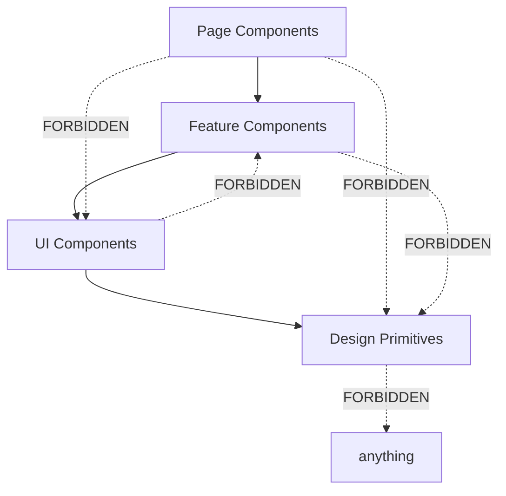

# React Frontend Reference

Depth for the `react-frontend` skill. `SKILL.md` holds the rules and the core templates; this file holds the full catalogue, the long tables, the extended examples and the limits of the evidence.

How to read it: scoreboard first, then the subsection of "Theme Specific Artifact" that matches the component, hook, route or scene being worked on, then the anti-pattern registry. To list the headings: `rg '^##|^###' reference.md`.

## Idiomatic Thesis Synthesis Statement

### React reliability

Reliable React TypeScript comes from modelling the UI as a typed state machine around trustworthy server-state boundaries.

The thesis has two halves, and every proposed rule is tested against both. Exhaustive unions and typed contracts serve the state-machine half. Query layers, schema forms and rollback-ready mutations serve the boundary half. A purely local tool, such as a canvas editor, exercises mainly the first half. A client-side-router app still benefits, but the client/server vocabulary maps less directly. Storing a server response in component state violates the boundary half. Adopting a popular state library without running this test is not justified.

In practice: separate client-only from server-capable code; parse transport data before hooks and components trust it; prefer query layers to ad hoc fetching; keep forms schema-driven; subscribe to the smallest store slice; treat optimistic updates as transactions; keep core journeys resilient when timing, navigation or JavaScript is imperfect. A plain-JavaScript app gains direction from this but no typed guarantees.

### Three.js in React

React reconciles when state changes. A live scene mutates objects thousands of times between those changes. Putting scene objects into React state turns per-frame updates into reconciliation, then into re-render storms and stale scenes. Small scenes hide this until data volume or a weaker device exposes it; the scale at which mixing fails is device- and scene-specific and not measured. Canvas-only and React-only designs avoid the tension by giving up one paradigm.

So the work is boundary management: ask which paradigm owns each object. Refs and imperative mutation handle frame work; React renders the shell and panels. react-three-fiber moves the boundary inside a library, but the three lanes (server, app, scene) still apply. The lane names may be translated (query, UI, canvas); the three-way distinction must survive every retelling.

### Design quality

High-quality front end = coherent task + complete states + accessible semantics + responsive composition + a visual system that fits the context + native implementation + rendered evidence. A screenshot, a token set or a green build alone is insufficient.

The pipeline is: request and user task (owner-confirmed), state and transition model, semantic and input contract, responsive composition, visual system, implementation, browser evidence, scoped acceptance. Each conversion must earn the next. A missing workflow, recovery path, semantic or piece of content cannot be repaired downstream; a missing journey state multiplies ambiguity across components, queries, content, accessibility, layout, tests and telemetry.

Quality is coupled. Typography can improve identity yet overflow. A dense table aids expert scanning yet fails touch. Motion can explain causality yet block input or ignore a reduced-motion preference. Evaluate trade-offs, not isolated properties. Novelty is never evidence by itself.

Evidence behaves as an invalidation graph: content expansion reopens text fit; a token change reopens the affected renders; a workflow change reopens state and navigation; a browser or asset change reopens rendering; a policy change reopens accessibility and authorisation. Front-end quality is controlled coherence, not a static score.

## Pattern Scoreboard Ranking Table

Scores are editorial emphasis set by the author of the patterns. They are not effectiveness percentages: there is no formula, cohort or study behind them.

### React reliability

| Score | Pattern | Rule |
|---|---|---|
| 97 | Behaviour-first UI test pyramid | Test what the user can do and see |
| 96 | Client-server boundary discipline | Do not drag whole trees into the client for one interactive leaf |
| 96 | Schema-validated forms | One schema powers field feedback and submit validation |
| 95 | Feature-collocated query layer | Server state is not component state; query keys are part of the contract |
| 95 | Minimal external store subscription | The store API can be global; the subscription stays local |
| 94 | Exhaustive UI state unions | One union over three booleans and two nullable fields |
| 93 | Navigation-aware error recovery | Errors lead to a recoverable state, not a dead end |
| 92 | Optimistic updates with rollback | Never ship an optimistic write without a rollback path |
| 91 | Progressive enhancement, minimal client | The best fix for a hydration bug is not needing hydration there |
| 90 | Typed event and route contracts | Declarative UI config stays exact, not widened |
| 89 | Abortable effects and cleanup | An effect that can outlive its component gets a cleanup path |
| 88 | Component boundary normalisation | Components render view models, not wire noise |

Supporting patterns from the longer catalogue, unscored: memoisation by decision matrix, list virtualisation, context split by change frequency, composition over configuration, container/presenter separation, layered imports.

### Three.js in React

| Rank | Pattern | Default rule and failure prevented |
|---:|---|---|
| 1 | Ownership split | Classify every piece of state as server, app or scene before writing components; the lane chooses the container |
| 2 | Typed adapters | Transform transport payloads into scene entities; backend shape stays out of rendering code |
| 3 | Lifecycle disposal | Explicitly clean geometry, materials, textures, listeners, sockets and scene resources |

The ranking follows the lane doctrine, not code volume. Actual defect frequencies are not recorded.

### Design quality

| Score | Pattern | Use |
|---|---|---|
| 95 | Workflow and context first | Default, except for a settled narrow correction |
| 91 | State-complete interface contract | Any dynamic workflow |
| 88 | Rendered evidence coupled to gates | Every claim about pixels or interaction |

Causal order: workflow and context, authority split, state contract, semantics and input, responsive and content composition, visual system, native implementation, rendered evidence, invalidation and recovery. The remaining patterns in that order: reuse the current system; familiar semantics for repeated commands; product-specific signal (for subject and brand, not for high-frequency tool novelty); stable responsive composition; accessibility as behaviour; deliberate motion; purposeful media and 3D.

Admit a new pattern only when it prevents a distinct recurring or consequential failure and states its preconditions, exceptions, unsafe state, detection, cost, counter-signal and invalidation. Promote it after controlled evidence on the target; adapt it if the existing system already protects the behaviour; retire it if the ceremony does not improve task success or defect detection.

## Agent Usage Decision Guide

- **Lead part.** Components, forms, queries, stores, tests: reliability. Canvas, camera, force graph, frame budget: scene. Look, layout, accessibility, visual review: design. A request for 3D work that is mostly about look and feel pairs design with scene; it does not replace either.
- **Order of work.** Client boundary, then lanes, then data model, then states, then constraints, then direction, then behaviour, then refinement, then verification. Reject a code-first response on substantial work: architecture and ownership settle who owns what, performance risks price it, and only then is implementation allowed.
- **State machine for a piece of work.** `orienting` -> `clarification_or_prototype` (when authority is missing) -> `experience_specified` -> `behavior_implemented` -> `rendered_for_scope` -> `verification_ready` -> `verified_for_scope`. `blocked_or_unresolved` and `invalidated` route back.
- **Modes.** Planning only (no mutation); end-to-end implementation; focused correction (no unrelated redesign); design exploration (isolated, no production promotion); code or experience review; recovery; global visual review (complete surface and state matrix).
- **Tool discipline.** Prefer the repository's components, tokens, icons, scripts and fixtures. Use real media only with provenance and a fallback. Use proven domain libraries for games, physics and 3D. Scripts may hash, parse, screenshot and measure geometry; a score never chooses fit. Parallelise only independent reads and disjoint assets; one writer per shared artefact; never revert unrelated work.
- **Logging.** Record the client-boundary decision and which reference subsections were opened. A deliberate skip, such as the fifth identical form, is recorded as a skip.
- **Minimum report.** Experience decision; evidence; state contract; visual direction; changed paths; verification and limits; uncertainty and owner; recovery; invalidation; next executable action.
- **Before implementation, inspect:** instructions; routes, shell, navigation and layout; components, tokens, theme, icons, type and media; browser states; tests and fixtures; the supported viewport, browser, input, locale and content policies; build, asset and performance constraints; standing owner decisions.
- **External documentation** is a freshness check, not a replacement for the repository's conventions.
- **Authority.** The product or domain owner chooses the workflow. A governed design system or brand chooses the visual language. Target source and config give implementation facts. Browser output under a named state gives pixels. Capable checks give behaviour. Policy plus semantic, automated, keyboard and assistive-technology evidence informs accessibility. Controlled measurement on the target gives numbers. An accountable owner accepts release risk.
- **Adopt, adapt, avoid.** Adopt when the task, the current system, the target implementation and rendered evidence support the whole workflow. Adapt when the intent survives a different mechanism and equivalence is shown. Avoid when intent, authority, diagnosis, domain or browser evidence is missing, or when a second design authority would result. Record the cost of being wrong: what a reviewer must undo and inspect.

## Decision Tradeoff Guide

### React reliability

| Default | Deviate when | Note |
|---|---|---|
| Server-capable code | A leaf needs interactivity | Client-everywhere code has a hydration-sized blast radius |
| Transactional optimism | Never without rollback | A uniform ban on optimism is simpler and less expressive; it may suit a high-churn team |
| Unmemoised simplicity | A matrix row applies | `useCallback` everywhere can cost more than it saves; the `none` rows are the ones most often violated |
| Query layer | No query library and a single consumer | An ad hoc effect fetch lacks invalidation and can race |
| Client virtualisation | Backend cannot bound the data | Server-driven pagination is preferable when it can |
| Context | Cross-cutting value only | Beyond two levels, split by change frequency |

A memo justified by referential equality for an effect dependency names its matrix row in a comment.

### Three.js in React

| Choice | Default and selection rule | Gotcha and verification |
|---|---|---|
| Declarative R3F vs imperative scene | Either; the lanes and frame-budget ownership do not change | The sources do not settle library choice; verify the chosen boundary |
| Store granularity vs selector discipline | Selector hooks; never a whole-store subscription for convenience | The fifth consumer can silently reintroduce storms; profile re-renders |
| Eager vs lazy assets | Lazy labels, textures and scene assets when scale warrants | Decide after measuring hover latency at the target node count |
| Typing depth vs adapter overhead | Type the transport, then slim to what the UI and scene need in the adapter | Mirroring the full backend may be needless; document dropped fields |
| Debounce socket events | Yes for visualisation | Wrong for alerting, where lateness matters |

Optimise toward the frame budget under load. A throwaway visualisation may choose convenience. Measure before optimising; the cost of the convenient options is not measured.

### Design quality

For each alternative record: task fit, relearning for users, accessibility and input risk, responsive and content risk, runtime and asset cost, maintenance and consumer impact, migration and rollback cost, the evidence needed, and the condition that would reverse the decision. Choose the least costly option that can both preserve and falsify the claim.

Component ladder, cheapest first: reuse the primitive when it fits; augment it for a missing state, size, content or accessibility need; compose existing primitives for hierarchy; add a bounded new component only when the semantics cannot be expressed; replace the design system only with consumer inventory, migration, rollback and owner; decline the redesign when the current system solves the task or authority is missing.

A token-only correction may use the focused profile. A navigation change, a shared component change or a product-wide visual change needs the consumer inventory, the state and browser matrix, migration and owner evidence.

Layout choices for a queue-and-detail tool: cards weaken comparison; a full-width detail route loses context; a modal risks long content, focus and history; a queue with a responsive detail pane keeps both. A dense table is preferred for many-row comparison unless touch or low-volume evidence selects cards.

Familiar prose, duplicate copies of the same advice, screenshot similarity and design-file intent are not adoption gates. Each can be stale, inapplicable or blind to semantics.

## Theme Specific Artifact

### Naming catalogue

The four-word convention with its full example sets. Whether it binds is a project decision (see "Where the sources disagree" in `SKILL.md`).

| Kind | Shape | Examples | Avoid |
|---|---|---|---|
| Component | Entity + Context + Purpose + Variant | `UserProfileCardCompact`, `PaymentFormWizardStep`, `NavigationSidebarMenuLink`, `DashboardMetricsChartArea`, `AuthLoginFormContainer`, `ProductListGridItem`, `SearchResultsTableRow`, `SettingsPageLayoutMain` | `UserCard`, `Form`, `Button`, `List`; six or more units such as `NavigationSidebarMenuLinkWithIconAndTooltip` |
| Component (visualisation code, 3-4 words) | same | `WorkspaceListSidebar`, `DiffGraphCanvasView`, `ConnectionStatusIndicator`, `EntityDetailPanel`, `MainContentArea` | `Sidebar`, `Graph` |
| Hook | `use` + Domain + Action + Qualifier | `useAuthStateListener`, `useFormValidationErrors`, `useLocalStoragePersist`, `useDebounceInputValue`, `useIntersectionObserverRef`, `useFetchDataWithCache`, `useWebSocketConnectionManager`, `useThemePreferenceToggle`, `useWorkspaceListData`, `useWebsocketDiffStream`, `useForcegraphNodeRenderer`, `useSelectedEntityDetails` | `useAuth`, `useForm`, `useFetch`, `useData`, `useWorkspaces`, `useWebsocket`; `useUserAuthenticationStateChangeListenerWithCleanup` |
| Event handler | `handle` + Target + Event + Action | `handleFormSubmitValidation`, `handleButtonClickNavigation`, `handleInputChangeDebounce`, `handleModalCloseCleanup`, `handleImageLoadComplete`, `handleCheckboxToggleState`, `handleDropdownSelectOption`, `handleFileUploadProgress`, `handleWorkspaceWatchToggle` | `handleSubmit`, `handleClick`, `onChange`, `onSelect`, `handleToggle` |
| Utility or function | verb + constraint + target + qualifier | `formatCurrencyWithLocale`, `validateEmailAddressFormat`, `parseJsonResponseSafely`, `transformArrayToHashmap`, `filterActiveUsersOnly`, `sortItemsByCreatedDate`, `capitalizeStringFirstLetter`, `truncateTextAtMaxLength`, `transformDiffToForcegraph`, `createWebsocketConnectionManager`, `fetchWorkspaceListData`, `updateSelectedWorkspaceState` | `transformDiff`, `createManager` |
| Store | noun + `Store` or `State` | `workspaceStore`, `diffVisualizationStore`, `connectionStateStore` | `store`, `state` |
| Scene object | Entity + Geometry + Material + Purpose | `ParticleSystemPointCloud`, `TerrainMeshHeightmapped`, `SkyboxCubeEnvironment`, `CharacterModelAnimated`, `WaterPlaneReflective`, `LightProbeAmbientCapture`, `BuildingGroupInstanced`, `VehicleMeshProcedural` | `Particle`, `Terrain`, `Player`, `Skybox` |
| Scene function | verb + target + operation + qualifier | `createMeshWithMaterial`, `updateCameraPositionSmooth`, `disposeSceneResourcesComplete`, `loadTextureFromUrl`, `calculateBoundingBoxWorld`, `applyTransformToGroup`, `rayCastFromCameraCenter` | `createMesh`, `update`, `dispose`, `load` |
| Animation function | verb + target + property + modifier | `animateRotationYAxis`, `interpolatePositionLinear`, `updateMatrixWorldRecursive`, `tweenOpacityFadeOut`, `morphTargetInfluenceSmooth`, `updateBoneTransformations` | none |

The generic scene layout uses shorter hook names (`useSceneData`, `useGraphSelection`, `useCameraBehavior`). That is the same disagreement seen from the other side: follow the project.

### State modelling

```tsx
type FetchState<T> =
  | { status: 'idle' }
  | { status: 'loading' }
  | { status: 'success'; data: T }
  | { status: 'error'; error: Error };

function useFetchDataWithState<T>(url: string): FetchState<T> {
  const [state, setState] = useState<FetchState<T>>({ status: 'idle' });
  useEffect(() => {
    const controller = new AbortController();
    setState({ status: 'loading' });
    fetchDataFromEndpoint<T>(url, controller.signal)
      .then((data) => { if (!controller.signal.aborted) setState({ status: 'success', data }); })
      .catch((error) => { if (!controller.signal.aborted) setState({ status: 'error', error }); });
    return () => controller.abort();
  }, [url]);
  return state;
}
```

Independent `isLoading`, `isError`, nullable `data` and nullable `error` permit loading-plus-error and data-plus-error and need manual synchronisation. This hook is for a code base without a query library; with one, the query result is mapped to the screen union instead.

Colocation rules:

- Lowest common ancestor: lift state shared by siblings to their parent and pass it down (`ChildInputComponent value/onChange`, `ChildDisplayComponent value`).
- Derived state: do not keep `filteredItems` in state synchronised from `[items, filter]`; it goes stale or drifts.
- Mirrored props: `useState(initialValue)` ignores later changes and an effect that resets it fights user input.

Executable specifications: when a fetch starts from idle, status is `loading` and neither data nor error is defined; on success, status is `success` with the response data and no error; shared child state is lifted; a filtered result is never in `useState`; expensive filtering is memoised.

### Context boundaries

```tsx
const UserContext = createContext<UserProfile | null>(null);
const UserActionsContext = createContext<UserActions | null>(null);

export function UserProviderComponent({ children }: { children: ReactNode }) {
  const [user, setUser] = useState<UserProfile | null>(null);
  const actions = useMemo<UserActions>(() => ({
    updateUserProfileFields: (patch) => setUser((u) => (u ? { ...u, ...patch } : u)),
    clearUserSessionState: () => setUser(null),
  }), []); // stable: action-only consumers do not re-render when user data changes

  return (
    <UserActionsContext.Provider value={actions}>
      <UserContext.Provider value={user}>{children}</UserContext.Provider>
    </UserActionsContext.Provider>
  );
}

export function useAuthContextValue(): AuthContextValue {
  const value = useContext(AuthContext);
  if (value === null) throw new Error('useAuthContextValue must be used within AuthProvider');
  return value;
}
```

Where each kind of value lives: form values in local state or a form library; UI toggles in local state; derived values in `useMemo`; fetched results in React Query or SWR; authentication, theme and locale, feature flags and WebSocket connections in context. Specifications: access outside the provider throws an error naming the missing provider; a context change does not re-render non-consuming siblings.

### Component architecture

- **Compound components.** `CardContainerComponent` exposes `.Header`, `.Body` and `.Footer`, rendering `header`, `main` and `footer` elements with classes `card-header`, `card-body` and `card-footer`; any part may be omitted. The opposite is a `BadCardProps` interface with header title, subtitle, icon and actions, body content and padding, footer actions and alignment, visibility flags, variant, size, radius, shadow and twenty more props, whose conditional rendering grows past fifty lines. Specifications: Header renders a `header` tag with exactly the `card-header` class; a card without Header renders with no header element.
- **Render props.** `DataFetcherComponent<T>` takes `url`, `renderLoadingState`, `renderErrorState(error)` and `renderSuccessState(data)`; idle and loading map to the loading renderer. The caller chooses, for example, `LoadingSpinnerLarge`, an `ErrorBoundaryFallback` that offers a reload, or `UserListTableComponent`. Function children suit algorithms: `ListVirtualizerComponent<T>` takes `items`, a numeric `itemHeight` and `(item, index) => JSX.Element`. Specification: success invokes only `renderSuccessState`, with the data.
- **Container and presenter.** `UserProfileContainerSmart` uses `useParams`, `useQueryUserById` and `useMutationUpdateUser`; it shows `LoadingSpinnerIndicator` while loading and `ErrorMessageDisplay` on error, and otherwise passes `user`, `onUpdateSubmit`, `isUpdating` and `updateError` to `UserProfilePresenterPure`. The presenter holds controlled name, email and bio fields initialised from `user`, submits through the callback, shows update errors inline, and disables the button with the label "Saving..." while updating. Specifications: the presenter initialises from user values and performs no fetch; the container fetches on mount, shows loading, then renders the presenter.
- **Layout shell.** `AppLayoutContainer` is `<div className="flex h-screen bg-gray-900 text-white">` holding `WorkspaceListSidebar` and `MainContentArea`.
- **List with nested action.** In `WorkspaceListSidebar` (`<aside className="w-64 bg-gray-800 p-4 border-r border-gray-700" data-testid="workspace-list-sidebar">`), each row is keyed by `workspace_identifier_value`, selects on click, and holds a watch button with `data-testid={`watch-toggle-${id}`}` whose handler calls `e.stopPropagation()` before toggling so the row is not also selected. The button reads "Watching" or "Watch". The list is read through `useWorkspaceList()`, `useSelectedWorkspaceId()` and `useWorkspaceActions()`, and fetched in `useEffect(() => { fetchWorkspaceListData(); }, [fetchWorkspaceListData])`. A `create-workspace-button` labelled "+ Add Workspace" sits below the list.

### Typed contracts

- Use `satisfies`, exact literals and readonly config for route manifests, action maps, keyboard shortcut maps, feature flags and navigation metadata.
- Mirror the backend's types in one file (`types/api.ts`) and convert at the adapter. Example shapes from a Rust backend that keeps four-word snake_case field names:

```typescript
export interface WorkspaceMetadata {
  workspace_identifier_value: string;
  workspace_display_name: string;
  source_directory_path_value: string;
  base_database_path_value: string;
  live_database_path_value: string;
  watch_enabled_flag_status: boolean;
  created_timestamp_utc_value: string;
  last_indexed_timestamp_option: string | null;
}

export interface WorkspaceCreateRequest {
  source_path_directory_value: string;
  workspace_display_name_option?: string;
}

export interface WorkspaceWatchToggleRequest {
  workspace_identifier_value: string;
  watch_enabled_flag_status: boolean;
}

export interface WorkspaceListResponse {
  success: boolean;
  endpoint: string;
  workspaces: WorkspaceMetadata[];
  total_workspace_count_value: number;
  token_estimate: number;
}

export type WebSocketEvent =
  | { event: 'subscribed'; workspace_id: string; timestamp: string }
  | { event: 'unsubscribed'; timestamp: string }
  | { event: 'pong'; timestamp: string }
  | { event: 'diff_started'; workspace_id: string; files_changed_count: number }
  | { event: 'entity_added'; entity_key: string; entity_name: string; file_path: string }
  | { event: 'entity_removed'; entity_key: string; entity_name: string }
  | { event: 'entity_modified'; entity_key: string; entity_name: string; modification_type: string }
  | { event: 'edge_added'; source_key: string; target_key: string; edge_type: string }
  | { event: 'edge_removed'; source_key: string; target_key: string; edge_type: string }
  | { event: 'diff_completed'; summary: DiffSummary; duration_ms: number }
  | { event: 'error'; code: string; message: string };

export interface DiffSummary {
  entities_added_count: number;
  entities_removed_count: number;
  entities_modified_count: number;
  edges_added_count: number;
  edges_removed_count: number;
  blast_radius_count: number;
}
```

- The store's create action posts `{ source_path_directory_value, workspace_display_name_option }` to `/workspace-create-from-path` and refetches the list on success, the same shape as the watch toggle.
- Normalisation, bad and good. Bad: raw backend payloads passed into components; JSX branching on provider-specific wire fields. Good: hooks or adapters normalise once; components consume stable, UI-shaped data.
- External stores: the slice rule holds for Zustand and Jotai alike.
- These exhibits use one product's vocabulary. All of them assume TypeScript. Translate the shape, not the names: rebuild a store or hook in the target product's terms and check its API contract and selectors.

### Effects, cleanup and refs

Decision tree: external synchronisation -> `useEffect`; DOM layout read or focus before paint -> `useLayoutEffect`; derivation -> inline or `useMemo`; user event -> handler; mount-only work -> `useEffect(..., [])`.

```tsx
useEffect(() => {
  const controller = new AbortController();
  const { signal } = controller;
  setLoading(true);

  (async () => {
    try {
      const response = await fetch(url, { signal });
      if (!response.ok) throw new Error(`HTTP ${response.status}: ${response.statusText}`);
      const data: unknown = await response.json();
      if (!signal.aborted) setData(parseUserProfilePayload(data));
    } catch (error) {
      if (error instanceof DOMException && error.name === 'AbortError') return;
      if (!signal.aborted) setError(error instanceof Error ? error : new Error(String(error)));
    } finally {
      if (!signal.aborted) setLoading(false);
    }
  })();

  return () => controller.abort(); // on unmount or when url changes
}, [url]);
```

Refs: `useRef<HTMLInputElement>(null)` with `useLayoutEffect` to autofocus before paint; a mutable non-rendering value such as an interval counter in `countRef.current`, with visible state updated only every tenth tick of a 100 ms interval and the interval cleared in cleanup; `usePreviousValueTracker<T>` assigns `ref.current = value` in an effect with no dependency array and returns the prior value (`undefined` on first render); `forwardRef<HTMLInputElement, CustomInputProps>` lets a parent button focus a child input.

Specifications: subscriptions clean up on unmount and re-establish when dependencies change; unmount during a fetch aborts it and causes no state-update warning; no timer callback runs after unmount; a change of `userId` never commits the earlier response.

### Memoisation and virtualisation

Memoise `performExpensiveFilterOperation(items, query)` on `[items, query]`. Stabilise a delete callback passed to a memoised child; a state setter is already stable and needs no dependency. Memoise a config object built from primitive fields before an effect depends on it. Do not memoise `count * 2`, wrap a callback for a normal child, or pass inline objects to a `React.memo` child: `React.memo` compares shallowly and re-renders for every new object. Hoist constants such as `const CHILD_STYLE = { color: 'red' }` outside the component.

```tsx
import { useVirtualizer } from '@tanstack/react-virtual';

function VirtualizedListContainerGeneric<T>({ items, renderItem, estimatedItemSize = 50, overscan = 5 }: Props<T>) {
  const parentRef = useRef<HTMLDivElement>(null);
  const virtualizer = useVirtualizer({
    count: items.length,
    getScrollElement: () => parentRef.current,
    estimateSize: () => estimatedItemSize,
    overscan, // extra items above and below the viewport
  });

  return (
    <div ref={parentRef} style={{ height: '600px', overflow: 'auto' }}>
      <div style={{ height: virtualizer.getTotalSize(), position: 'relative' }}>
        {virtualizer.getVirtualItems().map((virtualRow) => (
          <div
            key={virtualRow.key}
            style={{ position: 'absolute', top: 0, left: 0, width: '100%', transform: `translateY(${virtualRow.start}px)` }}
          >
            {renderItem(items[virtualRow.index], virtualRow.index)}
          </div>
        ))}
      </div>
    </div>
  );
}
```

A 10,000-product page can use `estimatedItemSize={120}` and `overscan={3}`. The pattern text quotes about 8 s initial render for 10,000 mounted rows against about 50 ms and roughly 15 DOM nodes when virtualised; those figures are illustrative, not measured on any repository. The structural claim holds: only visible plus overscan rows are in the DOM.

### Import layers



Specification: a page that imports a primitive fails a build-time check and produces a lint error. With Parseltongue, query the dependency graph for forbidden edges (the query follows this paragraph); a violation reads like `pages/Dashboard.tsx -> primitives/Button.tsx`, and the report lists the forbidden paths with suggested fixes. Its diff output marks entities `ADDED`, `MODIFIED` or `REMOVED` with identifiers such as `tsx:fn:useAuthContextValue:__path:src/contexts/AuthContext.tsx` and lists the blast radius (for example `UserProfileContainerSmart`, `AuthProviderComponent`, `ProtectedRouteWrapper`).

```text
?[page_entity, primitive_entity] :=
  *entity{entity_key: page_entity, entity_type: "tsx:import"},
  page_entity ~= "pages/",
  *depends_on{source: page_entity, target: primitive_entity},
  primitive_entity ~= "primitives/"
```

The query returns pairs such as `["pages/Dashboard.tsx", "primitives/Button.tsx"]`.

For imperative Three.js code the hierarchy is `Application -> Managers -> Components -> Utils -> THREE.*`, with `THREE` wrapped at the utility boundary. Specification: a direct `THREE.Vector3` import in the application layer fails the build with an architectural lint error.

### Project layouts

Visualisation app with four-word names:

```text
frontend/
  package.json  vite.config.ts  tsconfig.json  tailwind.config.js  playwright.config.ts  index.html
  src/
    main.tsx                      # entry point
    App.tsx                       # root component
    stores/      workspaceStore.ts  diffVisualizationStore.ts
    hooks/       useWorkspaceListData.ts  useWebsocketDiffStream.ts  useForcegraphNodeRenderer.ts
    components/
      Layout/         AppLayoutContainer.tsx  WorkspaceListSidebar.tsx  MainContentArea.tsx
      Visualization/  DiffGraphCanvasView.tsx  ConnectionStatusIndicator.tsx
      Details/        EntityDetailPanel.tsx  DiffSummaryStats.tsx
    utils/       transformDiffToForcegraph.ts  colorMappingHelpers.ts
    types/       api.ts  visualization.ts
  e2e/           workspace.spec.ts  visualization.spec.ts
```

Generic scene app:

```text
src/
  components/  layout/  scene/  panels/
  hooks/       useSceneData.ts  useGraphSelection.ts  useCameraBehavior.ts
  stores/      appViewStore.ts  graphSelectionStore.ts
  services/    api.ts  adapters.ts
  types/       graph.ts
```

Defaults for the second: transport parsing in `services/adapters.ts`; typed scene entities in `types/graph.ts`; scene hooks small and focused; overlays and inspector panels outside the render loop.

### Scene graph, pooling and entity components

Everything in the scene subsections is a default, not a substitute for profiling.

- **Five named root groups**, in render order (back to front for transparency): `environment` (skybox, fog, ambient effects), `terrain` (ground, water, vegetation), `entities` (characters, items), `effects` (particles, post-processing helpers), `ui` (3D UI, billboards). Name them `EnvironmentRootGroup`, `TerrainRootGroup`, `EntitiesRootGroup`, `EffectsRootGroup`, `UIRootGroup` so they are findable when debugging. `addEntityToSceneGraph(entity, category)` adds to the chosen root and traverses descendants so every `THREE.Mesh` casts and receives shadows; `removeEntityFromSceneGraph(entity)` calls `entity.removeFromParent()`; `getSceneForRenderer()` returns the scene. A flat root with everything added directly is unmaintainable.
- **Object pool** for objects created and destroyed often (projectiles, particles). `ObjectPoolMeshInstances<T extends THREE.Object3D>` holds `pool: T[]`, `active: Set<T>`, a factory and `maxPoolSize`; defaults `initialSize = 50`, `maxPoolSize = 200`; preallocated instances are invisible. `acquireInstanceFromPool()` pops or creates (warning `Object pool exhausted, creating new instance`), sets visible, adds to active. `releaseInstanceToPool(instance)` warns and returns if the instance is not active; otherwise hides it and pushes it back, or disposes it fully when the pool is at the maximum. `releaseAllInstancesToPool()` and `disposePoolComplete()` complete the API. Example: bullets share one `SphereGeometry(0.1, 8, 8)`, clone a `MeshBasicMaterial({ color: 0xffff00 })`, use initial 100 and maximum 500, and return to the pool after 3 seconds. At 60 bullets per second, no pooling means 60 allocations per second; pooling means none after warm-up. The frame-rate benefit is not measured.
- **Composition over inheritance.** `ComponentBehaviorInterface` requires `update(deltaTime)` and `dispose()`. `EntityWithComponents extends THREE.Object3D` maps names to components: a duplicate name warns, disposes the old component and replaces it; retrieval by name is typed; removal disposes and returns a boolean; `update` iterates all components; disposal disposes all and clears the map. Examples: `RotationAnimatorComponent` (axis, `speed * deltaTime`, `setRotationSpeed`) and `PhysicsBodyComponent` (velocity, acceleration, gravity `(0, -9.81, 0)`, mass default `1.0`, `a = F/m`, ground clamp at `y = 0` that zeroes vertical velocity). A sample player is a `1 x 2 x 1` green `MeshStandardMaterial` box rotating at `Math.PI / 4` per second with mass 70.

These class-based managers predate the lane doctrine. They are sound Three.js mechanics, not automatically the right shape inside react-three-fiber, where the library owns the scene graph and the loop.

### Resource loading

- **Texture cache.** `TextureManagerCached` keeps a `Map` cache plus in-flight `loadingPromises`, one `TextureLoader` and `maxCacheSize = 100`. Two loads of one URL return the same texture or the same promise, so there is one network request. On load it sets the sRGB colour space and anisotropy `16`, caches the texture, clears the promise and, when over capacity, evicts and disposes the oldest entry in insertion order. It offers `disposeTextureByUrl`, `disposeAllTexturesComplete` and `getCacheSize`.
- **Models.** `ModelLoaderGLTFDraco` wires `GLTFLoader` to a `DRACOLoader` with decoder path `/draco/` and `setDecoderConfig({ type: 'js' })` (or `'wasm'`). `loadModelFromUrl` caches the original and returns a clone so each instance has independent transforms. Options: `enableShadows`, `castShadow`, `receiveShadow`, `scale`. It traverses meshes, enables shadows unless told not to, sets `material.needsUpdate = true` and `frustumCulled = true`, logs `Loading model: <percent>%`, logs and rejects errors, and its `dispose()` disposes the DRACO loader and clears the cache.
- In react-three-fiber, `useLoader(GLTFLoader, url)` provides the cache and suspends while loading. The fallback is a grey wireframe `boxGeometry args={[1, 1, 1]}` with `meshBasicMaterial`. Specifications: the placeholder shows while suspended, the model after; duplicate URLs make one request.

### Render loop, resize and instancing

```typescript
class RenderLoopManagerDelta {
  private clock = new THREE.Clock();
  private frameId: number | null = null;
  private callbacks = new Set<(delta: number) => void>();
  private lastFrameTime = 0;
  private frameInterval = 1000 / 60;

  startRenderLoopAnimation(renderer: THREE.WebGLRenderer, scene: THREE.Scene, camera: THREE.Camera): void {
    if (this.frameId !== null) return; // prevent duplicate starts
    this.clock.start();
    const tick = (now: number) => {
      this.frameId = requestAnimationFrame(tick);
      if (now - this.lastFrameTime < this.frameInterval) return; // optional FPS cap
      this.lastFrameTime = now;
      const delta = Math.min(this.clock.getDelta(), 0.1); // clamp: no spiral of death after a stall
      for (const callback of this.callbacks) {
        try { callback(delta); } catch (error) { console.error('Update callback failed:', error); }
      }
      renderer.render(scene, camera);
    };
    this.frameId = requestAnimationFrame(tick);
  }

  stopRenderLoopAnimation(): void {
    if (this.frameId !== null) cancelAnimationFrame(this.frameId);
    this.frameId = null;
    this.clock.stop();
  }

  setTargetFPS(fps: number): void { this.frameInterval = 1000 / fps; }
}
```

- **Resize.** `ResponsiveCanvasManager` observes the container with `ResizeObserver`, measures once with `getBoundingClientRect()`, calls `renderer.setSize(width, height, false)` and `setPixelRatio(Math.min(devicePixelRatio, maxPixelRatio))` (default maximum `2`), then updates the perspective aspect or the orthographic frustum (`frustumSize = 10`; left and right `-/+ frustumSize * aspect / 2`, top and bottom `+/- frustumSize / 2`) and the projection matrix. `dispose()` disconnects the observer. React cleanup disposes the manager and the renderer.
- **Instancing.** `InstancedMeshManager` sets `DynamicDrawUsage`, starts with `count = 0`, reuses one `Object3D` dummy and caps at `maxInstances`. `addInstanceAtPosition` returns `-1` with a warning at the cap; defaults are rotation `(0, 0, 0)` and scale `1`; it writes matrix and colour and flags `instanceMatrix.needsUpdate` and `instanceColor.needsUpdate`. A transform update decomposes the existing matrix and changes only the supplied parts. A colour update validates the attribute and index. `clearAllInstances`, count getters and disposal of geometry and materials complete it. Example: 10,000 trees on a 100 x 100 grid, spacing 5, centred, random Y rotation, scale 0.8 to 1.2. Individual meshes cost 10,000 draw calls; one `InstancedMesh` costs one. The frame rates quoted beside that example are not measured.
- **Per-frame scratch objects.**

```typescript
const _direction = new THREE.Vector3();
const _quaternion = new THREE.Quaternion();
const _matrix = new THREE.Matrix4();

function updateEntityOrientationFrame(entity: THREE.Object3D, target: THREE.Vector3): void {
  _direction.subVectors(target, entity.position).normalize(); // reuse; no `new` inside the loop
  _matrix.identity().lookAt(entity.position, target, entity.up);
  _quaternion.setFromRotationMatrix(_matrix);
  entity.quaternion.slerp(_quaternion, 0.1);
}
```

- **Matrices.** Do not overwrite `matrixWorld`; Three.js rewrites it on the next render. Change position, rotation or scale and let the update run, or call `updateMatrixWorld(true)` when the hierarchy must be current immediately.
- **Layers on one canvas.** One renderer with `autoClear = false`: `clear()`, render the background scene, `clearDepth()`, render the foreground scene. Several renderers on one canvas lose the context.

### Camera, animation and shaders

- **Camera defaults.** Perspective: aspect from the container, FOV `75`, near `0.1`, far `1000`, position `(0, 5, 10)`, looking at the origin. Orthographic, for 2D-like, isometric or CAD views: bounds from `frustumSize` and aspect, near `0.1`, far `1000`, position `(10, 10, 10)`.
- **Renderer quality defaults.** Shadows on with `PCFSoftShadowMap` (or `VSMShadowMap`), sRGB output, `ACESFilmicToneMapping`, exposure `1.0`, physically based lighting. The pattern text names these as `sRGBEncoding` and `physicallyCorrectLights`; later Three.js releases changed the colour-space and lighting property names, so read the names from the installed version's documentation.
- **Follow camera.** `CameraFollowController` defaults to offset `(0, 5, 10)` and `smoothFactor = 0.1`. Desired position is target plus offset, reached by `lerp`. The look-at point is lerped too; if `target.userData.velocity` is a `Vector3`, look `0.5` units ahead. Clamp the factor to `[0, 1]`: `0` never moves, `1` snaps. Lower is smoother, higher more responsive; a sample uses offset `(0, 8, 15)` and factor `0.05`. `orbitCameraAroundTarget(angleRadians, radius)` sets the offset's X and Z from sine and cosine. Direct position assignment is the anti-pattern.
- **Force-graph focus.** On node click, move the camera to the node with a bounded duration (1000 ms in the template) and then call the selection callback. A second click during the move replaces the animation; it does not queue.
- **Animation mixer.** `AnimationControllerMixer` builds one mixer and an action per `AnimationClip`. `playAnimationByName(name, fadeInDuration = 0.3, loop = LoopRepeat)` warns and returns false for an unknown name; returns true without action if that clip is already running; otherwise resets the action, sets the loop count (`LoopOnce` -> 1, else `Infinity`), sets `clampWhenFinished` for one-shot clips, fades in and plays, fades out the previous action and records the current one. It exposes `update(delta)`, stop-all, the current name, `timeScale` and disposal. Use cross-fades (to Idle `0.5`, to Walk or Run `0.2`) rather than manual transforms.
- **Tween.** `TweenAnimatorSimple` interpolates from start to end over a duration with `easeOutQuad` by default (`t * (2 - t)`), an `onUpdate` and an optional `onComplete`. `updateTweenProgress(deltaTime)` clamps progress to 1, eases, updates, and returns false when finished or inactive. Other easings: `easeLinear`, `easeInOutCubic`, `easeOutElastic`, `easeOutBounce`. Example: tween camera FOV to `30` over `1.0` s, calling `updateProjectionMatrix()` on each update. Specification: 0 to 100 over one second ends at exactly 100.
- **Shaders.** Type the uniforms in TypeScript (`uColorTop`, `uColorBottom`: `THREE.Color`; `uTime`, `uNoiseIntensity`: `number`) instead of magic strings. Gradient example: the vertex shader passes `vUv`, position and the transformed normal; the fragment shader mixes bottom and top colour by `vUv.y`, adds `random(vUv + uTime) * uNoiseIntensity` (default `0.1`) and a rim-light term raised to the third power; material is `DoubleSide`. Water example: `uTime`, colours `0x0077be` and white, speed `1.0`, amplitude `0.5`; vertex displacement `sin(x * 2 + t * speed) * amplitude + sin(z * 3 + t * speed * 0.7) * amplitude * 0.5`; foam from `smoothstep(0.3, 0.5, elevation)`; alpha `0.8`, transparent, double-sided; `uTime` advanced each loop.

Scene specifications, ready to turn into tests:

- An entity added under a category lands in that root group, and its meshes cast and receive shadows; removal detaches it from its parent.
- Acquiring from an empty pool creates an instance and warns; releasing an inactive instance warns and changes nothing; a released instance is hidden.
- After complete disposal, no geometry, material or texture of the scene remains allocated, and the canvas element is gone from the DOM.
- Loading one texture URL twice makes one request.
- A container resize updates renderer size and camera projection without a window resize event.
- 10,000 instances render in one draw call; adding past the cap returns `-1`.
- A stalled tab resumes with a delta no larger than `0.1`.
- A model shows its placeholder while suspended and the model afterwards.

Scene quick card:

| Category | Preferred | Wrong choice |
|---|---|---|
| Disposal | Recursive and complete | `scene.remove()` only |
| Objects in loop | Reuse module-level objects | Create each frame |
| Many identical objects | `InstancedMesh` | Individual meshes |
| Textures | Centralised cache | Load everywhere |
| Scene organisation | Five named root groups | Flat structure |
| Animation | `AnimationMixer` with cross-fade | Manual transforms |
| Camera follow | Lerp with damping | Direct assignment |
| Resize | `ResizeObserver` | `window.onresize` |
| Matrix updates | Automatic or forced update | Manual matrix manipulation |
| Shaders | Uniforms with TypeScript types | Magic strings |

React quick card:

| Category | Prefer | Avoid |
|---|---|---|
| State | Discriminated unions; derived = computed; lift to common ancestor | Boolean flags; derived in `useState`; duplicate state |
| Props | Composition, children | Prop explosion |
| Memo | Expensive only (over 100 ms); `useCallback` for a memoised child | Memoising everything |
| Effects | External synchronisation only | Derived state in effects |
| Cleanup | Always return cleanup; `AbortController` for fetch | Forgotten cleanup; races |
| Keys | Stable unique id | Array index |
| Context | Cross-cutting only; split by frequency | Component state; one massive context |
| Tests | `data-testid`; page-object model | Class or tag selectors; inline locators |

### Design quality packet

Nine dimensions and what proves each:

| Dimension | Meaning | Proof |
|---|---|---|
| Task success | Primary job completes; likely failures recover | End-to-end and interaction checks, walkthrough; not a polished first screen |
| State completeness | Material async and data states have coherent UI | State matrix, fixtures, boundary screenshots |
| Accessibility | Perceive, understand, navigate, operate in the required modes | Semantics, automation, keyboard, assisted review as consequence requires |
| Responsive composition | Hierarchy survives containers, content lengths, viewports | Rendered matrix, overflow and text-fit inspection |
| Visual coherence | Type, colour, spacing, media, density, motion express one direction | Token audit, experienced review |
| Interaction clarity | Familiar commands, visible states, timely feedback | Hover, focus, pressed, disabled checks; usability |
| Runtime resilience | Data, auth, network, hydration, asset, render failures leave a safe next action | Fault fixtures, recovery, console and network evidence |
| Performance fit | Owner-approved budget under a named workload | Controlled measurement with functional and visual counter-gates |
| Maintainability | Architecture, ownership, tokens, assets stay native | Source and diff inspection, project checks |

Minimum inputs: a concrete user and task with frequency and consequence; the repository's and design system's conventions; the material data states; target devices, viewports, containers, input modes, browsers and accessibility expectations; a surface that can render the real implementation in those states.

Outputs for durable work: experience statement (user, task, context, direction, familiarity needs, non-goals); state model; interface contract (semantics, controls, content priority, responsive and accessibility behaviour, failure handling); visual system (type and colour roles, spacing and density, surfaces, media, motion, stable dimensions); working native implementation with real navigation; evidence matrix; handoff (changed paths, checks, renders, risks, rollback, owners, invalidation triggers).

A full packet for long-lived work is a provenance and invalidation graph for one bounded user journey at one target revision. It links existing product, design, code, test, browser and review artefacts; it does not copy them. Three completion profiles set its depth:

| Profile | Use | Required depth | Not needed unless the consequence changes |
|---|---|---|---|
| `focused_correction` | Current product and design authority plus a regression state settle one reversible component, token, content-fit or style defect | Journey and state id, target and source identity, defect reproduction, changed boundary, project result, before and after render, stop reason, invalidation | A new visual system, a full product source map, a broad browser study, an unrelated state catalogue |
| `standard_experience` | New page or workflow, meaningful redesign, multi-agent handoff, repeated state behaviour | Full decision and source ledger, state graph, semantics, responsive and accessibility boundaries, visual system, component and state ownership, behaviour checks, rendered matrix, runtime, recovery, invalidation | Domain assurance beyond the actual user consequence |
| `high_assurance_interface` | Regulated content, critical operation, destructive action, shared design system, broad compatibility, security or privacy, a material accessibility claim | Standard profile plus qualified domain authority; content, locale, device, browser, input and assistive variants; independent evidence; operations; rollback; residual risk; accountable acceptance | Nothing material may be omitted silently; unavailable evidence blocks, or becomes owner-accepted risk only where policy allows |

A spacing regression can reuse one current state. A destructive transfer flow cannot inherit that evidence just because both interfaces render.

The packet has ten blocks. Each field is listed with its completion rule.

**Block A: packet and experience identity**

- `packet_identifier`: stable and unique for the journey and revision; no unverified conclusion in the name.
- `packet_profile`: the profile, explained by user consequence, reversibility, shared consumers, novelty and lifespan.
- `user_goal_statement`: user or actor, concrete job, context, frequency, desired outcome.
- `product_mode`: operational, transactional, editorial, branded, game, editor, dashboard or another explicit category, with the reason.
- `decision_question`: one falsifiable experience branch; behaviour, visual, accessibility, compatibility, performance and owner-policy questions are split.
- `non_goals`: systems, users, devices, states, content, migrations and optimisations outside scope.
- `decision_consequence`: effects of a false positive and a false negative, detectability, reversibility, consumers, who bears the risk.
- `decision_owner`: who chooses task, content, design and support scope, and who accepts residual risk.
- `packet_state`: `collecting`, `experience_specified`, `behavior_implemented`, `rendered_for_scope`, `verification_ready`, `verified_for_scope`, `refuted`, `unresolved` or `invalidated`, with actor and time. "Looks polished", unexplained confidence, and "accessible" or "responsive" without scope and evidence are prohibited values.

Evidence for block A comes from the issue, review or incident record, the user request, product and content authority, the current workflow, task and audience evidence, project ownership and policy, and the gate transitions.

**Block B: target, instruction, source and authority identity**

- `target_identity`: repository or app root, revision, branch or working state, route, build or deployment, dependencies, browser configuration, sensitive-data boundary.
- `instruction_chain`: the applicable user, repository, directory, front-end, product, content, accessibility and domain instructions, with precedence.
- `source_registry`: stable ids for product, design, source, rendered and public evidence, each with path or URL, hash or version, date, scope, authority and read state.
- `duplicate_and_conflict_state`: hash-equal sources are grouped; contradictions between design, code and product are kept as contradictions and are not settled by voting.
- `existing_system_inventory`: routes, shells, navigation, components, tokens, type, icons, assets, stories and tests, data, state and query layers, consumers.
- `owner_authority_state`: the exact task, content, visual, support, accessibility or residual-risk decision that was accepted, with scope and date.
- `source_invalidation`: the product, hash, dependency, token, content, browser, policy or owner change that reopens claims.

Evidence for block B comes from version control, manifests and environment, the active instruction sources, the hash and mismatch ledger, the target repository and browser, the review or approval system, and the dependency graph.

**Block C: user journey and state registry**

- `journey_identifier`: stable id for one actor-visible task from entry through completion or recovery.
- `journey_entry_and_exit`: preconditions, start route and state, success outcome, cancellation, recovery exit.
- `state_identifier`: stable identity for each state or transition: default, loading, empty, partial, error, permission, disabled, pending, success, stale, offline or product-specific.
- `state_trigger`: user action, data response, permission, time, browser or runtime, content, or external event.
- `user_visible_outcome`: content, structure, control state, feedback, focus, announcement, next valid action.
- `side_effect_and_safety`: mutation, persistence, navigation, data loss, idempotency, cancellation, duplicate-action behaviour.
- `state_dependencies`: shared data, components, tokens, assets, content, owner decisions and downstream transitions.
- `state_invalidation`: the premise changes that require redesign, reimplementation or a new render.

Not every generic state is required in every interface. Require each state whose omission can alter the bounded task or the claimed quality. Evidence for block C comes from the user goal and routes, the product and service contract, the state model, query, mutation and runtime semantics, the experience contract, and the claim and source graphs.

**Block D: semantic, accessibility and input contract**

- `semantic_structure`: landmarks, headings, regions, lists, tables, forms, reading order, content relationships.
- `control_contract`: familiar control type, accessible name, role, value and state, disabled, pending and error behaviour, tooltip or help where needed.
- `input_paths`: pointer, keyboard, touch, voice, switch or other applicable modes, each reaching an equivalent task outcome.
- `focus_contract`: focus at start, on transition, in a modal or pane, on error, on removal, and on return.
- `status_and_error_communication`: visible text, programmatic relationship or announcement, timing, persistence, recovery.
- `preference_and_display_states`: reduced motion, theme, contrast, zoom and text size, other supported preferences.
- `assurance_boundary`: which automated, keyboard, semantic, assistive, expert and owner evidence is required, plus the explicit exclusions.

Evidence for block D comes from the DOM and product content, the component and design system, product support statements and tests, the state graph with browser evidence, and product and accessibility policy weighed against consequence.

**Block E: composition and visual system**

- `information_hierarchy`: primary task and content, secondary context, command priority, reading and scan order, density rationale.
- `responsive_contract`: container and viewport transformations, stable tracks and dimensions, wrap and reflow, overflow policy, content extremes, unsupported modes.
- `typography_roles`: display, body, label, data and status roles; fit with the current system; content, locale, loading and fallback; text-fit expectations.
- `color_and_surface_roles`: neutral, semantic, accent, background, border, focus, selection and error roles, with non-colour cues and modes.
- `spacing_density_geometry`: grid, rhythm, card and surface boundaries, control targets, aspect ratios, stable dimensions across dynamic states.
- `icon_and_control_language`: established library, icon semantics, text exceptions, tooltips, state variants.
- `media_asset_contract`: the actual subject, provenance, crop and fit, dimensions, loading, error and fallback, alt text and content purpose, privacy.
- `motion_contract`: causal role, trigger, duration and easing policy where owned, interruption, reduced motion, layout stability, performance.
- `distinctive_signal`: a small set of memorable choices specific to the product or subject, and why they fit.
- `visual_non_goals`: the trend, effect, component, palette or composition deliberately avoided, and why.

Evidence for block E comes from the user journey and product mode, layout source and support matrix, tokens, brand and content, the design system and accessibility evidence, rendered states, the asset system and content owner, direction review, and the trade-off record.

**Block F: component, implementation and ownership plan**

- `component_boundary`: existing and new components, responsibilities, semantic root, state and data ownership, composition contract, consumers.
- `reuse_adapt_diverge`: for each current primitive, reuse, bounded adaptation, new component, or governed migration, with the reason.
- `data_and_async_boundary`: query, mutation, authentication, cache and subscription ownership; cancellation; stale and conflict handling; errors; recovery.
- `route_and_navigation`: URL, history, back, deep link, shell, pane or modal, selection restoration, unauthorised and not-found behaviour.
- `asset_and_dependency_change`: new or changed media, font, icon, library, engine, bundler, permissions, lifecycle.
- `changed_path_ownership`: the exact owned paths, and how unrelated user or agent work is preserved.
- `implementation_recovery`: revert, feature flag, fallback, migration rollback or diagnostic route.

Evidence for block F comes from architecture and source, the design-system inventory, the target stack, the router and product contract, manifests and assets, the status and assignment map, and project operations.

**Block G: bidirectional behaviour and quality matrix**

- `check_identifier`: stable identity for each unit, component, integration, browser, accessibility, screenshot, performance or review check.
- `journey_state_links`: every check links to the journey, state, requirement, visual claim or invariant it observes.
- `fixture_content_environment`: exact data, authentication, errors, content lengths, viewport or container, browser and device, input, preferences, theme, locale, network.
- `oracle_or_review_rule`: an independently observable pass and fail outcome; visual criteria include direction and hierarchy, not pixel sameness alone.
- `expected_failure_reason`: why the pre-change behaviour should fail, and which unrelated harness failures invalidate the evidence.
- `coverage_and_no_claim`: the states, users, browsers, content, assistive paths and performance conditions left outside.
- `reverse_traceability`: orphan stories, tests and screenshots, undocumented current behaviour and stale baselines are resolved or retained explicitly.

Evidence for block G comes from project verification, the state registry, the test and render plan, the experience contract, the reproduction, the risk and support matrix, and a complete audit of existing checks.

**Block H: rendered evidence manifest**

- `render_identifier`: stable id linked to the target revision, state, check and attempt.
- `route_state_content`: exact URL or entry, data, authentication and async state, representative and extreme content, selected element.
- `viewport_environment`: container and viewport, device pixel ratio, browser and device, theme, locale, preferences, network, graphics where applicable.
- `artifact_locator_hash`: authorised locator for the screenshot, video, trace, DOM, accessibility tree or log, with size and hash, and its retention and privacy terms.
- `pixel_geometry_result`: text fit, overlap, clipping, spacing, stable dimensions, image and canvas visibility, first-viewport checks.
- `interaction_runtime_result`: focus, input, animation, state change, console, page and network errors, recovery.
- `visual_review_result`: direction fit, hierarchy, coherence, subject signal, density, alternatives, dissent, owner decision.
- `render_invalidation`: a component, token, content, fixture, asset, browser or capture-harness change makes the render stale.

Evidence for block H comes from the screenshot or browser run, the fixture, browser configuration, evidence storage, rendered inspection, experienced review, and the dependency graph.

**Block I: measurement and performance status**

- `measurement_hypothesis`: one interaction or rendering change, the metric direction, the causal mechanism, the effect on the decision.
- `baseline_and_candidate`: code, build, assets, configuration and fixture identities, with unrelated changes excluded.
- `workload_environment`: state, data and content, browser and device, network and cache, concurrency, graphics, instrumentation.
- `sample_statistics`: raw count, failures and exclusions, summary method, uncertainty, outlier policy.
- `quality_countermetrics`: task and functional equivalence, visual, accessibility, errors, resources, layout stability, recovery.
- `measurement_result_state`: one of unexecuted design, diagnostic observation, controlled result, representative result, operational observation.
- `owner_decision`: adopt, reject, investigate, reroute or select a budget, with scope and rationale.

Evidence for block I comes from version control, the benchmark or profile, raw measurement output, the behaviour and rendered gates, and the accountable owner.

**Block J: mismatch, release, recovery and invalidation**

- `mismatch_identifier`: the earliest stage at fault: product, source, state, semantic, composition, visual, implementation, render or measurement.
- `expected_and_actual`: the intended experience and the exact observation, kept separate.
- `bounded_hypotheses`: product, state, content, component, token, browser, asset, fixture or harness causes.
- `distinguishing_check`: the smallest observation that separates the leading causes.
- `affected_claims_surfaces`: every state, component, viewport, screenshot, metric or release decision that is invalidated.
- `verification_outcome`: pass, fail, contradiction, not applicable with a reason, or not run with the blocker.
- `decision_result`: proceed, proceed within scope, revise, reject, or escalation required, per branch.
- `residual_risk_owner`: remaining uncertainty, consequence, accountable acceptance, policy and review trigger.
- `rollback_or_recovery`: the exact reversal or containment, and the evidence to inspect after a failure.
- `next_action`: a non-empty executable step with owner, prerequisite and stop condition.

Evidence for block J comes from the failed gate, the contract set against the observation, the diagnostic record, the verification routes, dependency links, the captured gate result, the claim and owner record, and project operations.

Three packets for comparison. *Good*: links an operator workflow and the current design system to loading, error, stale and action states, keyboard and browser checks, narrow and wide renders, a restrained visual direction, and an unresolved performance branch. *Bad*: pastes ideal screenshots, labels the design modern and accessible, omits state, content and browser identity, and declares release from a build result. *Recoverable*: preserves current browser pixels and source identity but lacks product intent; it can support a narrow visual-regression observation, while redesign, user-outcome and release-policy claims stay downgraded until authority is reconstructed.

For durable work the packet lets a reviewer inspect the smallest changed state and surface. For a focused correction the reduced profile keeps evidence management cheaper than the user problem it protects.

Blocker classes, with what blocks and what releases:

| Blocker class | Block when | Release when |
|---|---|---|
| Product or task | User goal, content or authority is materially unresolved | Owner or current contract establishes the bounded experience |
| State or behaviour | Primary task, error, permission, pending, stale or recovery behaviour is missing or wrong | Claim-capable checks and the rendered state pass |
| Accessibility or input | Required semantics, names, focus, keyboard or input, status or preference path fails | The applicable multimodal evidence passes |
| Responsive or content | Text, controls, media or hierarchy overlap, clip or hide under supported conditions | The risk-based container and content matrix passes |
| Visual direction | Interface is generic, incoherent, subject-hidden or mismatched to the product mode | Experienced review can trace coherent decisions to task, subject and the actual render |
| Asset, media or 3D | Primary media is broken, misleading, blank, misframed, inaccessible or lacks a required fallback | Target pixel, runtime, input and fallback gates pass |
| Runtime | Console, page or network failures, or a stuck state, affect the task | Corrected behaviour plus observability and recovery evidence pass |
| Quantitative | An accepted budget or result lacks workload, baseline, sample, equivalence or owner | A controlled packet and a bounded owner decision exist |
| Ownership or lifecycle | A shared change lacks owner, migration, rollback or invalidation | Governance and consumer evidence pass |

Translating aesthetic vocabulary into checks: "understand users" becomes task and owner evidence; "clear tone" becomes a stated direction compared in renders; "constraints" become manifests, state, browser, accessibility and performance facts; "memorable" becomes subject-first yet legible; typography, colour, motion, overlap and texture each become an intentional, accessible, performant, content-safe, maintainable mechanism.

Test blind spots, to choose an independent bundle: unit tests miss layout, assets and focus; static checks miss dynamic announcements and layout; accessibility scanners miss full usability and assistive-technology behaviour; screenshots miss semantics and off-screen states; end-to-end tests miss aesthetic coherence; profiles miss correctness; human review misses hidden technical defects. Pick the least costly independent set that can expose the consequential failure still pending.

### Ownership map

React reliability columns: feature; union or state type; owning query hooks; normalisation site; client or server designation; memoisation and render-budget notes; test layers. Scene columns: component or hook; lane; data source; adapter, store or scene ref; re-render triggers; per-frame work (`none`, `bounded`, or measured milliseconds); verification hook.

One row per feature, or per page in a fully shared system. Without the state column the map is a file list. Numbers, not adjectives, go in render-budget cells. Diff the map against actual subscriptions in review; static import analysis misses hook subscriptions. A colocated doc comment is cheaper but loses the cross-feature view. Sample two rows each quarter. The map supplements the import-layer constraints; it does not replace them.

## Worked Example Set

Every example records the user and mode, the authority, the behaviour or visual choice, the expected failure, an independent verification, the missing evidence, a bounded conclusion, the overclaim that was rejected and what would invalidate it. Promote a fixture only when it reproduces the failure before the change and the final state after it. Include counterexamples.

### React reliability

1. **Rename with rollback, composed end to end.** Schema-validated form -> mutation with optimistic update -> union rendering -> behaviour tests. The mutation snapshots the workspace under `["workspace", id]`, writes the new name, and restores the snapshot in `onError`. The proof is a slow-network run with a 500 injected through MSW: the new name appears, the request fails, the old name returns, an error with a retry action is shown. The example needs a real server boundary; MSW is the minimum.
2. **Checkout planning.** Before code, spend five minutes naming the union (four states), the query layer (`useCartQuery`, `useSubmitOrderMutation`), and the rollback. Route the form through schema validation and unions first.
3. **Login form, component level.** With React Testing Library (`render`, `screen`, `fireEvent`, `waitFor`, `userEvent`) and `data-testid` selectors:
   - an invalid email shows "Invalid email format" in `error-message` and the submit mock is not called;
   - `user@example.com` with `SecurePass123!` calls the mock with `{ email, password }`;
   - with a 100 ms pending promise, `submit-button` is disabled during the wait and enabled after.
4. **Login journey with a page object.**

```typescript
// e2e/pages/LoginPageObject.ts
import { type Page, type Locator, expect } from '@playwright/test';

export class LoginPageObject {
  private readonly emailInput: Locator;
  private readonly passwordInput: Locator;
  private readonly submitButton: Locator;
  private readonly errorMessage: Locator;

  constructor(private readonly page: Page) {
    this.emailInput = page.getByTestId('email-input');
    this.passwordInput = page.getByTestId('password-input');
    this.submitButton = page.getByTestId('submit-button');
    this.errorMessage = page.getByTestId('error-message');
  }

  // Navigation
  async navigateToLoginPageRoute(): Promise<void> {
    await this.page.goto('/login');
    await this.page.waitForLoadState('networkidle');
  }

  // Actions
  async fillEmailInputField(email: string): Promise<void> {
    await this.emailInput.fill(email);
  }

  async fillPasswordInputField(password: string): Promise<void> {
    await this.passwordInput.fill(password);
  }

  async fillLoginFormCredentials(email: string, password: string): Promise<void> {
    await this.fillEmailInputField(email);
    await this.fillPasswordInputField(password);
  }

  async clickSubmitButtonElement(): Promise<void> {
    await this.submitButton.click();
  }

  // Assertions
  async expectErrorMessageVisible(): Promise<void> {
    await expect(this.errorMessage).toBeVisible();
  }

  async expectErrorMessageContainsText(text: string): Promise<void> {
    await expect(this.errorMessage).toContainText(text);
  }

  async expectRedirectToDashboard(): Promise<void> {
    await expect(this.page).toHaveURL(/\/dashboard/);
  }

  async expectSubmitButtonDisabled(): Promise<void> {
    await expect(this.submitButton).toBeDisabled();
  }

  async expectSubmitButtonEnabled(): Promise<void> {
    await expect(this.submitButton).toBeEnabled();
  }
}
```

   The locators are private, so a spec can only call the page object's methods; it never asserts on a locator directly. The spec creates the page object in `beforeEach` and navigates. Cases:
   - an invalid login: `fillLoginFormCredentials('invalid-email', 'password')`, `clickSubmitButtonElement()`, then `expectErrorMessageVisible()` and `expectErrorMessageContainsText('Invalid email')`;
   - a valid login ends with `expectRedirectToDashboard()`;
   - a route interception on `**/api/auth/login` that waits 1000 ms and then fulfils `{ status: 200, body: JSON.stringify({ success: true }) }`: call `expectSubmitButtonDisabled()`, then `await page.waitForResponse('**/api/auth/login')`, then `expectSubmitButtonEnabled()`. The delay sits in the mocked route, not in a `waitForTimeout`.

   Specifications for the page object: navigating ends at a URL matching `/login` with the network idle; `fillLoginFormCredentials` leaves exactly the supplied email and password in the inputs; `expectRedirectToDashboard` requires a URL matching `/dashboard` with navigation complete.
5. **Container and presenter.** Test the presenter with plain props and no network; test the container with MSW for fetch-on-mount, loading, then presenter.
6. **Virtualised product list.** 10,000 items, `estimatedItemSize={120}`, `overscan={3}`; assert only visible plus overscan rows exist in the DOM.
7. **Counterexample.** Three booleans (`isLoading`, `isError`, `isEmpty`) and two nullable fields. It looks healthy until a refetch after an error leaves both `isError` and data set and the screen renders an error banner over stale content.

### Three.js in React

1. **Typed store** with an actions object and selector exports (template in `SKILL.md`).
2. **WebSocket hook** with a ref that remembers the subscription, so a reconnect resubscribes.
3. **`ForceGraph3D` canvas** with memoised accessors and click-to-focus camera.
4. **Pure adapter** from snake_case transport to camelCase scene data.
5. **Playwright specs** for the DOM shell. The create flow: click `create-workspace-button`, fill `workspace-path-input`, click `confirm-create-button`, then expect the new row. The watch flow: click `watch-toggle-ws_test`, expect `connection-status-indicator` to read `Connected`. The canvas: `diff-graph-canvas` and `canvas` visible; a click at `{ x: 400, y: 300 }` opens `entity-detail-panel` only with mocked data that places a node there.
6. **Model loading.** `/models/character.glb` with shadows on, cast on, receive off, scale `2.0`; a `/textures/ground.jpg` texture from the shared cache on a `PlaneGeometry(10, 10)`.
7. **Counterexample.** A `GraphCanvas.tsx` that fetches, transforms, holds controls and camera logic, renders side panels and writes hover to the global store. Every hover re-renders the sidebar; every fix touches everything.

How far these exhibits transfer to unrelated products is not measured. Rebuild one in the target product's vocabulary rather than copying it.

### Design quality

1. **App, not landing page.** A support inbox must be searchable, selectable and replyable on the first screen, with loading, empty, error, permission, pending and failure states, and keyboard, wide and narrow evidence. "Best possible design" as the brief is rejected.
2. **Comparison density.** Many invoices to compare: a dense table with stable controls, no nested cards. Cards only when touch or low-volume evidence selects them.
3. **Familiar icon.** An icon-only action needs a semantic button, an accessible name, state, focus and, if needed, a tooltip. Visual recognition alone fails.
4. **Responsive content pressure.** Define transformations, wrapping, reflow and priority for long labels, errors, numbers, zoom, locales and intermediate containers. Do not shrink the desktop.
5. **Branded subject.** The literal product, place or person, with inspectable real media, must signal in the first viewport. A generic split hero or atmosphere that hides the subject fails.
6. **Three.js viewer.** Verify meaningful non-blank pixels, camera framing, assets, input and animation, resize, cleanup, fallback, console and network, desktop and mobile, and performance. Source presence, or any pixels at all, is insufficient.
7. **Good and bad pair.** Good: a compact operational queue with loading, empty, error and retry states, named icon controls, a stable table, keyboard evidence and narrow and wide renders. Bad: a marketing hero and card grid delivered for a dashboard, accepted from source alone. A concept before production is acceptable only with its assumptions, gaps and promotion gates written down.

## User Journey Scenario

### Builder (reliability)

Starts with the scoreboard. Leaves the planning step with the client boundary, the state unions, the loading, error and empty behaviour, and a shortlist of patterns. Then implements in the default pattern order and verifies with behaviour tests.

### Reviewer (reliability)

Starts with the anti-pattern rows, not the pattern list. Asks whether the diff survives slow data, bad data, retries and navigation. Inspects the surrounding file, since an isolated diff hides missing cleanup. The review is the enforcement point.

### Incident responder

Opens the specific recovery or cleanup rule directly. The full workflow waits until the incident is over.

### Graph view builder (scene)

Typed transport payloads -> pure adapter -> store with actions and selectors -> WebSocket hook with reconnect and a resubscription ref -> `ForceGraph3D` scene with memoised accessors and camera focus -> verification and DOM-shell end-to-end specs. The trap on this route is the reconnect that does not resubscribe: the status indicator says connected and the graph is stale.

### Shipment-exception console (design)

An illustration, not a record of a real product.

- **Situation.** High-frequency operators filter, compare, open, assign and recover from failures. The wide page works; the narrow one clips actions; several states are missing. "Faster" is an aspiration until a workload, operation, device, baseline, metric and owner budget exist.
- **Direction.** "Quiet control room": compact but not cramped, neutral surfaces, high-information type, semantic accents, crisp dividers, stable row and action geometry, restrained transition feedback. Layout: queue plus responsive detail pane.
- **State graph.** Initial loading with skeleton and status; populated with sort, filter, freshness and selection; filtered-empty with a clear action; true empty; partial with unavailable fields marked; stale selection identified before mutation; permission denied; action pending without duplicates; success linked to the affected row; typed failure with correction, retry, cancel or escalation; load error with safe retry or back. Toolbar, status and action space are reserved so nothing jumps.
- **Requirements.**
  - `REQ-EXC-001.0`: stable owner-approved priority fields; semantic sort, filter, freshness, status and detail; hierarchy preserved across content and containers.
  - `REQ-EXC-002.0`: identify stale selections and prevent unreviewed mutation.
  - `REQ-EXC-003.0`: preserve context, classify the failure, expose only valid recovery, prevent duplicates.
  - `REQ-EXC-PERF-001.0`: freeze workload and environment, record raw failures, preserve functional, visual and accessibility equivalence; non-accepting until the owner selects a budget.
- **Implementation.** Shell, table, icons, tokens, focus and data layer first. Extract state only where coupling blocks behaviour. Polish after behaviour.
- **Verification.** Queue, each state, stale selection, recovery, keyboard and focus, responsive content and semantics, each checked independently. The result can be `verified_for_scope` for the named matrix while performance or unsupported phone parity stays `unresolved` or out of scope.
- **Handoff.** Paths, fixtures, browsers, screenshots, accessibility results, gaps, rollback and owners. Changes to priority fields, actions, authorisation, freshness, navigation, primitives, tokens, locale, containers, browser support or budget reopen the evidence. A future fixture covers every listed state, content extremes, focus return, reduced motion and container transitions.

## Anti Pattern Registry Table

### React

| Anti-pattern | What goes wrong | Do instead | Check |
|---|---|---|---|
| Whole-store subscription | Every store change re-renders every consumer | Selector hooks per slice | grep; re-render count |
| Form rules duplicated in JSX and API code | Client and server disagree | One schema | review |
| Fetching in many unrelated components | Duplicated requests, stale caches | Feature-collocated query layer | grep |
| Nullable property soup, boolean flags | Impossible states render | Discriminated union | review; exhaustive switch |
| Optimistic write without rollback | The UI lies after a failure | Snapshot and restore | MSW failure test |
| Raw transport payloads deep in the tree | A backend rename becomes a component hunt | Normalise at the boundary | review |
| `waitForTimeout` in tests | Hides timing defects; flakes under load | Wait on state or response | grep |
| Prop mirrored into state with an effect | Ignores later changes, or fights user input | Controlled component or `key` reset | review |
| Eager initialiser `useState(createExpensiveArray())` | Runs on every render | `useState(() => ...)` | review |
| Stored derived state | Stale or drifting copies | Compute in render | review |
| Object prop as effect dependency | Effect loops | Destructure primitives or memoise | review; lint |
| Timer, listener or subscription without cleanup | Leaks; callbacks after unmount | Return cleanup | grep |
| Fetch without cancellation | Earlier response commits after `userId` changes | `AbortController` | MSW ordering test |
| Inline object props to a memoised child | `React.memo` never bails out | Hoist or memoise | lint |
| Index key in a dynamic list | Breaks state, DOM identity and animation | `item.id` | grep |
| Component defined inside render | Remounts every render, losing state | Define at module level | lint |

Review priority: the state trio (flags, mirrored props, stored derived state) and eager initialisers first. Automate the mechanical rows (index keys, inline object props, components inside render); the semantic rows need a person. Pair review-time greps with test-time rollback and cleanup checks.

### Scene

| Anti-pattern | Why it hurts | Do instead |
|---|---|---|
| One giant canvas component | Each fix touches everything | Data hooks, stores, scene, overlays, controls |
| Store writes on hover or per frame | Store updates propagate into shell re-renders | Scene ref for transient values |
| Raw API payloads into mesh creation | Backend renames become scene-layer hunts | Typed adapter |
| Scene objects recreated on React render | Churn and leaks | Create once, mutate through refs |
| Remove without dispose; orphan listeners | Leaks surface across scene swaps and long use, not in short tests: rising GPU memory, falling frame rate after repeated loads, a crashed tab | Recursive disposal in cleanup |
| Per-frame `Vector3` / `Quaternion` / `Matrix4` allocation | Frame budget consumed invisibly by collection pauses | Module-level scratch objects |
| Uncached derived metrics, unbounded per-frame work | Same | Cache; bound the work |
| Manual `matrixWorld` overwrite | Overwritten on the next render | Mutate transforms or `updateMatrixWorld(true)` |
| 10,000 individual meshes | 10,000 draw calls | `InstancedMesh` with a dummy, `setMatrixAt`, `instanceMatrix.needsUpdate` |
| Several `WebGLRenderer`s on one canvas | Context loss | One renderer, `autoClear = false`, `clearDepth()` between scenes |
| Uncapped reconnect loop | Hammers the server; hides the outage | Capped backoff, then a visible degraded state |
| Identity-based selection | Empties silently on refresh | Select by id |

### Design

Enter an item in the registry only when the mechanism has been observed or is strongly supported, recurs or carries a serious consequence, has a stable signal, and offers a safer route plus replayable evidence. Keep an unclassified category for novel failures. An entry passes when an affected target or a controlled fixture shows that its gate rejects the defect and releases only after the correct premise changes.

| Id | Stage and mechanism | Observable signal | Consequence | Safer default and containment | Release evidence |
|---|---|---|---|---|---|
| `context_free_visual_direction` | Product fit: a fashionable page style is selected before the user, product and current system are read | The direction could fit any company after swapping logo and copy | Generic output, poor trust, workflow mismatch, needless redesign | Stop visual commitment; write the task and product statement; inspect the current design system | A reviewer can connect each distinctive choice to subject, user or workflow |
| `application_replaced_by_landing_page` | Product form: the requested tool is delivered as a marketing hero and explanatory sections | Primary commands and data sit below promotional copy or are absent | The user cannot do the requested work on the first screen | Build the actual operating surface; reserve hero composition for a genuine offer or branded content page | A user-flow fixture completes the primary task without a marketing detour |
| `source_authority_blending` | Evidence: local guidance, a public pointer, a design preference and a target fact share one authoritative voice | No distinction among source, observation, inference and owner decision | An unsupported redesign or behaviour claim becomes hard to challenge | Type the claims; bind target decisions to current authority | Claim-to-source audit and explicit unknowns pass |
| `duplicate_design_source_voting` | Evidence weighting: two hash-equal guidance files are counted as independent support | Several citations share exact bytes | Confidence rises without another observation | Treat one content family substantively; keep the paths for provenance only | Hash ledger and corrected rationale |
| `happy_path_static_mockup` | State model: only the populated or default state is designed and built | Loading, empty, partial, error, permission, disabled or recovery fixtures are missing | Real data conditions produce blank, unstable or stuck interfaces | Define the applicable state graph before polish; allocate stable composition | State matrix plus rendered and behavioural checks |
| `client_failure_without_recovery` | Runtime behaviour: an authentication, network, hydration, asset or mutation error ends in a dead screen | Error text or a console event exists with no safe next action | The user loses work or cannot continue | Preserve context, explain the state, offer an authorised retry, back or correction, instrument the outcome | A fault fixture reaches the expected containment and recovery |
| `nested_card_hierarchy_collapse` | Composition: page sections and controls are wrapped in cards inside cards | Borders, shadows and equal radii create several competing containers | Hierarchy, density and scan path become unclear | Unframed page bands and layout; cards only for repeated items, modals or genuinely framed tools | Rendered review identifies one clear structural hierarchy |
| `rounded_text_control_overuse` | Control semantics: rounded rectangles with text replace familiar icons or appropriate controls | Undo, save, zoom, formatting, toggle, mode or options rendered as verbose pills | Toolbars expand, scanning slows, semantics become inconsistent | Established icon and control types, with accessible names, and tooltips where unfamiliar | Control audit plus keyboard and accessible-name checks |
| `feature_explanation_inside_product_ui` | Content: the interface narrates its features, styling, shortcuts or usage instead of exposing clear controls | Visible copy explains obvious functionality or aesthetic intent | The product is noisy and commands stay indirectly expressed | Make controls and states self-evident; place help only where the user consequence requires it | Content review shows every visible instruction serves a real task gap |
| `generic_card_grid_template` | Visual system: every page becomes heading, gradient and interchangeable cards | Composition and content stay the same across product types | Subject identity and workflow priorities disappear | Choose product-specific hierarchy, density, media and interaction patterns | A blind comparison can distinguish the product without relying only on the logo |
| `one_note_palette_system` | Colour: one fashionable hue family dominates surfaces, states, accents and data | Status and hierarchy differ mainly by saturation | Weak semantic distinction, trend convergence, possible contrast problems | Define neutral, semantic, content and accent roles suited to the product and its modes | Token and state review; contrast and non-colour-cue review |
| `decorative_orb_background_filler` | Background: gradients, bokeh, blobs or floating orbs are added with no subject or interaction purpose | The decoration could be removed without changing meaning, and may obscure content | Generic atmosphere, poor contrast, rendering cost | Real subject media, material texture, structural pattern, or a restrained surface treatment with a stated reason | Visual critique plus performance and contrast checks support keeping it |
| `hero_subject_signal_missing` | Branded or object page: the product, place, person or offer appears only as small navigation or eyebrow text | The first viewport could describe an unrelated brand | Weak identity and delayed orientation | Make the literal subject, name or offer a first-viewport signal; show a hint of the content that follows | Desktop and mobile first-viewport review with real media and content |
| `split_card_hero_composition` | Hero layout: the main experience is split into text and media cards, or the text is placed in a decorative card | The hero reads like a component demo, not an immersive subject | Reduced impact; generic layout | Relevant full-bleed media or scene with overlaid hierarchy, when a hero is genuinely required | The subject stays inspectable and the text legible at target viewports |
| `atmospheric_media_hides_subject` | Asset selection: the image is dark, blurred, cropped, stock-like or purely atmospheric when inspection matters | The user cannot see the actual product, place, object, state, gameplay or person | Misleading presentation; poor decision support | Direct, high-information media; generated assets where authorised; or a truthful fallback | Asset review confirms real subject visibility and provenance |
| `asset_failure_without_layout_fallback` | Runtime and media: a missing, slow, denied or invalid asset collapses the composition | Broken image, zero-height media, layout jump or unreadable text | Primary content or command is lost | Stable aspect and dimensions, accessible fallback, loading and error state, retry only when useful | A failed-asset fixture preserves hierarchy and task |
| `blank_or_unframed_3d_scene` | 3D: the canvas exists but pixels are blank, camera framing is wrong, assets fail or overlays conflict | Source contains Three.js but screenshots and canvas pixel checks show no intended scene | An expensive, non-functional primary experience | Verify renderer, size, camera, lights and materials, assets, animation, input, cleanup, fallback and real pixels | Desktop and mobile screenshots, a non-blank pixel test, interaction and runtime checks |
| `motion_without_causal_role` | Motion: effects are scattered, block input, shift layout or ignore required preferences | Many hover and reveal animations compete or delay repeated actions | Disorientation, latency, reduced accessibility, unstable tests | A few moments for continuity or emphasis; reduced motion and interruption supported | Preference, input and browser checks plus visual review |
| `responsive_shrink_only_layout` | Responsive composition: desktop geometry is scaled or hidden without rethinking hierarchy | Dense controls overflow, text shrinks too far, columns become unusable | Primary tasks fail in narrow containers or at zoom | Define container and viewport transformations, wrapping, stable tracks and priority changes | The required viewport, content and zoom matrix passes |
| `fixed_copy_layout_assumption` | Content resilience: the layout depends on short sample labels or ideal numbers | Long words, localisation, errors, the empty state or large values overlap or clip | Information and commands disappear for real content | Test representative extremes; wrap and reflow; constrain media; size controls stably | Long-content screenshots plus no-overlap and text-fit checks |
| `viewport_scaled_typography` | Typography: font size tracks viewport width directly, not semantic role and container | Type changes unpredictably across wide screens and compact panels | Poor hierarchy, readability and text fit | Stable role-based sizes; breakpoint or container adaptation only when necessary | Typography audit across content and containers |
| `unstable_control_dimensions` | Component layout: icon buttons, counters, boards, grids, tiles or toolbars resize with labels or state | Hover, loading, counts or icons shift the surrounding UI | Misclicks, visual jitter, fragile screenshots | Define stable dimensions, aspect and grid constraints; fit dynamic content inside them | State-transition screenshots and interaction checks |
| `visual_order_semantic_order_split` | Accessibility and composition: CSS placement or overlap creates a reading or focus sequence that differs from the visual hierarchy | Tab order or assistive reading jumps incoherently | Users cannot understand or operate the intended flow | Align DOM, visual, reading and focus order; move focus explicitly only for real state transitions | Keyboard and accessibility-tree walkthrough |
| `icon_without_accessible_name` | Control semantics: an icon-only action relies on visual recognition or a hover tooltip alone | Accessible name missing or duplicated, or state not announced | Non-visual and voice users cannot identify or operate the command | Semantic element, programmatic name, state, focus, optional tooltip | Accessibility-tree and keyboard checks |
| `color_only_state_communication` | Visual semantics: status or selection differs only by colour | No shape, label, icon or text gives a second cue | Users miss critical state under colour-vision or display conditions | Add a meaningful non-colour indication without duplicating noise | State review under greyscale and contrast, plus semantic inspection |
| `renderless_source_acceptance` | Verification: the interface is called polished from source, typecheck or build alone | No browser, screenshot, interaction or state evidence exists | Asset, overflow, canvas, focus and composition defects escape | Start the local app when required and inspect the target browser states | Captured rendered evidence plus behaviour and accessibility gates |
| `single_viewport_confidence` | Verification: one screenshot stands for all supported containers and content | No narrow, wide, dynamic-state or content-extreme samples | Hidden responsive failures reach users | Define a risk-based matrix and inspect every material transformation | Matrix reconciliation and a no-claim boundary |
| `screenshot_only_accessibility_claim` | Verification: pixels are used to infer semantics, keyboard behaviour and announcements | The screenshot looks correct while the accessibility tree or focus fails | Visual acceptance launders interaction barriers | Combine pixels with DOM and accessibility tree, keyboard, and targeted assisted evidence | The required multimodal checks pass |
| `visual_regression_as_design_authority` | Verification: a baseline screenshot is treated as inherently correct | An intended fix is rejected, or an existing defect is preserved, because pixels changed | A stale design validates itself | Review the baseline's authority; classify intended, unintended and unresolved diffs | Owner-approved visual contract and an updated, bounded baseline |
| `new_design_system_without_migration` | Architecture: a page introduces parallel tokens or components without a consumer and ownership plan | Similar primitives differ across surfaces and no authority governs them | Drift, bundle and maintenance cost, inconsistent behaviour | Reuse or adapt the current system, or run an explicit versioned migration | Consumer inventory, compatibility, rollout and rollback, owner acceptance |

Severity and default response:

| Class | Meaning | Default response |
|---|---|---|
| Advisory | A contextual visual choice could be stronger, but the current reversible task stays usable | Record the rationale and refine; do not invent a blocker |
| Visual-review blocking | Hierarchy, coherence, subject visibility or responsive fit is materially wrong | Revise the affected states before presentation is accepted |
| Behaviour blocking | Primary task, state transition, accessible operation, recovery or a required viewport fails | Stop completion and promotion until claim-capable evidence passes |
| High-assurance stop | Regulated content, destructive action, security or privacy, critical accessibility or production risk lacks the required evidence or authority | Route to the domain mechanism and the accountable owner; no local aesthetic override |

Recovery examples. *Good*: mobile error copy pushes the retry command under a fixed-height panel; remove the brittle height, define a stable action region, add long-error and narrow fixtures, and verify focus and recovery. *Bad*: hide overflow and shorten the sample text. *Conditional*: a branded editorial page may overlap image and type when real content, reading order, contrast, zoom and narrow rendering stay coherent.

## Verification Gate Command Set

Runnable commands are in `SKILL.md` under "Quality gates". This section gives the order and what each gate can and cannot prove.

Dependency chain. A pass proves only its own scope, and a later gate does not repair an earlier one:

| Gate | Checks | Cannot prove |
|---|---|---|
| A. Environment and ownership | right repository, branch, tools, who owns what | anything about the UI |
| B. Frozen identity | revision, fixtures, versions pinned | behaviour |
| C. Packet integrity | every state links to a visible outcome, side effect and invalidation | pixels |
| D. Source and build | `tsc`, lint, unit tests, build | layout, focus, assets |
| E. Interaction | component and end-to-end behaviour, recovery paths | aesthetic coherence |
| F. Accessibility and input | landmarks, reading order, native semantics, names, values, states, equivalent pointer, keyboard and touch paths, focus (initial, return, error, overlay), announcements, zoom, theme, contrast, motion | full assistive-technology usability unless tested with it |
| G. Rendered composition | hierarchy, content-aware transformations, type fallback and glyphs, semantic colour, stable geometry, truthful media and fallback, causal interruptible motion | semantics, off-screen states |
| H. Media and 3D | non-blank meaningful pixels, framing, input, animation, resize, cleanup, fallback | performance |
| I. Quantitative measurement | raw observations with uncertainty; rejects faster-but-incomplete candidates | correctness |
| J. Handoff and invalidation | split outcomes, residual owner, rollback, invalidation triggers | none |

Architecture checks that sit beside the chain: routes, history and deep links; query, cache, authentication and cancellation; dependency licences and rights; consumers of shared components.

Render capture. Record route, revision, fixture, state, viewport, device pixel ratio, browser, theme, locale and reduced-motion setting. Wait for a stable state. Take the full page and crops without hiding overflow. Capture DOM and accessibility tree separately. Capture console, network and asset results. Store each artefact at an authorised location with its size and hash, and with retention and privacy terms, and record what change makes it stale (the block H fields under "Design quality packet"). Never invent widths to fill a table; use the product's actual transition boundaries.

A gate harness should reject: missing states, clipped long errors, nameless icons, bad focus order, failed assets without fallback, a blank canvas, ignored reduced motion, and faster-but-incomplete candidates.

Scene verification list: loading, empty, degraded and disconnected states; camera reset; selection persistence across refresh; event cleanup; usability as data grows; WebGL fallback; DOM-shell behaviour; the fourteen checklist questions.

Test-first specifications (WHEN ... THEN ... SHALL) are gate definitions that exist before a framework is chosen. The ones scattered through "Theme Specific Artifact" can be turned into tests directly. Record which pyramid layer caught each defect.

Parseltongue commands for blast radius and forbidden imports are in `SKILL.md`; they apply only where that tool is installed.

## Failure Mode Table

| Failure mode | Signal | Response |
|---|---|---|
| Boolean flags instead of a union | Looks healthy until an impossible state renders | Replace with a union; exhaustive switch |
| Loosened compiler strictness | Types pass, runtime fails | Check `tsconfig` on change and in CI; a legacy waiver must be written down, or it is drift |
| Pattern erosion | Anti-pattern rejections creep up | Quarterly tally by pattern |
| Viewport state breaks the flow | Overlap, wrong focus order, slow feedback at one size | Screenshots across viewports; fix structure |
| Client error without recovery | Dead-end screen | Retry affordance, empty state, instrumentation |
| Stale success or race | Old response overwrites new | Abort, query keys, ordering test |
| Lanes blurred | Hover or frame data in store or React state | Re-classify; move to scene ref |
| Example rot | A quoted snippet no longer compiles against current library versions | Compile-check quoted TypeScript against the stated, dated stack; date the caveat |
| Reconnect without resubscribe | Indicator says connected; data stops | Resubscription ref; freshness indicator |
| Leak across scene swaps | Memory rises over long use | Disposal audit; memory profile across swaps |
| Hidden authority collision | Two design languages on one screen | Name the owner; reuse or migrate |
| Omitted material state | Blank area on empty, partial or denied | Add the state to the union and the fixtures |
| Control semantic mismatch | Clickable `div`, wrong role | Native element |
| Focus or navigation loss | Focus lands on `body` after an overlay closes | Define initial, return and error focus |
| Text overflow; responsive hierarchy break | Clipped errors, hidden primary action | Content-aware transformation; long fixtures |
| Generic visual defaults | Could be any product | State the direction and the subject signal |
| Contrast or state distinction | State only by hue | Roles, contrast, non-colour cue |
| Asset, font or media failure | Layout jumps or empties | Reserved dimensions; fallback |
| Blank or misframed canvas | Canvas present, nothing meaningful drawn | Pixel and framing check |
| Contract drift | UI field names diverge from the API | Adapter; typed transport file |
| Performance blocks feedback | Input acknowledged late | Attribute to a lane; measure |
| False-green verification | Passing check that cannot see the failure | Independent oracle; seed the failure |
| Stale packet or render | Evidence from an older revision | Invalidate on change |
| Parallel ownership conflict | Two writers on shared tokens or routes | One owner per shared artefact |
| Handoff without recovery | No rollback, no stated limits | Complete the output contract |

Diagnose at the causal layer: source or version drift; generic advice that does not fit the product; viewport, state or composition; client recovery or side effect.

Response sequence: make the state truthful and safe, and stop duplicates; freeze the exact evidence; bound the affected journeys and consumers; distinguish candidate causes; fix the nearest responsible contract; replay the failure and its neighbours; promote systemic lessons into primitives, fixtures, checks, policy, observability or invalidation rules.

Focused protocol: capture the expected wrong state first; use realistic boundary fixtures; inject a controlled fault; verify user truth, semantics, focus, data, logs and recovery; replay a neighbouring case; keep confidence in the cause separate from confidence in the mitigation.

## Workload Model

A workload is a user journey plus state, data and content, plus environment, plus input, plus rendering, asset and runtime conditions, plus a measurement boundary. "Faster" is not a workload.

- **Review unit (reliability).** One feature boundary: one user flow, three viewport classes, one loading state, one error state, one keyboard-only path.
- **Cost shape.** Unions and schemas are a one-time cost per feature. The query layer amortises. Rollback is per mutation: five mutations are five rollback designs. The test pyramid is recurring.
- **Batching.** A state-management rewrite across four features is too big for one unit. Three display components may be batched if none owns state and the boundary decision is logged.
- **Variables.** Actor, frequency and consequence; route, state, async, authentication, cache and network; data and content lengths, locales and media; browser, device, pixel ratio, GPU, input and preferences; concurrency and contention; instrumentation and sampling. Freeze the identity of baseline and candidate; exclude unrelated changes.
- **Pipeline stages.** Request and route; data and permission; render, layout and assets; input and feedback; completion and recovery; capture and analysis. Each stage needs a start, an end, its failures and cancellations, and an equivalence check.
- **Modes.** Favourable, representative, boundary or adversarial, failure and recovery, operational. Never generalise from favourable warm local behaviour.
- **Scene workload.** Node and edge counts, label count, event rate on the socket, device class, duration of use. State them with any frame-time number.
- **Safe narrowing.** Name the excluded states, users, browsers, devices and content, the consequence, the owner, the promotion gate and the terminal condition.

No count of pages, components or agents is a universal capacity.

## Reliability Target

Per release, per feature (targets to adopt, not measured results):

- zero impossible-state renders and zero unhandled union states;
- zero optimistic writes without a registered rollback;
- zero post-unmount state-update warnings;
- a journey test for every core flow.

These need telemetry and console-warning collection. Where the environment is silent, run throttled manual journeys. A quiet window proves little without a seeded failure drill.

Hard invariants for the experience: no duplicate destructive effect; no action on a stale or unauthorised scope; user work preserved; truthful pending, success and failure; coherent focus and status; no hidden primary command; subject media or canvas visible; supported content and input paths usable. Any one may block release despite overall success.

Fixtures that back the claim: initial, populated, empty, partial, timeout or offline, authentication or permission, stale or race, validation or conflict, mutation success and failure, cancellation, asset failure, recovery. A passing happy path cannot promote reliability.

A reliability acceptance is a bounded contract: supported revision, route, content class, browser, device and input, network and cache condition, user consequence, observation window, exclusions, owner, rollback and expiry. Model five parts: task completion and truth; state transition and recovery; semantic and input operation; responsive, content and media rendering; runtime, dependency and side-effect safety.

Do not game it: do not omit hard states, retry failures away, change the denominator, or call a fallback a success. Review the target when product, support matrix, browser, dependency, content or owner changes, on drift, on a new failure, or when the consequence changes.

For the skill's own guidance to stay reliable, the lane vocabulary may be translated (server, app, scene -> query, UI, canvas) but the three-way distinction must remain, and every avoid or failure case should name a rollback, an escalation or a next reference.

## Retry Backpressure Guidance

Never retry merely because a failure occurred.

Ladder for a user operation:

1. Abort the stale in-flight request with `AbortController`.
2. Complete any optimistic rollback.
3. Retry through query-layer invalidation, not a second ad hoc fetch. An ad hoc effect fetch races: a slow first attempt can overwrite a fresh retry.
4. Cap retries. Background retries may stay silent while under the cap; surface the failure after repeated attempts.
5. Recover through a route-level error boundary or a reset flow. A full-page boundary with a reload button is the crude fallback.
6. Always expose a recovery affordance.

Eligibility questions before any automatic retry: Is the failure classified as transient or as a stale premise? Has the premise changed? Is replay safe or idempotent? Is there a budget, a deadline, an owner and a terminal state? Is there coalescing or a global limit? Can it be cancelled? Are pending, degraded, failed, cancelled and recovered states visible, with attempt evidence kept? Are input, focus and navigation preserved, with a fallback or escalation? If safety or consequence is unknown, do not auto-retry.

Not retryable with identical input: validation failures, deterministic semantic or visual failures. Authentication failures need re-authentication. Overload needs backpressure and a bounded queue. Unknown or unsupported cases go to an owner. Retry caps are product policy; "one bounded retry" is only a local heuristic for an isolated stale read or start-up fault.

Risks by domain: user operation (duplicate effects); resource retrieval (storms, stale overwrite); browser verification (laundering flakiness); evidence refresh (silent substitution); agent workflow (lost or partial work); distributed ownership (conflicts).

Sockets: reconnect with a delay that starts near 3 seconds and grows exponentially, cap at 5 attempts, then show a degraded status. Each successful reconnect resubscribes. Never an uncapped loop. Debounce bursts of events before they reach state in a visualisation; do not debounce where lateness matters.

Camera: bound every tween. A repeated event replaces the running animation; it does not queue.

Verification: test with MSW-injected failures and confirm in the network log that the abort precedes the retry. Rerun a failed check only after the fixture, environment, code or harness changed, and keep the first failure.

Long workflows: checkpoint, and reread the specification before a broad rewrite, a commit, a push or any destructive operation.

## Observability Checklist

Capture the smallest privacy-safe evidence set that answers a concrete question. Volume without lineage is not observability.

Reliability signals:

- [ ] Union transitions sampled, including success transitions (needed for base rates).
- [ ] Rollback firings counted by mutation name.
- [ ] Aborts counted.
- [ ] Post-unmount warnings collected.
- [ ] Session replay considered as an alternative, with its cost and privacy implications weighed.

Scene signals, each with a rendered representation and a test id:

- [ ] Connection status.
- [ ] Data freshness. A stale graph after a missed resubscribe must not look current.
- [ ] Loading, empty, degraded, disconnected, fallback.
- [ ] Development-layer signals: console counts and re-render inspection in React DevTools.

Experience signals:

- [ ] Events represent outcomes and recovery (task started, completed, failed, cancelled, degraded; material branch; work preserved; retry; recovery), not DOM clicks alone.
- [ ] Operation, state, dependency and attempt ids present; cardinality bounded.
- [ ] No raw content, secrets, sensitive URLs, unrestricted labels or assistive-technology details without authorisation.
- [ ] Denominator, sampling, period and response owner defined.
- [ ] Envelope recorded: revision and source identities; journey, state, fixture, content class; viewport, browser, input, preferences, network; exact check, render or trace; expected, actual, failure, retry, recovery; scope and limits; owner and invalidation.

Modalities and what each sees: structured events (counts); traces (ordering, dependencies); distributions (population); screenshots and video (visual); DOM and accessibility tree (semantics); console and network (technical failure); user study (intent, outcome); the evidence packet (handoff). Combine independent modalities across blind spots.

Verify the observability itself by injecting known behaviour, semantic, asset, retry and source failures and checking that each produces a correctly classified, privacy-safe signal that a reviewer can reproduce and that someone owns. Good evidence is reconstructable. "p95 180 ms, zero console errors" with no scenario, population, method, equivalence or action is not.

## Performance Verification Method

Nothing in this skill's sources was benchmarked. Every figure below is a default, a target or an illustration, and is labelled.

1. **Measure mechanisms before latency.** Re-render count per interaction, DOM-node count, list size, subscription breadth. Audit each `useMemo`, `useCallback` and `React.memo` against the decision matrix.
2. **Attribute cost to a lane before changing code.** React lane: memoised callbacks and selectors. Scene lane: cached metrics, instancing, pooling, culling, reusable materials, degrading geometry, delta-clamped loops. Socket lane: debouncing. A fix in the wrong lane does nothing.
3. **Profile before and after at representative data volumes**, on the target device class.
4. **Five gauges for a scene at target node counts:** frame time; re-render counts with hover and animation scoped to the scene; memory across scene swaps and long use; reconnect success with subscriptions restored; coverage of loading, empty, degraded and disconnected states. Frame rate alone misleads: a 1,000-node graph on a workstation can mask a 10,000-node failure on a laptop.
5. **Controlled comparison.** Identical, or deliberately documented, state, data, content, build, browser, device, cache, network, graphics, concurrency and capture method. Otherwise label the result diagnostic and do not select a budget from it.
6. **Counter-gates.** Task result, data and content completeness, semantic and accessibility behaviour, visual fidelity, asset or 3D subject, error and recovery, layout stability, resources, input cancellation. A candidate that wins by omitting work is rejected.
7. **Statistics.** Do not report p50, p95 or p99 for tiny samples or a single review. Keep raw values, failed and censored runs, warm-up, outliers, exclusions, instrumentation overhead and uncertainty.

Figures and their status:

| Figure | Status |
|---|---|
| "Expensive" computation threshold of 100 ms for `useMemo` | Rule of thumb from the pattern corpus; not measured |
| Local interaction p95 under 100 ms, no overlap across mobile, tablet and desktop screenshots | Target without workload, device, sample or clock; define local provenance before using it as a gate. "No overlap" is a visual invariant, not a latency |
| 10,000 rows: about 8 s unvirtualised, about 50 ms and about 15 DOM nodes virtualised | Illustrative; not measured |
| 10,000 individual meshes = 10,000 draw calls; instanced = 1 | Structural fact of the technique; accompanying frame rates not measured |
| 60 pooled bullets per second = zero allocations after warm-up | Structural; frame-rate benefit not measured |
| Pixel ratio cap of 2, anisotropy 16, texture cache of 100, pool sizes 50/200 | Defaults to tune, not optima |
| Reconnect delay 3000 ms, 5 attempts | Defaults; product policy decides |

A performance contract names: the outcome; the exact metric with start, end, clock, aggregation and error handling; where the target came from; population and environment; equivalence; method and blind spots; decision rule, uncertainty, owner and next action. Missing any field makes it a proposal or an investigation, not a result.

Result sentence: "Under [workload, environment, revision], [candidate] changed [metric] from [baseline distribution] to [candidate distribution], with [failures and uncertainty], while [equivalence gates]; [owner] chose [decision] within [scope]."

Responsive verification uses actual transition boundaries, containers, content extremes, zoom, text scale, fonts and themes. 3D comparison uses the same assets, fidelity and camera, and checks the subject is non-blank, framed and cleaned up. Field telemetry complements a lab comparison; it does not replace equivalence.

## Scale Boundary Statement

- **Context.** More than two levels of nesting: split by change frequency. A virtualised list under a deep, frequently changing context still re-renders.
- **Lists.** In the thousands: virtualise, or paginate on the server when the backend can bound the data.
- **Stores.** Whole-store reads: move to slices, or to a query layer for remote data. The fifth consumer is where selector discipline usually lapses.
- **Scene.** One canvas boundary is assumed. Several canvases replicate the lanes per canvas. Beyond interactive node counts, change the representation: aggregation, clustering, level-of-detail summaries. The ceilings are not measured and depend on device and scene.
- **Not covered by any source here.** Server-side rendering of scenes, native targets, physics offloaded to workers, multiple independent systems with separate owners, production traffic without a service-level objective.
- **Splitting work between people or agents.** Partition only where inputs, ownership, semantics and verification are independent. Equal line or page ranges are unsafe when shards touch shared tokens, routes or global state. Each shard records its frozen revision, scope, prerequisites, owned paths, excluded and shared surfaces, input fixtures, output artefacts, checks, retry and cancel rules, integration owner and terminal state. Integration replays cross-shard journeys and shared-consumer renders; a green shard does not establish global coherence. Work serially on shared premises and high coupling.
- **Long-running work.** Durable checkpoints, atomic writes, an attempt ledger, a reread of current instructions before resuming, terminal states. A retry must not overwrite newer work. Stop when shared authority, observability or recovery is missing.

Scale follows coupling, consequence, variability, observability and governance, not a fixed count.

## Outcome Metrics and Feedback Loops

No metric has a baseline yet. Each needs an identity, owner, population, denominator, exclusions, period, version, method, action threshold, privacy basis and retirement condition.

Reliability loop, quarterly:

- Classify each review rejection against the anti-pattern rows and each incident against the patterns.
- Track rejections per anti-pattern, incident retrofits per pattern, and rollback firings.
- Falling rejections are ambiguous: reviewers may have stopped looking. Seed anti-pattern diffs to find out.
- A rising rollback count with flat incidents can be healthy: rollbacks are doing their job.
- Aggregate by pattern, never by person.
- Sample two ownership-map rows against the code.

Scene loop: the five gauges under "Performance Verification Method". Re-render counting is the earliest signal.

Experience loop:

- Leading indicators come before outcomes: material-state fixture coverage, keyboard-path coverage, changed-consumer renders, source freshness, recovery checks, primary workflow completion without layout, accessibility or state regressions.
- Failure signals: blank or stale success, duplicate effects, focus loss, unhandled asset or client failure, retry exhaustion, unresolved conflict, reuse of stale evidence, tools listed without a user workflow or failure states.
- Kinds of measure: deterministic gates (state fixtures, control names, keyboard path, consumer renders, expected failures); sampled indicators (task success, errors, reversals, accessibility barriers, visual findings, recovery); workflow and maintenance (rework, orphan states or tests, migration drift); runtime (latency, resources, layout shift, errors, retries, canvas); downstream (completion, abandonment, support and accessibility outcomes, when ethically and operationally authorised).
- Never infer user benefit from conformance. "The pattern is present" is different from "there are fewer errors".
- Route each signal to an owner and an action. Retire a proxy when its state, denominator, schema or action changes or when teams work around it. Never reward suppressed reports, excluded users or excess data capture.

## Completeness Checklist

Reliability (counts: 12 patterns, 16 anti-patterns, 5 habits):

- [ ] Client boundary decided and logged.
- [ ] One union per screen or workflow; exhaustive render.
- [ ] One schema per form.
- [ ] Query hooks beside the feature; keys treated as contract.
- [ ] Transport normalised before props.
- [ ] Store read through slice selectors.
- [ ] Every optimistic write has a rollback.
- [ ] Every effect that can outlive the component has cleanup.
- [ ] Every recoverable error has a next action; route boundary and reset flow exist.
- [ ] Config maps typed with `satisfies` and exact literals.
- [ ] Core journeys work with server-rendered defaults where possible.
- [ ] Tests at the right layers; no arbitrary waits; test ids present.

Scene (3 ranked patterns, 4 layers, 14 checklist questions):

- [ ] Every piece of state assigned to a lane.
- [ ] Adapter is pure and imports neither React nor Three.js.
- [ ] Disposal covers geometry, materials, textures, listeners, sockets, observers and renderer.
- [ ] No per-frame allocation; delta clamped.
- [ ] Selection by id; reset or fit-to-view; hover and click distinct; keyboard or panel equivalent.
- [ ] Labels, geometry and textures degrade or load lazily at volume.
- [ ] Reconnect capped and resubscribing; freshness visible.
- [ ] Loading, empty, partial, degraded, disconnected and no-WebGL states rendered with test ids.

Design:

- [ ] User, task, mode, frequency, consequence and non-goals stated; owner known.
- [ ] Existing system inspected; reuse, adapt or diverge decided.
- [ ] Every material state linked to a visible outcome, side effect and invalidation.
- [ ] Landmarks, reading order, native semantics, names, values and states.
- [ ] Equivalent pointer, keyboard and touch paths; focus on open, return, error and overlay; announcements.
- [ ] Zoom, theme, contrast and reduced motion.
- [ ] Hierarchy holds; content-aware transformations; type fallback and glyph coverage; semantic colour with non-colour cues; stable geometry; truthful media with fallback; causal, interruptible motion.
- [ ] Routes, history and deep links; cache, authentication and cancellation; asset rights; consumers of shared components.
- [ ] Every render labelled with route, state and environment; runtime errors classified.
- [ ] Measurements keep raw observations and uncertainty.
- [ ] Handoff has split outcomes, residual owner, rollback and invalidation.

Packet acceptance, for a standard or high-assurance packet. It is accepted only when all of these hold:

- [ ] User, product mode, target, instructions, sources, design authority and working state can be reconstructed.
- [ ] Duplicate sources and conflicts between product, design, code and render are explicit.
- [ ] Every material state and transition has user-visible behaviour or an owned unresolved branch.
- [ ] Semantics, controls, input, focus, status, responsive, content and accessibility boundaries match the consequence.
- [ ] The visual direction is coherent, product-specific and expressed through a bounded system, not accumulated decoration.
- [ ] Shared components, tokens and assets have consumer, compatibility, ownership and migration evidence where needed.
- [ ] Material states have capable checks, and every retained test, story and screenshot names what it governs.
- [ ] Rendered evidence covers the risk-based matrix of state, content, container, browser and input.
- [ ] Expected failures demonstrate that the behaviour and visual gates can reject the named defect.
- [ ] Quantitative language has a complete result or stays explicitly unexecuted or unresolved.
- [ ] Implementation stayed inside the authorised paths and preserved unrelated work.
- [ ] Each pass states its no-claim boundary.
- [ ] Split outcomes, residual risk, rollback or recovery, invalidation and next action are non-empty.
- [ ] Evidence storage and assets follow privacy, security, licensing and retention policy.

A complete packet is not a complete experience. Artefacts without user authority, states, content, focus and recovery do not count.

## Adjacent Reference Routing

Route by the capability that is missing, with the exact missing authority named. Topic resemblance, tool availability and popularity are not reasons.

| Need | Go to |
|---|---|
| `tsconfig`, `exactOptionalPropertyTypes`, compiler policy, Node or server TypeScript | `typescript-backend` skill |
| Static diagram, explainer or slide page | `visual-explainers` skill |
| Generative art, image prompts | `generative-art-and-images` skill |
| Reproducing and diagnosing a runtime defect; code review method | `review-verify-debug` skill |
| Writing WHEN-THEN requirements and test-first plans | `executable-specs` skill; [executable specifications](../../A03-Executable-Specs01.md) |
| Finding code and blast radius in a large repository | `codebase-navigation` skill |
| Commits, branches, pull requests | `git-delivery-flow` skill |
| Working principles and overall workflow | [LLM principles](../../A00-LLM-Principles01.md), [workflow](../../A01-LLM-Workflow01.md), [idiomatic prompt](../../A02-Mega-Idiomatic-Prompt.md) |
| Product discovery, user research | Product owner |
| Content, legal, domain, brand, asset rights | The named owner |
| Design-system governance and migration | Design-system owner |
| Accessibility assurance beyond automated and keyboard checks | Accessibility specialist |
| Performance profiling and telemetry budgets | Whoever owns the budget; see "Performance Verification Method" |
| Security, authentication, privacy | Security owner; threat-specific tests |
| Production observability and operations | Operations owner; see "Observability Checklist" for the front-end signals |
| Framework-specific server-component behaviour | The framework's current documentation; no answer is held here |

Stays here: schema forms, front-end testing, the React and Three.js boundary, force-graph layout and physics, node identity across refresh, label culling, scene systems.

Anything handed off should come back with: decision, authority, revision and scope, states, content and environment, direct evidence, failures and limits, owner, invalidation and next action. If no route can establish a claim, narrow the claim or stop.

## Source Evidence Mapping Table

Sources are named by kind. Tier A is the owner's own skill material and is the backbone. Tier B is the owner's longer pattern writing and adds depth. Tier C is third-party and contributed ideas only, restated.

| Tier | Source | Contributed |
|---|---|---|
| A | React and Three.js visualisation agent definition (force-graph front end; React 18, react-force-graph-3d 1.24, zustand 4, TanStack Query 5, Tailwind 3, Vite 5, Playwright) | Stack pins; project tree; four-word naming for functions, components, hooks and stores; store with actions and selector hooks; WebSocket hook with resubscription; force-graph canvas and colours; adapter; backend-matching types and event union; end-to-end specs and test ids; layout and sidebar components; `response.ok` rule; reconnect constants; performance tips |
| A | React TypeScript reliability agent definition (the same text also served as the reliability skill's reference) | Failure-mode premise; inherited TypeScript baseline; thesis; twelve scored patterns with their rules and code; seven anti-patterns; five habits |
| A | React TypeScript reliability skill and its reference map | Use conditions; five-step workflow; default pattern order; output expectations; reading order for the reference |
| A | React and Three.js skill | Three lanes; ownership; data model before visuals; composable scene; verification list; default rules; five-section output contract; guardrails; pairing with design guidance |
| A | Force-graph scene checklist | Fourteen review questions in four groups |
| A | React and Three.js patterns reference | Four-layer ownership table; generic scene layout; good defaults; four scene anti-patterns |
| A | Agent interface metadata for both skills | Default request wording, used as trigger examples |
| B | Front-end design quality pattern notes | Governing question; eight-stage sequence with stop conditions; nine quality dimensions; evidence states; authority split; scoreboard; ten principles; product modes; component ladder; completion profiles and ten packet blocks with their fields; 30-entry anti-pattern registry with signals, containment and release evidence; gate chain; failure modes; retry, observability, performance, scale and metric methods; console journey; six examples |
| B | React TypeScript reliability pattern notes | Two halves of the thesis; ordering nuance; ownership map; review unit; release targets; retry ladder; signals; feedback loop; scale triggers; treatment of the naming convention as a team choice |
| B | Three.js and React visualisation pattern notes | Paradigm-boundary thesis; three ranked patterns; lane purity by imports; build order; trade-offs; five gauges; reconnect guidance; scale limits |
| B | React front-end pattern catalogue (version 1.0.0, 2026-01-30) | Naming shapes for components, hooks, handlers, utilities; `FetchState` hook; colocation; context rules; compound components; render props; container and presenter; memoisation matrix; virtualisation; effect taxonomy; abort detail; refs; Testing Library and page-object examples; state, effect and render anti-patterns; import layers; quick card; Parseltongue commands |
| B | Three.js visualisation pattern catalogue (version 1.0.0, 2026-01-30) | Scene naming; five root groups; pool; entity components; disposal; texture cache; DRACO loading; render loop; resize; instancing; camera defaults and follow; mixer; tween; shaders; scene anti-patterns; import layers; quick card; react-three-fiber frame and loader patterns |
| C | A published front-end design skill (third-party) | Deciding purpose, tone, constraints and the memorable element before code; levers of type, colour, motion, composition and detail; matching code effort to the direction. Scoped by the owner's rule that novelty is not evidence |

## Evidence Boundary Notes

What is known: the rules, code and tables above are what the owner's material says. The code compiled in the author's setting against the stated stack at the stated dates; it has not been recompiled against current library releases.

What is inferred: that the three parts combine as one workflow; that the selectors in "Where the sources disagree" resolve each conflict as the owner would. Those selectors are synthesis, not quotation.

What is proposed, not executed: the release targets, the retry ladder limits, the observability signals, the performance method, the metric loop, the scale partitions.

What is unknown: any real product's users, states, browser matrix, assets, performance, telemetry or capacity; defect frequencies per pattern; how well the exhibits transfer; the node count at which a mixed-lane scene fails.

What depends on an owner: visual direction, migration, support matrix, risk acceptance, budgets and service-level objectives, rollout, security and privacy.

Specific cautions:

- **Scores** (97 to 88; 95, 91, 88) are editorial weight.
- **Version pins** are a dated snapshot that was tested together. Pin-dependent claims carry a date. `react-force-graph-3d` ref methods, Three.js colour-space and lighting property names, and DRACO decoder configuration are the most likely to have moved.
- **The force-graph example** calls `centerAt` and `zoom` on a 3D graph ref, as its source does. Confirm against the installed version.
- **The class-based scene managers** are older than the lane doctrine and are kept as mechanics.
- **The product vocabulary** in the exhibits (workspaces, diffs, watch toggles, snake_case four-word API fields) belongs to one product.
- **Third-party aesthetic guidance** is inspiration. A screenshot or design file is intent. Source is candidate behaviour. A browser screenshot is one named state. An automated accessibility pass is the findings that tool can make. An owner approval is a bounded policy.
- **External pointers**, unretrieved: `https://react.dev/learn`, `https://threejs.org/docs/`, `https://www.typescriptlang.org/docs/handbook/intro.html`, `https://docs.github.com/actions`. Treat them as places to check, not as evidence.

Labels for a claim: `target_product_observation`, `verification_result`, `proposal_not_executed`, `owner_decision`, `conflicting_evidence`, `unknown_or_blocked`, `not_applicable`. Keep the kind of authority and the kind of evidence distinct. A claim record holds: identity and decision, evidence class and identity, scope, authority, confidence with its reason, the limit set by counter-evidence, the verification on the target, and what invalidates it.

Promotion to a stronger claim needs: product fit, non-goals and an owner; the target implementation with falsifiable render or behaviour checks; for an outside fact, a direct current source plus local reproduction; for a fixture, a result with a boundary rationale; for a number, a controlled result with equivalent outcome, population, raw data and uncertainty. Any change of source, dependency, product, consumer, state, content, support matrix, oracle, environment or owner can invalidate it.

Claim rules: no transitive authority; duplicated text does not add confidence; a URL is not a finding; an inference is labelled as one; a test proves only what it can observe; nobody substitutes for an owner; negative evidence is kept; after diagnosis, current product behaviour beats a generic pattern. When sources conflict, keep both, identify scope and authority, and do not average. A green build or a screenshot never overrides observed behaviour.

Source preference when checking a fact: target policy and local code, tests and reproduction; then official versioned documentation; then maintainer repositories, tests and issues; then original research; then secondary writing. Snippets, popularity and undated tutorials are never final. "No authoritative result" is a valid outcome and narrows the claim.

## Future Refresh Search Queries

None of these has been run. Theme-name searches return little; prefer the targeted probes.

Targeted probes:

- React release notes and TypeScript release notes since early 2026.
- Changelogs for Vitest, Jest, React Testing Library, MSW and Playwright.
- `react-force-graph-3d` releases after 1.24: ref methods, accessor props, control types.
- `@react-three/fiber` and `three` release and migration notes: colour management, lighting flags, loader APIs, disposal behaviour.
- `zustand` after 4.x and `@tanstack/react-query` after 5.x: selector and mutation API changes.
- `@tanstack/react-virtual` API changes.
- Tailwind after 3.x and Vite after 5.x migration notes.

Query families for design questions: exact browser and platform support; control and standards semantics; framework exact-version migration; maintained component examples; measurement methodology; media and 3D lifecycle; security and privacy of telemetry; exact repository regressions.

Generic seed queries, kept for completeness:

- `react typescript reliability patterns official documentation best practices`
- `threejs react visualization patterns official documentation best practices`
- `threejs react visualization patterns GitHub repository examples`
- `threejs react visualization patterns changelog release notes migration`
- `frontend design quality patterns official documentation best practices`
- `frontend design quality patterns GitHub repository examples`
- `frontend design quality patterns changelog release notes migration`

Refresh rules:

- Refresh only for a consequential, current question: browser, platform, framework, accessibility, security or tooling behaviour; known version drift; an unresolved contradiction in the target; a specialist standard. Do not browse to decorate, to substitute popularity for authority, or to confirm a decided answer.
- Date every finding. Record the query, filters, source identity and version, fit to the product, the outcome, and which pattern or example it confirmed or invalidated.
- Classify each finding as pattern-breaking or example-breaking. Patterns age more slowly than APIs; a renamed test API usually needs only a dated caveat on an example.
- Check React first, then the libraries in the scene stack.
- Reject snippets, versionless or anonymous guidance, examples with incomplete states, bare benchmarks, popularity and recency-as-authority.
- Adding a link without re-verifying the work that depends on it is not a refresh.
