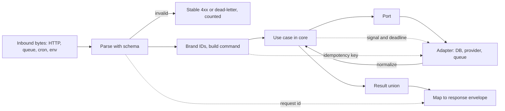

# TypeScript Backend Reliability: Reference

Depth for [SKILL.md](SKILL.md). The rules live there. This file holds the full pattern
catalogue, the scoreboards, longer examples, failure modes and operations guidance.

Sub-topics used throughout:

- **Language**: TypeScript reliability for any `.ts` code.
- **Backend**: APIs, workers, queues, CLIs and long-running services.
- **MERN**: React + Express + Mongoose + MongoDB.
- **Legacy MERN catalogue**: an older example library, kept for structure and thresholds.
- **OpenCode patterns**: twelve patterns observed in the OpenCode codebase.

## Idiomatic Thesis Synthesis Statement

### Language

Reliable TypeScript comes from treating the type system as a guardrail, not a costume.
That means:

- compile with strictness that exposes ambiguity;
- make type and value module boundaries explicit;
- accept `unknown` at boundaries;
- parse once at the edge with schemas;
- infer types from schemas instead of duplicating them;
- preserve literal precision when contracts need exactness;
- model state and protocol flows with discriminated unions;
- use assertion functions when invalid states must stop execution;
- distinguish recoverable error results from invariant violations;
- normalize transport shapes before business logic touches them;
- make persistence version-tolerant;
- propagate cancellation and deadlines explicitly;
- partition large repos with project references;
- test behaviour across unit, component, integration and end-to-end layers.

The guardrail fails in one way: an interface-only contract, a cast or an `any` at a
boundary makes every downstream signature repeat a lie. Strictness must be switched on; a
lax `tsconfig` turns the list above into suggestions. Runtime validation without static
types loses the other half of the guardrail.

Seven things to keep if everything else is forgotten: strict compiler settings are not
negotiable; type-only imports are explicit; external data starts as `unknown`; schemas
define runtime truth and inferred types; unions are exhaustive; cancellation and
deadlines are explicit; behaviour-first tests are the final backstop.

### Backend

Reliable backend TypeScript is mostly about making IO lies impossible to ignore:

- requests, events, env and queue payloads enter as `unknown`;
- domain IDs are branded before business logic uses them;
- recoverable failures stay explicit in signatures;
- outbound provider, database and HTTP shapes are normalized;
- deadlines and cancellation propagate through the full call chain;
- writes are idempotent when retries can happen;
- persistence and config formats evolve without breaking old data.

The mechanism is early, visible failure: parse errors at the edge, swapped IDs rejected by
brands, results forcing call-site handling, provider drift stopped in adapters. One
boundary parse beats scattered defensive checks in the core. Even an internally owned
service can lie through deployment drift. "Mostly" is deliberate: algorithmic bugs,
concurrency errors and resource leaks are outside what this doctrine claims to prevent.

### MERN

Reliable MERN code does not come from cleverness. It comes from a small set of boring,
compounding decisions: explicit contracts, explicit validation boundaries, explicit
database invariants, explicit query discipline, explicit recovery paths, explicit
security defaults. The best MERN code is the code where:

- validation exists in more than one layer;
- data ownership is obvious;
- failures are expected and shaped;
- reads are lightweight and deterministic;
- writes preserve invariants deliberately;
- tests exercise the same boundaries production uses.

Good path: validate at Express, map to a command, save with Mongoose semantics, return a
stable DTO, invalidate the TanStack Query key, test at the network boundary. Bad path:
trust a shared `User` interface and return a hydrated document.

## Pattern Scoreboard Ranking Table

Scores are one author's relative prioritization. They are ordering aids, not measurements
and not probabilities. A 96-point request schema cannot make an unsafe write safe, and an
84-point idempotency rule may dominate a payment path. Choose by failure boundary, blast
radius and asymmetric harm; take the smallest set that closes the failure path; then
check which high-scored items you left out and why. Whether following the lists reduces
defects is not measured.

Three different rubrics are in play. Do not compare scores across tables.

| Table | Rubric | Cut |
| --- | --- | --- |
| Language | failure prevention 40, evidence strength 25, breadth 20, maintainability under change 15 | 81+ |
| Backend | not stated; the same patterns rescored for API boundaries | 85+ shown |
| MERN | bug prevention 35, production safety 25, ecosystem proof 20, clarity and maintainability 20 | above 80 |
| OpenCode | uncommonness 30, elegance 25, cleverness 25, practical value 20 | 90+ |

The language patterns were chosen through four lenses: type-system safety, runtime
boundary integrity, operational resilience, and a skeptical production lens. The
skeptical question: does this pattern still help when inputs are malformed, the browser
is weird, persistence drifts across versions, or a teammate changes one branch and
forgets another?

### Language

| Score | Pattern | Tier | Why it survived |
| ---: | --- | --- | --- |
| 98 | Schema-First Boundary Parsing | S | Single strongest guard against invalid runtime data |
| 97 | Behavior-First Test Pyramid | S | Most reliable way to catch cross-layer regressions |
| 96 | Exhaustive Union Flow Control | S | Prevents "forgot a case" bugs at compile time |
| 96 | Strict Compiler Railguards | S | Turns silent ambiguity into visible errors |
| 95 | Module-Boundary Import Hygiene | S | Prevents emit confusion and hidden side-effect bugs |
| 95 | Unknown-Until-Proven Typed | S | Stops unsafe trust at system edges |
| 94 | Versioned Persistence Migration | A | Handles old data, partial data and lazy upgrades |
| 94 | Satisfies Configuration Contracts | S | Validates config shapes without losing inference |
| 93 | Schema-Validated Forms | A | Same contract powers UX and runtime checks |
| 93 | Assertion-Function Narrowing | S | Encodes "must be true now" in the type system |
| 92 | Typed Transport Normalization | A | Makes provider and API differences an adapter problem |
| 92 | Branded Identifier Types | A | Stops mixing semantically different strings or numbers |
| 91 | Deep Merge Forward Compatibility | A | Keeps persistence robust across schema drift |
| 91 | AbortSignal Deadline Propagation | A | Makes cancellation and time budgets explicit |
| 90 | Explicit Result Error Algebra | A | Keeps recoverable failures visible in signatures |
| 90 | Feature-Collocated Query Layer | A | Reduces stale-fetch bugs and duplicate state |
| 89 | Layered Boundary Adapters | A | Keeps domain logic free of IO details |
| 89 | Literal Exactness Preservation | A | Keeps route, config and action tables precise |
| 88 | Quota-Aware Storage Degradation | B | Plans for browser storage failure |
| 86 | Stable-Key Stream State Machines | B | Critical for streaming and event-heavy systems |
| 85 | Project-Reference Build Partitions | B | Improves build speed and enforces repo boundaries |
| 84 | Progressive Enhancement Minimal Client | B | Fewer features depend on client JavaScript |

Tier S is adopted by default, tier A is a strong default for most codebases, tier B is
used when its operational trigger appears. Re-tiering for a context is valid when the
reason is stated (an async-heavy library can promote deadline propagation to a default).
Silent re-tiering is drift.

### Backend

| Score | Pattern | Why it matters |
| ---: | --- | --- |
| 98 | Schema-First Request Parsing | Stops invalid input before it contaminates the core |
| 96 | Strict Compiler and Module Railguards | Prevents silent widening and emit mistakes |
| 95 | Explicit Result Error Algebra | Makes recoverable failures impossible to ignore |
| 94 | Branded Identifier Types | Stops mixing semantically different scalars |
| 94 | Deadline and Cancellation Propagation | Prevents orphaned async work and timeout drift |
| 93 | Typed Transport Normalization | Isolates provider and wire-level quirks |
| 92 | Ports-and-Adapters Service Core | Keeps domain rules testable and framework-light |
| 90 | Idempotent Mutation Boundaries | Makes retries safe for writes |
| 90 | Boot-Time Env Validation | Fails fast instead of failing weird |
| 89 | Persistence Evolution Contracts | Prevents upgrades from corrupting stored state |
| 88 | Contract and Integration Tests | Verifies real HTTP, database and queue behaviour |
| 85 | Project-Reference Build Partitions | Helps large backends stay separable and fast |

The order encodes blast radius. Parsing is first because invalid input contaminates
everything downstream. Project references are last because their failure is build
friction, not data corruption. The two 94s and the two 90s are ties; context may reorder
them. A config-heavy service can weight env validation upward; record the deviation.

### MERN

| Pattern | Score | Why it survives |
| --- | ---: | --- |
| `Validated-Request-Boundary-Schema` | 96 | Prevents bad input from entering server logic at all |
| `Observer-Based-Query-Hook` | 96 | Reliable server-state caching, dedupe, refetch, invalidation |
| `Schema-Validated-Form` | 95 | Strong client-side contract, fewer malformed requests |
| `Centralized-Express-Error-Middleware` | 95 | Prevents swallowed async failures and hanging responses |
| `Save-First-Mongoose-Validation` | 94 | Better validation and middleware semantics than update shortcuts |
| `Lean-Query-Read-Path` | 93 | Faster and safer reads when document features are unnecessary |
| `Type-Safe-Request-Intercept` | 93 | Test and dev mocking without contract drift |
| `Session-Scoped-Mongo-Transactions` | 92 | Explicit multi-document consistency when truly needed |
| `Feature-Collocated-Query-Layer` | 92 | Keeps API calls, query keys and types from drifting apart |
| `Hardened-Header-Cookie-Baseline` | 91 | Raises the default security floor for every Express app |
| `Behavior-First-Component-Test` | 91 | Catches real regressions instead of implementation trivia |
| `Version-Key-Optimistic-Concurrency` | 90 | Prevents stale-write corruption on contested documents |
| `Update-Validator-Guard-Rail` | 90 | Stops query-style updates from bypassing schema intent |
| `Navigation-Aware-Error-Recovery` | 90 | Keeps one route crash from poisoning the client session |
| `Memory-Hard-Password-Hashing` | 89 | Prevents very common auth mistakes |
| `Embed-Reference-Modeling-Decision` | 89 | Prevents schemas that cannot scale cleanly |
| `Selective-Populate-Field-Boundary` | 88 | Controls document bloat, hidden coupling and data leaks |
| `Versioned-Storage-Persist-Middleware` | 88 | Safer local persistence and state migrations |
| `Compound-Partial-Index-Strategy` | 88 | Predictable query behaviour under load |
| `Stable-Range-Pagination-Contract` | 87 | Prevents large-list pagination from degrading or duplicating |
| `Health-Check-Shutdown-Readiness` | 86 | Safer deploys, cleaner restarts, fewer zombie requests |
| `Mongo-Collection-Schema-Validation` | 85 | Server-side last line of defence against schema drift |
| `Async-Context-Request-Correlation` | 85 | Makes logs and failures traceable across async boundaries |
| `Idempotency-Safe-Retry-Operations` | 84 | Retries without duplicate writes or ghost side effects |
| `Minimal-External-Store-Subscription` | 84 | Stable client state without broad accidental re-renders |
| `Auth-Bruteforce-Throttle-Window` | 83 | Low-cost protection for the most-attacked routes |
| `Retry-Backoff-Exponential-Strategy` | 83 | Better recovery from transient downstream failures |

Patterns scored but left off the MERN shortlist:

| Pattern | Why excluded |
| --- | --- |
| `Client-Server-Boundary-Directive` | Powerful, but tied to Next.js and server components rather than classic MERN |
| `Server-Action-Mutation` | Strong React/Next direction, weak fit for Express-backed MERN |
| `Optimistic-Update-Hook` | Useful, but easy to misuse without rigorous rollback and reconciliation |
| `Suspense-Integrated-Query-Hook` | Good, but not a first-line reliability primitive for most teams |
| `Monorepo-Workspace-Config` | Strong developer experience, not directly reliability-critical |
| `Autopopulate-Everything-Plugin` | Convenient, but erodes boundary clarity and performance predictability |
| `Offset-Pagination-As-Default` | Simple to demo, weak default for growing collections |

### OpenCode patterns

| Score | Pattern | Sub-scores (uncommon / elegant / clever / practical) |
| ---: | --- | --- |
| 98 | Hierarchical multi-instance state sync with event streaming | 30 / 25 / 25 / 18 |
| 96 | Stateful streaming-response transformation | 30 / 24 / 24 / 18 |
| 95 | Lazy-initialized child store with owner capture | 30 / 25 / 22 / 18 |
| 95 | ANSI diff-based terminal serialization | 29 / 24 / 24 / 18 |
| 94 | Unified synchronous/asynchronous storage adapter | 29 / 25 / 22 / 18 |
| 94 | URL-scoped OAuth credentials | 29 / 24 / 23 / 18 |
| 93 | Session trimming with a recency window | 28 / 24 / 23 / 18 |
| 92 | Binary-search state reconciliation | 28 / 24 / 22 / 18 |
| 92 | Discriminated-union stream parsing | 28 / 24 / 22 / 18 |
| 91 | Quota-aware storage and eviction | 27 / 23 / 23 / 18 |
| 91 | CSS-variable theming with `light-dark()` and `color-mix()` | 27 / 24 / 22 / 18 |
| 90 | Deep merge with type-preserving migration | 26 / 23 / 22 / 19 |

This rubric rewards novelty, not reliability. Scale for each dimension: uncommonness 30
never seen elsewhere, 25 rare, 20 uncommon but documented, 15 occasional, 10 somewhat
common; elegance 25 self-documenting, 20 clean, 15 readable, 10 needs comments, 5 messy;
cleverness 25 uniquely uses the language, 20 deep understanding, 15 creative, 10
standard, 5 naive; practical value 20 production-grade, 15 solves a real problem, 10
reusable, 5 one-off, 1 toy.

## Agent Usage Decision Guide

1. State the visible behaviour and its failure states.
2. Classify the owning boundary and the mode (language, backend, MERN).
3. Map the path from the caller to the database and back.
4. Inspect the repository's conventions, lockfile and compiler version.
5. Select the minimum set of patterns that closes the failure path.
6. Write boundary tests. Implement. Rerun the cross-layer gates.
7. Stop on missing ownership or irreversible uncertainty.

Reading order inside each catalogue: scoreboard first, then only the patterns that match
the boundary being touched, then the anti-pattern registry, then the gate. A webhook
review reads parsing, normalization and idempotency. An idempotency question reads one
pattern, not the whole catalogue. Do not apply project references to a small service
because the list contains them.

Which bucket reads which MERN section:

| Task | Read |
| --- | --- |
| Request validation, form contracts, collocated query layers, MSW transport testing | Contract boundaries |
| TanStack Query, behaviour-first tests, route error recovery, persisted client state | Frontend reliability |
| Error middleware, security headers, readiness and shutdown, request correlation | Express and API reliability |
| `save()` vs update methods, `lean()`, update validators, optimistic concurrency, transactions, populate | Mongoose query and write reliability |
| Embed vs reference, index design, range pagination, collection schema validation | MongoDB modelling |
| Password hashing, idempotency, auth throttling, retry strategy | Auth and cross-cutting |
| A new endpoint from scratch | Operational defaults in SKILL.md (Mode M) |
| A convenience pattern that looks attractive | Excluded patterns and the anti-pattern registry |

What to record for a non-trivial change: bucket, selected and rejected patterns,
assumptions, tests and what they observed, public-contract changes, security review,
rollout, rollback. Do not change a response envelope without a migration. Do not finish
without error and empty states.

Writing freely and reviewing afterwards is a weaker process than classifying first: it
lets the happy-path handler exist before the parser does.

When the repository has stronger local conventions, follow them unless they reduce a
reliability guarantee. If a task needs a deviation from these rules, say why and preserve
the same property another way.

## Decision Tradeoff Guide

| Decision | Choose the first when | Choose the second when |
| --- | --- | --- |
| Throw vs `Result` | Invariant or programmer violation, impossible state | Expected business outcome such as `email-already-exists`. "Result everything" hides the distinction; wrapping pure maths is excess ceremony. |
| Brand vs bare string | Swapping two values could corrupt data | The value lives inside one function |
| Ports vs direct calls | Core testability and fakes matter. The cost of skipping ports shows at test time, not authoring time. | A two-function endpoint. Parsing and idempotency stay mandatory. |
| Lazy vs eager migration | Default: migrate on read, touch only data that is used | A one-shot migration only when old shapes cannot be read safely any more |
| `save()` vs atomic query update | Middleware, validation, optimistic concurrency or document semantics matter | A true atomic transition. Then: explicit operators, `runValidators`, stated concurrency expectation, integration test. |
| Lean object vs document | Read-only serialization | Methods, getters, setters, virtuals or `save()` are needed |
| Embed vs reference | Queried together, updated together, small and bounded | High cardinality, unbounded growth, or duplication too hard to keep consistent |
| Cursor vs offset pagination | Any list that grows. Needs a matching index. | Small fixed admin list, deterministic sort, documented size bound |
| Cookie vs header auth | Browser sessions; set `httpOnly`, `secure`, `sameSite` | Non-browser clients; decide by threat model |
| Shared schema package vs separate schemas | Client and server live in one repository | Ownership is split and contract tests detect drift |
| `satisfies` vs annotation vs `as` | Declarative objects that must obey a contract and keep literals | An annotation when widening is wanted; `as` only as a fenced last resort |
| Literal preservation vs inference | A precision-sensitive API boundary: route tables, event names, tuples | Ordinary values where widening is harmless |
| Project references vs one project | Typecheck time threatens the gate, or boundaries need compiler enforcement | Small repo; faster hardware or CI caching can defer the restructuring |

Stance by category: adopt edge validation, distinct DTOs, query-owned server state,
centralized errors, projection, deterministic sorting and observability. Adapt writes,
modelling, pagination and auth to the invariants, workload and threat model. Avoid
shortcuts that erase trust or duplicate effects. Escalate irreversible schema, token and
multi-system changes.

A tradeoff record covers: invariant, user and data consequence, workload, security, local
convention, alternatives, complexity, tests, migration, observability, rollback, owner.
The cost of an error follows irreversibility and hidden coupling more than code size.
Transactions do not cure poor modelling. The language rubric prices failure prevention
(40) well above maintainability (15); that is a stated value, not a finding.

Adopt, adapt or avoid a pattern from this file:

| Decision | Choose when | Cost and check |
| --- | --- | --- |
| Adopt | The rule and current library documentation agree | Fastest; may copy a stale assumption. Confirm against the installed version. |
| Adapt | The rule is sound but the ecosystem moved | Keeps repository fit. Say which part is the rule and which is your inference. |
| Avoid | Evidence is thin, conflicting or unrelated to the task | Prevents false confidence. Give a warning or route elsewhere. |
| Cost of wrong | Guidance sends work to the wrong files, tests or abstraction | Wasted implementation and weaker verification. The reviewer should know what to undo. |

## Theme Specific Artifact

### Language: pattern catalogue

**1. Strict compiler railguards (96, tier S).** Turn on strictness that exposes
uncertainty early. The baseline `tsconfig` is in SKILL.md. What each flag buys:

| Flag | Effect |
| --- | --- |
| `strict` | Catches broad type unsafety |
| `noUncheckedIndexedAccess` | Forces you to acknowledge missing keys |
| `exactOptionalPropertyTypes` | Stops "optional means undefined-ish" confusion |
| `noFallthroughCasesInSwitch` | Reduces silent branch bugs |
| `useUnknownInCatchVariables` | Stops implicit trust in thrown values |
| `verbatimModuleSyntax` | Emitted module behaviour matches what you wrote |
| `noUncheckedSideEffectImports` | Forces scrutiny of side-effect imports |
| `noUnusedLocals`, `noUnusedParameters` | Dead names surface as errors |
| `isolatedModules`, `moduleDetection: "force"` | Each file is a module that a single-file transpiler can handle |

**2. Module-boundary import hygiene (95, tier S).** Separate type-only imports from
runtime imports and preserve the distinction in emit. It avoids accidental runtime
imports that exist only for types, makes side effects visible, and keeps transpilation
predictable across bundlers and runtimes.

```typescript
import type { UserProfile, UserRepositoryPort } from "./user-types";
import { parseUserProfileSafely } from "./user-codec";

export type { UserProfile };

export async function loadUserProfileSafely(
  repository: UserRepositoryPort,
  userId: string,
): Promise<UserProfile> {
  const raw = await repository.fetchUserById(userId);
  return parseUserProfileSafely(raw);
}
```

**3. Schema-first boundary parsing (98, tier S).** Parse incoming data once at the
boundary, infer types from the schema, and only then hand data inward. If data crosses a
process, network, storage or browser boundary, it needs a runtime schema. The schema is
also the documentation.

```typescript
const userProfileSchema = z.object({
  id: z.string(),
  email: z.string().email(),
  role: z.enum(["user", "admin"]),
});
type UserProfile = z.infer<typeof userProfileSchema>;

export function parseUserProfileSafely(input: unknown): UserProfile {
  return userProfileSchema.parse(input);
}
```

**4. Unknown until proven typed (95, tier S).** Use `unknown` for untrusted payloads,
task data, cache payloads and tool arguments (`Record<string, unknown>`) until parsing or
narrowing proves the shape. `any` spreads unsafety downstream; `unknown` forces proof. If
you see `any`, assume the smoke alarm was just turned off.

```typescript
type TaskDefinition<T> = {
  type: string;
  data: unknown;
  timeout?: number;
  decode: (input: unknown) => T;
};

export async function runWorkerTaskSafely<T>(task: TaskDefinition<T>): Promise<T> {
  const value = await executeRawTask(task.type, task.data);
  return task.decode(value);
}
```

**5. Exhaustive union flow control (96, tier S).** Represent protocol states, events,
async results and UI state as discriminated unions with exhaustive handling. The compiler
catches missing cases, invalid states become harder to represent, and it scales better
than boolean soup.

```typescript
type StreamEvent =
  | { type: "text"; text: string }
  | { type: "tool-call"; callId: string; name: string }
  | { type: "reasoning"; summary: string }
  | { type: "done"; finishReason: "stop" | "tool_calls" | "error" };

function assertExhaustiveCaseNever(value: never): never {
  throw new Error(`Unhandled case: ${JSON.stringify(value)}`);
}

export function handleStreamEventExhaustively(event: StreamEvent): void {
  switch (event.type) {
    case "text": appendTextChunk(event.text); return;
    case "tool-call": beginToolExecution(event.callId, event.name); return;
    case "reasoning": appendReasoningChunk(event.summary); return;
    case "done": finishActiveStream(event.finishReason); return;
    default: assertExhaustiveCaseNever(event);
  }
}
```

**6. `satisfies` configuration contracts (94, tier S).** Plain annotations widen literals
too early; `as` can silence real mistakes; `satisfies` checks the contract and keeps the
inferred values.

```typescript
type RouteContract = Record<string, { path: `/${string}`; authRequired: boolean }>;

const applicationRoutes = {
  home: { path: "/", authRequired: false },
  settings: { path: "/settings", authRequired: true },
  billing: { path: "/billing", authRequired: true },
} satisfies RouteContract;

type RouteName = keyof typeof applicationRoutes;
```

**7. Assertion-function narrowing (93, tier S).** When execution must stop unless a
condition holds, encode it once instead of scattering non-null assertions and
`if (!x) throw`. It centralizes the invariant and narrows the type after the call.

```typescript
export function assertUserProfilePresent(
  value: UserProfile | null | undefined,
): asserts value is UserProfile {
  if (!value) throw new Error("User profile must be present");
}

export function renderUserMenuSafely(maybeUser: UserProfile | null): string {
  assertUserProfilePresent(maybeUser);
  return maybeUser.email;
}
```

**8. Behaviour-first test pyramid (97, tier S).** Test pure logic, then components, then
service and API integration, then end-to-end behaviour. Unit tests catch local
regressions, component tests interaction regressions, integration tests contract
failures, end-to-end tests broken journeys. Stack: Vitest or Jest (unit), React Testing
Library (component), MSW (network mocking), Supertest or equivalent (integration),
Playwright (end to end). Test user-observable behaviour first. Mock only one layer below
the thing under test.

**9. Typed transport normalization (92, tier A).** Normalize provider-specific or
API-specific responses into one internal shape before application logic sees them. It
isolates vendor quirks and makes retries, metrics and caching consistent.

```typescript
type NormalizedProviderResponse = {
  provider: "openai" | "anthropic" | "google" | "local";
  model: string;
  content: string | null;
  toolCalls: Array<{ id: string; name: string; arguments: Record<string, unknown> }>;
  finishReason: "stop" | "length" | "tool_calls" | "content_filter";
};

export function normalizeProviderResponseStrictly(
  provider: string,
  raw: unknown,
): NormalizedProviderResponse {
  return providerNormalizers[provider](raw);
}
```

**10. Versioned persistence migration (94, tier A).** Read persisted data through an
adapter that migrates old versions lazily, reads legacy keys, merges partial data with
defaults, and exposes readiness when storage is asynchronous. Prefer migration on read
over one giant migration. Version the storage contract even if you think you will never
need it.

**11. Branded identifier types (92, tier A).** Stops `UserId`, `OrderId` and raw `string`
collapsing into one type, and makes argument swaps hard for people and for code
generators. Brand at the domain edge, not after bugs appear. The constructor is in
SKILL.md; a consumer looks like this:

```typescript
export async function fetchUserByIdStrictly(id: UserId): Promise<UserProfile> {
  const raw = await fetchUserTransport(id);
  return parseUserProfileSafely(raw);
}
```

**12. Deep merge for forward compatibility (91, tier A).** When loading partial persisted
state, merge recursively with defaults while preserving arrays, primitives, nulls and
unknown future keys. Shallow merge is not enough: future versions add fields and old
versions omit them. Do not hard-deny unknown fields in an evolving format.

```typescript
function isRecord(value: unknown): value is Record<string, unknown> {
  return typeof value === "object" && value !== null && !Array.isArray(value);
}

export function mergePersistedStateForward(defaults: unknown, value: unknown): unknown {
  if (value === undefined) return defaults;
  if (value === null) return null;
  if (Array.isArray(defaults)) return Array.isArray(value) ? value : defaults;
  if (isRecord(defaults)) {
    if (!isRecord(value)) return defaults;
    const result: Record<string, unknown> = { ...defaults };
    for (const key of Object.keys(value)) {
      result[key] = key in defaults
        ? mergePersistedStateForward(defaults[key], value[key])
        : value[key];
    }
    return result;
  }
  return value;
}
```

`undefined` means missing. `null` means intentionally empty. `false` is a value. Do not
collapse them.

**13. Schema-validated forms (93, tier A).** Drive forms from a schema, not scattered
inline checks. The same rules power field validation and submission parsing. Prefer one
schema feeding client and server over duplicated validation logic.

```typescript
const loginFormSchema = z.object({
  email: z.string().email(),
  password: z.string().min(8),
});
type LoginFormData = z.infer<typeof loginFormSchema>;

export function LoginFormValidated(): JSX.Element {
  const form = useForm<LoginFormData>({ resolver: zodResolver(loginFormSchema) });
  return (
    <form onSubmit={form.handleSubmit(submitLoginFormSafely)}>
      <input {...form.register("email")} />
      <input type="password" {...form.register("password")} />
      <button type="submit">Sign in</button>
    </form>
  );
}
```

**14. Explicit result error algebra (90, tier A).** Callers must handle failure paths on
purpose; recoverable validation, network and business errors stop hiding in exceptions.
A hand-written `Result` union or a library such as `neverthrow` both work. Full example
in SKILL.md.

**15. `AbortSignal` deadline propagation (91, tier A).** Accept a signal at async
boundaries, compose it with deadlines, and pass it down instead of inventing disconnected
timers. Each long-running boundary decides how cancellation arrives, how deadlines are
enforced, and how abort reasons are surfaced. The earlier form of the example ended with
`return raw as T`; that cast breaks rule 3, so the SKILL.md template takes a `decode`
function instead. A fire-and-forget cache warm may omit the signal only when its
signature says so.

**16. Feature-collocated query layer (90, tier A).** Keep server-state fetching beside
the feature that owns it, use stable query keys, and let a query library manage
freshness, retries and invalidation. Server state is not local component state. Query
keys are part of the contract surface.

**17. Literal exactness preservation (89, tier A).** Preserve exact literals in config
helpers, tuples and lookup tables with `as const` and `const` type parameters. Widened
types lose information the compiler could have used; readonly exactness prevents
accidental mutation of declarative metadata.

```typescript
export function defineRoutesPrecisely<
  const TRoutes extends Record<string, { path: `/${string}`; authRequired: boolean }>
>(routes: TRoutes): TRoutes {
  return routes;
}

const applicationRoutes = defineRoutesPrecisely({
  home: { path: "/", authRequired: false },
  settings: { path: "/settings", authRequired: true },
});
```

**18. Layered boundary adapters (89, tier A).** L1 core: domain types, invariants, pure
functions. L2 application: use cases, orchestration, ports. L3 adapters: HTTP, database,
browser APIs, queues, providers. No circular dependencies. Frameworks plug into the core;
they do not colonize it.

```typescript
export interface UserRepositoryPort {
  findUserById(id: string): Promise<User | null>;
  saveUser(user: User): Promise<void>;
}

export class UpdateUserProfileUseCase {
  constructor(private readonly repository: UserRepositoryPort) {}

  async execute(command: UpdateUserProfileCommand): Promise<void> {
    const user = await this.repository.findUserById(command.userId);
    if (!user) throw new Error("User not found");
    await this.repository.saveUser(applyUserProfileUpdate(user, command));
  }
}
```

**19. Project-reference build partitions (85, tier B).** Split a large repository into
referenced composite projects with an explicit dependency direction. It shortens builds,
reduces editor memory and typecheck churn, and turns the dependency graph into a build
contract. Small repos do not need it.

```json
{
  "files": [],
  "references": [
    { "path": "./packages/core" },
    { "path": "./packages/app" },
    { "path": "./packages/web" }
  ]
}
```

**20. Quota-aware storage degradation (88, tier B, browser only).** Treat storage quota
errors as a normal failure. Browsers disagree on quota error names and codes, and storage
can fail after long healthy periods. Failure order: write directly; repair the corrupted
key; evict old entries; fall back to memory. Detail under OpenCode pattern 6.

**21. Stable-key stream state machines (86, tier B).** In streaming or event-heavy
systems, do not assume every identifier is stable. Logical operations span several
events, provider IDs can rotate or be partial, so track state by the identifier that is
stable across events (an `output_index`, not a rotating item ID). Protocol correctness
beats "looks unique enough".

**22. Progressive enhancement, minimal client (84, tier B, browser only).** Keep core
journeys working with minimal client JavaScript when the product allows. Fewer hydration
and client-state failure modes, smaller blast radius when scripts fail. If a feature does
not need a client-side state machine, do not invent one.

**The nine-rule operating procedure.**

1. Boundary: network, local storage, file system, browser APIs, worker messages, queue
   payloads and provider SDK responses all enter as `unknown`.
2. Parsing: define the schema once, infer the type, parse at the boundary, pass typed
   data inward.
3. Control flow: discriminated unions, exhaustive `switch`, `never` checks.
4. Module: `import type`, `verbatimModuleSyntax`, runtime imports visibly runtime.
5. Error: recoverable failures return results, invariant violations throw, caught values
   are narrowed from `unknown`.
6. Async: accept `AbortSignal`, compose deadlines, propagate cancellation downward.
7. Persistence: version storage, migrate on read, preserve unknown future keys, merge
   partial state carefully.
8. Testing: unit for pure logic, component for behaviour, integration for contracts, end
   to end for journeys.
9. Architecture: core stays framework-light, adapters own IO, query and cache logic stays
   feature-local, project references when scale justifies them.

**Strictness ledger.** One row per module or file cohort, kept beside `tsconfig.json` and
updated in every change that touches strictness, boundaries or casts:

| Cohort | Strict flags on | Boundaries parsed / total | Unions exhaustive | Casts and suppressions (why, removal trigger) | Gate passes |
| --- | --- | --- | --- | --- | --- |
| `packages/core` | all | 6 / 6 | yes | 1: branded constructor | yes |
| `packages/legacy-sync` | `strict` only | 2 / 5 | no | 7: listed in file header, remove with v3 API | typecheck only |

Lint suppressions are casts by another name. Coverage columns can be generated; the
justifications are written by a person. Without the ledger, blessed exceptions and duct
tape look the same. Small repositories can harden in one change and skip it.

### Backend: pattern catalogue

Scope: Node.js, Bun, Deno, workers, APIs, queues, CLIs, long-running services. The
language baseline applies without re-debate: strict flags, `import type`, `unknown` at
trust boundaries, schema-first parsing, exhaustive unions, assertion functions,
`satisfies`, explicit cancellation, project references when scale needs them.

**1. Schema-first request parsing (98).** Parse HTTP bodies, headers, params, queue
payloads and cron or job inputs at the edge. Parse once, pass typed data inward, never
let raw `req.body` travel through the app.

**2. Boot-time env validation (90).** Environment config is another untrusted boundary.
Crash at boot when it is invalid. Template in SKILL.md.

**3. Branded identifier types (94).** For database primary keys, tenant and workspace
IDs, idempotency keys, message and job IDs. If two IDs should never be swapped, they
should never share the same bare type.

```typescript
declare const userIdBrand: unique symbol;
declare const workspaceIdBrand: unique symbol;
export type UserId = string & { readonly [userIdBrand]: "UserId" };
export type WorkspaceId = string & { readonly [workspaceIdBrand]: "WorkspaceId" };
```

**4. Explicit result error algebra (95).** Expected business failures should not
disappear into generic exceptions. A signature such as
`Promise<Result<UserId, CreateUserError>>` shows the failure and identifier discipline
before the body is read.

**5. Deadline and cancellation propagation (94).** Every backend boundary answers: who
can cancel this, how long can it run, what happens downstream when it aborts.

**6. Typed transport normalization (93).** Provider-specific drift belongs in adapter
code, not use-case code.

```typescript
type NormalizedWebhookEvent =
  | { type: "user-created"; userId: UserId }
  | { type: "workspace-deleted"; workspaceId: WorkspaceId };

export function normalizeWebhookEventStrictly(input: unknown): NormalizedWebhookEvent {
  const parsed = webhookEnvelopeSchema.parse(input);
  return parsed.event_type === "user.created"
    ? { type: "user-created", userId: createUserIdSafely(parsed.data.user_id) }
    : { type: "workspace-deleted", workspaceId: createWorkspaceIdSafely(parsed.data.workspace_id) };
}
```

**7. Ports-and-adapters service core (92).** Framework code wraps the core; it does not
define it.

```typescript
export interface UserRepositoryPort {
  findUserByEmail(email: string): Promise<UserRecord | null>;
  insertUser(data: CreateUserRequest): Promise<UserId>;
}
export interface AuditLogPort {
  recordUserCreated(userId: UserId): Promise<void>;
}

export class CreateUserUseCase {
  constructor(
    private readonly users: UserRepositoryPort,
    private readonly audit: AuditLogPort,
  ) {}

  async execute(input: CreateUserRequest): Promise<Result<UserId, CreateUserError>> {
    const existing = await this.users.findUserByEmail(input.email);
    if (existing) return { ok: false, error: { type: "email-already-exists" } };
    const userId = await this.users.insertUser(input);
    await this.audit.recordUserCreated(userId);
    return { ok: true, value: userId };
  }
}
```

**8. Idempotent mutation boundaries (90).** If clients or queues can retry, writes need
deduplication keys. Retries without idempotency are duplicate bugs waiting for traffic.

```typescript
declare const clientMessageIdBrand: unique symbol;
type ClientMessageId = string & { readonly [clientMessageIdBrand]: "ClientMessageId" };

type CreateMessageCommand = {
  roomId: WorkspaceId;
  authorId: UserId;
  clientMessageId: ClientMessageId;
  content: string;
};

export async function createMessageDeduplicated(
  command: CreateMessageCommand,
): Promise<Result<MessageRecord, { type: "duplicate" }>> {
  const existing = await findMessageByClientId(command.clientMessageId);
  if (existing) return { ok: false, error: { type: "duplicate" } };
  return { ok: true, value: await insertMessageRecord(command) };
}
```

The find-then-insert above still races under concurrency. Back it with a unique index on
the client key so the database enforces the dedup, and treat the duplicate-key error as
the `duplicate` outcome.

**9. Persistence evolution contracts (89).** Stored shapes need a migration story: add
fields safely, preserve unknown keys when possible, migrate old versions lazily, never
assume today's format is forever.

**10. Contract and integration tests (88).** Minimum layers: unit tests for pure domain
logic, integration tests for repositories and adapters, HTTP contract tests for handlers,
end-to-end tests for critical journeys. A repository test against a real database
container beats a green suite that mocks everything. Recorded contract fixtures drift;
refresh them as part of the gate. An internal batch worker can skip end-to-end tests if
the contract layers remain.

**11. Project-reference build partitions (85).** Partitions for a large backend: `core`,
`application`, `adapters`, `services`, `workers`.

**Request lifecycle.** The operational artifact for a service is this diagram with the
persistence boundary, the observability hook and a failure table beside it.



### MERN: pattern catalogue

The places where generated MERN code is most often risky: request-boundary validation,
auth and security hardening, Mongoose read-path discipline, update-validator caveats,
populate and projection hygiene, pagination stability, request correlation.

Status labels: patterns 1 to 9 come from the owner's React pattern notes; 10 to 19, 21
to 24 and 26 were cross-checked against Express, Mongoose, MongoDB, Node and OWASP
documentation (URLs in the evidence table); 25 and 27 are inference from system-design
notes and are not MERN-specific.

#### Contract boundaries

**1. `Validated-Request-Boundary-Schema` (96).** Never let raw `req.body`, `req.params`
or `req.query` flow straight into handlers or Mongoose calls. The browser schema is
helpful; the server boundary schema is mandatory. Express itself warns not to trust user
input. Validation at the edge keeps malformed data out of business logic and makes route
handlers narrower.

```typescript
import { z } from "zod";
import type { Request, Response, NextFunction } from "express";

const createUserBodySchema = z.object({
  email: z.string().email(),
  name: z.string().min(2),
  password: z.string().min(12),
});

export function validateCreateUserRequest(req: Request, res: Response, next: NextFunction) {
  const parsed = createUserBodySchema.safeParse(req.body);
  if (!parsed.success) {
    return res.status(400).json({
      error: "Invalid request body",
      details: parsed.error.flatten(),
    });
  }
  req.body = parsed.data;
  next();
}
```

**2. `Schema-Validated-Form` (95).** React Hook Form + Zod. Form validation is contract
definition, not UI decoration: fewer malformed payloads reach the server, validation
stays close to types, error messages are deterministic.

```typescript
export const createUserSchema = z.object({
  email: z.string().email(),
  name: z.string().min(2),
});
export type CreateUserInput = z.infer<typeof createUserSchema>;

export function useCreateUserForm() {
  return useForm<CreateUserInput>({
    resolver: zodResolver(createUserSchema),
    defaultValues: { email: "", name: "" },
  });
}
```

**3. `Feature-Collocated-Query-Layer` (92).** Keep feature queries, mutations and types
inside the feature. The point is not folder aesthetics; it is preventing query-key drift,
endpoint duplication and contract mismatch.

**4. `Type-Safe-Request-Intercept` (93).** MSW at the network layer for tests and local
development. Tests exercise real fetch boundaries, fake data stays structurally close to
production payloads, and UI can be tested before the backend exists without lying about
transport. MSW-first development says nothing about persistence or auth until those are
tested separately.

#### Frontend reliability

**5. `Observer-Based-Query-Hook` (96).** TanStack Query for server state. Do not put API
data into ad-hoc component state or a giant global store. Request deduplication is built
in, stale and fresh boundaries are explicit, and retry, refetch and invalidation become
deliberate.

```typescript
import { queryOptions, useQuery } from "@tanstack/react-query";
import { api } from "@/lib/api-client";

export const getUser = (userId: string) => api.get(`/users/${userId}`);

export const getUserQueryOptions = (userId: string) =>
  queryOptions({
    queryKey: ["user", userId],
    queryFn: () => getUser(userId),
    staleTime: 60_000,
  });

export const useUser = (userId: string) => useQuery(getUserQueryOptions(userId));
```

**6. `Behavior-First-Component-Test` (91).** Prefer `getByRole`, `getByLabelText` and real
user actions. Assert outcomes the user can observe. Avoid brittle snapshots as a primary
source of confidence.

**7. `Navigation-Aware-Error-Recovery` (90).** When a route crashes, reset or remount the
error boundary on navigation so a stale error does not poison later transitions. The
pattern comes from Next.js and transfers to React Router: error boundary per route
segment, reset on pathname change, a deliberate retry action.

**8. `Versioned-Storage-Persist-Middleware` (88).** Local storage is a schema. Stale
persisted shapes silently break apps; migrations are easier than debugging corrupted
browser state.

```typescript
persist(
  (set) => ({
    sidebarOpen: false,
    setSidebarOpen: (value: boolean) => set({ sidebarOpen: value }),
  }),
  {
    name: "ui-store",
    version: 2,
    migrate: (persisted, version) => {
      if (version < 2) return { sidebarOpen: false };
      return persisted as { sidebarOpen: boolean };
    },
  },
);
```

The cast in `migrate` is the kind the proof ladder asks you to replace with a parse when
the stored value matters.

**9. `Minimal-External-Store-Subscription` (84).** If global client state is needed, keep
it minimal and subscribe by slice. Fewer accidental re-renders, less hidden coupling.

#### Express and API reliability

**10. `Centralized-Express-Error-Middleware` (95).** Express catches synchronous errors
automatically; async errors must reach `next(err)`. Error middleware lives last. This
prevents silent failures and hanging requests and keeps error serialization consistent.

```typescript
app.use((err: unknown, req: express.Request, res: express.Response, next: express.NextFunction) => {
  if (res.headersSent) return next(err);
  const message = err instanceof Error ? err.message : "Internal Server Error";
  res.status(500).json({ error: message });
});
```

This form returns `err.message`. A production service hides internals; see the
disagreement table in SKILL.md.

**11. `Hardened-Header-Cookie-Baseline` (91).** `helmet()` for common headers, explicit
CORS policy, secure cookie settings for cookie-backed auth, no framework fingerprinting.
Harden once at bootstrap; do not make every route rediscover security settings.

**12. `Health-Check-Shutdown-Readiness` (86).** Expose health endpoints, stop accepting
work on `SIGTERM`, finish in-flight requests, close database connections cleanly. A
health check that ignores MongoDB readiness reports healthy while every request fails.

**13. `Async-Context-Request-Correlation` (85).** Attach a request ID once and carry it
through async work; otherwise logs from one request disappear into a shared stream.

```typescript
import { AsyncLocalStorage } from "node:async_hooks";
import crypto from "node:crypto";

const requestContext = new AsyncLocalStorage<{ requestId: string }>();

app.use((req, res, next) => {
  requestContext.run({ requestId: crypto.randomUUID() }, next);
});

export function getRequestId() {
  return requestContext.getStore()?.requestId;
}
```

Every log line for a request should be traceable. Do not pass `requestId` through every
function by hand. Correlation matters most around retries, transactions and background
side effects.

#### Mongoose query and write reliability

**14. `Save-First-Mongoose-Validation` (94).** Use `doc.save()` when possible; the
Mongoose documentation recommends it for validation and middleware support. Middleware
runs in the expected place, validation is clearer, version tracking behaves better. Do
not reach for `findOneAndUpdate()` by reflex.

**15. `Lean-Query-Read-Path` (93).** Lean results are plain objects, not Mongoose
documents: less overhead on hot read paths, no accidental reliance on mutation or
`save()`, easier serialization boundaries.

**16. `Update-Validator-Guard-Rail` (90).** Update validators are not the default safety
net; for query-style updates you must ask for them. Teams assume validation "just
happens", and generated update code often omits `runValidators: true`.

**17. `Version-Key-Optimistic-Concurrency` (90).** Mongoose's default versioning is not
full optimistic concurrency.

```typescript
const houseSchema = new Schema(
  {
    status: { type: String, required: true },
    photos: [{ type: String }],
  },
  { optimisticConcurrency: true },
);
export const House = model("House", houseSchema);
```

**18. `Session-Scoped-Mongo-Transactions` (92).** Sessions with `withTransaction()` or
`Connection#transaction()` for true multi-document consistency. Either all writes land or
none do; the helper can retry transient transaction errors; Mongoose change tracking
stays consistent on rollback. Because the helper may rerun the callback, the callback
must not contain a side effect that cannot be repeated (an email, a provider call).

**19. `Selective-Populate-Field-Boundary` (88).** Never treat `populate()` as a licence to
hydrate half the database into every response. Over-population leaks fields, hurts
latency and obscures ownership; list endpoints get expensive fast.

```typescript
const posts = await Post.find({ published: true })
  .select("title slug author createdAt")
  .populate({ path: "author", select: "name avatarUrl" })
  .lean();
```

#### MongoDB modelling

**20. `Embed-Reference-Modeling-Decision` (89).** One of the highest-leverage design
calls in the stack. A bad embed-or-reference choice becomes migration pain later.

**21. `Compound-Partial-Index-Strategy` (88).** Indexes are part of the model, not a
cleanup task. Adding a unique index to a collection that already holds duplicates needs
a migration; plan it.

**22. `Stable-Range-Pagination-Contract` (87).** MongoDB documents that `skip()` slows as
the offset grows and recommends range queries. Unstable sorting causes duplicates or
gaps between pages; pagination bugs are silent data-integrity bugs at the UX layer.

**23. `Mongo-Collection-Schema-Validation` (85).** MongoDB is flexible by default, not
safe by default. Collection-level validation catches bad writes from scripts, admin
tools and side channels, reduces type drift, and is a backstop when app-layer validation
is bypassed.

#### Auth and cross-cutting

**24. `Memory-Hard-Password-Hashing` (89).** OWASP recommends Argon2id first, scrypt as
fallback, bcrypt as a legacy-acceptable option when configured correctly. The wrong
algorithm or a synchronous API turns auth into a bottleneck or a breach surface.

**25. `Idempotency-Safe-Retry-Operations` (84).** If you retry writes, make them
idempotent first. Good candidates: payment initiation, email send requests, checkout
submission, webhook consumption. Retries without idempotency are duplication bugs with a
delay.

**26. `Auth-Bruteforce-Throttle-Window` (83).** Auth routes are attacked differently from
content routes; per-route throttling is cheap protection against credential stuffing and
brute force.

**27. `Retry-Backoff-Exponential-Strategy` (83).** Retry transient failures only.

#### Vertical-slice decision packet

Keep one per capability. Fill the fields that apply; narrow it to an API contract sheet,
a migration decision, a threat model or a browser test plan when only one layer changes.

| Field | Content |
| --- | --- |
| User workflow | The action and its visible states |
| Trust boundaries | Where data re-enters as `unknown` |
| Request and response schemas | Names and owners |
| Client-state owner | Query key, store slice or form |
| Express middleware | Validation, auth, rate limit, order |
| Service invariant | The rule the write must not break |
| Mongoose operation | `save()`, atomic update or transaction, and why |
| MongoDB model and index | Embed or reference; the index serving the query |
| Auth policy | Who may do this; deny by default |
| Failure envelope | Stable error shapes per failure |
| Tests | Layer, boundary exercised, observed result |
| Telemetry | Events, correlation, redaction |
| Rollout and rollback | Order of deployment; how to undo |

### Legacy MERN catalogue (2025 example library)

An older set of MERN + TypeScript examples. Use it to discover structure and concrete
thresholds, then modernize and validate. Do not copy blindly its `localStorage` token
handling, `any` usage, default offset pagination, bcrypt-first hashing or generic base
repository. Where it disagrees with the catalogue above, the disagreement table in
SKILL.md selects.

Its stated goals: type safety, performance, security, separation of concerns,
testability, scalability.

**Repository layout.**

```text
shared/{types,utils,constants,validations}
client/src/{components,pages,hooks,services,store,types,utils}
server/src/{controllers,middleware,models,routes,services,utils,types}
docs/
docker-compose.yml
```

Feature layout on the client: `features/<feature>/{components,hooks,services,types,index.ts}`,
with cross-feature code in `shared/`. Path aliases: `@shared/*`, `@client/*`,
`@server/*`, `@/*`.

**Root scripts** (run client and server together with `concurrently`):

```json
{
  "scripts": {
    "dev": "concurrently \"npm run server:dev\" \"npm run client:dev\"",
    "server:dev": "cd server && npm run dev",
    "client:dev": "cd client && npm run dev",
    "build": "npm run client:build && npm run server:build",
    "test": "npm run client:test && npm run server:test",
    "lint": "npm run client:lint && npm run server:lint",
    "type-check": "npm run client:type-check && npm run server:type-check"
  }
}
```

**tsconfig additions** to the strict baseline: `target` and `lib` ES2022 plus DOM libs,
`module: "ESNext"`, `moduleResolution: "bundler"`, `allowImportingTsExtensions`,
`resolveJsonModule`, `isolatedModules`, `moduleDetection: "force"`, `noEmit`,
`jsx: "react-jsx"`.

**Shared types.** Utility types `DeepPartial`, `DeepRequired`, `OmitNested`; `BaseEntity`
(`_id`, `createdAt`, `updatedAt`); `ApiResponse<T>`; `PaginationParams` (`page`, `limit`,
`sortBy`, `sortOrder`). Contracts: `User` (`_id`, `email`, `name`, `role` of `user` or
`admin`, `isActive`, timestamps); `CreateUserDto` (`email`, `name`, `password`);
`UpdateUserDto` (optional `name`, `role`, `isActive`); `LoginDto`; `AuthResponse` (user
without password, `token`, `refreshToken`). Endpoint contracts are typed by method and
path so client and server share one definition: POST register and login bodies and
responses; GET users with `PaginationParams & { search?: string; role?: string }`
returning `ApiResponse<User[]>`; GET, PUT and DELETE by `{ id: string }`.

```typescript
type DeepPartial<T> = { [P in keyof T]?: T[P] extends object ? DeepPartial<T[P]> : T[P] };

interface ApiResponse<T = unknown> {
  success: boolean;
  data?: T;
  message?: string;
  errors?: string[];
  meta?: { page?: number; limit?: number; total?: number; totalPages?: number };
}
```

**Env and database bootstrap.** `EnvConfig` fields: `PORT`, `NODE_ENV`, `MONGODB_URI`,
`JWT_SECRET`, `JWT_EXPIRE`, `CORS_ORIGIN`. `connectDatabase` exits the process with code
1 on failure. Connection singleton options: `maxPoolSize: 10`,
`serverSelectionTimeoutMS: 5000`, `socketTimeoutMS: 45000`, `bufferCommands: false`,
`bufferMaxEntries: 0`. The `bufferMaxEntries` option was removed from later driver
versions; check the installed version. The database health check reports connection
state without throwing.

`DatabaseConnection` is a singleton (`getInstance()`) with an `isConnected` flag.
`connect(uri)` returns early with a log line when already connected, so a second call
does not open a second connection. After connecting it registers `mongoose.connection`
listeners that set the flag false on `error` and `disconnected` and true on
`reconnected`, and log each event. `disconnect()` does nothing when not connected, and
`getConnectionStatus()` returns the flag. `healthCheck()` returns
`{ status: 'disconnected' }` when the flag is false. Otherwise it pings with
`mongoose.connection.db.admin().ping()` and returns `status: 'healthy'` when `ok === 1`,
else `'unhealthy'`, with `details: { readyState, host, port, name }`. A thrown error is
caught and returned as `status: 'unhealthy'` with the error message as the details.

**Express middleware order.** Helmet with a content-security policy (`defaultSrc 'self'`,
inline styles, same-origin scripts, `data:` and HTTPS images); CORS from config with
credentials, an explicit method list and `Content-Type` and `Authorization` headers;
compression;
Morgan request logging; JSON and urlencoded parsers with a 10 MB limit; cookie parser;
rate limit; `/health` (status, ISO timestamp, uptime, environment); routes; not-found
handler (`Route <originalUrl> not found`, 404); error handler last.

**Error mapping.**

| Error | Status | Message |
| --- | ---: | --- |
| Mongoose `ValidationError` | 400 | `Validation Error` |
| Mongoose `CastError` | 400 | `Invalid ID format` |
| Duplicate key (code 11000) | 409 | `Duplicate field value` |
| Anything else | 500 | `Internal Server Error` in production; stack included elsewhere |

Envelope: `{ success: false, message }`. The middleware logs message, stack, status, URL,
method, IP and user agent. Apply the redaction rules from the observability checklist
before copying that log line.

**Auth middleware.** Read a Bearer token from `Authorization`; 401 when missing or
invalid; verify the JWT; load the user by the decoded ID without the password and attach
it to the request; reject when the user no longer exists. `authorize(...roles)` returns
401 without a user and 403 when the role is not included. Routes authenticate globally;
list, create, update and delete add `authorize('admin')`; GET by ID needs authentication
and validation but no admin role. Each route runs its own validation.

**JWT handling.** Access token payload `{ id, email, role }`, default lifetime 15
minutes. Refresh token payload `{ id, email, type: 'refresh' }`, lifetime 7 days. On
refresh: verify the signature, check the token type, check the user exists and is
active, and rotate the refresh token.

**Validation middleware.** `validateRequest(schema)` validates one object,
`{ body: req.body, query: req.query, params: req.params }`, with Yup and
`abortEarly: false`, so one schema covers all three request parts and every failure is
reported at once. On a Yup `ValidationError` it maps `error.inner` to
`{ field: err.path, message: err.message }` and responds 400 with
`{ success: false, message: 'Validation failed', errors }`. Any other error goes to
`next(error)`. On success it calls `next()` and leaves the request untouched, so later
code still reads the unparsed `req.body`; the newer boundary rule (use the parsed value,
not the raw request) is the correction.

**Validation limits** (enforced by that middleware): name 2 to 50 characters; email
lowercased and trimmed; password at least 8 characters with upper case, lower case and a
digit; role from an enum; list `limit` 1 to 100; `sortBy` restricted to an allow-list
(`name`, `email`, `createdAt`, `updatedAt`); `sortOrder` default `desc`. The allow-list
for `sortBy` is worth keeping in any validator: it stops callers sorting on unindexed or
private fields. The same source sets a schema-level password minimum of 6 while its
request validation says 8, and the newer boundary example says 12. Pick one policy and
enforce it in one schema.

**Controllers and services.** Controllers type the request, wrap in `try`/`catch`, and
call `next(error)`; defaults `page = 1`, `limit = 10`; 201 on create; 404 when missing.
The list service computes `skip = (page - 1) * limit` and builds the filter from two
optional inputs: `role` is an equality filter, and `search` becomes `$or` over `name` and
`email` with `{ $regex: search, $options: 'i' }` (case-insensitive). It runs
`find(query).select('-password').sort({ createdAt: -1 }).skip(skip).limit(limit).lean()`
and `countDocuments(query)` in parallel with `Promise.all`, and returns `users`, `page`,
`limit`, `total` and `totalPages = Math.ceil(total / limit)`. The original types the
filter object as `any`, and an unanchored case-insensitive regex cannot use an index
efficiently; type the filter and bound the search before copying. Get by ID uses
`findById(id).select('-password')`. Update uses
`findByIdAndUpdate(id, { ...data, updatedAt: new Date() }, { new: true, runValidators: true })`
with the same projection. Delete uses `findByIdAndDelete` and returns `!!result`. Email
lookup uses `findOne({ email })`.

**User schema.** Name trimmed, required, at most 50 characters; email unique, lowercased,
trimmed; role enum defaulting to `user`; `isActive` default true, `emailVerified` default
false; timestamps. `toJSON` strips the password, tokens and `__v`. Indexes on email,
`createdAt` descending and `{ role: 1, isActive: 1 }`. bcrypt with cost 12 in a pre-save hook that runs only when the password is
modified. Password field excluded by default and loaded with `select('+password')` for
login. Verification and reset tokens are 32 random bytes in hex; the reset token expires
after 10 minutes.

**Generic repository.** A `BaseRepository<T extends Document>` wrapping create, find,
findOne, findById, update, delete, exists, count and bulk operations, with paginated
reads (page 1, limit 10, `createdAt` descending unless `sortBy` is given) that run items
and count in parallel. It hides projection, `lean()`, sessions and validator choices
behind one interface, which is why it is on the do-not-copy list. Prefer a narrow port
per use case.

**Client.** Typed component props that extend the native element props (a `Button` with
`variant`, `size`, `loading`, optional `icon`; disabled when `disabled || loading`). A
`useApi<T>` hook holding `{ data, loading, error }` with `execute` and `reset`. Its
signature is `useApi<T>(apiCall: () => Promise<ApiResponse<T>>, options = {})`, with
options `immediate?: boolean` (default false), `onSuccess?: (data: T) => void` and
`onError?: (error: Error) => void`. `execute` sets `loading` true and clears `error`
before the call. It accepts a response only when `success && response.data`: it stores
the data and calls `onSuccess(data)`. Otherwise it throws
`response.message || 'API request failed'`. The `catch` normalizes a non-`Error` throw to
`new Error('Unknown error')`, stores the error and calls `onError(error)`; `finally`
clears `loading`. `execute` is a `useCallback` over `[apiCall, onSuccess, onError]`, so
callers must pass stable functions or it is rebuilt on every render. When `immediate` is
true an effect calls `execute()`. `reset` sets data null, error null and loading false.
A `useForm<T>` hook holding `{ values, errors, touched, isValid, isSubmitting }`: validate
on change, mark touched on blur, block submit on errors, wrap `onSubmit` in
`try`/`finally`.

The hook's contract: `useForm<T extends Record<string, any>>({ initialValues, validate?, onSubmit })`,
with `validate?: (values: T) => Partial<Record<keyof T, string>>` and
`onSubmit: (values: T) => Promise<void> | void`. Initial state is `values: initialValues`,
`errors: {}`, `touched: {}`, `isValid: false`, `isSubmitting: false`.
`setValue(name, value)` copies the values, reruns `validate` and sets `isValid` when there
are no error keys. `handleChange(name)` returns a change handler for input, textarea and
select elements that calls `setValue(name, e.target.value)`; `handleBlur(name)` calls
`setTouched(name)`. `handleSubmit` calls `e.preventDefault()` and validates. With errors
it stores them, marks every field touched and returns without calling `onSubmit`.
Without errors it sets `isSubmitting`, awaits `onSubmit(values)` and clears
`isSubmitting` in `finally`. `reset` restores the initial state. The hook returns the
state plus `setValue`, `setTouched`, `handleChange`, `handleBlur`, `handleSubmit` and
`reset`.

A Redux Toolkit store with `auth` and `ui` reducers. The default middleware's
serializable check ignores the `persist/PERSIST` action. The store exports `RootState`
(`ReturnType<typeof store.getState>`) and `AppDispatch` (`typeof store.dispatch`), and
the typed hooks `useAppDispatch` and `useAppSelector` are built from them. `AuthState` is
`{ user: User | null, token: string | null, isAuthenticated, loading, error: string | null }`,
with `token` initialised from `localStorage.getItem('token')`. The `auth/login` and
`auth/register` thunks call the auth service, write the returned token to `localStorage`,
and on failure use `rejectWithValue` with the error message or the fallback
`'Login failed'` / `'Registration failed'`. The `auth/logout` thunk removes the token
and dispatches `clearAuth`. Reducers: `clearAuth` sets user and token to null,
`isAuthenticated` to false and error to null; `clearError` sets error to null. For both
login and register, `pending` sets `loading` and clears `error`, `fulfilled` clears
`loading`, stores user and token and sets `isAuthenticated`, and `rejected` clears
`loading` and stores the message. The token in `localStorage` is on the do-not-copy
list.

Axios client: 10 second timeout; Bearer header from `localStorage`; on 401 retry once
after calling `/api/auth/refresh`, otherwise clear tokens and redirect to `/login`. Typed
wrappers return `ApiResponse<T>`. API calls live in a service layer, not in components.

The wrappers are `get`, `post`, `put`, `patch` and `delete<T>`. `UserService` maps:

| Method | Request |
| --- | --- |
| `getUsers(params: PaginationParams & { search?, role? })` | GET `/users` |
| `getUserById(id)` | GET `/users/:id` |
| `createUser(CreateUserDto)` | POST `/users` |
| `updateUser(id, UpdateUserDto)` | PUT `/users/:id` |
| `deleteUser(id)` | DELETE `/users/:id` |
| `updateUserProfile(Partial<User>)` | PUT `/users/profile` |
| `changePassword(currentPassword, newPassword)` | POST `/users/change-password` with body `{ currentPassword, newPassword }` |
One retry owner applies here: the 401 retry must not sit under a second retry layer, and
a refresh that returns 401 must not loop.

**Rate limits** (Redis-backed store): general 100 requests per IP per 15 minutes; auth 5
per IP per 15 minutes, not counting successful requests; password reset 3 per IP per
hour. Standard headers on, legacy headers off, and an explicit retry-later message.

**Performance notes.** `lean()`, projection, pagination, sorting on indexed fields,
aggregation pipelines for statistics. Text search with a text index, `$text`, sort by
text score, limit 20. Bulk update with `updateMany` and `_id: { $in: ids }`. Redis cache
helper with `get`, `set`, `del`, default TTL 3600 seconds; cache failures degrade to
`null` or a no-op rather than failing the request; invalidation by key pattern. Note
that the Redis `KEYS` command scans the whole keyspace; use `SCAN` or tagged keys in
production. A method decorator caches service results. On the client: `react-window`
`FixedSizeList` (height 400, item size 80, overscan 5) with memoized rows, memoized item
data and stable click callbacks; lazy images through an `IntersectionObserver` with
threshold 0.1 that disconnects after the image enters view and on unmount, with a
placeholder before load and on error.

**Tests.** Unit tests cover normal values, boundaries, invalid input, callbacks and
reset (utility examples: date formatting, currency with positive, zero, negative and a
second currency, valid and invalid emails).

Component tests (Jest and Testing Library) query by role and drive `userEvent.setup()`.
`Button` cases:

- renders with default props and the default variant classes;
- a click fires the handler exactly once;
- `loading` makes the button disabled and shows the spinner
  (`data-testid="loading-spinner"`);
- `rerender` with `variant="secondary"` then `"danger"`, and with `size="sm"` then
  `"lg"`, changes the classes;
- `disabled` disables it;
- extra props such as `title` pass through to the element.

`useApi` hook cases, run through `renderHook` with the mocks cleared before each:

- initial state is data null, loading false, error null;
- with `immediate: true` the API call runs once and data is set (awaited with
  `waitFor`);
- a successful `execute` sets data and leaves error null;
- a rejected call leaves data null and sets `error.message`;
- `onSuccess` is called with the data;
- `onError` is called with the error;
- `reset` returns data null, error null, loading false.

API tests use Supertest against a real test database. `beforeAll` connects, registers a
test user through `/api/auth/register` and keeps its token for the admin-only routes;
`afterAll` deletes all users and disconnects. They assert status, envelope shape,
persisted state, and that the password never appears in a response. Cases:

| Request | Expected |
|---|---|
| GET `/api/users?page=1&limit=10` with the token | 200, `success: true`, `data` is an array, `meta.page = 1`, `meta.limit = 10` |
| GET `/api/users` without a token | 401 |
| POST `/api/users` with valid data | 201, name and email echoed, no `password` in the body |
| POST `/api/users` with an empty name, a bad email and a short password | 400, `success: false`, `errors` is an array |
| PUT `/api/users/:id` | 200 with the new name |
| PUT on a well-formed ID that does not exist | 404 |
| DELETE `/api/users/:id` | 200, and a following GET of that ID returns 404 |

Playwright covers the auth flow using `data-testid` selectors, starting each test at
`/`:

- register: fill name, email, password and confirm password; expect the text
  'Registration successful' and URL `/dashboard`;
- login with valid credentials: expect URL `/dashboard` and 'Welcome, Test User';
- invalid credentials: expect 'Invalid credentials' and the URL still `/login`;
- logout through the user menu: expect URL `/login`.

These cases share one database and depend on order (the update and delete cases reuse
the ID from the create case). Isolate state per test before copying the layout.

**Its anti-pattern pairs.** `any` for data processing → generics plus a type guard such
as `isUser`. Direct state mutation → immutable update. Missing effect dependencies and
state updates after unmount → complete dependency list plus a cleanup flag. Synchronous
bcrypt → the async API. Async route without error propagation → `try`/`catch` with
`next(error)`. N+1 queries in a loop → `populate` or `$lookup`. Unindexed frequent
queries → index the fields you filter and sort on.

### OpenCode patterns

Twelve patterns observed in the OpenCode codebase (upstream project
`anomalyco/opencode`, <https://github.com/anomalyco/opencode>). Several are client-side
or terminal-side; they are kept here because their persistence, stream-parsing and
credential ideas feed the rules above. They were selected for novelty, not reliability.

**1. Hierarchical multi-instance state sync with event streaming.** Problem: a
multi-project tool holds global providers and configuration plus per-project sessions,
files and VCS state; it must load projects lazily, persist and migrate state, cascade
global changes into projects, synchronize over WebSocket, and not grow memory with
thousands of sessions.

- Capture the reactive owner once (`const owner = getOwner()`) and fail if absent.
- Keep caches for SDK clients, VCS, metadata and child stores. Queue directories in a
  `Set`. Use `root` and `running` flags and a `drain()` loop.
- Pause while a global reload is in flight. Bootstrap the root, then process two
  projects at a time with `Promise.all`, yield with `await tick()` (a `setTimeout(0)`),
  and reschedule if work remains.
- Listen to typed SDK events, route global events separately, handle them in a
  discriminated `switch`, unregister with `onCleanup(unsub)`.

Why: owner capture creates reactive contexts outside the component call stack without
leaks. Three cache levels (SDK, persisted, memory) separate pooling, durability and
reactivity. Cooperative yielding keeps the UI responsive while bootstrapping 50 or more
projects. Pause and resume keeps global updates atomic. Pushed typed events beat
polling. The result is a small database on the client: caching, event sourcing and
bounded concurrency applied to state.

**2. Lazy-initialized child store with owner capture.** SolidJS effects and memos need an
owner. Stores created in callbacks lose reactivity; eager stores waste memory; refs
break reactivity. Capture `getOwner()` once and create each child under
`runWithOwner(owner, ...)` with defaults such as `status: "loading"`, `session: []`,
`sessionTotal: 0`. Two phases: persisted caches first, reactive store second. An effect
waits for the persisted store's ready accessor before filling state, which avoids a
flash of empty state. `child(directory, options)` separates creation from loading and
bootstraps only when `options.bootstrap ?? true` and status is loading. Ownership is
lexical, so treat it as a closure variable.

**3. Binary-search state reconciliation.** Keep sessions, projects, messages and parts
sorted by ID. `Binary.search(array, target, key)` returns `{ found, index }`; when
absent, `index` is the insertion point, so one search serves both update and insert.

```typescript
const result = Binary.search(items, info.id, (item) => item.id)
if (result.found) {
  setStore("items", result.index, reconcile(info))
} else {
  const next = items.slice()
  next.splice(result.index, 0, info)
  setStore("items", reconcile(next, { key: "id" }))
}
```

On update, remove archived sessions, clean caches and decrement totals with
`Math.max(0, total - 1)`. On delete, remove when found. For a missing message array,
create `[info]`. Sortedness after every operation is the invariant that makes the
lookup correct. The source's rule of thumb, not a measurement: linear search is fine at
10 items; at 1000 items and 10 events per second use binary search.

**4. Session trimming with a recency window.** For 10,000 or more sessions across 50
projects, keep pagination plus recent work and never drop pending user-facing state.
Constants: recency window 4 hours, recent limit 50. Updated time is
`s.time.updated ?? s.time.created`; sort by descending timestamp, then
`id.localeCompare` as a deterministic tiebreak.

```typescript
const cutoff = Date.now() - 4 * 60 * 60 * 1000
const selected = takeRecentSessions(roots.slice(limit), 50, cutoff)
const keepChildren = children.filter((child) =>
  (child.parentID && keepRootIds.has(child.parentID)) ||
  (permission[child.id] ?? []).length > 0 ||
  sessionUpdatedAt(child) > cutoff
)
```

`takeRecentSessions` skips invalid and duplicate IDs and items at or before the cutoff.
`trimSessions` filters non-archived sessions, sorts by ID, splits roots and children,
keeps `roots.slice(0, limit)` as the base and adds up to 50 recent roots from the rest.
Keep a child when its parent is kept, it has a pending permission request, or it was
updated after the cutoff. A timestamp cutoff is more stable than "top 50" as time
passes. Insertion sort is acceptable at N = 50. A `Set` prevents overlap between tiers.

**5. Unified synchronous and asynchronous storage adapter.** Browser `localStorage` is
synchronous; desktop storage is asynchronous. Expose one `persisted<T>(target, store)`
API that supports migrations, legacy keys, partial data and a reactive ready signal.
Both adapters run the same algorithm:

```typescript
const raw = await current.getItem(key)
if (raw !== null) {
  const parsed = parse(raw)
  if (parsed === undefined) return raw            // keep unparseable data, do not destroy it
  const next = JSON.stringify(merge(defaults, migrate?.(parsed) ?? parsed))
  if (raw !== next) await current.setItem(key, next) // fix-up on read
  return next
}
for (const legacyKey of legacy) {
  const old = await legacyStore?.getItem(legacyKey)
  if (old === null || old === undefined) continue
  await current.setItem(key, old)
  await legacyStore?.removeItem(legacyKey)
  // parse, migrate, merge and normalize the copied value as above
}
return null
```

How the adapter is assembled around that algorithm:

- A string target is normalized to `{ key }`. The defaults are snapshotted (deep-cloned)
  from the store before anything is read.
- Backend choice: desktop storage is used when
  `platform.platform === "desktop" && platform.storage` exists. Otherwise the current
  store is `localStorage` with the configured prefix, or direct `localStorage` when no
  storage name is configured.
- Current and legacy stores are kept separate. In the browser the legacy store is direct
  `localStorage`; on desktop it is the platform's default or legacy-named store. The
  asynchronous path returns `null` when no legacy store exists.
- `setItem` and `removeItem` delegate to the current store; the asynchronous versions
  `await` each call.
- The store is wired with `makePersisted(store, { name: config.key, storage })`, which
  returns `[state, setState, init]`.
- `init instanceof Promise` decides synchronous versus asynchronous. `ready` comes from
  a `createResource` whose fetcher awaits `init` when it is a promise and whose initial
  value is `!isAsync`.

It returns `[state, setState, init, ready]`; `ready()` is true immediately for
synchronous storage and after initialization for asynchronous storage. Async is a
deployment detail, not a domain detail. Lazy read migration avoids touching unused data.
Legacy migration happens automatically instead of as a separate release step.

**6. Quota-aware storage and eviction.** Browser `localStorage` commonly allows 5 to 10
MB. Treat quota failure as expected. Detect it by `DOMException` name
(`QuotaExceededError`, `NS_ERROR_DOM_QUOTA_REACHED`, `QUOTA_EXCEEDED_ERR`), code 22 or
1014, or a name or message matching `/quota/i`.

```typescript
try {
  storage.setItem(key, value)
} catch (error) {
  if (!quota(error)) throw error
  try {
    storage.removeItem(key)       // repair a corrupted key, then retry
    storage.setItem(key, value)
  } catch (error) {
    if (!quota(error)) throw error
    if (!evict(storage, key, value)) cacheSet(key, value) // memory fallback
  }
}
```

Eviction scans only keys with the application's own prefix, excludes a keep-list, sorts
by stored size largest first, deletes one at a time and retries. Never evict unrelated
application keys. The memory cache is bounded at 500 entries and 8 MiB, counting UTF-16
as `value.length * 2`, pruning oldest first. A value held only in memory may be lost on
refresh.

**7. Deep merge with type-preserving migration.** Persisted data can be old, partial,
extra or malformed. `{ ...defaults, ...stored }` fails for nested fields and type
mismatches. Rules: `undefined` → default; `null` → null; default is an array → accept
only an array; default is an object → require an object, merge known keys recursively,
keep unknown keys; otherwise take the present primitive. Code under Language pattern 12.

**8. URL-scoped OAuth credentials.** Credentials are tied to the server URL; a move from
staging to production must not reuse tokens or client registrations.

```typescript
const entry = await McpAuth.getForUrl(mcpName, serverUrl)
const expires_in = entry?.tokens?.expiresAt
  ? Math.max(0, Math.floor(entry.tokens.expiresAt - Date.now() / 1000))
  : undefined
await McpAuth.updateTokens(mcpName, {
  accessToken: tokens.access_token,
  refreshToken: tokens.refresh_token,
  expiresAt: tokens.expires_in ? Date.now() / 1000 + tokens.expires_in : undefined,
  scope: tokens.scope,
}, serverUrl)
```

- A configured `clientId` wins. Otherwise look up stored client information by URL.
- If `clientSecretExpiresAt < Date.now() / 1000`, return `undefined`. That is the signal
  for dynamic client re-registration (RFC 7591).
- Store expiry as an absolute time; compute the relative `expires_in` on read.
- PKCE `codeVerifier` and `state` (RFC 7636) are ephemeral and stay separate from
  durable tokens. Missing values throw a descriptive error.

**9. Stateful streaming-response transformation.** Streaming events can interleave
reasoning, text and tool calls; one tool call spans start, delta and end events; GitHub
Copilot rotates `item_id` on every event, so the item ID is not a stable key. A stateless
map cannot reconstruct these sequences. Keep the finish reason, usage, logprobs, response
ID, a `hasFunctionCall` flag, the service tier, the current text ID and current reasoning
output index, and maps of ongoing tool calls and active reasoning, both keyed by the
stable `output_index`. Each active reasoning entry keeps its canonical item ID (the
`item.id` from the added event), its encrypted content and a `summaryParts` list. An
ongoing tool call keeps the tool name, the call ID and, for the code interpreter, the
container ID.

```typescript
const ongoingToolCalls: Record<number, ToolCall | undefined> = {}
const activeReasoning: Record<number, Reasoning | undefined> = {}
if (isResponseOutputItemAddedChunk(value)) {
  if (value.item.type === "function_call") {
    ongoingToolCalls[value.output_index] = {
      toolName: value.item.name,
      toolCallId: value.item.call_id,
    }
    controller.enqueue({ type: "tool-input-start", id: value.item.call_id, toolName: value.item.name })
  }
} else if (isResponseOutputItemDoneChunk(value)) {
  const call = ongoingToolCalls[value.output_index]
  ongoingToolCalls[value.output_index] = undefined
  if (call) controller.enqueue({ type: "tool-input-end", id: call.toolCallId })
}
```

What each input event emits:

| Input event | Item type | State change | Emitted |
|---|---|---|---|
| `response.output_item.added` | `function_call` | register the call under `output_index` | `tool-input-start` with the call ID and tool name |
| `response.output_item.added` | `code_interpreter_call` | register it with tool name `code_interpreter`, the item ID and the container ID | `tool-input-start`, then a `tool-input-delta` that opens the JSON input (container ID and the start of the `code` string) |
| `response.output_item.added` | `message` | set the current text ID | `text-start` with the item ID in provider metadata |
| `response.output_item.added` | `reasoning` | register canonical ID, encrypted content and `summaryParts: [0]`; set the current reasoning index | `reasoning-start` with ID `${itemId}:0` and the item ID and encrypted content in provider metadata |
| `response.output_item.done` | `function_call` | clear the entry; set `hasFunctionCall` | `tool-input-end`, then `tool-call` with call ID, tool name, the arguments as input and the item ID in provider metadata |
| `response.output_item.done` | `reasoning` | clear the entry and the current reasoning index | `reasoning-end` for the last summary part, ID `${canonicalId}:${lastPartIndex}` |
| reasoning summary delta | | | `reasoning-delta` with ID `${canonicalId}:${partIndex}` |

Parse each chunk with a schema. On parse failure set the finish reason to `"error"` and
enqueue `{ type: "error", error }` instead of throwing mid-stream. A `TransformStream`
controller may emit several output events per input event. Reasoning summary deltas use
a stable `${canonicalId}:${partIndex}` identifier. Tools executed by the provider (web
or file search) are marked `providerExecuted: true` and are handled differently from
client tools.

**10. Discriminated-union stream parsing.** One schema is the source of runtime
validation and static types for 20 or more event types. Nest a second discriminated
union for the item type.

```typescript
const chunk = z.discriminatedUnion("type", [
  z.object({
    type: z.literal("response.output_item.added"),
    output_index: z.number(),
    item: z.discriminatedUnion("type", [
      z.object({ type: z.literal("message"), role: z.literal("assistant"), id: z.string() }),
      z.object({ type: z.literal("function_call"), id: z.string(), call_id: z.string(), name: z.string() }),
      z.object({ type: z.literal("reasoning"), id: z.string(), encrypted_content: z.string().nullish() }),
    ]),
  }),
  z.object({
    type: z.literal("response.output_item.reasoning.summary.delta"),
    output_index: z.number(),
    delta: z.string(),
  }),
])
type Chunk = z.infer<typeof chunk>
```

Derive type guards from the discriminators. Do not keep separate hand-written types and
guards. Adding an event without handling it should surface as an exhaustiveness error.

**11. ANSI diff-based terminal serialization.** Serializing a terminal buffer must not
emit style for every cell, must handle wide CJK and emoji cells, and must distinguish
visual wrapping from newlines.

- Track the cursor style, current row and a pending empty-cell count.
- Compare foreground, background and flags with the previous cell; emit only changed SGR
  attributes; reset with `0` when returning to defaults; use on/off pairs such as
  inverse `7`/`27` and bold `1`/`22`.
- Colours by mode: RGB `38,2,r,g,b` with channels `(c >>> 16) & 0xff`, `(c >>> 8) & 0xff`,
  `c & 0xff`; palette `38,5,n` for `n >= 16`, otherwise `90 + (n & 7)` or `30 + (n & 7)`;
  default foreground `39`. Background follows the same logic.
- Skip placeholder cells of width 0. Treat empty cells as spaces, accumulate them, and
  flush one `" ".repeat(n)` before the next style change or visible character.
- At row end emit `"\r\n"` only when the next line is not marked as wrapped.

ANSI output is a persistent state machine. The source says diffing is "typically 10×"
smaller than naive output; that figure is not measured there.

**12. CSS-variable theming.** `light-dark()` selects theme values, `color-mix(in lab, ...)`
makes perceptually uniform shades, and every token has an `--override` escape hatch.

```css
[data-diffs] {
  --diffs-bg: light-dark(var(--diffs-light-bg), var(--diffs-dark-bg));
  --diffs-bg-hover: var(
    --diffs-bg-hover-override,
    light-dark(
      color-mix(in lab, var(--diffs-bg) 97%, var(--diffs-mixer)),
      color-mix(in lab, var(--diffs-bg) 91%, var(--diffs-mixer))
    )
  );
  --diffs-bg-selection: var(
    --diffs-bg-selection-override,
    rgb(from var(--surface-warning-base) r g b / 0.65)
  );
}
```

Recipes: buffer background mixes base and mixer 92% / 8%; hover 97% / 3% light and 91% /
9% dark; addition and deletion backgrounds 98% base + 2% semantic colour in light, 92% +
8% in dark; emphasis uses relative colour alpha 0.7 light and 0.1 dark; selection alpha
0.65, selection number 0.85, both taken from `--surface-warning-base`. A dark-mode host
override for Copilot, `:host([data-color-scheme='dark']) [data-diffs]`, sets
`--diffs-selection-number-fg` to `#fdfbfb` and switches the selection and
selection-number backgrounds to `rgb(from var(--solaris-dark-6) r g b / 0.65)` and
`/ 0.85`, still wrapped in their `--override` variables so a caller's override keeps
winning. LAB mixing is perceptually preferable to RGB. Relative
colours derive alpha without ten hand-defined shades. Overrides allow customization
without forking.

**Cross-cutting themes.**

- Ownership first: capture the owner and pass it, rather than fighting the framework.
- Lazy but instant: lazy stores, migrations and eviction become invisible through
  multi-level caching.
- Data structures enable algorithms: sorted arrays make binary search and
  insertion-point updates practical.
- Schemas are types: infer types, parse at boundaries, derive guards.
- Diff first: diff styles and persisted data before emitting or rewriting.
- Failure is normal: quota limits, URL changes, expiring client secrets, rotating IDs,
  malformed events and wrapped lines each need a designed degradation or repair path.
- Three-valued logic: missing `undefined`, explicit `null`, ordinary values.
- Stateful streams are valid: a transform can track several correlated pieces of state.
- Model OAuth and streaming as state machines.

## Worked Example Set

Each example states the context, the deciding condition, the selected pattern, the path
across layers, the visible consequence, the test evidence and the recovery. Good and bad
cases differ by one governing condition. Borderline cases need containment and an
expiry: state what keeps the compromise from spreading and when it is revisited or
removed. Three recurring borderline cases:

- a legacy Redux flow, kept only while migration risk exceeds the reliability cost and
  contract tests guard it;
- MSW-first development, acceptable only until persistence and auth evidence is
  supplied;
- `findOneAndUpdate`, only for a true atomic transition, with update operators,
  validators, concurrency reasoning and integration tests.

### Example 1: a transfer endpoint (write path)

- **Context.** `POST /transfers` moves a balance between two accounts. Mobile clients
  retry on timeout.
- **Deciding condition.** The write can be replayed, and two documents must change
  together.
- **Good.** Parse body and headers with a schema. Require an `Idempotency-Key` header and
  brand it. Authorize the actor against the source account. Look up the key; on a hit
  return the stored result. Otherwise run both balance changes and the idempotency
  record in one `withTransaction()` callback with sequential awaits, with a unique index
  on the key. Return a stable envelope. The client invalidates the account query key and
  shows success or conflict.
- **Bad.** Retry raw `req.body` and patch global client state optimistically. The second
  attempt moves the money twice and the UI shows a balance the server never had.
- **Borderline.** A single-document counter change may use `findOneAndUpdate` with
  `$inc`, a guard in the filter (`{ _id, balance: { $gte: amount } }`),
  `runValidators: true`, a stated concurrency expectation and an integration test.
- **Test evidence.** Supertest contract tests for malformed body, missing key, replayed
  key and insufficient funds; a real-database test for the transaction and the unique
  index race. Fakes do not prove persistence.
- **Recovery.** A replay returns the first result. A conflict returns a stable 409.

### Example 2: a list endpoint (read path)

- **Context.** `GET /posts` backs an infinite feed. Users report duplicates on page 3.
- **Deciding condition.** The collection grows, and the sort key `createdAt` is not
  unique.
- **Good.** Validate `query` (limit 1 to 100, opaque cursor). Sort by
  `{ createdAt: -1, _id: -1 }`. Page with the `$or` range filter from SKILL.md. Add the
  compound index `{ published: 1, createdAt: -1, _id: -1 }`. Project the fields the card
  needs. Populate `author` with `name avatarUrl` only. `lean()`.
- **Bad.** `skip((page - 1) * limit)` with `sort({ createdAt: -1 })`. Rows with equal
  timestamps reorder between requests, and inserts shift every later page.
- **Borderline.** An admin table over a few hundred rows keeps offset pagination, with
  `_id` added to the sort and the size bound written down.
- **Test evidence.** Insert rows with identical `createdAt`, walk every page, assert no
  duplicates and no gaps. Check the plan with `explain("executionStats")`.

### Example 3: sign-up and login (auth and client state)

- **Context.** Email and password accounts in a classic MERN app.
- **Good.** One Zod schema on the server; the form uses React Hook Form with the same
  schema concept. Argon2id with the async API. Login returns the same generic error for
  an unknown email and a wrong password. The login route has its own rate limit. The
  session token travels in an `httpOnly`, `secure`, `sameSite` cookie. The response DTO
  never contains the password hash. The client keeps the user in a query, not in a
  hand-rolled global store.
- **Bad.** Validate only in the browser, hash with `bcrypt.hashSync` in the handler,
  return `User not found` for unknown emails, return the hydrated Mongoose document.
- **Borderline.** An existing app stores a Bearer token in `localStorage`. Keep it only
  as a recorded, time-boxed exception with a threat-model note; do not copy it into new
  code.
- **Test evidence.** Contract tests for 400, 401, 409 (duplicate email mapped from the
  unique-index error) and 429. An assertion that no response body contains `password`.

### Example 4: a provider webhook (backend)

Recipe in SKILL.md, Mode B. The diff should show the schema, the brands, the normalized
union, the ports and the delivery-ID key as separate, reviewable pieces. A webhook
handler that works in the demo and writes twice on redelivery is the canonical failure.

### Example 5: hardening a shared library (language)

Recipe in SKILL.md, Mode L. Strict mode can surface hundreds of errors on first enable.
Ratchet per file; in a large library start with the boundary files.

### Exercise

All backend examples share one small domain: `UserId`, `WorkspaceId`,
`CreateUserRequest`, `CreateUserError`. Extend it with one operation (for example
"invite a user to a workspace") that composes at least four patterns: brands feed
results, results feed port signatures, idempotent writes consume both. Judge the
composition, not recall of a validator's API. Porting the exercise to a different
validator is a valid variant.

Four names carry a quarter of the operating procedure. Expand each from memory:

| Name | Expands to |
| --- | --- |
| `parseUserProfileSafely` | parse at the boundary, then return the typed value |
| `handleStreamEventExhaustively` | `switch` with a `never` check |
| `normalizeProviderResponseStrictly` | one internal shape for all providers |
| `mergePersistedStateForward` | version-tolerant merge with defaults |

## User Journey Scenario

### Adding a capability to a MERN app

1. Start from intent and the visible states: success, empty, validation, authorization,
   conflict, dependency failure, retry.
2. Define request and response schemas.
3. Thin React query layer; thin Express handler; business rules in a service.
4. Choose the Mongoose and MongoDB semantics (save, atomic update, transaction; embed or
   reference; index).
5. Verify the whole workflow.

Good: the form is re-parsed at Express, the save is idempotent, a stable DTO comes back,
the query key is invalidated, and success and conflict feedback are accessible. Bad:
cast the form data, write `req.body`, show only a spinner. One capability owns the map.
Split real-time, cross-service and migration-heavy work by ownership and reversibility.

### Adding a webhook endpoint to a service

Parse the envelope → brand the IDs → normalize event names → wrap the use case in ports
→ key the write with the delivery ID → propagate the deadline → contract tests against
recorded envelopes. The journey assumes the provider can redeliver.

### Hardening a loosely typed library

Strict flags per file → boundary schemas → unions with `never` → branded IDs → versioned
persisted shapes → merge gate. The journey assumes you own the consumers or have a
semver plan.

## Anti Pattern Registry Table

Review only the detectors implicated by the changed path. Each row gives the signal, the
boundary where the signal is a false positive, and the smaller safe replacement. This is
not a style linter and it does not ban query updates.

| Anti-pattern | Signal in code | Not a problem when | Replace with |
| --- | --- | --- | --- |
| Type-only API contract | `interface` for a payload, no schema; `as T` on `response.json()` | The value never crosses a runtime boundary | Schema, `z.infer`, one parse |
| `req.body as MyType` | Cast on `req.body`, `req.query`, `req.params` | Never | Validation middleware or parse in the handler |
| `any` at a trust boundary | `: any`, `as any`, `JSON.parse` result used directly | Low-stakes test fixture (still prefer the ladder) | `unknown` plus parse |
| `as` as duct tape | `as unknown as`, unexplained casts | A branded constructor right after its check | `satisfies`, parse or brand |
| Mixed type and value imports | Types imported without `import type` | `verbatimModuleSyntax` is off and cannot be enabled yet | `import type` |
| Boolean-soup state | `isLoading`, `isError`, `isDone` on one object | Flags are truly independent | Discriminated union |
| Silent default over a union | `default: return` in a `switch` on a tag | The union is open by design and the default logs | `never` check, plus logging |
| Stringly typed IDs | `(userId: string, orgId: string)` | Value used inside one function | Branded types |
| Generic `Error` for business failure | `throw new Error("email taken")` | Invariant violation | `Result` with a named error union |
| Timeout without abort | `Promise.race` with a timer; `setTimeout` reject | Never for IO | `AbortSignal.timeout` composed and passed down |
| Uncancellable async work | No `signal` parameter on an IO function | Fire-and-forget whose signature says so | Accept and forward `AbortSignal` |
| Retried write without key | Retry wrapper around `POST` or `insert` | The operation is naturally idempotent | Client- or message-derived key plus unique index |
| Env as trusted strings | `process.env.X!` scattered in code | Never | Schema parsed at boot |
| Shallow merge of persisted state | `{ ...defaults, ...stored }` | Flat state that never gains nested fields | Recursive merge that keeps unknown keys |
| Transport leakage | Provider field names in use-case code | The adapter itself | Normalizer in the adapter |
| Framework-embedded business logic | Rules inside route handlers, hooks or SDK callbacks | A two-function endpoint | Use case behind ports |
| Single-layer testing | Only unit tests, or only end-to-end | Headless library with a documented absent layer | Layers by boundary |
| Browser-only validation | No schema in the Express route | Never | Server boundary schema |
| Entity and DTO collapse | One `User` type in model, request and response; `res.json(doc)` | Never for documents with private fields | Distinct DTO and explicit mapping |
| `unique: true` as validation | No handling of duplicate-key error | Never | Map code 11000 to a stable 409; pre-check only as UX |
| `findOneAndUpdate` by reflex | Update helpers on every write path | True atomic transition | load → mutate → `save()` |
| Missing update validators | Update call without `runValidators: true` | Never for user-supplied fields | Add the option, or use `save()` |
| `lean()` on a document path | Lean result then `.save()`, a virtual or a method | Read-only serialization | Drop `lean()` there |
| Full relation-tree populate | `populate("a b c")` with no `select`; autopopulate plugin | Small bounded relation actually rendered | Selective populate plus `lean()` |
| N+1 queries | A query inside a loop over results | Never on a request path | `populate`, `$in` or `$lookup` |
| Unbounded embedded array | `comments: [...]` that only grows | Small, bounded | Reference with an index |
| Unstable pagination | `skip` with a non-unique sort | Small fixed admin list, bounded and documented | Range pagination with `_id` tiebreak |
| Synchronous password hashing | `hashSync`, `compareSync` in a handler | Never in a request path | Async Argon2id |
| Weak token defaults | Token in `localStorage`; cookie without flags | Recorded legacy exception | `httpOnly`, `secure`, `sameSite` cookie |
| Scattered 500 handling | `res.status(500)` in handlers | Never | One error middleware, last |
| Missing readiness and shutdown | No health route, no `SIGTERM` handler | Short-lived CLI | Health route plus graceful close |
| No request correlation | Logs without a request ID | Single-shot script | `AsyncLocalStorage` context |
| Unversioned persisted client state | `persist` without `version` and `migrate` | Never for state that survives releases | Versioned persist with migration |
| Tests on internals | Assertions on state or instance internals; snapshot-only suites | Never as the primary evidence | Role and label queries, observable outcomes |
| Core journey needs client JavaScript | Form that only works after hydration | Applications where that is a product decision | Progressive enhancement (browser code only) |

The first two language rows form a pair: both fabricate evidence. A cast validated by a
feature flag is still a scoped lie. Banning generic throws for business failures does not
ban throws.

## Verification Gate Command Set

Commands are in SKILL.md under Quality gates. Choose gates by the boundary that changed:

| Changed boundary | Gate | Tooling example |
| --- | --- | --- |
| Any TypeScript | Strict typecheck, lint with zero warnings | `tsc --noEmit`, `eslint . --max-warnings=0` |
| Pure logic | Unit tests | Vitest or Jest |
| React component or form | Component tests on observable behaviour | Testing Library, `userEvent` |
| Client transport | Network-level mocks | MSW |
| Express route | HTTP contract tests, including 400, 401, 403, 404, 409 | Supertest |
| Repository, transaction, index | Integration test against a real database | Isolated MongoDB instance or container |
| Critical journey | End-to-end test | Playwright |
| Query shape | Plan inspection | `explain("executionStats")` |
| Auth and input handling | Abuse-case tests; deny by default | Contract tests with hostile input |
| Build | Production build succeeds | Repository build script |

Record for each run: command, working directory, exit status, environment, how real the
fixtures and dependencies were, the boundary exercised, expected versus observed result,
exclusions, and whether a failure was a flake.

Do not:

- call a typecheck request validation, mocks transaction proof, or snapshots user
  behaviour;
- report planned commands as executed;
- run from the wrong package root or against stale generated types;
- mock the middleware you are testing;
- leave cleanup nondeterministic, or put secrets or shared state in fixtures;
- paste output without the exit status.

Manual checks after the commands: every new external input is parsed at the boundary; no
new `any` in core logic; new unions are exhaustive; persisted shapes are
version-tolerant; retries, timeouts and loading states are explicit.

Green commands alone are a costume at the process level: all four can pass while fetch
results are cast to interfaces.

## Failure Mode Table

| Failure mode | Distinguishing signal | Containment and recovery |
| --- | --- | --- |
| Runtime schema breach | Type errors deep in the core; `undefined` property reads on "typed" values | Parse at the edge; add the missing schema; contract test with the offending payload |
| Async error never reaches Express | Hanging requests; unhandled rejection in logs | Route errors to `next`; one error middleware last |
| Event-loop blocking | Latency rises on all routes together; synchronous hashing or large synchronous parsing in a handler | Move to the async API; bound payload size |
| Write validation gap | Invalid documents in the collection after an update path | `runValidators`, or `save()`; collection-level validation as backstop |
| Stale concurrent write | Lost update on a contested document | `optimisticConcurrency`; retry at the use-case level with a fresh read |
| Unique-index race | Two requests pass the pre-check; one fails with code 11000 | Treat the index as the authority; map the error to a stable conflict |
| Query or index mismatch | High examined-to-returned ratio; slow deep pages | Index for the query shape; range pagination; restore a dropped index |
| Over-population | Large responses; leaked fields; many queries per request | Selective populate; projection; DTO mapping |
| Cache and UI disagree | Stale or duplicate list items after a write; optimistic state never reconciled | Invalidate the query key; disable optimistic UI until rollback is designed |
| Auth or secret exposure | Tokens or hashes in responses or logs | DTO mapping; log redaction; revoke credentials |
| Retry duplication | Duplicate records with the same client ID or delivery ID | Idempotency key plus unique index; one retry owner |
| Retry storm or dependency saturation | Attempts multiply while the dependency slows | Stop retrying; shed load; bound queues; circuit; pause rollout |
| Ready before the database | Health is green and requests fail at startup | Readiness reflects the MongoDB connection |
| Orphaned work after timeout | Work continues after the caller has gone | Signal propagation end to end |
| Provider drift | New field or event name breaks the core | Normalizer rejects or maps in the adapter; refresh recorded fixtures |
| Request surge | Queue depth and latency grow without bound | Rate limits, queue bounds, cancellation; have rollback ready before rollout |
| Silent security boundary failure | A route works without the expected permission | Abuse-case tests; explicit deny-by-default checks |
| Storage quota exceeded (browser) | Quota exception from `setItem` | Repair key, evict own keys, fall back to memory |
| Irreversible migration | No path back after a schema or index change | Stage additive changes; compatibility window; test the rollback |
| Stale guidance | A library changed the behaviour a rule relies on | Check the installed version and release notes; mark the rule provisional |
| Generic advice escapes review | A "best practice" with no command, test or metric behind it | Do not accept it until one exists |
| Compiler drift | A new compiler release changes a flag or offers a better mechanism | Review releases; a new mechanism can retire a workaround, as `satisfies` did |

Never raise retry counts to cope with database saturation. A stale-cache degraded mode
needs an expiry, telemetry and no writes. Each mode needs an owner, a safe reproduction,
a root-cause test and proof that recovery worked.

## Workload Model

The unit of work is one independently owned capability whose client workflow, API
routes, service invariants, collections, indexes and rollback can be traced together.

A split prompt, not a capacity claim: one service, up to about 25 endpoints or workers,
about 1000 representative requests in a test run, one deploy rollback path per review
batch. These numbers have no benchmark behind them. When a task exceeds them, split it
or narrow the scope.

Split by capability, trust boundary, collection or query shape, deployment unit or
rollback unit when unrelated hotspots, incompatible migrations, browser concurrency,
background work or irreversible data changes appear. Record owners, dependencies, input
distribution, concurrency, side effects, fixtures and reversibility.

Reading budget: one question should cost one pattern plus the anti-pattern rows, not the
whole catalogue. A cast question reads the proof ladder and one tier S pattern. A
greenfield service or a team standard can justify reading everything.

## Reliability Target

These rules do not define a service objective. Set one per service. What they do define:

- Every external input on a changed path is parsed at its boundary.
- Every write a client or queue can retry is deduplicated by a client- or message-derived
  key.
- Every new async boundary takes and forwards a signal.
- No unsupported production, security, latency or reliability claim appears in a
  hand-back.
- Every "avoid" or failure case names a rollback, an escalation or the next place to
  look.

A review-sampling check the sources propose, not a measured threshold: in 20 sampled
uses of this guidance, at least 18 should reach the right adopt, adapt, avoid or
route-elsewhere decision. Weight by severity. One confident unkeyed retry, or one missed
auth or data-exposure hole, fails the sample even when the other 19 are right.

Integrity checks for the guidance itself: the five backend habits stay five and stay
specific; the proof ladder keeps all four rungs in order; throw and `Result` stay paired
with the expectedness test; tiers are not flattened; re-tiering states its reason.

## Retry Backpressure Guidance

- **One retry owner.** Decide which layer retries. A query library retrying on top of an
  HTTP client that retries multiplies attempts.
- **Classify first.** Transient (network, temporary `429`, brief unavailability) may
  retry. Validation, auth and business failures never do. An ambiguous timeout on a
  write is not a known failure: without a key it must not be replayed.
- **Stay inside the deadline.** Retries consume the caller's time budget. A two-second
  handler budget is partitioned across its downstream calls.
- **Back off with jitter.** No fixed-interval loops. Honour `Retry-After`; do not retry a
  `429` blindly.
- **Keys from the caller.** Client message ID, provider delivery ID, `Idempotency-Key`
  header. A database unique constraint gives functional dedup; make the intent explicit
  in the type and the code. A queue consumer checks the delivery ID before writing.
- **Bound concurrency.** No unbounded `Promise.all` over user-sized input. Bound browser,
  server and database concurrency, and share one capacity budget.
- **Apply backpressure before the database.** Reject or queue at admission with a stable
  conflict or `Retry-After`. Bounded queues, circuit breakers, load shedding. Putting
  backpressure after MongoDB is saturated is too late.
- **Transactions.** The transaction helper may rerun its callback. Keep emails, provider
  calls and other non-repeatable effects outside it.
- **Client honesty.** Show pending and failure states. Do not retry after logout. Guard
  token refresh against loops. Do not write success into the cache before the durable
  commit.
- **Stop.** When saturation or verification is red, stop admission or pause the rollout.
  Some conflicts need a person.

Retrying an unkeyed write turns a transient failure into a permanent duplicate.

## Observability Checklist

Correlate:

- workflow or route, and actor category (never secrets);
- outcome, using the error-union variant as the event name;
- latency, attempts, timeouts, conflicts, cancellations;
- active and queued work, event-loop and connection-pool pressure;
- MongoDB operation and query shape;
- client query state where the client reports telemetry;
- deployment cohort and rollback trigger.

Practices:

- Request ID assigned once and carried by `AsyncLocalStorage`. Do not lose it in
  callbacks or background work.
- Structured logs for decisions, metrics for aggregates, traces for cross-boundary
  latency, `explain` output for query plans, audit logs for sensitive actions.
- Derive metric and alert names from the error unions. Instrument both channels: the
  `Result` channel for expected failures and the exception channel for invariant
  violations. Watching only results misses programmer bugs. Generic APM alone misses the
  typed failure catalogue.
- A union variant names an event, not its cause. A spike in `email-already-exists` may
  point to a UX bug upstream.
- Keep retryable and non-retryable failures distinct. Count retries on the client as
  well as on the server.
- Keep dimensions low-cardinality. Every alert has an owner and a containment step.
- Redact. Never log `req.body`, JWTs, tokens or PII. Scrub typed payloads too. No public
  stack traces.
- Do not emit a success event before the durable write.
- Health checks reflect MongoDB readiness.
- Sample successes only if errors, security events and saturation stay unsampled.
- Verify the telemetry on each path: success, malformed input, unauthorized, not found,
  conflict, dependency timeout, saturation, cancellation, rollback.

At compile time: exhaustive switches and `never` checks make a new variant visible at
the next build. Assertion functions throw at the violated invariant. `import type` keeps
the runtime dependency graph legible. Every cast and `any` is a documented blind spot.
Compile-time visibility catches drift at the next change; it does not see defects in
code that is already deployed.

## Performance Verification Method

1. Get the service's own latency and error objective before deployment.
2. If none exists, use a provisional local check on representative handlers: p95 under
   200 ms and p99 under 500 ms, or write down why latency does not apply (batch worker,
   CLI). These two numbers are placeholders from the sources, not measured guarantees.
3. Put the time budget at the entry boundary, propagate the signal through every async
   call, and measure after the budget holds. Deadlines turn slow calls into handled
   failures. A timeout without cancellation leaves the work consuming capacity.
4. Record the measurement: commit, dependency versions, environment, data volume and
   indexes, fixtures, concurrency, warm-up, duration, percentile method, p50, p95, p99,
   throughput, errors, saturation, `explain` output, baseline, command.
5. Compare deltas and saturation, not single runs. Growth in the tail and in the
   examined-to-returned document ratio exposes modelling faults.

No throughput guidance is claimed here.

Typecheck duration is a health signal for the gate. A ten-minute typecheck makes people
skip `tsc`. When duration threatens gate compliance, use project references; faster
hardware or CI caching can postpone the restructuring. Runtime speed is a separate
question.

## Scale Boundary Statement

These rules cover one service, one repository or project graph, and one independently
reversible capability.

They stop at:

- cross-service consistency, distributed transactions and sagas. Use outbox, saga and
  idempotent-consumer designs; do not stretch a dedup key into a two-phase commit;
- sharded or multi-region MongoDB, search-heavy analytics, dominant real-time or queue
  workloads;
- production traffic with no service objective;
- shared DTO changes that cannot ship atomically, and migrations that cannot roll back;
- anything the compiler cannot see: published packages, other repositories, the wire.
  Parse at each of those. Beyond one repository or project graph, use contract testing
  and schema registries; that machinery is outside what these rules provide. A shared
  schema parsed by producer and consumer beats shared bare types. Do not trust a wire
  payload because both services import the same types. Generated API types are only as
  faithful as their generator; check them.
  Branded types shared across services need deliberate versioning.

When a change is coupled across layers: sequence it, version the contract, keep a
compatibility window, stage additive schema and index changes, add consumer tests. Never
split one breaking feature into React, route and MongoDB pieces without one contract
owner. Parallelize only after contracts and fixtures are frozen and both suites run.

The rules scale down as well: to a CLI, a script, a single edge function. Thresholds
depend on coupling, topology, traffic, data and ownership, not on universal counts.

## Outcome Metrics and Feedback Loops

Nothing here has a measured baseline. No source supports an improvement percentage. Use
direction and location, not absolute targets.

Service gauges:

| Gauge | Healthy direction | Reading notes |
| --- | --- | --- |
| Boundary rejections | Occur at edges, not in the core | Zero rejections on a public API is suspicious, not success. A rise may mean discipline is working; look upstream. |
| Orphaned or uncancelled work | Toward zero as signals propagate | |
| Duplicate writes | Toward zero as keys land | A high duplicate-rejection count can mean idempotency works |
| Provider drift | Caught in adapters | |
| Unhandled business failures | Toward zero | Signatures force handling |

Review where failures occur, not only how many. Few incidents with failures inside the
core still predicts trouble.

Codebase gauges:

| Gauge | Healthy direction |
| --- | --- |
| Strict-flag coverage | Rising |
| Boundary-parse coverage over the enumerated boundaries | Rising |
| Casts and suppressions per boundary | Falling, each with a current justification. Normalize per boundary: a growing codebase can add casts while density falls. |
| Union exhaustiveness | Holds as protocols grow |
| Gate pass rate without bypass | Stays binding. Growth in bypasses is a measure of culture: each exemption is a silent renegotiation. |

MERN workflow signals: workflow success and recovery, accessibility regressions,
malformed-request rejection, stable error envelopes, authorization escapes, stale or
duplicate list items, write conflicts, query-plan regressions, retry duplicates, time to
diagnose, clarity of rollback.

Avoid: test count as coverage; p95 without a workload; averages that hide tails;
validation rejections counted as availability failures; hidden retries; happy-path-only
completion.

With low volume use review samples, time to reproduce, fixture-drift checks, query-plan
audits, rollback drills, accessibility checks and near-miss review.

Feedback must change the earliest gate that could have prevented the problem. For each
metric you adopt, define unit, denominator, baseline, owner, cadence and the action on
breach.

## Completeness Checklist

A change is complete when each item links to code, a command result, a fixture, an
observation, or a stated reason it does not apply:

- [ ] The workflow is bounded and its visible states are named.
- [ ] Runtime request schemas exist for body, params and query.
- [ ] Contracts, DTOs and entities are distinct.
- [ ] Client-state ownership is clear (query, store slice or form).
- [ ] Authorization is checked on the server.
- [ ] The service invariant is stated and enforced.
- [ ] Query and write semantics are chosen deliberately.
- [ ] Model and indexes fit the query.
- [ ] Responses and errors are stable shapes.
- [ ] Success, empty and failure states are visible to the user.
- [ ] Boundary tests cover invalid input and auth denial, not only success.
- [ ] Observability covers the new path, with redaction.
- [ ] Expected failures are in signatures; IDs that can be swapped are branded.
- [ ] Deadlines and cancellation flow through; retried writes are keyed.
- [ ] Uncertainty is written down.
- [ ] Rollout and rollback are described.

Replay one success and one failure end to end. A reduced checklist is fine for UI-only,
transport-only or read-only changes when the exclusions are stated. Migration, security,
privacy and deployment policy may add gates.

Commonly missed: invalid-input and auth-denial cases; an unreconciled query cache; the
migration needed before adding a unique index; side effects that cannot be reversed;
secrets in fixtures; accessibility checked only by eye. Completeness is a connected graph of contracts and ownership, not
isolated boxes.

## Adjacent Reference Routing

| Question | Go to |
| --- | --- |
| React components, rendering, hooks, Three.js or canvas, visual quality and accessibility | The `react-frontend` skill in this library |
| Writing the contract before the code: preconditions, postconditions, error conditions | [../executable-specs/SKILL.md](../tir-executable-specs/SKILL.md) |
| Reviewing, verifying or debugging a change | [../review-verify-debug/SKILL.md](../tir-code-review/SKILL.md) |
| Finding the affected boundaries in a large codebase | [../codebase-navigation/SKILL.md](../tir-codebase-navigation/SKILL.md) |
| Python services | [../python/SKILL.md](../tir-python/SKILL.md) |
| Bundlers, deployment, infrastructure | Not covered. Say so. |
| Deep auth design, MongoDB scaling, queues, real-time, GraphQL, operations | Specialist owners. Not covered. |

Schema-first parsing belongs to both language and backend work: the language baseline
owns the technique, the backend mode owns where it is deployed. A question about a union
for React state needs the technique from here and the deployment context from the React
skill.

Hand off a named, disputed decision, not a keyword. Carry the workflow, the contracts,
the evidence, the failed gate, the constraints, the answer expected from the other owner
and the condition for coming back. Reconcile returned contract or test changes here.
Detect routing cycles: if the same decision bounces between owners without new evidence,
stop routing and decide it with the evidence in hand or escalate to one named owner. Do not dump all context, and do not
leave shared ownership ambiguous.

## Source Evidence Mapping Table

| Claim area | Basis | Status |
| --- | --- | --- |
| Language patterns, tiers, rubric, nine-rule procedure, 12 anti-patterns, gate | The owner's TypeScript reliability doctrine | Authored doctrine. Scores are assertions. |
| Backend patterns, scoreboard, five habits, 7 anti-patterns | The owner's backend reliability doctrine | Authored doctrine. Scores are assertions. |
| MERN patterns 1 to 9 | The owner's React pattern notes | Authored doctrine |
| MERN patterns 10 to 19, 21 to 24, 26 | Doctrine cross-checked by its author against the documentation below | Cited by the source; not re-fetched for this file |
| MERN patterns 25 and 27 | System-design notes | Inference; not MERN-specific |
| Legacy MERN catalogue | Older example library by the same owner | Historical examples; superseded where the disagreement table says so |
| OpenCode patterns | Reading of the `anomalyco/opencode` codebase | Observation of one project; novelty-scored |
| Review-sampling target, workload split numbers, p95 and p99 placeholders | Proposed in the source digests | Unmeasured |

Documentation the MERN doctrine cites:

| Topic | URL |
| --- | --- |
| Express error handling | <https://expressjs.com/en/guide/error-handling.html> |
| Express health checks and graceful shutdown | <https://expressjs.com/en/advanced/healthcheck-graceful-shutdown.html> |
| Express production security | <https://expressjs.com/en/advanced/best-practice-security.html> |
| Mongoose validation | <https://mongoosejs.com/docs/validation.html> |
| Mongoose `findOneAndUpdate()` | <https://mongoosejs.com/docs/tutorials/findoneandupdate> |
| Mongoose lean | <https://mongoosejs.com/docs/tutorials/lean.html> |
| Mongoose populate | <https://mongoosejs.com/docs/populate.html> |
| Mongoose transactions | <https://mongoosejs.com/docs/transactions.html> |
| Mongoose versioning and optimistic concurrency | <https://mongoosejs.com/docs/guide.html> |
| MongoDB data modelling | <https://www.mongodb.com/docs/manual/data-modeling/best-practices/> |
| MongoDB partial indexes | <https://www.mongodb.com/docs/manual/core/index-partial/> |
| MongoDB schema validation | <https://www.mongodb.com/docs/manual/core/schema-validation/> |
| MongoDB `skip()` | <https://www.mongodb.com/docs/manual/reference/method/cursor.skip/> |
| MongoDB indexed sort | <https://www.mongodb.com/docs/manual/tutorial/sort-results-with-indexes/> |
| Node `AsyncLocalStorage` | <https://nodejs.org/api/async_context.html> |
| OWASP password storage | <https://cheatsheetseries.owasp.org/cheatsheets/Password_Storage_Cheat_Sheet.html> |
| TypeScript handbook | <https://www.typescriptlang.org/docs/handbook/intro.html> |
| Express | <https://expressjs.com/en/> |
| MongoDB with TypeScript | <https://www.mongodb.com/resources/products/compatibilities/using-typescript-with-mongodb-tutorial> |

The language doctrine also names, without URLs, the TypeScript documentation for
assertion functions, type-only imports, `useUnknownInCatchVariables`, `satisfies`,
`const` type parameters, project references and `verbatimModuleSyntax`, and the MDN
pages for `AbortController` and `AbortSignal.timeout`.

## Evidence Boundary Notes

- **Scores are opinions.** Every score is one author's prioritization under a declared
  rubric. Publishing the rubric makes a score disputable; it does not make it empirical.
  Citing "98/100" as measured prevention of parsing failures is invalid.
- **Effect is unmeasured.** No source measures defect reduction, incident prevention or
  improvement from following these rules.
- **Placeholders are placeholders.** The p95 and p99 values, the 18-of-20 sampling
  target, the 25-endpoint and 1000-request split prompt, the "10×" terminal-diff figure
  and the binary-search thresholds come from the sources without measurements.
- **A source proves only its own domain.** MongoDB documentation does not prove Mongoose
  validation behaviour. TypeScript does not validate `req.body`. Express documentation
  does not set auth policy.
- **Version sensitivity.** Mongoose option names and defaults, zod APIs, `AbortSignal`
  helpers, compiler flags and driver options change. Check the lockfile and release
  notes. Treat version-sensitive claims as provisional until checked against the
  installed version.
- **Not proof.** Mocks do not prove persistence. A typecheck does not prove runtime
  trust. An unopened URL is not evidence. A repository's convention is not ecosystem
  doctrine. An expected result is not an observed result.
- **The target repository decides.** Live code, tests, lockfiles, security policy and
  current primary documentation determine what applies. Neither a file's date nor an
  older token-storage example overrides data integrity.
- **Conflicts are kept.** Where sources disagree, both positions are recorded with a
  selector (SKILL.md, "Where sources disagree").
- **Legacy examples.** The 2025 catalogue is for structure and thresholds. Its token
  storage, hashing default, pagination default and generic repository are not
  recommendations.
- **Necessary, not sufficient.** Algorithmic bugs, concurrency errors and resource leaks
  are outside what these patterns claim to prevent.
- **Labels for reuse.** When quoting a claim elsewhere, say whether it is authored
  doctrine, an externally documented fact, an observation of the target repository, an
  executed result, or inference. An unlabelled claim should be read as inference.

## Future Refresh Search Queries

Start from the exact claim, the package and the target version. Prefer official
documentation, maintainer repositories, security standards, release notes and migration
guides. Reproduce locally. Do not treat search rank as authority, merge Mongoose results
with MongoDB results, mix library generations, or search only for "best MERN
architecture".

Refresh when: a claim is disputed, a dependency is upgraded, a gate fails, a security
event occurs, a runtime reaches a new LTS, or a TypeScript major release lands.

Targeted queries:

- `mongoose findOneAndUpdate runValidators default <installed major version>`
- `mongoose optimisticConcurrency versionKey save vs update`
- `mongoose transactions withTransaction Promise.all`
- `mongodb range pagination skip performance`
- `express <major version> async error handling rejected promise`
- `OWASP password storage cheat sheet argon2id parameters`
- `zod <major version> migration guide`
- `AbortSignal.any runtime support node bun deno`
- `typescript <version> release notes verbatimModuleSyntax satisfies`
- `tanstack query <major version> queryOptions migration`
- `express-rate-limit standardHeaders store redis`

Broad queries kept from the sources:

- `mern typescript stack patterns official documentation best practices`
- `mern typescript stack patterns GitHub repository examples`
- `mern typescript stack patterns changelog release notes migration`
- `typescript backend reliability patterns official documentation best practices`
- `typescript backend reliability patterns GitHub repository examples`
- `typescript backend reliability patterns changelog release notes migration`
- `typescript language reliability patterns official documentation best practices`
- `typescript language reliability patterns GitHub repository examples`
- `typescript language reliability patterns changelog release notes migration`

Search by fingerprint as well as by name, to find renamed successors: "IO lies", branded
identifiers, result error algebra, "guardrail, not a costume", unknown until proven
typed. Record the query, date, version, source authority, contrary evidence and whether
the rule changed.
