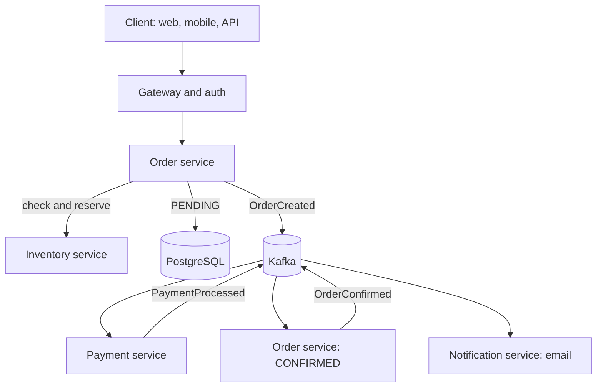

# System Design and Polyglot Idioms: Reference

Detailed catalogue, examples and evidence notes behind [SKILL.md](SKILL.md). SKILL.md holds the operating rules, prompts and blank templates and is usable alone; this file adds depth in four areas, each appearing as a subsection where it has something to say: system design, polyglot idioms, .NET and Angular, and idiom extraction.

## Idiomatic Thesis Synthesis Statement

No architecture pattern and no language idiom is correct without its conditions. The skill is matching conditions to the situation, proving the match with a gate, and writing the result in the form native to each stack.

### System design

Distributed systems trade consistency, availability, latency and cost. Advice with its conditions removed turns into ritual: CQRS for simple CRUD, event sourcing with no snapshots, push fan-out for celebrity accounts. Every recommendation therefore carries **Use when**, **Avoid when** and **Anti-pattern**, and is evaluated against the consumer's own estimates. Even a "startup MVP" row is conditional. Reliable use is: consult project and catalogue material first, check current public guidance second, and turn both into a decision backed by a verification gate.

### Polyglot idioms

Reliable cross-stack guidance is evidence-labelled, classified by stack and layer, and coupled to a gate. Executable specifications define behavior; stack-native types encode invariants; refactoring happens only behind green gates. Branded types, sealed interfaces and sentinel errors are three stack-specific forms of one move: making illegal states unrepresentable. Small Go interfaces, Java repository interfaces with constructor injection and TypeScript interface parameters are three forms of another: making dependencies visible.

### .NET and Angular

A behavior is correct only when its outcomes survive every boundary: the server decides and distinguishes them, the transport carries them with stable discriminants, the client parses them instead of assuming them, one owner holds the resulting state, and the user can perceive and recover from each one. Conservative defaults and project conventions come before catalogue snippets. A change that compiles on both sides has shown static consistency, nothing more.

### Idiom extraction

Idioms are mined, not invented: triage a high-quality codebase, extract patterns from its hotspots into a fixed schema, verify the snippets, apply them as constraints in test-first implementation, and feed failures back as new records. Prevalence across three or more codebases is what makes a pattern universal.

## Pattern Scoreboard Ranking Table

The ranking orders emphasis. The scores attached to the three guidance rules in the source material (95, 91, 88) were never measured and are kept only as an ordering. When incident data exists, rank by incident frequency or by enforcement cost (lintable rules first) instead.

### Rules that rank first in every area

| Rank | Rule | Failure it prevents |
|---:|---|---|
| 1 | Consult project and catalogue material before synthesizing | Context-free, generic advice |
| 2 | Keep observed facts, refreshed external facts and inference separate | Authority inflation; stale numbers presented as live |
| 3 | Attach every recommendation to a command, checklist item or review question | Unverifiable instruction |

### System design tiers

| Tier | Patterns | Basis |
|---|---|---|
| Default (multi-witness) | Retry discipline (exponential backoff, full jitter, budgets); circuit-breaker state machine; idempotency keys; consistent hashing with virtual nodes; saga compensation; cache-aside; quorum overlap `R + W > N` | Stated consistently in all or most of the three guides in the compendium |
| Conditional (frequent, with strong warnings) | CQRS; event sourcing; microservices; sharding; multi-leader replication; exactly-once messaging | Frequent in the guides and warned against for simple domains in the same guides |
| Contextual | Platform-specific patterns (Kubernetes workloads, cloud data-store modeling, serving patterns) | Depth in one guide; do not let that depth define the core |
| Single-witness values | A 50 percent circuit threshold; specific canary weights; probe timings | One guide; treat as an example |

Frequency inside the compendium is a proxy for importance, not a measure of the wider literature. Two of the three guides share ancestry in the same interview-method book, so their agreement is weaker than agreement that includes the technology-oriented guide. Pattern counts claimed by the guides themselves were never audited and are not repeated here.

### Polyglot tiers

| Tier | Rule | Enforcement point |
|---|---|---|
| Cross-stack families (apply first) | Explicit types at boundaries; contextual error values; constructor-injected dependencies; idempotent effects | Compile-time checks, review-visible wrapped errors, testable injected dependencies, retry-safe effects |
| Stack defaults | The keyed idioms in the catalogue below | The stack's own compiler, linter and tests |
| Narrow inferences | Anything present in fewer than three stacks | Review question only; label as narrower |

### .NET and Angular tiers

| Rank | Concern | Why first |
|---:|---|---|
| 1 | Behavior and authorization | Everything downstream inherits a wrong promise |
| 2 | Transport contract and outcome discriminants | Generation and parsing depend on it |
| 3 | Back-end outcomes, cancellation, effects | The server is the authority |
| 4 | Runtime parsing or documented atomic trust | Static types do not check deployed payloads |
| 5 | One state owner and one async model | Duplicate owners and mixed models produce stale and impossible states |
| 6 | Accessible states and recovery | The user-visible half of every outcome |
| 7 | Cross-layer test, compatibility, rollback | Proof and reversibility |

Override this order at the earliest observed failing boundary.

### System design catalogue by area

Every entry is conditional. Numbers are the catalogue's examples and are dated where they describe a product (see Evidence Boundary Notes).

#### Kubernetes pods, deployments and workloads

| Pattern | What it does | Use when | Avoid when / caveat |
|---|---|---|---|
| Sidecar | A secondary container beside the application shares network and storage to add logging, monitoring or proxying without changing the app | The cross-cutting function justifies the overhead | Simple apps; functionality unrelated to the main container |
| Ambassador | A localhost proxy handles outbound connection pooling, load balancing, authentication | Outbound dependencies need uniform handling | One simple dependency |
| Adapter | Normalizes heterogeneous application output for metrics or log systems | Disparate formats feed one collector | Formats already uniform |
| Init container | Runs to completion, in sequence, before main containers: dependency download, waiting for a service, migrations, setup | Start-up needs ordered prerequisites | Work that must repeat during runtime |
| Rolling update (`RollingUpdate`) | Kubernetes default; gradually replaces pods. Example `maxSurge: 1`, `maxUnavailable: 0` | Default zero-downtime deploys | Old and new versions cannot coexist |
| Blue-green | Deploy and test green, switch the Service/load balancer atomically | Instant rollback is worth double infrastructure | Cost-sensitive or stateful cutovers |
| Canary | Send a small share of traffic, increase only after metrics validate. Commonly 1 to 5%; one example uses 10% | Metric-gated exposure | Too little traffic for a signal |
| Progressive rollout controller (Argo Rollouts) | Weighted steps with pauses and analysis-driven rollback (example: 20%, 10m, 40%, 10m) | Rollback should be automatic on metric regression | No reliable analysis metric |
| Shadow traffic | Mirror production requests to a candidate with no user impact and compare | Behavior comparison before cutover | Requests have side effects that cannot be isolated |
| Feature toggle | Runtime exposure, trunk-based development, A/B tests | Decouple deploy from release | Toggles nobody removes |
| StatefulSet | Ordered deployment, stable identity and storage; DNS `$(podname).$(servicename).$(namespace).svc.cluster.local`; `volumeClaimTemplates` for per-pod persistence | Databases, brokers, anything needing stable identity | Stateless services |
| DaemonSet | One pod per selected node | Collectors, agents, node services | Per-request workloads |
| Job / CronJob | Parallel or indexed batch work; scheduled tasks with timezone and concurrency policy | Finite or scheduled work | Long-running services |
| Horizontal pod autoscaler (HPA) | Scales on CPU, memory or custom metrics (example: 2 to 10 replicas, 70 percent CPU) | Load correlates with the chosen metric | Latency-sensitive services where CPU is the wrong signal |
| Event-driven autoscaler (KEDA) | Scales on external metrics such as Kafka consumer lag or queue depth (example `lagThreshold: "100"`) | Queue-driven workers | No external signal |
| Pod disruption budget (PDB) | Keeps minimum availability during voluntary disruption (example `minAvailable: 2`) | Any replicated service during node maintenance | Single-replica workloads (it would block drains) |
| Network policy | Default-deny ingress and egress, then explicit allows; isolate namespaces by label | Always, in shared clusters | — |

#### Cloud platform patterns (product facts are dated to the catalogue, late 2025, and unverified since)

- **AWS Lambda cold starts:** Provisioned Concurrency pre-initializes execution environments for predictable customer-facing latency (example `ProvisionedConcurrentExecutions: 10`).
- **AWS Step Functions saga:** a state machine runs place order → reserve inventory → take payment; a failure runs the compensations in reverse.
- **AWS SNS/SQS fan-out:** one SNS topic distributes to SQS queues that process independently.
- **DynamoDB single-table design:** composite keys co-locate entities (`PK: USER#123`, `SK: ORDER#456`) so one query returns related items. **GSI overloading** reuses generic attributes to stretch the catalogue's stated limit of 20 global secondary indexes. **Adjacency list** stores both directions of a many-to-many relationship under a partition key.
- **GCP Cloud Run concurrency:** the catalogue states default 80, maximum 1000; choose from load-test results.
- **GCP BigQuery:** partition by date and cluster on up to four frequently filtered columns (`PARTITION BY DATE(timestamp_column) CLUSTER BY customer_id, product_category`).
- **GCP Spanner interleaved tables:** physically co-locate child rows with their parent for parent-child queries.
- **Azure Durable Functions:** stateful orchestration by checkpoint and replay.
- **Azure Cosmos DB consistency levels:** Strong, Bounded Staleness, Session, Consistent Prefix, Eventual; select by staleness and availability need.

#### Data stores

- **MongoDB:** embed one-to-one and one-to-few data that is read together; reference high-cardinality or frequently updated data. *Bucket* groups time series into time buckets to cut document and index counts. *Computed* stores precomputed aggregates for read-heavy expensive calculations. *Change streams* drive real-time reactions and synchronization.
- **Cassandra:** model query-first, one table per access pattern. Wide rows with clustering columns suit time series, feeds and messages. Compaction: size-tiered (STCS) for write-heavy general use, leveled (LCS) for read-heavy consistent latency, time-window (TWCS) for TTL time series. Lightweight transactions (`INSERT ... IF NOT EXISTS`) use Paxos and cost about four times the latency, per the catalogue.
- **Redis:** sorted sets for leaderboards (`ZADD`, `ZRANK`, `ZREVRANGE leaderboard 0 9 WITHSCORES`); streams for event logs and consumer groups (`XADD`, `XREADGROUP`, `XACK`); HyperLogLog for cardinality (catalogue figure: fixed 12KB, 0.81% standard error, for billions of items); locks with `SET NX PX`, a unique value and a Lua-script release.
- **Elasticsearch:** in bool queries `must` scores, `filter` skips scoring, `should` is optional, `must_not` excludes. Index lifecycle management (ILM) moves Hot → Warm → Cold → Frozen → Delete (example: roll over at 50GB, shrink after 7d, delete after 90d).
- **PostgreSQL:** partition by range (date, ID), list (discrete values) or hash (even spread). B-tree is general and covering; GIN for full text and JSONB/arrays; GiST for geometry and ranges; BRIN for large sequential data at low overhead. MVCC/autovacuum need dead-tuple and isolation tuning. Materialized views precompute expensive queries under a chosen refresh strategy.
- **MySQL/InnoDB:** the Primary/clustered index defines physical order, so choose keys for range access. Source-replica, group replication and multi-source fit different availability and scaling needs. Use an online schema-change tool (`gh-ost`, `pt-online-schema-change`) for large low-lock migrations.
- **Time series:** TimescaleDB hypertables partition automatically by time (`SELECT create_hypertable('conditions','time')`); continuous aggregates refresh incrementally (`time_bucket('1 hour', time)`); InfluxDB retention policies define lifecycle, with continuous-query downsampling.
- **Graph (Neo4j):** index, avoid scans, inspect plans with `PROFILE` / `EXPLAIN`. PageRank measures influence, shortest path routes, Louvain finds communities.
- **NewSQL:** CockroachDB multi-region clusters define node regions, survival goals (ZONE/REGION) and table locality (`REGIONAL BY ROW`, `GLOBAL`).
- **Polyglot persistence:** PostgreSQL for transactions, MongoDB for documents, Redis for cache, Elasticsearch for search. Choose per need, not per fashion.

#### Machine-learning serving

- **Feature store:** an online store (Redis/DynamoDB) targets sub-10ms inference lookups; an offline warehouse serves training. Point-in-time joins prevent label leakage. Features are computed in batch (Spark/SQL), by stream consumers (Kafka), or on demand.
- **Model serving:** shadow traffic compares predictions with no user impact; canary traffic rises only with safe metrics and a rollback; ensembles combine models for accuracy.
- **Retrieval-augmented generation:** documents → chunk → embed → vector store; query → embed → similarity search → retrieved context → prompt → response. Chunk by fixed size with overlap, by semantic boundary, or recursively by hierarchy. Hybrid retrieval combines dense embeddings with sparse BM25.
- **LLM serving:** vLLM PagedAttention pages the KV cache (the catalogue repeats a claim of 2 to 4 times throughput and near-zero waste; not measured here), continuous batching that admits and removes requests dynamically, speculative decoding in which a draft model proposes tokens the target verifies.

#### Service decomposition and communication

- **Decompose** by business capability (orders, payments, inventory; no overlapping capabilities), by domain-driven subdomain and bounded context (dedicated core, shared generic), or into self-contained vertical slices.
- **Strangler migration:** route traffic progressively from the monolith to new services. Never leave it permanently incomplete.
- **Synchronous calls** (REST/gRPC) are simple to debug but couple availability in time. **Asynchronous queues** decouple and accept eventual consistency.
- **Choreography:** services react to domain events with no controller. **Orchestration:** a coordinator owns the workflow and its visibility, at the cost of a coordination dependency.
- **Service mesh:** Envoy sidecar proxies provide mutual TLS (mTLS), retries and circuit breaking transparently. Use it for consistent cross-cutting behavior across a polyglot fleet.
- **API gateway:** back-end-for-front-end (BFF) gives mobile, web and IoT clients each a tailored gateway; aggregation combines downstream responses to cut round trips; offloading centralizes authentication, rate limits and TLS termination.
- **Service discovery:** client-side discovery queries a registry and load-balances itself (Eureka); server-side discovery puts a load balancer or platform Service in front (Kubernetes). Registries such as Consul, etcd and Eureka track instances and health.
- **Database ownership:** database-per-service preserves autonomy and API boundaries and makes cross-service joins hard; a shared database simplifies transactions, couples services and is mainly transitional.

#### Sagas, events and transactions

- **Saga:** local transactions plus compensations. Choreography fits roughly 2 to 4 services; watch for circular event dependencies and event storms. Orchestration fits complex multi-step workflows. Compensating transactions: every step needs a compensation that semantically undoes its committed effect. Avoid when immediate consistency is mandatory.
- **Event sourcing:** an append-only immutable log with schema `(global_position, stream_id, event_type, event_data, timestamp)`. Snapshot every 100 to 1000 events (catalogue example) to bound replay. Projections build query-optimized read models. Upcasting transforms old event shapes at read time.
- **CQRS:** command handlers enforce rules against a write store; asynchronous events update denormalized query models. Combined with event sourcing it enables reconstruction and new projections, and adds complexity. Avoid for simple CRUD or when strong immediate consistency is required.
- **Transactional outbox:** business row and outbox row in one database transaction; a relay publishes, then marks sent. Avoids two-phase commit (2PC); it makes the DB/message publication atomic.
- **Idempotent consumer:** records processed message IDs to tolerate at-least-once redelivery.
- **Change data capture (CDC, for example Debezium):** tails the transaction log to synchronize other systems with no application change.
- **Two-phase commit (2PC):** prepare all participants, commit only if all vote yes; blocks when the coordinator fails.

#### Data architecture and search

- **Data mesh:** domain teams own data products on self-service infrastructure. Use when a central data team cannot scale.
- **Lakehouse:** raw-data flexibility with ACID table formats (Delta Lake/Apache Iceberg). **Data lake:** native raw data with schema-on-read.
- **Search:** an inverted index maps terms to documents; BM25 ranks by term frequency, inverse document frequency and length normalization; vector search uses embeddings with approximate nearest-neighbour indexes such as HNSW.

#### Partitioning, replication, consensus and time

- **Sharding:** hash for even distribution, range for time-series and range queries, directory lookup for flexibility at the cost of a lookup service. Consistent hashing with virtual nodes minimizes key movement and balances heterogeneous nodes; the catalogue names Cassandra, DynamoDB, Discord and Akamai as hash-ring users.
- **Replication:** single leader gives strong ordering and a write bottleneck; multi-leader enables multi-region writes and requires conflict handling; leaderless uses quorums. Synchronous replication trades latency for durability; asynchronous the reverse; semi-synchronous waits for one replica.
- **Quorum:** `R + W > N` guarantees read and write sets overlap. A sloppy quorum accepts any available nodes during a partition, trading consistency for availability; hinted handoff holds writes for an unavailable node; read repair fixes replicas during reads.
- **Conflict resolution:** last-write-wins (LWW) timestamps (simple, loses data), version vectors (detect concurrency), CRDTs (merge automatically).
- **Consensus:** Raft has follower, candidate and leader states, majority election, leader heartbeats and majority-committed log replication, and is easier to follow than Paxos; the catalogue lists etcd, Consul/CockroachDB/TiKV as users. Paxos/Multi-Paxos use proposers, acceptors and learners. ZAB gives ZooKeeper a total order of updates.
- **Probabilistic structures:** a Bloom filter answers membership in O(k) with no false negatives and false-positive rate `(1 − e^(−kn/m))^k`, written `(1-e^(-kn/m))^k` in the catalogue; HyperLogLog estimates cardinality in 12KB; Count-Min Sketch estimates frequency in sublinear space; a Merkle tree compares only the hash branches that differ.
- **Clocks:** Lamport clocks update to `max(local, received)+1`; vector clocks track per-node causality and identify concurrent events at O(N) space; hybrid logical clocks (HLC) combine physical and logical time with bounded skew.
- **Coordination:** a lock is a Redis `SETNX` key with a TTL, or a ZooKeeper ephemeral node. A fencing token (monotonic) rejects stale holders. A lease expires unless renewed. A quorum or STONITH (forced fencing of the old node) prevents split brain.

#### Caching

| Strategy | Mechanics | Trade-off |
|---|---|---|
| Cache-aside | Check cache; on miss load from the database and store | Simple; stale until TTL or invalidation; first read is slow |
| Read-through | The cache loads on miss | Same as cache-aside with loading centralized |
| Write-through | Update cache and database synchronously | Consistent; slower writes |
| Write-behind | Acknowledge at once, batch database writes | Fast; possible loss on failure |
| Write-around | Write to the database only | Suits write-once data; first read misses |

Choose by read/write ratio, consistency, latency and durability needs.

- **Invalidation:** TTL is simple and stale until expiry; event or CDC invalidation reacts to source changes; version tags invalidate on mismatch. Warm/preload before traffic. Negative-cache not-found results with a short TTL.
- **Stampede control:** request coalescing (single flight) merges identical concurrent misses into one database call; probabilistic early expiration avoids synchronized expiry; a regeneration lock lets one caller rebuild; stale-while-revalidate serves the old value during refresh.
- **Tiers:** in-process L1 (about 1ms in the catalogue's ladder), distributed L2 (about 5ms), database (about 50ms). A near-cache mirrors hot distributed entries locally.
- **Eviction:** LRU, LFU, FIFO, random; choose by access pattern.

#### Messaging and streaming

- **Consumers:** competing consumers scale a queue with one consumer per message; in a log broker, members of a group compete and different groups each receive every record; an exclusive consumer preserves strict order.
- **Routing:** Fan-out/pub-sub broadcasts; topic routing supports wildcards (`*.error`, `auth.#`); content routing inspects the payload.
- **Reliability:** a dead-letter queue (DLQs in the catalogue) holds messages that exhausted retries; poison messages are isolated. Deduplicate with message IDs/idempotency (the catalogue cites a 5-minute deduplication window for SQS FIFO). Exactly-once in Kafka combines idempotent producer PID/sequence numbers, transactions and `read_committed` consumers.
- **Ordering:** FIFO queues are strict (the catalogue cites 3,000 TPS with batching for SQS FIFO); partition ordering holds for a key routed to one partition; priority queues (RabbitMQ offers 0 to 255) and delayed messages (DLX/plugins) schedule work; compacted topics keep the latest value per key.
- **Point-to-point versus publish-subscribe:** one consumer per message for work distribution; all subscribers for event notification.
- **Stream time:** event time is when it happened and gives deterministic results; processing time is when it was handled. A watermark at *t* asserts no earlier events will arrive. Late data is dropped, accepted within an allowed lateness, or sent to a side output.
- **Windows:** tumbling (fixed, non-overlapping); sliding or hopping (overlapping, for moving averages); session (closed by inactivity).
- **Lambda versus Kappa:** Lambda merges an accurate batch layer and a fast speed layer at serving; Kappa runs one replayable stream pipeline, simpler but needing a capable processor and a volume that replay can handle.
- **State:** checkpoints recover distributed state for exactly-once; savepoints support planned upgrades and migrations.
- **Joins:** stream-stream joins need time bounds; stream-table joins enrich from dimensions; temporal joins use table state as of the event time.

#### API design

- **REST:** broad, public, browser-friendly. HATEOAS embeds action links; the Richardson maturity levels run Level 0 endpoint → Level 1 resources → Level 2 HTTP verbs → Level 3 hypermedia.
- **GraphQL:** typed, solves over-fetching, suits mobile and complex data. Apollo Federation composes a supergraph in which services own types (`@key`); DataLoader batches and caches per-request lookups to solve N+1; Persisted hash queries shrink payloads and allow whitelisting.
- **gRPC:** HTTP/2 with Protobuf; typed and efficient for internal services, with limited browser support. Unary, server-streaming and bidirectional-streaming modes.
- **Realtime transports:** WebSockets are full duplex (chat, gaming, co-editing); server-sent events are one-way over HTTP with built-in reconnect (feeds, notifications); long polling is the fallback where WebSockets are unavailable and is a poor fit at high frequency.
- **Versioning:** URL (`/api/v1/`) is visible and common; header (`Accept: application/vnd.api.v2+json`) keeps URLs clean and follows HTTP semantics.
- **Pagination:** an opaque cursor stays consistent under concurrent change and suits large, fast-moving or infinite-scroll data; keyset (`WHERE id > :last_id ORDER BY id LIMIT 20`) is index-efficient; offset (`LIMIT n OFFSET m`) is simple, allows random page access and degrades at large offsets (`OFFSET 10000`).
- **Rate limiting:** token bucket (fixed refill, permits bursts), leaky bucket (smooth output), fixed window (cheap, bursts at boundaries), sliding log (accurate, memory-heavy), sliding counter (weights previous and current windows; balanced). A distributed limiter needs Redis/Lua (Redis + Lua for atomicity), not per-process state.
- **Idempotency keys:** the server stores the response under a client-supplied unique key (the catalogue's payment example caches a UUID-keyed response for 24h) so a retry returns the same result. The catalogue attributes mandatory `Idempotency-Key` headers on writes to Stripe.
- **ETags:** `If-None-Match` validates a cache; `If-Match` rejects a concurrent update.

#### Resilience

- **Circuit breaker:** CLOSED counts failures, OPEN fails fast, HALF-OPEN probes recovery. Opens on a failure ratio or a slow-call ratio. One guide's Resilience4j example: threshold 50%, open wait 30s, sliding window 10, minimum 5 calls. The 50% figure appears in one guide only. Use for external dependencies, not local operations.
- **Bulkhead:** thread-pool bulkheads isolate a dependency's capacity; semaphore bulkheads cap concurrent calls with less overhead and suit reactive code.
- **Retry:** see Retry Backpressure Guidance.
- **Timeouts:** inner shorter than outer (edge 60s → gateway 55s → service 50s → DB 30s); propagate the remaining deadline via `X-Request-Deadline`.
- **Fallback:** static defaults, stale cache, progressive degradation that preserves core behavior.
- **Load shedding and admission control:** drop work at overload; gate at entry; priority shedding protects higher-tier traffic.
- **Failover:** active-passive (RTO of minutes to hours), active-active (near-zero RTO), pilot light (a minimal core and database replica scaled up after a disaster).
- **Chaos engineering:** Chaos Monkey terminates instances; fault injection covers CPU/network/disk; GameDays rehearse response. Chaos Mesh supplies NetworkChaos (partitions), StressChaos (exhaustion) and PodChaos (failures) against a steady-state hypothesis. Platform self-healing restarts and reschedules through probes.

#### Security

- **Authentication:** authorization code with PKCE for interactive clients (the catalogue states it is required under OAuth 2.1; a random `code_verifier`, for example 128 characters, and a SHA-256 `code_challenge` prevent interception). Client credentials for machine-to-machine. JWTs: asymmetric signing (RS256), minimal claims, verification on every request, expiry of 15 to 30 minutes. WebAuthn/FIDO2 is phishing-resistant, domain-bound and passwordless. Rotate refresh tokens on every use and revoke the family on reuse.
- **Authorization:** RBAC for clear organizational roles; ABAC for dynamic rules over user, resource and environment attributes; ReBAC (Zanzibar style) for hierarchical and shared resources.
- **API security:** blanket, per-endpoint and suspicious-source rate limits; validate types, patterns, sizes and schemas and reject unexpected content; restrict CORS origins and never use `*` for authenticated APIs.
- **Secrets:** Vault issues dynamic credentials, including temporary DB credentials, with rotation and audit logs. Envelope encryption uses a unique DEK per object, AES-GCM for the data, and a KEK/KMS-wrapped DEK; rotating the KEK re-encrypts only the DEKs.
- **Network:** zero trust authenticates continuously regardless of network position; Defense in depth layers WAF, VPC, AuthN/AuthZ and encryption; mTLS authenticates both ends; SPIFFE/SPIRE issues short-lived X.509/SVID workload identities with rotation.

#### Observability

- **Tracing:** propagate `traceparent` and `tracestate`. Head sampling is simple and misses rare failures; tail sampling waits for the trace to complete and keeps errors and slow traces (example threshold 5000ms) at the cost of buffering. A span may carry domain attributes such as `order.id`.
- **Metrics:** four golden signals (P99 latency, Traffic/QPS, errors, saturation); RED (Rate/Errors/Duration); USE (Utilization/Saturation/Errors). Avoid unbounded labels (`user_id`, `request_id`); label cardinality under 100 per label and total series under 10 million.
- **Logs:** JSON with timestamp, level, service, trace ID and message; correlation IDs/trace and span IDs connect records across services.
- **Alerts:** symptoms over causes; multi-window burn rate (14.4× over 1 h pages, 6× over 6 h tickets); the error budget is `1 - SLO`; freeze feature releases when it is exhausted. At a 99.9% SLO and 10M monthly requests, 10,000 failures are allowed; the 14.4× expression can be `error_rate > (14.4 * 0.001)`. PromQL error rate: `sum(rate(http_requests_total{status=~"5.."}[5m])) / sum(rate(http_requests_total[5m]))`; P99: `histogram_quantile(0.99, rate(http_request_duration_seconds_bucket[5m]))`.

#### Storage and database internals

- **Storage types:** object storage (S3) is flat and unstructured, quoted at 11 nines durability, for archives, media and lakes; block storage is low-latency direct I/O for DBs/VMs; file storage is hierarchical NFS/SMB for shared and legacy applications.
- **Tiering:** hot on NVMe for active data, warm on standard SSD for roughly 30 to 90 days, cold on HDD/archive. Access-based tiering moves objects automatically (S3 Intelligent-Tiering).
- **Write-ahead log (WAL):** log durably before applying to data files; the basis of crash recovery and replication.
- **LSM versus B-tree:** LSM (memtable → SSTable → compaction) favors sequential writes and compression and pays in compaction (RocksDB/Cassandra); B-tree favors reads and in-place O(log n) updates with lower write amplification (PostgreSQL/MySQL).
- **Erasure coding:** split into *k* data and *m* parity fragments; any *k* reconstruct. Roughly 50 percent overhead against 200 percent for triple replication. The catalogue's Reed-Solomon examples are Backblaze 17+3 and Facebook cold storage.
- **Indexes:** covering indexes enable index-only scans; partial indexes shrink the index and improve cache efficiency.

#### Networking and traffic

- **Load balancing:** L4 routes by IP:port, fast and protocol-agnostic, suited to non-HTTP/DB traffic (AWS NLB); L7 inspects URL/headers/cookies and terminates SSL (AWS ALB). Algorithms: round robin (simple), weighted (capacity-aware), IP hash (client persistence), least connections (variable or long requests), least response time (latency-sensitive), power of two choices, P2C (the less loaded of two random servers, O(1)), consistent hashing (caches).
- **Mesh implementations** (dated product facts): the Istio control plane (Istiod) distributes xDS configuration to Envoy sidecars; Istio weights versions for canaries and injects delay or errors. Linkerd provides automatic mTLS with 24-hour certificate rotation from ServiceAccounts. Cilium uses eBPF identity policy and socket-level kube-proxy replacement.
- **DNS and edge:** GeoDNS maps clients to nearby regions; health-checked DNS failover removes failed endpoints. CDN hierarchy: edge → regional → origin shield → origin, where the shield consolidates misses. Edge functions (Lambda@Edge) run authentication, A/B assignment and personalization.
- **Proxies and connections:** a reverse proxy load-balances, terminates TLS and caches. HTTP/2 multiplexes streams over one TCP connection. PgBouncer may serve thousands of application connections with 100 DB connections.

#### Scaling and batch

- **Horizontal** adds instances and requires statelessness; **vertical** adds CPU/RAM up to a hardware ceiling and leaves a single point of failure (SPOF); **diagonal** optimizes one node, then clones it.
- Vertical suits early, stateful or legacy systems. Horizontal suits high-availability and read-heavy systems.
- **Autoscaling:** reactive on CPU/memory/queue depth (AWS target-tracking example: CPU 50 with 300s scale-in and scale-out cooldowns); predictive forecasting (example: 14 days of history forecasting 48h); scheduled for known spikes such as Friday/e-commerce peaks; scale-to-zero (Knative) for idle cost.
- **Read replicas** spread reads, not primary writes; a Master-slave, read-heavy (90 percent and above) workload fits, but replica lag makes immediate read-after-write unsafe. Shard when write scale requires it.
- **Cells** limit blast radius; **shuffle sharding** isolates tenants; jitter prevents synchronized load.
- **Batch:** Fan-out/scatter-gather parallelizes then aggregates, and total latency is the slowest worker; MapReduce separates parallel transformation from aggregation.
- **Queue technology selector** (catalogue-era guidance): Kafka for highest throughput, replay and per-partition ordering; RabbitMQ for low-latency task queues and per-queue ordering; SQS for managed, serverless operation and FIFO. Point-to-point is SQS/RabbitMQ; publish-subscribe is SNS/Redis/Kafka.

#### Coordination, CAP examples and estimation constants

- **Redlock:** across independent Redis clients, set a unique UUID with `SET NX PX` and require a quorum of `len(clients)//2+1`. Suitable for efficiency and duplicate prevention, not correctness-critical coordination; a single Redis is a SPOF. ZooKeeper ephemeral sequential nodes coordinate more strongly at operational cost.
- **Vector clocks** classify two events as BEFORE/AFTER/CONCURRENT at O(N) storage; the catalogue points to DynamoDB/Riak-style conflict detection.
- **CAP examples in the catalogue:** CP stores (MongoDB/HBase/etcd/Redis) reject or block writes during a partition; AP stores (Cassandra/DynamoDB/CouchDB) accept and resolve later. Banking/inventory choose CP; social feeds and DNS choose AP. PACELC: under Partition choose A/C, Else latency or consistency. Product classifications like these depend on configuration and version; treat them as dated.
- **Trade-off statement form:** state X versus Y, give pros and cons, relate them to requirement Z, recommend, then say what is lost.
- **Cache specifics:** cache-aside always sets a TTL (example 600s); write-through must handle the cache-success/DB-failure partial; write-behind is wrong for financial durability and must persist its dirty-key list or a crash loses everything; evict LRU for temporal sessions and views, LFU for enduring popularity, FIFO for time-sensitive logs, random for uniform access.
- **Sharding specifics:** range sharding hotspots recent data; hash sharding harms range queries and modulo rehashing moves everything; directory sharding suits complex or multi-tenant routing, and the directory is a bottleneck that must be replicated. Master-master enables multi-region writes and requires conflict handling.
- **Event sourcing:** immutable audit and rebuildable state; avoid for simple CRUD/high-frequency cases.
- **Fault-tolerance examples:** retry at most 5 with full jitter capped at 60s; liveness (initial 15s, period 10s, threshold 3) detects deadlock; readiness (initial 5s, period 5s) gates traffic and checks dependencies; a startup probe covers slow initialization.
- **Estimation examples:** 1M requests/day ≈ 12 QPS; 1M× 10 actions ≈ 115 QPS; 10M× 50 ≈ 5,800; 100M× 100 ≈ 115,740. Peak is 2 to 3 times average, or 10% of daily traffic in one hour. Servers: peak QPS/QPS per server (typically 1,000 to 2,000), times a safety factor of 1.3 to 2.0. `Cache size=daily reads×average size×0.20` under an 80/20 assumption. `Ingress=write QPS×request size`; egress is read QPS × response size. Replication typically ×3; annual ×365.
- **Availability arithmetic:** 99% = 3.65d/year, 99.9% = 8.76h, 99.99% = 52.6m, 99.999% = 5.26m.
- **Latency ladder as printed:** L1 0.5ns, L2 7ns (another guide ~4ns), memory 100ns, SSD 4KB read 150µs, HDD seek 10ms, 1MB over network 10ms, same-datacenter RTT 500µs, cross-region 100 to 300ms, cross-continent 150ms. 2^10 = 1KB, 2^20 ≈ 1MB, 2^30 ≈ 1GB, 2^40 ≈ 1TB.
- **Interview time split:** two budgets, one per interview length. 45 minutes: clarify 5 to 8m, high-level design 10 to 15m, deep dive 15 to 18m, wrap-up 5 to 10m. 60 minutes: clarify 5 to 10m, high-level design 15 to 20m, deep dive 20 to 25m, wrap-up 5 to 10m. Ask scale, consistency versus availability, and read/write ratio; get buy-in; then APIs/data flow, schemas, algorithms, edge cases, trade-offs, bottlenecks. The phase table is under "System design: interview flow".

#### Selection by stage (the compendium's closing guide)

Start simple, measure actual usage, evolve by consistency, availability, latency, scale and cost.

| Stage | Scaling | Database | Cache | Messaging |
|---|---|---|---|---|
| MVP | Vertical | PostgreSQL | Redis cache-aside | None |
| Growing SaaS | Horizontal | PostgreSQL with replicas | Redis write-through | RabbitMQ |
| Social | Horizontal | Cassandra (AP) | Multi-tier plus CDN | Kafka |
| Finance | Vertical, HA | PostgreSQL (ACID) | Write-through | Kafka exactly-once |
| E-commerce | Horizontal | MySQL, Redis, Elasticsearch | Cache-aside plus CDN | SQS and SNS |

#### Quick reference by need

| Need | Choices |
|---|---|
| High availability | Circuit breaker, bulkhead, async messaging; cells and shuffle sharding |
| Zero-downtime deploys | Blue-green, canary, rolling |
| Multi-tenant isolation | Cell architecture, shuffle sharding |
| Real-time analytics | Redis Streams, Kafka, materialized views |
| Global distribution | Multi-region, eventual consistency, CDN |
| High write volume | LSM storage, write-behind, async messaging |
| Strong consistency | 2PC, single leader, synchronous writes |
| Cost | Spot/reserved capacity, tiered storage, deduplication, erasure coding |

#### Technologies, standards and authorities the compendium names

Kubernetes, AWS, GCP, Azure, PostgreSQL, MongoDB, Redis, Elasticsearch, OpenTelemetry, OAuth 2.1, W3C Trace Context, CNCF; Kafka, RabbitMQ, SQS, Flink, Kafka Streams, Spark Streaming, Elasticsearch/OpenSearch/Solr, InfluxDB/TimescaleDB/Prometheus, Neo4j/Neptune/JanusGraph. Books and practices: Google SRE, the Amazon Builders' Library, *Release It!*, *Designing Data-Intensive Applications* (Kleppmann), Alex Xu's interview volumes, and Jeff Dean's latency numbers. Engineering practices are attributed to Netflix, Uber, Airbnb, Stripe, Discord, Pinterest, LinkedIn, Shopify and Meta. All of these are names the compendium cites; none was retrieved, so each is a lead for refresh, not a verified authority.

### Polyglot idiom catalogue by section key

Keys (TS.x, J.x, G.x, D.x, K.x) make a borrowed idiom auditable: cite the key in the answer. Version and tool details are those of the handbook (2024 to 2025) and need a freshness check before they are enforced.

#### TypeScript and JavaScript

| Key | Idiom | Use when → form | Avoid / anti-pattern |
|---|---|---|---|
| TS.0 | Workspace setup | Compiler: `strict`, `noUncheckedIndexedAccess`, `noImplicitReturns`, `noFallthroughCasesInSwitch`, `noImplicitOverride`, `exactOptionalPropertyTypes`, `noPropertyAccessFromIndexSignature`, consistent file casing; ES2022 target, bundler resolution, declarations and source maps, `skipLibCheck`. Aliases `@/*`, `@components/*`, `@utils/*`, `@types/*`. Lint with strict type-checked rules plus a formatter: no explicit `any`, explicit return types, nullish coalescing and optional chaining. Monorepo task runners cache build and test; the dev task is persistent and uncached. Test runner: Node environment, `src/**/*.{test,spec}.{ts,tsx}`, V8 coverage in text, JSON and HTML, thresholds of 80 for lines, functions, branches and statements, a setup file | `../../../` imports; loosening `strict` per file |
| TS.1 | Branded types for domain IDs | `type UserId = string & { readonly brand: unique symbol }`; constructors may validate a prefix (`usr_`, `ord_`); prove rejection with `@ts-expect-error` | Plain strings, which allow IDs to be mixed at runtime |
| TS.2 | Discriminated unions for state machines | Literal `status` union (`idle | loading | success(data) | error(error)`), timestamps where useful, legal transitions enforced (success only from loading) | Boolean flags allowing `loading && error` or success without data |
| TS.3 | Const assertions | `['GET','POST'] as const`; `typeof methods[number]` for the union; action unions | Verbose manual `readonly` annotations |
| TS.4 | Type predicates | Return `person is Admin` (or guard `unknown`) so `filter(isAdmin)` yields `Admin[]` | A plain `boolean` guard, which does not narrow |
| TS.5 | Constrained generics | `K extends keyof T` for property access; `T extends object` for merges; `T extends { id: string }` for repositories; intersections for IDs and timestamps | `any` |
| TS.6 | Template literal types | Exact routes, events and style names (`/${'v1'|'v2'}/${Resource}`, `on${Capitalize<T>}`); recursive `ExtractParams<'/users/:userId/orders/:orderId'>` yields `'userId' | 'orderId'` for a type-safe URL builder | Free-form strings for structured names |
| TS.7 | Runtime schema validation with inferred types | Validate all external data; infer the type from the schema; `parse` throws, `safeParse` returns a result. Example user schema: UUID id, email, name of 1 to 100 characters, optional integer age 0 to 150, role enum, coerced date | `json as User` |
| TS.8 | Async error handling | A `[data, null] | [null, Error]` tuple helper, a typed `AsyncResult`, or `Promise.allSettled` for independent partial failures; normalize unknown throws to `Error`; log failed IDs | Unhandled rejections |
| TS.9 | Typed custom hooks | A generic `useAsync<T, Args>` returning `data`, `error`, `isLoading`, `execute`, `reset`, with `onSuccess` and `onError`; reset clears state; no updates after unmount. `useDebounce` cleans its timer; `useLocalStorage` guards server rendering and JSON failure | Untyped hook returns; timers with no cleanup. For React depth use `react-frontend` |
| TS.10 | Module augmentation | Declaration-merge the framework request type (`user`, `requestId`), a global config object, or an HTTP client config (`retry`, `retryDelay`) | Editing dependency sources |
| TS.11 | Mapped types | `Partial`, `Required`, `Readonly`, `Pick`, `Omit`, plus project helpers (`RequireKeys`, `Nullable`, recursive `DeepPartial`, `Mutable`), form state (`values`, `errors`, `touched`, `dirty`), key prefixing, `KeysOfType` | Hand-duplicated variants of one shape |
| TS.12 | `infer` in conditional types | `ReturnType`, `Parameters`, array and promise unwrapping (`Awaited`, nested), component props, API response data, event-map handlers | Manual type restatement |
| TS.13 | Function overloads | Overload signatures before the implementation when the input shape selects the return type (`fetchData(string | string[])`); generic event emitters with typed argument tuples | Overloads where a union return is honest |
| TS.14 | `satisfies` | Check a record, theme or route table while keeping literal inference; catches wrong tuple length and unknown keys | An annotation, which widens literals |
| TS.15 | Testing | Typed mock functions, mocks cleared in `beforeEach`, behavior assertions, role and label queries with user-event simulation and `waitFor` for components | Asserting private calls |

Further TypeScript forms from the broader catalogue:

- **Layer model.** L1 language (types, generics, inference), L2 runtime built-ins, L3 ecosystem packages.
- **Dependency injection.** A service takes its database and mailer as constructor-parameter interfaces; tests pass typed doubles.
- **Error classes.** A base application error with `code`, `statusCode`, `timestamp` and `context`; a validation error subclass carrying field details. A validation middleware returns 400 with flattened details. A library `ResultAsync` supports railway-style chaining.
- **`Result` helpers.** `ok`, `err`, `map`, `flatMap`, `unwrapOr`, `isOk`, `isErr`.
- **Password schema example.** Normalized email; password of at least 8 characters with upper case, lower case and a digit.
- **Fluent builder.** For multi-step object construction with validation at `build()`. When a generated schema exists, let `build()` call the schema's `parse` so one boundary owns validity (see "Schema-validated resource stack builder" under the extracted idioms).
- **Async control.** Debounce and throttle with `cancel` and `flush`; a bounded async queue or limiter (example concurrency 5, timeout 10 s); in the browser, a bounded worker pool that queues when every worker is busy (see "Bounded browser worker pool" under the extracted idioms); `AbortController` to cancel superseded or unmounted requests and to time out a fetch.
- **Server-state library defaults (React, comparison only).** Stable key factories, 5-minute stale time, `enabled: !!id`, invalidation after mutation, optimistic update with snapshot, rollback and refetch. Compound components use a typed context and throw when used outside the provider.

Plain JavaScript idioms: `const` by default and strict mode; `Object.freeze` for configuration; `Object.fromEntries` to rebuild objects; `at(-1)`; `Object.groupBy`; `reduce` for aggregates; currying; `pipe` and `compose`; async generators for paginated sources; `Promise.withResolvers`; a `Proxy` for validation on assignment; `WeakMap` or `#private` for private state.

#### Java and Spring Boot

| Key | Idiom | Use when → form | Avoid / anti-pattern |
|---|---|---|---|
| J.1 | Records | DTOs, value objects, projections. Compact constructors normalize email and name, require non-null, validate `Money` as non-negative with scale 2, reject mixed currencies; operations return new values | Mutable setter POJOs |
| J.2 | Sealed hierarchies | Events (`OrderCreated`, `Confirmed`, `Shipped`, `Delivered`, `Cancelled`) switched exhaustively without `default`; sealed `Result.Success` / `Failure` with `map` and `flatMap` | Open hierarchies with a silent `default` |
| J.3 | `Optional` | Return type only; `map`, `flatMap`, `filter`, `orElseGet`, `orElseThrow`, `ifPresentOrElse`; collections return empty | `Optional` parameters or fields; unchecked `.get()` |
| J.4 | Dependency injection | Constructor injection only; segregated `UserReader` and `UserWriter` | Field injection |
| J.5 | Profiles and configuration | `@ConfigurationProperties` with `@Validated` (example: pool size 1 to 100, duration at least 1 s); `${DB_PASSWORD}` from the environment; profile-specific beans (a real broker outside tests, a mock in tests); `@ConditionalOnProperty` and `@ConditionalOnMissingBean` | Hardcoded secrets |
| J.6 | JPA entities | UUID IDs, non-null and unique columns, enum strings, managed bidirectional relationships, `@Version`, creation and update timestamps, protected constructor plus factory, equality on ID with a class-based hash. Fetch joins or `@EntityGraph(attributePaths = {"orders", "orders.items"})` against N+1 | Equality on mutable fields; lazy loads in loops |
| J.7 | Reactive | `Mono` for 0 to 1, `Flux` for 0 to N; not-found maps to 404, duplicate to 409; compose with `Mono.zip`; non-blocking repository and service | A blocking call inside a reactive chain |
| J.8 | Testing | Unit tests with mocks and no context, parameterized cases; full-context tests with a containerized database for persistence; web-slice tests asserting 200, 404 and 400 for an invalid body | Loading the whole context for a unit test |
| J.9 | Virtual threads (Java 21 and later) | High-throughput I/O-bound blocking work: enable the framework's virtual-thread property or a virtual-thread-per-task executor; bound waits (example 5 s); structured concurrency scopes (a preview feature in Java 21); final immutable state; a thread-safe cache (example 10,000 entries, 5-minute expiry) | Expecting CPU speedup |
| J.10 | Streams | Pure transform, filter, group, partition, flatMap, reduce; `.toList()` (Java 16 and later); `Collectors.teeing` (12 and later); merge functions for duplicate keys; parallel only for large inputs (example threshold 10,000) | Side effects in `forEach` |

Spring forms from the broader catalogue:

- **Controller conventions.** Versioned mapping, `@Valid` bodies, 201 with a `Location` header on create.
- **Error mapping.** One `@ControllerAdvice` maps not-found to 404 and validation to 400.
- **Transactions.** `@Transactional` with explicit `propagation`, `isolation` and `rollbackFor` on service methods.
- **Dynamic queries.** `Specification` predicates.
- **Security.** Stateless JWT configuration with every endpoint covered.
- **Remote calls.** Circuit breaker, retry and time limiter composed, with a fallback returning a typed failure.
- **Persistence tests.** A containerized database (the catalogue pins PostgreSQL 15).
- **Pattern matching.** Record and type patterns over sealed shapes.
- **Grouping.** `groupingBy` with downstream collectors.

#### Go

| Key | Idiom | Use when → form | Avoid / anti-pattern |
|---|---|---|---|
| G.1 | Error wrapping | Sentinel errors (`ErrNotFound`, `ErrUnauthorized`, `ErrInvalidInput`, `ErrConflict`); `fmt.Errorf("finding user %s: %w", id, err)`; `errors.Is` / `errors.As`; `errors.Join` (Go 1.20 and later) for validation aggregates | Ignored errors; panic for recoverable failures |
| G.2 | Context | First parameter; check `ctx.Err`; pass to database and client calls; derive a request timeout (example 5 s) and `defer cancel()`; typed context keys, sparingly, for request and user IDs | Replacing the caller's context with `context.Background()` |
| G.3 | Goroutines and channels | Worker pool, fan-out and fan-in that select on `ctx.Done()`; close jobs and results after the `WaitGroup`; `errgroup.WithContext` cancels siblings on first error | A sender on an unread unbuffered channel (leak); give it a receiver or a buffer of 1 |
| G.4 | Interface design | Small interfaces (`Reader`, `Writer`); accept interfaces, return concrete structs; constructor injection; functional options (`WithTimeout`, `WithRetries`, `WithLogger`) | Huge exported manager interfaces |
| G.5 | Table-driven tests | Named subtests: regular, premium at 10 percent, VIP at 20 percent, negative amount returning `ErrInvalidAmount`, unknown type returning `ErrUnknownUserType`, zero allowed; assert errors, values and interactions | One assertion-heavy test per function |
| G.6 | HTTP handlers | Path values from the standard router (Go 1.22); decode and validate; JSON with content type and status; sentinel and deadline errors map to 404, 401, 504; unknown errors map to 500 without detail; middleware for request ID, access log and panic recovery. Routes such as `GET /api/users/{id}` | Leaking internal error text |

Also: `sync.Once` for one-time initialization; `sync.Pool` with reset before reuse; generic constraints over underlying types; DTO tags such as `json:"email" validate:"required,email"`. The proverbs that guide style: clear is better than clever; a little copying is better than a little dependency; make the zero value useful; errors are values; handle errors immediately; composition over inheritance.

#### Infrastructure

| Key | Idiom | Form | Avoid / anti-pattern |
|---|---|---|---|
| D.1 | Terraform modules | Typed, documented, validated inputs; outputs; provider and tool constraints (example `required_version >= 1.5`, provider `~> 5.0`). High-availability examples require at least two zones or subnets; default network `10.0.0.0/16`; merged common tags (`ManagedBy = terraform`). A managed-Kubernetes module validates name length (at most 40) and version (at least 1.27), encrypts secrets, uses a private endpoint and control-plane logs, typed node groups and a sensitive certificate output. Remote state in an encrypted bucket with a lock table | Hardcoded values; unpinned providers |
| D.2 | Docker multi-stage builds | Separate dependency, build and runtime stages; cache `go.mod` or `package*.json` first; compile Go with `CGO_ENABLED=0 GOOS=linux -ldflags="-s -w"`; distroless or slim non-root runtime; health check; production-only Node dependencies | Single-stage `npm install` images carrying dev dependencies |
| D.3 | Kubernetes deployment | Rolling update, 3 replicas, `maxSurge: 1`, `maxUnavailable: 0`; non-root, read-only root filesystem, drop all capabilities; secrets by key reference; example requests 100m / 128 Mi and limits 500m / 512 Mi; liveness `/healthz` (initial 15 s, period 20 s, timeout 5 s, 3 failures), readiness `/ready` (5 s, 10 s, 3 s, 3); disruption budget `minAvailable: 2`; autoscaler 3 to 10 at 70 percent CPU and 80 percent memory; anti-affinity, topology spread, scrape annotations | No limits; one probe for everything; root containers |
| D.4 | GitHub Actions CI/CD | Run on pushes to main and develop and on pull requests to main; cancel superseded runs; pinned toolchains (example Go 1.22, Node 20) with caching; lint with a 5-minute timeout; a database service container with health checks; `go test -v -race -coverprofile=coverage.out ./...`; fail on coverage upload failure; cached image builds; registry login with the workflow token; branch, pull-request, SHA and semver tags; deploy from main only | Long-lived cloud credentials in secrets |

GitOps controllers and a chart-plus-overlay layout are the handbook's deployment recommendation; an infrastructure-as-code alternative in a general-purpose language is listed as acceptable.

#### Kafka

| Key | Idiom | Form | Avoid / anti-pattern |
|---|---|---|---|
| K.1 | Idempotent producer | `enable.idempotence=true`, `acks=all`, retries `Integer.MAX_VALUE`, max in-flight 5; delivery timeout 120,000 ms, request timeout 30,000 ms; batch 16,384 bytes, linger 10 ms, snappy compression, 32 MB buffer. Handle async futures; bound synchronous sends (10 s); aggregate batch futures | Fire-and-forget; silently dropped send errors |
| K.2 | Consumer group with manual commit | Auto-commit off; purpose-named group; max poll 100, poll interval 300,000 ms, session 45,000 ms, heartbeat 15,000 ms, reset `earliest`; concurrency 3 with immediate manual acknowledgment; 3 retries with 1 s backoff, then dead-letter topic. Deduplicate by topic, partition and offset; mark processed before acknowledging; acknowledge only after success; rethrow retryable errors for redelivery | Auto-commit with non-idempotent processing |
| K.3 | Streams with windowing | Exactly-once processing guarantee; hourly tumbling counts per customer; 5-minute windows advancing by 1 minute with 1 minute of grace for revenue; materialized state stores; versioned output topics; `mapValues` transforms; stream-table joins for enrichment | Unbounded stream-stream joins |
| K.4 | Schema registry | Registry-governed evolution and typed serialization. Example `OrderCreatedEvent`: IDs, item array (`productId`, integer quantity, decimal bytes with precision 10 and scale 2), total with precision 12 and scale 2, millisecond timestamp, version defaulting to 1. Registry-aware serializer and deserializer, specific reader, topic-record naming strategy | Ungoverned schema changes |
| K.5 | Testing | An embedded broker with 3 partitions and a dead-letter topic; await processing for at most 10 s and assert state; a malformed event must produce exactly one dead-letter record. Alternative: containerized broker and registry (the handbook pins 7.5.0 images) | Mocking the broker client for integration claims |

Also from the broader catalogue: producer transactions for atomic multi-record writes; dead-letter headers `original-topic` and `error-message`; an outbox table read by a log-tailing connector, with columns for aggregate type, aggregate ID, event type and payload.

#### MERN comparison layer (thin; attach a confidence warning)

- **MongoDB:** embed data read together, reference high-cardinality or independently updated data; aggregation pipelines for reporting.
- **Express:** an async wrapper that forwards rejections to error middleware; one error-handling middleware; JWT verification middleware.
- **React:** context for authentication state; query keys for server state; schema-validated forms.
- **Tests:** component tests by role and label; HTTP tests against the app with an in-process client.
- For anything beyond comparison, use `typescript-backend` and `react-frontend`.

#### Tool choices recorded in the handbook (2024 to 2025; verify before adopting)

| Category | Primary | Alternative |
|---|---|---|
| TypeScript testing | Vitest | Jest |
| TypeScript validation | Zod | Yup, Valibot |
| Client and server state | Zustand, TanStack Query | Redux Toolkit |
| Java build | Gradle (Kotlin DSL) | Maven |
| Java testing | JUnit 5, AssertJ, Testcontainers | — |
| Go testing | testify, gomock | — |
| Go linting | golangci-lint | — |
| Infrastructure as code | Terraform | Pulumi, CDK |
| Kubernetes delivery | Helm, Kustomize, Argo CD | Flux |
| CI/CD | GitHub Actions | GitLab CI |
| Kafka testing | Testcontainers | EmbeddedKafka |
| Kafka schema | Avro with Schema Registry | Protobuf |
| Observability | OpenTelemetry with Grafana | Datadog |

### Polyglot: concrete forms from the broad catalogue

The keyed tables above give each idiom once. The broader catalogue is a second witness for many of them and adds the concrete forms below. Where it differs from the keyed handbook (retry helper, probe values, memory limit, topic naming, interface prefix) both are kept; the selectors are in SKILL.md section 12.

#### TypeScript

- **Naming.** Types and interfaces descriptive PascalCase (`UserAuthenticationState`); functions and variables camelCase (`fetchUserProfile`); constants `MAX_RETRY_COUNT`; generics `T` or descriptive (`TResponse`, `TError`).
- **Non-negotiables.** Type safety over runtime checks; layered dependencies (L1 TypeScript primitives → L2 Node.js built-ins → L3 npm ecosystem), preferring the lower layer unless ecosystem functionality is needed; interface-based injection for mocking; TC39 Explicit Resource Management (`using`); structured errors (Result or custom classes); discriminated unions for complex domains; Promise/async-await with correct propagation; performance claims validated with benchmarks.
- **Layer example.** L1 `type UserId = string & { readonly brand: unique symbol }; type Optional<T> = T | null | undefined;`. L2 `EventEmitter`, `createHash`. L3 `zod`, `effect` (`Effect`, `pipe`).
- **Injection.** `interface IDatabase { query<T>(sql: string, params?: unknown[]): Promise<T[]> }`, held as `private readonly db`, tested with `jest.fn().mockResolvedValue(...)`. (This catalogue uses the `I` prefix; the handbook forbids it.)
- **Structured errors.** `Result<T,E> = {ok:true,value:T}|{ok:false,error:E}`. `parseJSON<T>` catches `JSON.parse` and returns the `SyntaxError` in the error branch. `AppError(message, code, statusCode=500)` sets `name` to the subclass name; `ValidationError(errors)` uses code `VALIDATION_ERROR`, status 400, and joins the messages.
- **Branded IDs.** Use to prevent primitive obsession; avoid for simple prototypes and internal-only code. `createUserId` rejects anything that is not a UUID (accepts `550e8400-e29b-41d4-a716-446655440000`) and casts; `getUser(id: UserId)` cannot receive an arbitrary string.
- **State union.** `ApiState<T> = {status:'idle'} | {status:'loading'} | {status:'success';data:T} | {status:'error';error:Error}`; avoid when a simple boolean is sufficient.
- **Mapped, conditional and template types.** `Readonly<T>`, `Partial<T>`, `Required<T>`, `RequireKeys<T,K> = T & Required<Pick<T,K>>`; `NonNullable<T>`; `ExtractPromise<T>`. Route typing: `HttpMethod = 'GET'|'POST'|'PUT'|'DELETE'`, an `ApiRoute` template beginning `/api/`, and `Endpoint` as `${HttpMethod} ${ApiRoute}`, so `GET /api/users` is valid but `PATCH /users` is not.
- **neverthrow.** `divide(a,b)` returns `err('DIVISION_BY_ZERO')` for zero, otherwise `ok(a/b)`, and chains with `.map` / `.mapErr`.
- **Zod.** `z.object({email:z.string().email(), age:z.number().min(0).max(120), role:z.enum(['admin','user','guest'])})`; `z.infer` for the type; `safeParse` success becomes `ok(data)`, failure `err(zodError)`.
- **Fluent HTTP builder.** Defaults: method `GET`, empty URL, empty headers, optional body; setters return `this`; `build()` rejects a missing URL and returns `{method,url,headers,body}`. Use: `new HttpRequestBuilder().setMethod('POST').setUrl('/api/users').addHeader('Content-Type','application/json').setBody({name:'Test'}).build()`.
- **`Promise.allSettled`.** Map each settled result to `Result<User,Error>` keyed by the original ID (`fulfilled` → `{ok:true,value}`, rejected → `{ok:false,error}`).
- **Timeout.** `fetchWithTimeout<T>`: create an `AbortController`, schedule `controller.abort()` after `timeoutMs`, pass `signal` to `fetch`, always `clearTimeout` in `finally`.
- **Basic retry.** `withRetry(fn,{maxAttempts,baseDelayMs})` waits `baseDelayMs * 2^attempt` between non-final attempts, then throws the last error. It has no cap, jitter or retryability filter: a teaching form, not a production one.

#### JavaScript

- **Naming.** camelCase variables and functions; PascalCase classes; SCREAMING_SNAKE_CASE constants; `#` private fields.
- **Non-negotiables.** `const` over `var`; `'use strict';`; explicit try/catch/finally; immutable updates (`Object.freeze`, spread); pure functions where possible; defensive parameter validation; `WeakMap`/`WeakRef` for memory-conscious caches; benchmark critical paths.
- **Objects.** `Object.freeze({apiUrl:'https://api.example.com', timeout:5000})` (mutation throws in strict mode). `Object.fromEntries(new URLSearchParams('name=John&age=30'))` yields string values; transform with `Object.entries(...).map(([k,v])=>[k,Number(v)*2])`.
- **Arrays.** `arr.at(-1)`, `arr.at(-2)`. ES2024 `Object.groupBy(users, user => user.role)` → `{admin:[Alice,Charlie], user:[Bob]}`. `reduce` for keyed aggregates: start `acc[product]` at `{quantity:0,total:0}` and add quantity and `quantity*price`; orders A(2×10), B(1×20), A(3×10) give A `{quantity:5,total:50}` and B `{quantity:1,total:20}`.
- **Functions.** Curry by recursing with `fn.bind(null,...args)` until `args.length >= fn.length`, so `add(1)(2)(3)` and `add(1,2)(3)` both give 6. `pipe(...fns)` runs left to right, `compose(...fns)` right to left: `processUser = pipe(normalize, validate, sanitize, save)`.
- **Async.** An async generator paginates: fetch `nextUrl`, yield `data.items`, set `nextUrl = data.nextPage`; consume with `for await (const items of paginate('/api/users'))`. ES2024 `Promise.withResolvers()` exposes `{promise,resolve,reject}`.
- **Proxy.** A `set` trap runs a validator and throws `TypeError('Invalid value for ...')` on failure; example validators: age a number in `0..150`, email matching `/^[^\s@]+@[^\s@]+\.[^\s@]+$/`.
- **WeakMap privacy.** The constructor stores `{ssn}` in a `WeakMap`; `getLastFourSSN()` reads and slices it; the association does not prevent garbage collection.

#### Spring Boot and Java

- **Naming.** Suffixed PascalCase classes (`UserService`, `OrderRepository`, `SecurityConfig`); camelCase beans; properties `lowercase.with.dots`; packages `com.company.module.layer`.
- **Non-negotiables.** Constructor injection; interface-first contracts; `@ConfigurationProperties` over hardcoding; explicit `@Transactional` boundaries; a domain exception hierarchy; Mockito/MockMvc-testable components; Spring Security on every endpoint; Actuator health and metrics.
- **Injection.** Replace `@Autowired private UserRepository` with a `final` field and a constructor, commonly Lombok `@RequiredArgsConstructor`.
- **Error mapping.** `@ControllerAdvice` maps `EntityNotFoundException` to 404 and `MethodArgumentNotValidException` to 400 with `ErrorResponse("VALIDATION_FAILED", errors)`.
- **Conditional beans.** Redis only under `@ConditionalOnProperty(name="cache.type",havingValue="redis")`; `ConcurrentMapCacheManager` under `@ConditionalOnMissingBean(CacheManager.class)` as fallback.
- **Controller.** `@RestController`, `@RequestMapping("/api/v1/users")`, `@Validated`, `@Valid @RequestBody`; create returns 201 with `Location /api/v1/users/{id}`; lookup returns 404 when absent and validates the ID with `@Min(1)`. Test with `@WebMvcTest` and `MockMvc`: POST `{"name":"John","email":"john@email.com"}` and assert 201 and JSON id `1`.
- **Service.** `@Transactional(propagation=REQUIRED, isolation=READ_COMMITTED, rollbackFor=Exception.class)` around order persistence and inventory decrement.
- **Repository.** `Specification`: a null category returns null, otherwise `cb.equal(root.get("category"), category)`; combine `hasCategory("Electronics").and(priceBetween(100,500))`.
- **Security.** Disable CSRF, `SessionCreationPolicy.STATELESS`, permit `/api/auth/**`, role `ADMIN` for `/api/admin/**`, authenticate the rest, `oauth2ResourceServer(...jwt(...))`, method security enabled.
- **Integration test.** `@SpringBootTest(RANDOM_PORT)`, `@Testcontainers`, a `postgres:15` container, `@DynamicPropertySource` for JDBC URL/user/password; `TestRestTemplate` asserts `HttpStatus.CREATED`.
- **Remote payment.** Resilience4j `@CircuitBreaker(name="paymentService", fallbackMethod="fallbackPayment")` with `@Retry` and `@TimeLimiter` around a `CompletableFuture`; the fallback returns `PaymentResponse.failed("Service temporarily unavailable")`.
- **Java 17 to 21 defaults.** Records and final fields; `Optional` and `@Nullable`; try-with-resources; defensive immutable copies; composition over inheritance; types final or designed for extension; fail fast with clear exceptions.
- **Record.** `Email(String value)` requires non-null, matches `^[A-Za-z0-9+_.-]+@(.+)$`, lowercases and trims; `invalid` throws `IllegalArgumentException`.
- **Sealed result.** `sealed interface Result<T> permits Success, Failure` with `Success<T>(T value)` and `Failure<T>(String error)`.
- **Pattern matching.** Sealed `Shape` (`Circle`, `Rectangle`, `Triangle`) with an exhaustive switch: `Math.PI*r*r`, `w*h`, `0.5*b*h`.
- **Virtual threads.** `Executors.newVirtualThreadPerTaskExecutor()` in try-with-resources, one HTTP request per URL, collect `Future<Response>`; for I/O, not CPU speedup.
- **Streams.** `Collectors.groupingBy(Employee::getDepartment, Collectors.counting())`; nested `groupingBy(department, groupingBy(level))`.

#### Go

- **Proverbs.** Do not communicate by sharing memory, share memory by communicating; concurrency is not parallelism; the bigger the interface, the weaker the abstraction; make the zero value useful; errors are values; clear is better than clever; a little copying is better than a little dependency; accept interfaces, return structs.
- **Naming.** MixedCaps/mixedCaps, never underscores; initialisms stay uppercase (`URL`, `HTTP`, `ID`, `API`).
- **Interfaces.** `ProcessData(r io.Reader) (*Result,error)` returns `&Result{Data:data}` or the read error. Split a five-method `DataStore` (`Get,List,Create,Update,Delete`) into `Getter` and `Lister`.
- **Errors.** `fmt.Errorf("get user %d: %w", id, err)`; `errors.Is(err, sql.ErrNoRows)`.
- **Context.** `ctx, cancel := context.WithTimeout(context.Background(), 5*time.Second)`, `defer cancel()`, pass to `db.QueryContext`. (At a process root only; inside a request derive from the caller's context.)
- **Goroutines.** A worker pool starts `numWorkers`, ranges over jobs, sends results, waits, then closes results; ownership of closing must be clear. Fan-in starts one copier per input, closes the output only after all copiers finish.
- **`sync`.** `sync.Once` for a singleton; `sync.Pool`: `Get()`, defer `Reset()` and `Put()`.
- **Generics.** `type Number interface { ~int | ~int64 | ~float64 }`; `Sum[T Number]`.
- **Tests.** Table cases `(1,2,3)`, `(-1,-2,-3)`, `(0,0,0)` under `t.Run`, reporting actual versus expected.
- **Functional options.** `type Option func(*Server)`; `NewServer(addr, opts...)` defaults to `30*time.Second`; `NewServer(":8080", WithTimeout(5*time.Second))`.

#### Infrastructure

- **Naming.** Kubernetes and Helm lowercase hyphenated (`my-service-deployment`); Terraform snake_case (`aws_instance.web_server`); descriptive CI job and step names.
- **Non-negotiables.** All infrastructure versioned as code; Git as the source of truth; immutable infrastructure replaced, not modified; declarative over imperative; least privilege; built-in observability; reproducible builds; fail fast and recover fast.
- **Kubernetes.** Requests `memory:128Mi,cpu:100m`, limits `memory:256Mi,cpu:500m`; liveness `/health` on 8080 after 30s every 10s; readiness `/ready` after 5s every 5s. Hardening: `runAsNonRoot:true`, `runAsUser:1000`, `fsGroup:2000`, `allowPrivilegeEscalation:false`, `readOnlyRootFilesystem:true`, `drop:[ALL]`. Rolling update `replicas:3`, `maxSurge:1`, `maxUnavailable:0`. Default-deny network policy: `podSelector:{}` with both Ingress and Egress denied.
- **Docker.** Avoid `ubuntu:latest` and single-stage copies. `python:3.12-slim AS builder` runs `pip install --user -r requirements.txt`; the runtime stage copies `/root/.local` into a clean `python:3.12-slim`, runs as `USER 1000`, and ends `CMD ["python","app.py"]`.
- **Terraform.** `environment` validated as one of `dev`, `staging`, `prod` with the message `Environment must be dev, staging, or prod.`; passed with `var.vpc_cidr` into `./modules/vpc`. Remote state: S3 bucket `my-terraform-state`, key `prod/terraform.tfstate`, region `us-east-1`, `encrypt=true`, DynamoDB table `terraform-locks`.
- **GitHub Actions.** Matrix on `ubuntu-latest` for Node `18,20`: checkout `@v4`, setup-node `@v4` with npm cache, `npm ci`, `npm test`. OIDC instead of stored secrets: `id-token: write`, `contents: read`, AWS credentials action `@v4` with role `arn:aws:iam::123456789:role/GitHubActionsRole` in `us-east-1`.

#### Kafka

- **Naming.** Topics `com.company.domain.event`; groups `order-processor-group`; connectors `jdbc-source-customers`.
- **Defaults.** Idempotent producers; at-least-once delivery with idempotent consumers; Avro/Protobuf with Schema Registry; deliberate partitioning; monitored consumer lag; exactly-once only where required; DLQs for failures; explicit retention.
- **Producer.** `bootstrap.servers=localhost:9092`, `enable.idempotence=true`, `acks=all`, `retries=Integer.MAX_VALUE`, `max.in.flight.requests.per.connection=5`; the callback logs and handles failures.
- **Transactions.** `transactional.id` per instance; `initTransactions`, `beginTransaction`, send to `orders` and `audit`, `commitTransaction`; abort on exception.
- **Consumer.** `enable.auto.commit=false`, `isolation.level=read_committed`; poll `Duration.ofMillis(100)`; retry `RetryableException`; send `NonRetryableException` to the DLQ; `commitSync` after the batch.
- **Dead letters.** Keep the original key and value, add headers `original-topic` and `error-message`, send to `topic.DLQ`.
- **Streams.** `KStream.mapValues` builds an `EnrichedOrder`; `TimeWindows.ofSizeWithNoGrace(Duration.ofMinutes(5))` then `groupByKey().windowedBy(...).count()`; a stream-table join `(order, customer) -> new EnrichedOrder(order, customer)`.
- **Outbox (Debezium).** `id UUID PRIMARY KEY`; `aggregate_type`, `aggregate_id`, `type` as `VARCHAR(255)`, required; `payload JSONB NOT NULL`; `created_at TIMESTAMP DEFAULT NOW()`.

#### MERN

- **Naming.** Components `UserProfile.tsx`; hooks `useAuth`; collections lowercase plural (`users`, `orders`); routes `/api/user-profiles`.
- **Non-negotiables.** Composition over inheritance; unidirectional data flow; hooks, services and components separated; API-first design; validation at every layer; error boundaries; auth middleware; planned indexes.
- **MongoDB.** Embed one-to-few (a user's `addresses`); reference high-cardinality data. Pipeline: `$match` completed orders → `$group` by `customerId` summing `amount` → `$sort` descending → `$limit:10`.
- **Express.** `Promise.resolve(fn(req,res,next)).catch(next)`; error middleware returns `{success:false,error:...}` with `err.statusCode || 500` and says `Server Error` in production. JWT middleware rejects a missing token with `AppError('Access token required',401)`, verifies with `process.env.JWT_SECRET`, loads the user by `userId` without the password, calls `next()`.
- **React.** `AuthProvider` owns `user`, `login`, `logout` (`setUser(null)`); `useAuth` throws outside the provider. Query keys `all:['users']`, `list(filters)`, `detail(id)`; `useUsers` with `staleTime:5*60*1000`; creation invalidates `userKeys.all`. React Hook Form with `zodResolver`, password minimum 8, submit via `handleSubmit`.
- **Tests.** `userEvent.setup()`, fill `test@example.com` / `password123`, assert the mock received exactly those credentials. Supertest: `request(app).get('/api/users').set('Authorization', 'Bearer <token>').expect(200)`, then `body.success === true` and `body.data` an array.

#### Pre-commit checklist from the broad catalogue

- **Types.** No implicit `any`; proper Java/Go generics; null safety; exhaustive matching.
- **Errors.** No silent failures; domain error types; error boundaries or global handlers.
- **Tests.** Unit tests for business logic (the catalogue asks for 80 percent or more; see the coverage disagreement); API integration tests; critical-path performance tests.
- **Security.** Validate every boundary; authentication/authorization middleware; no hardcoded secrets; parameterized queries against SQL injection; output encoding against XSS.
- **Performance.** Indexes for common queries; configured connection pools; caching for read-heavy data; async I/O.
- **Observability.** Structured logs; Prometheus-format metrics; health checks; distributed tracing where applicable.
- **Infrastructure.** Resource limits; liveness/readiness probes; graceful shutdown; retry/circuit breakers on external calls.

### Polyglot: concrete forms from the test-first handbook

Named tools, properties and values behind the keyed tables. All are the handbook's 2024 to 2025 choices; check currency before enforcing any of them.

- **Naming.** TypeScript/JS: verb-first camelCase functions (`fetchUserById`), PascalCase types with no `I` prefix, component files `UserProfile.tsx`, utilities `date-utils.ts`, tests `*.test.ts` or `*.spec.ts`. Java: packages `com.company.users`, tests `*Test` and `*IT`. Go: single-word lowercase packages, one-method interfaces ending `-er` (`Reader`, `Closer`), files `snake_case.go`, tests `*_test.go`, acronyms in caps (`HTTPClient`, `ID`). Infrastructure: Terraform snake_case, Kubernetes kebab-case, images `company/user-service:v1.2.3`, Helm values camelCase, workflow names kebab-case. Kafka: topics `orders.created.v1`, groups `order-processor-group`, schemas and connectors PascalCase (`OrderCreatedEvent`, `PostgresSourceConnector`).
- **Workflow tools.** STUB: `Result<User, UserError>` and a branded `UserId` in TypeScript; validating records in Java; DTO tags and `context.Context` methods in Go. RED: Vitest/JUnit 5 with Mockito/Go `gomock`. GREEN: `existsByEmail` → typed error (`Result.err('EMAIL_EXISTS')`, `Result.failure(UserError.EMAIL_EXISTS)` under `@Transactional`, `ErrEmailExists`), otherwise create, save, publish `UserCreatedEvent`, return success; Go wraps repository errors with `%w`. REFACTOR: input validation, structured logging, metrics, error context, documentation. The full three-stack walk-through is under "Polyglot: one contract through STUB, RED, GREEN, REFACTOR".
- **Testing trophy (attributed to Kent C. Dodds).** Static checks (TS/Go compiler, ESLint, Checkstyle); mostly integration tests, which the handbook calls the highest ROI; unit tests for complex algorithms and pure functions; E2E (Playwright/Cypress) only for critical user paths.
- **Layers.** Presentation (controllers, handlers, GraphQL resolvers, CLI); application (services, use cases, commands, queries, DTOs); domain (entities, value objects, events, aggregates); infrastructure (repositories, external APIs/queues/caches). The domain has zero external dependencies; bounded contexts talk through events; no transaction spans several aggregates.
- **Specification example.** `WHEN…THEN…SHALL`: an absent `new@example.com` with a valid password creates the account, sends a verification email and returns 201 with the user ID; an existing email returns `409 CONFLICT` and creates nothing.
- **Quality checklists.** Code: documented public APIs, named constants instead of magic numbers, one responsibility per function, actionable errors, no commented-out code, automated formatting. Tests: AAA, names `should_[expected]_when_[condition]`, independent and deterministic, mocks only at boundaries, business-logic coverage `>80%`, unit tests under 100ms and integration tests under 5s as targets, null/empty/boundary/error paths. Security: boundary validation, no secrets in code or logs, SQL/NoSQL injection prevention, authorization before business operations, rate limits, CORS/dependency scanning. Architecture/performance: no circular layers, documented P50/P99/throughput, no N+1, pooled connections, pagination, async non-critical work. Observability: JSON logs, correlation IDs, RED metrics, `/health` and `/ready`, graceful shutdown, SLO alerts, business dashboards.
- **Error philosophy.** Result/Either per stack: TS `{ok:true,value}|{ok:false,error}`, Java sealed Success/Failure, Go `(value,error)`. Log levels by category: validation, authentication, authorization and rate limit at WARN; not found at DEBUG; conflict at INFO; server and unavailable at ERROR.
- **Stack principles.** TS: `strict: true`, `unknown` over `any`. Java: immutable by default, `final`. Go: handle errors immediately. DevOps: IaC, immutable deployments, always able to roll back, observe everything ("cattle, not pets"). Kafka: events are immutable facts; design for replay; evolve schemas from day one; consumers always idempotent.
- **Production order contract.** `MAX_QUANTITY=1000`; credit-limit enforcement; total = sum(price × quantity); UUID v4 and server creation time; an audit entry; P99 `<100ms` for up to 10 items and `<500ms` for up to 100 (targets, not measurements); the same `idempotencyKey` within 24h returns the cached result. Errors: `INSUFFICIENT_STOCK`, `CUSTOMER_NOT_FOUND`, `VALIDATION_ERROR`.
- **Design anti-patterns with their fixes.** God service → split user, email, payment and report responsibilities. Anemic model → keep invariants, totals, add and cancel on a rich `Order`. Testing internals → assert the invalid-email behavior, not a private `validateEmail` call. Temporal coupling → replace `load→validate→calculate→process` with a self-contained `process(orderId)`. Leaky abstraction → expose `findByEmail(Email)`, not JPA `@Query` details. Primitive obsession → `CreateUserRequest` with branded `Email` and `Name`. Hidden service locator → constructor injection. Boolean parameters → named options (`includeAttachments`, `sendCopy`, `trackOpens`). Shotgun surgery → colocate model and schema so one field is one edit.
- **Load script (k6).** Stages: ramp to 50 for 1m, hold 50 for 5m, spike to 100 for 1m, hold 100 for 2m, ramp down 1m. Thresholds `http_req_duration p(99)<500` and error `rate<0.01`. `POST ${__ENV.API_URL}/api/orders` with bearer `${__ENV.API_TOKEN}`; check 201 and a response ID; record a `Trend` and a `Rate`; sleep 1s.
- **Diagram shape (Mermaid only, `flowchart TD`).** Clients (Web/Mobile/API) → Kong/Auth → Order/Inventory/Payment/Notification → Postgres/Redis/Kafka.
- **TS.0 tooling.** ES2022/bundler/ESNext; ESLint strict type-checked plus Prettier; Turborepo/Nx; no `../../../` imports; Vitest coverage thresholds of 80 for lines, functions, branches and statements, with a setup file.
- **TS.1 to TS.15 names.** `getUser(OrderId(...))` must fail to compile; `getProperty` with `K extends keyof T`; `${Property}${Direction}` style names and a `buildUrl` helper; `.safeParse`; `usePrevious`; `Window.__CONFIG__` (`apiUrl`, environment) and Axios config augmentation; overloads for `createElement`; `satisfies` keeping literals such as `'/'`, `16` and `'#007bff'`; `vi.fn<[Args],Return>` and `vi.mocked`.
- **Defensive retry helper.** Retry network errors and 5xx only; 3 attempts; base 1000ms; cap 30000ms; `base*2^(attempt-1)` plus at most 10% jitter; `shouldRetry/onRetry` hooks. A bounded `AsyncQueue` or `p-limit`.
- **React (comparison only).** A compound `Accordion` with `multiple` and `defaultExpanded`.
- **Java names.** Profile `!test` for the real Kafka bean; Spring Boot 3.2 `spring.threads.virtual.enabled=true`; `StructuredTaskScope.ShutdownOnFailure` (Java 21 preview); a Caffeine cache; WebFlux for 0..N/streaming.
- **Go names.** `errors.Is/As/Join`; Go 1.22 `PathValue`; routes for GET plus POST/PUT/DELETE.
- **Infrastructure names.** Terraform `required_version >=1.5`, AWS provider `~>5.0`, at least 2 AZ/subnets, `ManagedBy=terraform`, an EKS module. Kubernetes: `SecretKeyRef`, limits 500m/512Mi, liveness 15s/20s/5s/3, HPA at CPU70%/memory80%, Prometheus annotations. CI: Postgres 15 service, Codecov failure fatal, Buildx/cache, GHCR login via `GITHUB_TOKEN`, PR/SHA/semver tags, `azure/k8s-deploy@v4`. GitOps with ArgoCD/Flux; Terraform/Pulumi.
- **Kafka names.** Producer: delivery timeout 120000ms, request timeout 30000ms, batch 16384, 32MB buffer. Consumer: interval 300000ms, session 45000ms, heartbeat 15000ms, `MANUAL_IMMEDIATE`, dead-letter topic (DLT). Streams: `EXACTLY_ONCE_V2`, store `orders-per-customer-hourly`. Schema: Confluent Schema Registry, `KafkaAvroSerializer/Deserializer`, `TopicRecordNameStrategy`. Tests: `@EmbeddedKafka(partitions=3)`; Testcontainers with `confluentinc/cp-kafka:7.5.0` and `cp-schema-registry:7.5.0`.
- **Tool alternatives.** Vitest/Zod/Zustand with Yup/Valibot as validation alternatives; Gradle/JUnit5; Pulumi/CDK; OpenTelemetry/Grafana-style observability.

### Polyglot: idioms extracted from reference codebases

Four idioms mined from open-source codebases, written in the idiom-record shape of SKILL.md section 11.5. Each was observed in one project, so each is context-specific until it is found in three or more codebases. The snippets are code shapes copied from the extraction; none was compiled here, and the upstream files were not re-fetched.

| Idiom | Stack | Upstream project | Pick it when |
|---|---|---|---|
| Bounded browser worker pool | TypeScript, web workers | Neo4j Browser | Expensive, cancelable browser work must not create workers without limit |
| Sentinel enum for unspecified defaults | Python | pandas | `None` is a valid argument value and omission must mean something else |
| Schema-validated resource stack builder | TypeScript, generated schemas | Alien platform SDK | A fluent builder accumulates configuration and one schema must own validity |
| Outline-aware excerpt assembly | Rust, editor buffers | Zed | Code context for a model must keep structural anchors under a token or line budget |

#### Bounded browser worker pool (TypeScript, web workers)

- **Where found.** Neo4j Browser, `src/shared/services/WorkPool.ts`.
- **Form.** A `WorkPool` class holds a queue of `Work` and a register of `Worker` objects. The constructor takes a `createWorker` factory and `maxPoolSize`, default 15. `getFreeWorker` returns a registered worker whose state is `FREE`; otherwise it creates and registers a new worker only while the pool size is below `maxPoolSize`; otherwise it returns `null` and the work stays queued.

```ts
class WorkPool {
  private readonly queue: Array<Work> = []
  private readonly register: Array<Worker> = []

  constructor(
    private readonly createWorker: () => BoltWorkerModule,
    private readonly maxPoolSize = 15
  ) {}

  private getFreeWorker() {
    const freeWorker = this.register.find(
      worker => worker.state === WORKER_STATE.FREE
    )
    if (freeWorker) return freeWorker
    if (this.getPoolSize() < this.maxPoolSize) {
      const workerObj = new Worker(this.createWorker())
      this.register.push(workerObj)
      return workerObj
    }
    return null
  }
}
```

- **Why it matters.** Query work is queued, assigned to reusable workers and bounded by `maxPoolSize`, which prevents runaway worker creation in the browser.
- **Principle.** Treat background execution as a small scheduler with a queue, a registry, worker state and completion hooks.
- **Use when.** Browser-side tasks are expensive, cancelable and safe to serialize through worker messages.
- **Avoid when.** The update is latency-sensitive UI work that should stay synchronous, or the tasks need shared mutable worker state across jobs.
- **Risk.** Worker lifecycle bugs leave work stuck in `BUSY`. Cancellation must cover queued work and in-flight work.
- **When extending it.** When adding work types, preserve ID-based lookup, the finish hooks and `next()` scheduling. Add tests for cancellation of queued work and for pool saturation.
- **Relation to the catalogue.** By inference, this is the browser form of the bounded queue or limiter in the TypeScript async rules, and of backpressure in general: a full pool queues, it does not spawn. Related pattern names in the same extraction set: worker-local client task queue, non-blocking shard pump dispatch, bounded async event-store reads.

#### Sentinel enum for unspecified defaults (Python)

- **Where found.** pandas, `pandas/_libs/lib.pyi` and `pandas/core/indexes/base.py`.
- **Form.** A one-member enum is the sentinel; a `Final` alias names it and a `Literal` alias types it.

```python
class _NoDefault(Enum):
    no_default = ...

no_default: Final = _NoDefault.no_default
NoDefault: TypeAlias = Literal[_NoDefault.no_default]
```

```python
if allow_fill is no_default:
    if fill_value is None:
        warnings.warn(..., Pandas4Warning, stacklevel=find_stack_level())
        allow_fill = False
    else:
        allow_fill = fill_value is not no_default
```

- **Why it matters.** The API can tell "argument omitted" from "argument explicitly passed as `None`" through a long deprecation window. On omission it warns (a deprecation warning with the caller's stack level) and derives the value.
- **Principle.** Represent omission with an identity-stable sentinel, not with a value from the domain.
- **Use when.** `None` is a valid user value but omission has separate semantics.
- **Avoid when.** The API is new: keyword-only parameters and explicit enums are cleaner.
- **Rules.** Compare with `is no_default` (identity, not equality). Translate the sentinel before calling lower-level code that does not understand it, because sentinels leak into downstream helpers and generic algorithms.
- **Relation to the catalogue.** By analogy (an inference, not part of the extraction), other stacks face the same omitted-versus-null question: `undefined` versus `null` in TypeScript under `exactOptionalPropertyTypes`, and a pointer field in Go. Related pattern names in the same extraction set: API evolution decorator, extension protocol hooks. For Python work beyond this one idiom use the `python` skill.

#### Schema-validated resource stack builder (TypeScript)

- **Where found.** Alien platform SDK, `packages/core/src/resource.ts` and `packages/core/src/stack.ts`.
- **Form.** A fluent `add(resource, lifecycle, options?)` writes `{config, lifecycle, dependencies: []}`, plus `remoteAccess` when requested, into an internal `Partial<StackConfig>` keyed by resource ID and returns `this`. `build()` returns `StackSchema.parse(this._config)`. That call is the only place a deployable configuration is produced.

```ts
public add(resource: Resource, lifecycle: ResourceLifecycle, options?: AddResourceOptions): this {
  const entry: ResourceEntry = { config: resource.config, lifecycle, dependencies: [] }
  if (options?.remoteAccess) {
    entry.remoteAccess = true
  }
  this._config.resources![resource.config.id] = entry
  return this
}

public build(): StackConfig {
  return StackSchema.parse(this._config)
}
```

- **Why it matters.** Users get a fluent API while final validation stays in the generated schema, so invalid partial state never leaks as deployable configuration.
- **Principle.** Builders accumulate intent. One schema-backed boundary converts intent into a validated artifact.
- **Use when.** An SDK assembles infrastructure, workflow or policy objects across many small calls.
- **Avoid when.** Construction is trivial and parsing the object directly with the schema is clearer.
- **Risk.** The internal state is a `Partial<StackConfig>`, so every builder method must preserve the invariants until `build()`.
- **When extending it.** For a new resource type: schema fields first, then the builder affordances, then tests that call `build()` instead of inspecting private builder state.
- **Relation to the catalogue.** This is the fluent builder (validation at `build()`) combined with runtime schema parsing at a boundary (TS.7). The hand-written HTTP request builder in the broad catalogue checks one field by hand; this form delegates every check to the schema. Related pattern names in the same extraction set: cached binding context with lifecycle drain, typed SQL `WITH` option conversion traits.

#### Outline-aware excerpt assembly (Rust, editor buffers)

- **Where found.** Zed, `crates/edit_prediction_context/src/assemble_excerpts.rs` (edit-prediction context assembly).
- **Form.** `assemble_excerpt_ranges(buffer, input_ranges: Vec<(Range<Point>, usize)>)` takes target ranges with an order value. It clips each range to whole lines and merges the ranges. It collects the outline items that contain each range and adds their header and tail ranges, not their full bodies, carrying the input's order. It extends the list with those outline ranges, merges again and returns the ranges in deterministic order.

```rust
// Abridged shape; the loop over outline items is elided, so this does not compile as shown.
pub fn assemble_excerpt_ranges(
    buffer: &BufferSnapshot,
    input_ranges: Vec<(Range<Point>, usize)>,
) -> Vec<(Range<u32>, usize)> {
    let mut input_ranges = input_ranges.into_iter()
        .map(|(range, order)| (clip_range_to_lines(&range, false, buffer), order))
        .collect();
    merge_ranges(&mut input_ranges);

    let outline_items = buffer.outline_items_as_points_containing(0..buffer.len(), false, None);
    for (input_range, input_order) in &mut input_ranges {
        if item_range.end > input_range.start {
            add_outline_item(item_range.clone(), body_range.clone(), *input_order, buffer, &mut outline_ranges);
        }
    }
    input_ranges.extend(outline_ranges);
    merge_ranges(&mut input_ranges);
}
```

- **Why it matters.** The context given to the model keeps semantic anchors (the enclosing outline headers and tails) around the targets without dumping whole function bodies.
- **Principle.** Expand context with structure-aware ranges, then merge and order deterministically. Prefer this to arbitrary line padding.
- **Use when.** Assembling LLM or edit context under a tight token or line budget.
- **Avoid when.** The task is an exact refactor where omitted body content could hide a required dependency.
- **Risk.** Outline quality depends on parser or language-server accuracy. The fallback must still include the direct input range.
- **Relation to the catalogue.** The same rule applies when feeding hotspots to the extraction prompts in SKILL.md section 10 and when handing code to a sub-agent: send the target lines plus the signatures that enclose them. Related pattern names in the same extraction set: byte-aware range conversion, snippet context parse matrix.

## Agent Usage Decision Guide

### Choosing a mode

| Mode | Enter when | First action | Do not |
|---|---|---|---|
| Estimator | A design is requested with no numbers | Run the QPS, storage and cache formulas | Discuss sharding before the estimate |
| Designer | Estimates exist and a boundary or pattern must be chosen | Bind axes to business facts, then select with conditions | Prefill positions from a prior design |
| Reviewer | A design or diff exists | Run the anti-pattern registry mechanically, then check adoption conditions | Accept a pattern because it is familiar |
| Explainer | Someone needs to understand options | Comparison table plus the five-step trade-off script | Present interview scripts as production guidance |
| Idiom implementer | Code must be written in a covered stack | Find the keyed idiom, sample neighbors, choose Adopt, Adapt or Avoid | Blend two variants of a helper |
| Slice builder | One behavior crosses ASP.NET Core and Angular | Choose the profile, then fill the behavior ledger | Generate DTOs before outcome semantics are frozen |
| Idiom extractor | An archive must be built or grown | Triage, then forensic extraction | Feed a whole repository into one prompt |

Estimator normally precedes designer. Modeless browsing leads to pattern shopping.

### Routing a polyglot question

| Question type | Go to | Emit |
|---|---|---|
| "How do I write X in stack S?" | The keyed idiom for S; widen to the broader catalogue notes when the key is thin | The key (for example K.2) with the code |
| "Deliver this behavior" | The stub, red, green, refactor workflow and the order-service example | Tests first, then code |
| "Port this from A to B" | Read A's idiom, then B's, then implement behind B's gates | Both keys and what changed in translation |
| "Extract idioms from this code" | The extraction prompts | Schema records |
| Stack not covered | Labelled external research, the stack's own skill, or a new extracted record | A confidence warning |

Retrieve by section, not by whole catalogue: a point question about consumer commits needs K.2, not every table. Full reads are for audits. Budget one stack family and one question type per use; a translation may load a home and a target stack; add at most one workflow section. Split anything broader into sequenced steps.

Fit check for a translation: name the home stack, the target stack and the behavior. An infrastructure-only use (the D keys) is valid and narrow.

### Choosing a .NET and Angular profile

| Profile | Use when | Minimum action |
|---|---|---|
| Primary vertical slice | ASP.NET Core behavior or effects and an Angular consumer both change | Outcome contract, parser, mapping, one owner, recovery, cross-layer test, release envelope |
| Back-end boundary | Back end changes with no Angular edits | Transport consumers, cancellation, side effects, integration test |
| Front-end consumer | The back-end contract is stable | Deployed payload and runtime parse, state and async model, accessible states, component and browser evidence |
| Contract evolution | Schema, generated client, outcomes or version change across independent consumers | Schema owner, deterministic generation, old/new tests, staged migration, rollback |
| Realtime companion | Server push affects Angular state | Snapshot, order, duplicate, gap, resync, auth renewal, reconnect and offline semantics |
| Not primary | Pure syntax, CSS, database tuning, Node/MongoDB, infrastructure, security architecture, multi-service operations | The narrower guide, plus only the affected contract check |

Before implementing, record: the outcomes; the discovered projects, manifests, scripts, compiler settings, generator, schema, consumers and deployment owners; every trust boundary; the selected outcome, async, state, compatibility and rollback models; the exact gates.

Stop production work when the stack, the user outcome or authorization, the schema owner, the current behavior of a volatile API, the cross-boundary test or the supported versions are unknown. An isolated spike needs a convergence gate.

Keep a record of behavior, boundaries, evidence, chosen profile, rejected profiles, first probe, gates and reversal condition.

### Choosing an idiom-extraction prompt

| Situation | Use | Output |
|---|---|---|
| Several small or medium repositories, a first survey | The broad extraction prompt, then correlation, compile-time-safety and anti-pattern follow-ups, in that order | Markdown pattern and anti-pattern entries per repository; a prevalence matrix |
| One repository too large for a single prompt | Triage (prompt 1), then forensic extraction (prompt 2) per hotspot with the matching layer focus block | Schema records |
| A reference architecture is wanted for a domain | Architectural template synthesis (prompt 3) | Overview, components, diagram, skeleton |
| A feature must be implemented with archived idioms | Constraint-guided implementation (prompt 4), test first | Tests, then code that honors the injected idioms |
| A compile error, test failure or lint warning occurred | Retrospective analysis (prompt 5) | Root cause, refactor, and a new record if no idiom covered it |

The full prompt texts are in SKILL.md section 10. Two roles run them: a discovery agent researches and extracts; an implementation agent applies. Keep the roles separate so that extraction is not biased by the task at hand.

Layer focus blocks used with forensic extraction:

| Layer | Example sources | Look for |
|---|---|---|
| L1, language core, no OS | heapless, embassy, RTIC | Memory management without the standard library (static allocation, stack-based collections, fixed buffers); enum-based error handling with no boxed dynamic errors; synchronization and hardware abstraction without an OS (critical sections, atomics, traits); type-state programming |
| L2, standard library | rayon, clap, regex | Ownership mastery (smart pointers, interior mutability, fewer allocations and clones); iterators and closures over manual loops; standard synchronization primitives and data parallelism; API design with Builder, Newtype, RAII and conversion traits |
| L3, ecosystem | tokio, axum, serde | Async task management, async synchronization, streams, `Send`/`Sync` safety, avoiding executor blocking; framework architecture (middleware and service layering, data model); procedural and declarative macros; advanced trait use for extensibility |

The reference set the owner prompt names, as leads for mining (none was fetched or read for this document): anyhow <https://github.com/dtolnay/anyhow>, axum <https://github.com/tokio-rs/axum>, Bevy <https://github.com/bevyengine/bevy>, Clippy <https://github.com/rust-lang/rust-clippy>, embassy <https://github.com/embassy-rs/embassy>, embedded-hal <https://github.com/rust-embedded/embedded-hal>, heapless <https://github.com/knurling-rs/heapless>, hyper <https://github.com/hyperium/hyper>, quote <https://github.com/dtolnay/quote>, Rayon <https://github.com/rayon-rs/rayon>, RTIC <https://github.com/rtic-rs/rtic>, Serde <https://github.com/serde-rs/serde>, syn <https://github.com/dtolnay/syn>, thiserror <https://github.com/dtolnay/thiserror>, Tokio <https://github.com/tokio-rs/tokio>, tonic <https://github.com/hyperium/tonic>, Tower <https://github.com/tower-rs/tower>. Pin a commit before extracting; a repository's default branch moves.

Comparison pairs worth extracting side by side: `anyhow` and `thiserror` for application versus library error handling; Tokio and embassy for hosted versus embedded async; serde's trait system and axum's extractors for API design; heapless and standard collections for memory; property-based and unit testing.

## Decision Tradeoff Guide

### Trade-off axes (system design)

| Axis | Choose side A when | Choose side B when | Cost of the wrong choice |
|---|---|---|---|
| Consistency versus availability under partition | A wrong answer is worse than no answer: payments, inventory, bookings | Stale or divergent data is tolerable and uptime is the promise: feeds, profiles, DNS | Consistency for a profile store gives up availability for nothing; availability for a ledger loses money |
| Latency versus consistency without a partition | The interaction budget is tight and bounded staleness is acceptable | Read-your-write is required | Slow interactive paths, or users seeing their own writes vanish |
| Latency versus throughput | Interactive request path | Bulk or background path where batching is acceptable | Tail latency from batching, or wasted capacity from per-item work |
| Monolith versus services | One team, one deploy cadence, uniform scaling | Deploy contention, divergent scaling, clear ownership boundaries | A distributed monolith, or a monolith that blocks every team |
| Read versus write optimization | Measured read-heavy ratio: denormalize, cache, replicate | Write-heavy: normalize, log-structured storage, async fan-out | Cache complexity with no read load, or write stalls |
| Push versus pull | Small, bounded fan-out; read latency matters | Very large fan-out; freshness on demand | Fan-out storms, or slow reads |

Storage engines that reject or block writes under partition and those that accept and reconcile later exist on both sides; choose by the business fact, not by which company uses the engine.

### Adopt, Adapt, Avoid

| Option | Choose when | Cost | Verification question |
|---|---|---|---|
| Adopt | Project evidence and current evidence agree; greenfield code | Fast; may copy a stale assumption | Is the pattern present in both the project (or catalogue) and a current source? |
| Adapt | Evidence is strong but public guidance or local convention differs; brownfield code with a uniform dialect | Needs an explicit inference note | Are observation, external fact and inference labelled separately? |
| Avoid | Evidence is thin, conflicting or unrelated; unmapped stack | Needs deeper research | Is there a confidence warning and a next route? |
| Cost of wrong | The guidance sends work to the wrong files, tests or abstraction | Wasted implementation and weak verification | What must be undone or inspected? |

### Resolving conflicting variants

1. Check context equivalence first. Many conflicts are two contexts (a 1 to 5 percent canary and a 10 percent canary).
2. For configuration, prefer the more specific source (production manifests over a sketch).
3. For principles, prefer corroboration (two independent treatments over one).
4. For helpers that exist in a basic and a defensive form, prefer the defensive form (jitter and predicates, mock scaffolding, producer timeouts) unless the task needs the breadth of the other catalogue.
5. If the conflict remains, cite both and the exact difference. Recency cannot break the tie when dates are not comparable.
6. For teaching, purpose-fit can favor a simpler walkthrough (for example a consensus walkthrough written for interviews).

A single mapped source is not a canon: issue a confidence warning before declaring policy from it. Source roles are canonical, supporting, legacy, duplicate, conflicting.

### Local dialect versus catalogue (polyglot)

- A repository that uses a `Result` library keeps using it; adding a hand-rolled `Result` creates two dialects.
- Branded IDs in a repository of plain-string IDs are high value and a visible dialect break: record the rationale and scope.
- An existing convention that ignores errors is not preserved. Fix it one module per cycle, behind gates.

### .NET and Angular decision rules

| Decision | Default | Change when | Harm of the wrong choice |
|---|---|---|---|
| Endpoint style | The project's existing convention (controllers or Minimal APIs) | Add a shared controller or filter policy only when repeated behavior needs an owner | Two conventions to maintain |
| Explicit outcomes | Use when validation, not-found, conflict, forbidden or duplicate effects change transport or UI | Do not wrap infallible local operations | Generic errors, or ceremony around code that cannot fail |
| Persistence access | Direct persistence for one store-specific use case | Add a repository or service for multiple stores, an external dependency, transaction policy, or an independently varying query | A repository that only renames is harmful; direct access is harmful when policy, isolation or test needs are unmet |
| Validation | The server owns security, invariants and effects | The client mirrors only stable, helpful checks | Client-only validation is bypassable |
| Client contract | Hand-write a tiny stable adapter when no generator has an owner | Generate when schema, operations and consumers make drift costly, with frozen input, command and version and a diff gate | Stale generated shapes, or hand-written drift |
| Runtime trust | Parse external, independent, cached or proxied payloads | Static declarations suffice only under documented atomic same-build trust | Malformed data in trusted state |
| Reactive model | One signal owner for synchronous state; Observable for temporal, multi-event, cancellable composition | — | Awaiting a stream; repeated conversion; nested subscriptions |
| State scope | Feature-local | A global store only for observed cross-view coordination, invalidation or navigation recovery | Global complexity for local state |
| Breaking contracts | Additive, tolerant or versioned migration with a retirement point | Co-deploy a breaking change only when atomicity is enforced | Stale consumers break |

Adopt when project convention plus a focused gate proves value. Adapt when the responsibility fits but the example conflicts. Avoid unsupported, duplicate or ownerless mechanisms. Escalate persistent schema, security, generator or release-order changes.

Decision ledger:

```text
Behavior held constant:
Project evidence and mandatory policy:
Selected option and responsibility owned:
Simpler candidate rejected because:
Focused gate and observed result:
Known uncertainty or untested combination:
Owner, rollout impact, and rollback trigger:
Reopen this decision when:
```

### Classifying older .NET and Angular material

Classify each claim, not the whole document:

| Class | Meaning |
|---|---|
| Historical observation | The exact claim as archived |
| Candidate guidance | Relevant and internally consistent |
| Supporting evidence | Independent reinforcement |
| Project policy | A current, owned requirement |
| Legacy guidance | Kept for migration |
| Conflicting evidence | Contradicted elsewhere |
| Negative evidence | A recorded mistake that remains plausible |
| Duplicate evidence | Restates another item |

Promote only after target fit and an executable gate. Demote on a counterexample. Current roles of the older material: version labels are historical; four-word naming and rigid layering are conflicting candidates; C# boundary idioms are candidates; the Angular async contradiction is negative evidence; generated clients are conditional; realtime reconnect is a warning; testing guidance is a strong candidate; performance precision is unsupported.

Extraction record:

```text
Source and heading:
Exact historical observation:
Role: candidate | legacy | conflicting | negative | duplicate
Target boundary and user consequence:
Project evidence inspected:
Executable gate and result:
Unresolved currentness or applicability:
Disposition: promote | adapt | retain warning | reject
Owner and refresh trigger:
```

## Theme Specific Artifact

Three artifacts carry the method: a design decision worksheet, an idiom card, and a cross-stack behavior ledger. Blank templates are in SKILL.md section 11; filled examples follow.

### System design: filled decision worksheet

```text
Reader, starting state, decision, moment of use:
  Platform engineer; a new appointment-booking API; decide data store and caching;
  used at the design review before the first sprint.
Mode: designer (estimates done first)

ESTIMATE
  Assumptions: 1M daily users, 10 actions each, 2 KB per booking, 20:1 reads to writes.
  Average QPS = 1,000,000 × 10 / 86,400 ≈ 115; peak ≈ 350.
  Writes ≈ 5.5/s -> 5.5 × 2 KB × 86,400 ≈ 0.95 GB/day; ≈ 1 TB/year at 3 replicas.
  Cache = daily reads × object size × 0.20 ≈ 9.5M × 2 KB × 0.2 ≈ 3.8 GB.
  Servers = 350 / 1,000 × 1.5 -> 1 (run 2 for availability).
POSITION
  Consistency vs availability: double-booking a slot is unacceptable -> consistency.
  Latency vs consistency: availability listing may be seconds stale -> latency on reads.
  Monolith vs services: one team, one deploy -> monolith.
  Read vs write: 20:1 -> read optimization.
  Push vs pull: not applicable: no fan-out.
SELECT
  Pattern: single-leader relational store with one read replica.
    Use when: strong ordering needed and write volume is low (5.5 writes/s).
    Avoid when: write saturation -> not near.
    Anti-pattern screened: reading the replica right after a write
      -> booking confirmation reads the leader.
  Pattern: cache-aside for availability listings, TTL 60 s.
    Use when: read-heavy, bounded staleness acceptable (listing only).
    Anti-pattern screened: no TTL; stampede -> single-flight on miss.
  Pattern: idempotency key on POST /bookings.
  Rejected: sharding (115 QPS does not need it; tenant_id kept in every key as insurance);
    CQRS (read and write models do not diverge); event sourcing (no audit requirement).
  Decision: adopt.   Cost of being wrong: add replicas or shard later; schema ready.
VERIFY
  Gates: replay same idempotency key twice -> one booking, same response;
    concurrent booking test for one slot -> exactly one success;
    staged load at peak × 2 with P99 threshold supplied by the product owner;
    cache hit ratio and origin QPS on the dashboard.
  Failure path bound: DB timeout 3 s inside a 5 s request deadline; no automatic retry
    of the write without the key.
  Evidence: estimates are arithmetic on stated assumptions; pattern conditions are
    catalogue facts; TTL 60 s is an inference to confirm with the product owner.
  Envelope successor: write saturation -> partition by tenant.
  Reopen when: write QPS exceeds 30 percent of measured leader capacity, or a second
    team starts deploying into the same service.
```

### System design: migration record

When a decision replaces an existing structure, record the sequence instead of only the end state:

```text
From -> to:
Reason (the envelope reached, with the measurement):
Transition structure allowed and its end date (for example a shared database):
Steps, each independently deployable and reversible:
Traffic-shift mechanism and gate per step (shadow, canary, percentage):
Dual-write or backfill plan and its reconciliation check:
Rollback trigger and procedure per step:
Removal of the old path (owner, date, proof nothing still calls it):
```

### Polyglot: filled idiom card

```text
Pattern name:      Functional options for configuration
Stack and layer:   Go, language core (L1)            Key: G.4
Context / problem: A constructor needs optional settings without a growing parameter
                   list or a config struct full of zero-value ambiguity.
Snippet:
    type Option func(*Server)
    func WithTimeout(d time.Duration) Option { return func(s *Server) { s.timeout = d } }
    func NewServer(addr string, opts ...Option) *Server {
        s := &Server{addr: addr, timeout: 30 * time.Second}
        for _, o := range opts { o(s) }
        return s
    }
Rationale:         Defaults live in one place; call sites name what they change; adding
                   an option does not break callers.
Anti-pattern:      Boolean and positional parameters; exported mutable config fields set
                   after construction.
Relevant packages: none (standard language features)
Provenance:        Polyglot handbook, Go interface-design section; snippet not compiled
                   here -> candidate until `go build` passes in the target module.
User goal / decision boundary / gate:
                   Configure an HTTP client wrapper; adopt in new packages, adapt where a
                   config struct convention already exists; gate: go vet ./... && go test ./...
```

The same card expressed in the machine-readable schema uses ID `GO-L1-API-FUNCTIONAL-OPTIONS`.

### Polyglot: source and freshness policy

| Evidence | May support | May not support |
|---|---|---|
| The project's own code, configuration, tests | Current local convention and behavior | Ecosystem consensus |
| Catalogue idiom (keyed) | A candidate form with its conditions | Current library or compiler behavior |
| One shipped product's code | That a pattern works in that product | General authority (its storage-eviction choice reflects its own constraints) |
| Retrieved official documentation, with page and date | Current API and version facts | Local convention |
| An unretrieved URL | Nothing; it is a lead | Any claim |

Cite a specific documentation page, never a site root.

**Audience and non-goals.** The polyglot catalogue serves an engineer or agent who already works in one of the stacks and must design, translate or review across another. It does not teach a language from first principles, does not replace a stack's own style guide, and does not settle framework choices the project has already made.

**Source hierarchy.** Primary: the project's own code and tests, then retrieved official documentation. Secondary: the keyed catalogue idioms, which are dated candidates. Historical: older catalogue variants and single-product examples, kept for their trade-offs and never cited as current behavior.

**Updating an idiom safely (example).** The catalogue's producer setting `max.in.flight.requests.per.connection=5` is questioned. (1) Record the question and freeze the decision that depends on it. (2) Retrieve the client's own configuration page and note page, version and date. (3) Compare against the project's pinned client version. (4) If the two agree, leave the card and add the retrieval date; if they differ, write a new card version with the changed condition, keep the old one marked superseded with the reason, and re-run the gate that exercised the setting. (5) Never edit a card in place without the retrieved page; an absent official statement is uncertainty, not permission.

### .NET and Angular: behavior ledger

The ledger is not a second OpenAPI document, client, ADR, sequence diagram or test. It links to those authoritative declarations and records what none of them holds: each outcome end to end.

Header fields: stable behavior identity; the user promise and what work is retained; links to schema, generator, parser and state; owners for back end, front end, schema, generation, telemetry and rollback, and whether deployment is atomic; conditional concerns (concurrency, duplicates, cancellation, retry, realtime, offline, migration); project revision, last gate run and unrefreshed assumptions.

Filled example for `UpdateProfile`:

| Outcome | .NET precondition and effect | Transport discriminant | Parser result | Angular state and recovery | Proof | Retry, duplicate, cancel |
|---|---|---|---|---|---|---|
| Accepted | Authorized; one commit; new version | 200, `kind: "accepted"`, version | `ok` | `saved`; draft cleared; status announced | Integration test; browser happy path | Duplicate with same key returns the same result |
| Validation rejected | No write; field errors | 400 problem details, `kind: "validation"` | `ok` | `editing` with field errors; draft retained; focus to first error | Endpoint test; component test | Not retried |
| Forbidden | No write; safe disclosure | 403, `kind: "forbidden"` | `ok` | Read-only notice; no retry control | Endpoint test with a forbidden identity | Not retried |
| Missing | No write | 404, `kind: "missing"` | `ok` | Not-found view, distinct from an empty result | Endpoint test | Not retried |
| Conflict | No silent overwrite; current server value returned | 409, `kind: "conflict"`, server value and version | `ok` | `conflict`; draft kept separate from server value; user chooses | Concurrency test; browser test | Not retried automatically |
| Unavailable | Effect known absent, or unknown | 503, `kind: "unavailable"`, `effectKnownAbsent` | `ok` | `retryable`; draft retained; bounded retry control | Fault-injection test | Retry only if effect is known absent or the write is idempotent |
| Malformed | — | Anything failing the parser | `ok: false` | Protocol-failure state; nothing partially rendered as trusted | Malformed-payload fixture | Not retried; reported |
| Cancelled | Honest effect semantics; commit boundary defined | Client abort | — | Late results ignored; state returns to `editing` | Cancellation test reaching the database call | — |

A row that says only "error → show message" is invalid. Mark an impossible concern `not applicable` with the reason; an unresolved one needs an owner and a date. Refresh the ledger when schema, generator, parser, state, outcome, deployment or rollback changes.

### Idiom extraction: schema record

Every extraction prompt embeds this schema so that output is machine-readable and retrievable.

```json
{
  "id": "RUST-L2-ERROR-THISERROR",
  "layer": "L2 (Std)",
  "name": "Library error enum with derived Display and source",
  "domain_keywords": ["Error Handling", "API Design"],
  "context_problem": "A library must expose failures callers can match on, without boilerplate Display and From implementations.",
  "solution_snippet": "#[derive(Debug, thiserror::Error)]\npub enum StoreError {\n    #[error(\"key not found: {0}\")]\n    NotFound(String),\n    #[error(\"io failure\")]\n    Io(#[from] std::io::Error),\n}",
  "rationale": "Typed variants let callers branch at compile time; #[from] keeps the source chain; no dynamic error type leaks into the public API.",
  "anti_patterns": {
    "description": "Returning a boxed dynamic error or a string from a library API.",
    "example": "pub fn get(k: &str) -> Result<Vec<u8>, Box<dyn std::error::Error>>"
  },
  "relevant_crates": ["thiserror"],
  "provenance": "Illustrative record written for this reference; not extracted from a repository and not compiled. Replace with file-level provenance before admitting."
}
```

ID form: `<LANGUAGE>-L<1|2|3>-<DOMAIN>-<PATTERN_NAME>`. The three IDs the method itself uses as injected constraints are `RUST-L2-ITERATOR-COMBINATORS`, `RUST-L3-ASYNC-MUTEX` and `RUST-L2-ERROR-THISERROR`.

Field correspondence with the eight-field idiom card: name ↔ `name`; stack and layer ↔ `layer` plus the language prefix of `id`; context ↔ `context_problem`; snippet ↔ `solution_snippet`; rationale ↔ `rationale`; anti-pattern ↔ `anti_patterns`; packages ↔ `relevant_crates`; provenance ↔ `provenance`. `id` and `domain_keywords` exist for retrieval.

Markdown form produced by the broad prompt:

```text
    ## [Repository Name] - [Pattern Category]

    ### Pattern: [Name]
    **Layer**: L1/L2/L3
    **Context**: when to use, when not to use
    **Example**: 3-5 lines
    **Benefits**: safety, performance, readability
    **Source**: file path

    ### Anti-Pattern: [Name]
    **Problem**: what goes wrong
    **Better Approach**: the idiomatic alternative
    **Rationale**: why
```

Admission: the snippet compiles; the anti-pattern and provenance are filled; provenance resolves to something a reviewer can open; the snippet is short enough to review in seconds (a 100-line snippet defeats the purpose). A record missing its anti-pattern or provenance is an unreviewable snippet, and free-form notes are drafts. Universal status needs the pattern in three or more codebases; otherwise label it context-specific.

## Worked Example Set

### System design: nine worked designs

These are interview-scoped designs from the compendium. Each number is an assumption to restate, not a constant. Re-derive the first, fifth and ninth from requirements alone as a drill, then compare for method coverage.

| Design | Requirements and shape | Key choices | Use / avoid notes |
|---|---|---|---|
| URL shortener | 7-character aliases, redirects, custom aliases and expiry, 99.99 percent availability, low latency, about 100:1 reads to writes | Base62 (`A-Z a-z 0-9`) gives 62^7 ≈ 3.5 trillion keys; a key-generation service (KGS/ZooKeeper); cache in front of a NoSQL key-value store. Storage example: 1,000 write QPS × 2.5KB = 216GB/day; 5 years × 365 × 3 replicas ≈ 1.2PB | Avoid predictable sequential IDs and collision-prone MD5 truncation with no collision handling. Eventual consistency is acceptable. |
| Rate limiter | Per-client limits across a fleet | Token bucket for bursts, leaky bucket for smoothing, fixed window for cost, sliding log for accuracy, sliding counter as the balance | Atomic store-side script required for distributed correctness |
| Consistent hashing | Distribute keys across changing nodes | Ring; key goes to the first node clockwise; 100 to 200 virtual nodes per server | Avoid modulo rehash. Use for caches, shards, load balancing. |
| Snowflake IDs | Sortable 64-bit unique IDs without coordination | `1 sign | 41 timestamp | 5 datacenter | 5 machine | 12 sequence`: about 69 years, 32 × 32 locations, 4,096 IDs/ms/machine, 4.19M IDs/ms in total | Wait for the next millisecond after sequence 4095. Avoid where clocks are unreliable. |
| News feed | Timeline for followers | Hybrid fan-out: push for regular users (under 10,000 followers), pull for celebrities (over 1 million), push only to online users | Pure push fails at celebrity fan-out; pull-only is fine at small scale if the assumption is explicit. Instrument follower distribution against the threshold. |
| Chat | Real-time messaging with presence | WebSockets, a partitioned log, a presence service, wide-row storage; heartbeat every 15 to 30 s, offline after 3 missed; store offline messages and sync on reconnect | Avoid long polling at high frequency |
| Autocomplete | Top suggestions by prefix | Trie with cached top-K at each node gives O(prefix) lookup; shard by initial letters and replicate; aggregate hourly or daily | Do not update the trie per query |
| Video streaming | Upload, transcode, deliver | Transcode originals into multiple resolutions and codecs; CDN; segmented delivery in 2 to 10 s chunks; adaptive bitrate follows bandwidth | Avoid a single bitrate |
| File sync | Upload, sync, dedupe | 4 MB chunks hashed with SHA-256; resumable and delta uploads; deduplication (the catalogue claims 30 to 50 percent savings, unmeasured here) | Use content-defined chunking when binary content shifts |

Gradient for practice: the shortener exercises estimation and encoding; the feed exercises push versus pull and the celebrity edge case; file sync exercises chunking, deduplication, sync and conflict resolution.

### System design: good, bad and borderline uses

- **Good.** A team estimates 115 QPS, writes "one PostgreSQL primary with a replica; shard key column included now", binds consistency to the fact that double-booking is unacceptable, and attaches a restore drill as the gate.
- **Good.** A client retries with full jitter, a 10 percent budget and 429 awareness, and stops when the circuit is open.
- **Bad.** Three immediate retries on every error at the browser, the gateway and the SDK.
- **Bad.** "We chose a wide-column store because a larger company uses it" for a profile store; or choosing consistency-first for that profile store and giving up availability for no business reason.
- **Bad.** Calling the news-feed design field-proven. It is an interview-scoped design nobody here operated.
- **Bad.** Recommending a single replayable stream pipeline before asking about data volume.
- **Borderline.** A shared database during a monolith decomposition: acceptable with an owner and an end date, an anti-pattern without them.
- **Borderline.** Reusing last quarter's worksheet: allowed only after rechecking its estimates.
- **Borderline.** Quoting availability arithmetic without provenance: the math is source-independent, but say that it is arithmetic.
- **Borderline.** A circuit-breaker question: topology if it is about where breakers go, a library question if it is about one call site.

### System design: interview flow

The four-step method has a separate time budget for each interview length. Do not merge the two columns into one range.

| Phase | 45-minute interview | 60-minute interview | Focus |
|---|---|---|---|
| Requirements clarification | 5 to 8 min | 5 to 10 min | Functional and non-functional requirements |
| High-level design | 10 to 15 min | 15 to 20 min | Architecture diagram, APIs, data flow |
| Deep dive | 15 to 18 min | 20 to 25 min | Specific components and algorithms |
| Wrap-up | 5 to 10 min | 5 to 10 min | Trade-offs, bottlenecks, improvements |

The method's step-by-step prose gives looser boxes (understand the problem 5 to 10 minutes, high-level design 10 to 15, deep dive 15 to 25, wrap-up 3 to 5). Where the prose and the table differ, use the table row for the interview length at hand.

In order: ask the expected scale, the consistency-versus-availability priority and the read/write ratio, separating functional requirements (what the system does) from non-functional ones (how it performs); draw load balancers, web servers, databases and caches, define the API endpoints, explain the data flow and gain agreement on the high-level design before going deeper; then cover the components the interviewer cares about: schemas, caching strategy, algorithms and edge cases; finish by summarizing the trade-offs made, the bottlenecks and the possible improvements. These time boxes are interview facts and do not transfer to delivery planning.

### Polyglot: one contract through STUB, RED, GREEN, REFACTOR

The handbook walks one small contract through all four phases in TypeScript, Java and Go. Use it as the smallest complete template for a new service method. The order-creation spine below is the larger, failure-path-first version of the same cycle.

**Contract.** `createUser`, `findById`, `updateUser`. The error union is `'EMAIL_EXISTS' | 'INVALID_DATA' | 'NOT_FOUND'`.

**STUB: define the interface first.**

```typescript
interface UserService {
  createUser(data: CreateUserDTO): Promise<Result<User, UserError>>;
  findById(id: UserId): Promise<User | null>;
  updateUser(id: UserId, data: UpdateUserDTO): Promise<Result<User, UserError>>;
}

type UserId = string & { readonly brand: unique symbol };
type CreateUserDTO = { email: string; name: string };
type UserError = 'EMAIL_EXISTS' | 'INVALID_DATA' | 'NOT_FOUND';
```

```java
public interface UserService {
    Result<User, UserError> createUser(CreateUserDTO data);
    Optional<User> findById(UserId id);
    Result<User, UserError> updateUser(UserId id, UpdateUserDTO data);
}

public record UserId(String value) {
    public UserId {
        Objects.requireNonNull(value);
        if (value.isBlank()) throw new IllegalArgumentException("UserId cannot be blank");
    }
}
```

```go
type UserService interface {
    CreateUser(ctx context.Context, data CreateUserDTO) (*User, error)
    FindByID(ctx context.Context, id UserID) (*User, error)
    UpdateUser(ctx context.Context, id UserID, data UpdateUserDTO) (*User, error)
}

type UserID string

type CreateUserDTO struct {
    Email string `json:"email" validate:"required,email"`
    Name  string `json:"name" validate:"required,min=1,max=100"`
}
```

The absence case differs by stack on purpose: `User | null` in TypeScript, `Optional<User>` in Java, `(*User, error)` in Go. The Java value object rejects null and blank in its compact constructor.

**RED: write the failing test.** Each test builds the service from a mocked repository and a mocked event publisher, stubs the email-existence check to return false and the save to succeed, calls `createUser` with `test@example.com` and name `Test`, and asserts success and the returned email. It fails because the implementation does not exist yet.

```typescript
describe('UserService', () => {
  it('should create user with valid data', async () => {
    const service = new UserServiceImpl(mockRepo, mockEventBus);
    const dto: CreateUserDTO = { email: 'test@example.com', name: 'Test' };

    const result = await service.createUser(dto);

    expect(result.isOk()).toBe(true);
    expect(result.unwrap().email).toBe('test@example.com');
  });
});
// Test FAILS - UserServiceImpl not implemented
```

```java
@ExtendWith(MockitoExtension.class)
class UserServiceTest {
    @Mock UserRepository repository;
    @Mock EventPublisher eventPublisher;
    @InjectMocks UserServiceImpl service;

    @Test
    void shouldCreateUserWithValidData() {
        var dto = new CreateUserDTO("test@example.com", "Test");
        when(repository.existsByEmail(dto.email())).thenReturn(false);
        when(repository.save(any())).thenAnswer(inv -> inv.getArgument(0));

        var result = service.createUser(dto);

        assertThat(result.isSuccess()).isTrue();
        assertThat(result.getValue().email()).isEqualTo("test@example.com");
    }
}
// Test FAILS - UserServiceImpl not implemented
```

```go
func TestUserService_CreateUser(t *testing.T) {
    ctrl := gomock.NewController(t)
    defer ctrl.Finish()

    mockRepo := mocks.NewMockUserRepository(ctrl)
    mockEvents := mocks.NewMockEventPublisher(ctrl)
    service := NewUserService(mockRepo, mockEvents)

    dto := CreateUserDTO{Email: "test@example.com", Name: "Test"}
    mockRepo.EXPECT().ExistsByEmail(gomock.Any(), dto.Email).Return(false, nil)
    mockRepo.EXPECT().Save(gomock.Any(), gomock.Any()).Return(nil)

    user, err := service.CreateUser(context.Background(), dto)

    require.NoError(t, err)
    assert.Equal(t, "test@example.com", user.Email)
}
// Test FAILS - UserService not implemented
```

**GREEN: the minimal implementation.** The body has the same four steps in every stack: if the repository reports the email exists, return the typed error; otherwise create the user, save it, publish `UserCreatedEvent`, and return success.

```typescript
class UserServiceImpl implements UserService {
  constructor(
    private readonly repo: UserRepository,
    private readonly events: EventBus
  ) {}

  async createUser(data: CreateUserDTO): Promise<Result<User, UserError>> {
    if (await this.repo.existsByEmail(data.email)) {
      return Result.err('EMAIL_EXISTS');
    }

    const user = User.create(data);
    await this.repo.save(user);
    await this.events.publish(new UserCreatedEvent(user));

    return Result.ok(user);
  }
}
// Test PASSES
```

```java
@Service
@RequiredArgsConstructor
public class UserServiceImpl implements UserService {
    private final UserRepository repository;
    private final EventPublisher eventPublisher;

    @Override
    @Transactional
    public Result<User, UserError> createUser(CreateUserDTO data) {
        if (repository.existsByEmail(data.email())) {
            return Result.failure(UserError.EMAIL_EXISTS);
        }

        var user = User.create(data);
        repository.save(user);
        eventPublisher.publish(new UserCreatedEvent(user));

        return Result.success(user);
    }
}
// Test PASSES
```

```go
type userServiceImpl struct {
    repo   UserRepository
    events EventPublisher
}

func NewUserService(repo UserRepository, events EventPublisher) UserService {
    return &userServiceImpl{repo: repo, events: events}
}

func (s *userServiceImpl) CreateUser(ctx context.Context, dto CreateUserDTO) (*User, error) {
    exists, err := s.repo.ExistsByEmail(ctx, dto.Email)
    if err != nil {
        return nil, fmt.Errorf("checking email existence: %w", err)
    }
    if exists {
        return nil, ErrEmailExists
    }

    user := NewUser(dto)
    if err := s.repo.Save(ctx, user); err != nil {
        return nil, fmt.Errorf("saving user: %w", err)
    }

    s.events.Publish(ctx, UserCreatedEvent{User: user})
    return user, nil
}
// Test PASSES
```

What differs per stack in GREEN:

| Step | TypeScript | Java | Go |
|---|---|---|---|
| Duplicate email | `Result.err('EMAIL_EXISTS')` | `Result.failure(UserError.EMAIL_EXISTS)` | `return nil, ErrEmailExists` (a sentinel error) |
| Transaction | None in the example | `@Transactional` on the method | None in the example |
| Infrastructure failure | Rejected promise propagates | Exception propagates | Wrapped with context: `fmt.Errorf("checking email existence: %w", err)`, `fmt.Errorf("saving user: %w", err)` |
| Success | `Result.ok(user)` | `Result.success(user)` | `return user, nil` |

**REFACTOR: production quality.** With the test green, add input validation, structured logging, metrics, error context and documentation.

Limits of the example (review observations, not handbook text). The RED test covers only the success path; add the duplicate-email test next, since the negative case comes first in the SKILL.md workflow. None of the GREEN bodies decides what happens when the publish fails after the save: the Go version discards the result of `Publish`, the TypeScript version lets the rejection propagate after the save, and the Java version publishes inside the transaction. That is what GREEN means: minimal, not final. Close the gap in REFACTOR with an outbox or a publish-after-commit rule, and add a test that a failed save publishes nothing.

### Polyglot: the order-creation spine

One behavior, specified once and implemented per stack, is the translation reference between stacks.

**Contract (basic).** Preconditions: the customer is active, every product is purchasable, quantities are positive. Postconditions: an order exists in `PENDING`, inventory is reserved in the exact quantities, `OrderCreated` is published. Errors: `INSUFFICIENT_STOCK`, `CUSTOMER_NOT_FOUND`, `VALIDATION_ERROR`.

**Contract (production additions).** `MAX_QUANTITY = 1000`; credit limit enforced; total equals the sum of price times quantity; server-generated UUID and creation time; an audit entry; P99 under 100 ms for orders of up to 10 items and under 500 ms for up to 100 items (targets from the handbook's contract, not measurements); the same `idempotencyKey` within 24 hours returns the cached result.

**Executable specification.**

```gherkin
Scenario: stock is sufficient
  Given active customer C-123, stock P-001 = 10 and P-002 = 5
  When an order requests 2 × P-001 and 1 × P-002
  Then the system SHALL create the order in PENDING
  And SHALL reserve exactly 2 × P-001 and 1 × P-002
  And SHALL publish OrderCreated

Scenario: stock is insufficient
  Given stock P-001 = 1
  When an order requests 5 × P-001
  Then the system SHALL return INSUFFICIENT_STOCK with available = 1
  And SHALL NOT reserve inventory
  And SHALL NOT publish any event
```

**Cycle.**

1. STUB: `Result<Order, OrderError>` and a branded `OrderId` in TypeScript; validating records and a sealed result in Java; a DTO with validation tags and `context.Context`-first methods in Go.
2. RED: the insufficient-stock test first, then the success test. Mocks for the repository and the event publisher; assert no save and no publish on failure.
3. GREEN: check customer and availability, create the aggregate, persist, publish, return success. This code has no validation or logging and is not final.
4. REFACTOR: boundary validation, structured logs with a correlation ID, metrics, error context, and compensation that releases reservations when persistence fails.

**Event flow.**



**Load script body** for this contract: `POST ${__ENV.API_URL}/api/orders` with a bearer token from `${__ENV.API_TOKEN}`; check for 201 and a response ID; record a latency trend and an error rate; sleep 1 s between iterations; staged profile as in SKILL.md section 14.4.

**Limits of the example.** It does not exercise infrastructure; use K.1 and K.2 for messaging and D.1 for a typed, validated cluster module. Whether the three stack implementations in the handbook stayed in step with each other was not verified.

### Polyglot: good, bad and borderline uses

- **Good.** Reimplementing insufficient-stock rejection in a second stack, keeping both `SHALL NOT` assertions.
- **Good.** Citing K.2 for manual offset commits and showing the consumer acknowledges only after the deduplicated handler succeeds.
- **Good.** A retry with five attempts, jitter and a `shouldRetry` predicate.
- **Good.** Showing N+1 queries fall to one after a fetch join.
- **Bad.** Answering a Rust question from TypeScript idioms.
- **Bad.** An uncapped retry; retrying a schema validation error; using coverage as a performance claim.
- **Bad.** Quoting GREEN-phase code as the finished service, or copying the refactored service without its tests.
- **Bad.** Citing an agent-instruction web page for Go error wrapping.
- **Borderline.** A dead-letter topic with no stated backoff parameters.
- **Borderline.** Copying saga compensation into a single-store transaction: likely overkill.
- **Borderline.** Generalizing one shipped product's deep-merge or storage-eviction approach to all TypeScript code.
- **Borderline.** MERN guidance: coverage is thin, add a confidence warning.

### Translation pairs

| Concept | TypeScript | Java | Go | C# |
|---|---|---|---|---|
| Expected failure | `Result<T, E>` union | Sealed `Result` | `(T, error)` with `%w` | Closed outcome records |
| Absence | `T | undefined` under strict null checks | `Optional<T>` return | Zero value plus `ok`, or `ErrNotFound` | Nullable reference types |
| Nominal ID | Branded type | Record wrapper | Defined type (`type UserID string`) | `readonly record struct` |
| Closed state set | Discriminated union | Sealed interface | Typed constants with exhaustive switch lint | Abstract record hierarchy |
| Optional configuration | Options object with `satisfies` | Builder | Functional options | Options pattern / `init` properties |
| Cancellation | `AbortSignal` | Interrupt, structured scope | `context.Context` | `CancellationToken` |
| Dependency wiring | Constructor interface parameters | Constructor injection | Constructor function taking interfaces | Constructor / primary constructor |

The C# column and the Go nominal-ID and closed-state rows are inferences from combining the catalogues; verify against project convention.

### .NET and Angular: current-oriented examples

**Closed outcome hierarchy (C#).** Expected domain failures are data; unexpected infrastructure faults stay faults and go to telemetry.

```csharp
public abstract record UpdateProfileOutcome
{
    public sealed record Accepted(ProfileDto Profile, string Version) : UpdateProfileOutcome;
    public sealed record ValidationRejected(
        IReadOnlyDictionary<string, string[]> Errors) : UpdateProfileOutcome;
    public sealed record Forbidden : UpdateProfileOutcome;
    public sealed record Missing : UpdateProfileOutcome;
    public sealed record Conflict(ProfileDto Current, string Version) : UpdateProfileOutcome;
    public sealed record Unavailable(bool EffectKnownAbsent) : UpdateProfileOutcome;
}
```

Map this to HTTP once, at the transport. Other layers do not invent their own mappings.

**Runtime parser (TypeScript).** Accept `unknown`; verify record, discriminant and field types; return a parse result; send unsupported or malformed variants to a protocol-failure state.

```typescript
type ParseResult<T> = { ok: true; value: T } | { ok: false; reason: string };

type UpdateProfileResult =
  | { kind: 'accepted'; profile: Profile; version: string }
  | { kind: 'validation'; errors: Record<string, string[]> }
  | { kind: 'forbidden' }
  | { kind: 'missing' }
  | { kind: 'conflict'; current: Profile; version: string }
  | { kind: 'unavailable'; effectKnownAbsent: boolean };

function isRecord(v: unknown): v is Record<string, unknown> {
  return typeof v === 'object' && v !== null && !Array.isArray(v);
}

export function parseUpdateProfileResult(payload: unknown): ParseResult<UpdateProfileResult> {
  if (!isRecord(payload) || typeof payload['kind'] !== 'string') {
    return { ok: false, reason: 'not a tagged record' };
  }
  switch (payload['kind']) {
    case 'accepted': {
      const profile = parseProfile(payload['profile']);
      if (!profile.ok || typeof payload['version'] !== 'string') {
        return { ok: false, reason: 'accepted: bad profile or version' };
      }
      return { ok: true, value: { kind: 'accepted', profile: profile.value, version: payload['version'] } };
    }
    case 'forbidden': return { ok: true, value: { kind: 'forbidden' } };
    case 'missing':   return { ok: true, value: { kind: 'missing' } };
    // validation, conflict and unavailable follow the same shape: check every field.
    default: return { ok: false, reason: `unsupported kind: ${payload['kind']}` };
  }
}
```

`payload as UpdateProfileResult` is not validation. Every outcome on the wire appears in both the union and the parser. The external parser may tolerate bounded unknown variants; internal switches over the normalized type stay exhaustive. This sketch has not been compiled against a project; compile adapted code under the target configuration.

**Generated validators.** Acceptable only with an owned, reproducible input and command. An atomic deployment that generates both sides may document that no second parser is needed. Proxies, caches, independent producers, old clients or untrusted input make that omission borderline.

**Edit state (TypeScript).**

```typescript
type EditState =
  | { kind: 'editing'; draft: ProfileDraft; fieldErrors?: Record<string, string[]> }
  | { kind: 'submitting'; draft: ProfileDraft }
  | { kind: 'saved'; profile: Profile; version: string }
  | { kind: 'conflict'; draft: ProfileDraft; server: Profile; version: string }
  | { kind: 'retryable'; draft: ProfileDraft }
  | { kind: 'protocolFailure'; draft: ProfileDraft };
```

The draft survives conflict and unavailability. One owner exposes this as a signal or derives it from an Observable. Independent `isLoading`, `hasError` and `isSaved` booleans can represent impossible states.

**A bad async program.** A production service returns `Observable<Profile>`, the component `await`s it, and the test double returns a Promise. The test passes and the component never receives a value. Keep the Observable with teardown, or adapt once to a Promise in one named place. Exact doubles and late-result and cancellation tests are mandatory.

### .NET and Angular: screen-level example

**Screen:** edit profile. **User goal:** change display name and email without losing typed input. **Decision point:** how to handle a concurrent edit from another device. **Failure mode guarded:** silent overwrite. **Gate:** a browser test that edits in two contexts and asserts the second sees the conflict view with its draft intact.

| Aspect | Specification |
|---|---|
| State model | `EditState` above, owned by one feature-scoped store service |
| Component contract | `ProfileFormComponent`: inputs `state` (read-only), outputs `draftChanged`, `submitted`, `conflictResolved`; no HTTP inside |
| Server and client boundary | Server authorizes, validates, checks version, commits; client mirrors required-field and format checks only |
| Interaction map | Type → `draftChanged`; Submit → `submitting` (overlapping submits ignored); 200 → `saved`; 400 → `editing` with field errors, focus first invalid field; 409 → `conflict` with "keep mine" and "take theirs"; 503 → `retryable` with a Retry button; malformed → `protocolFailure` with a reload action |
| Empty, loading, error states | Loading skeleton with a status region; not-found view distinct from empty; each error state names its recovery action |
| Accessibility review | Errors associated with fields; a polite live region announces saved, conflict and unavailable; focus moves to the first error or to the conflict heading; every action reachable by keyboard |
| Performance budget | Set from the project's baseline for intent-to-trusted-state; none is supplied here |
| Tests | Parser table test including malformed fixtures; store transition tests including invalid orders; component test per state; endpoint tests per outcome; one browser happy path and one negative path |
| Visual checks | Screenshots of each state at the project's target viewports; no overlap; visible focus |

### .NET and Angular: historical examples

The following come from an older reference written against .NET 8, C# 12, Angular 18.2 and TypeScript 5.5.2. Version labels are historical; the snippets were not compiled here. Treat each as a candidate and check it against the project's versions and conventions.

**Minimal API host and route table.**

```csharp
var builder = WebApplication.CreateBuilder(args);
builder.Services.AddDbContext<ApplicationDbContext>(o =>
    o.UseSqlServer(builder.Configuration.GetConnectionString("DefaultConnection")));
builder.Services.AddScoped<IUserRepositoryAsync, UserRepositoryAsync>();
builder.Services.AddScoped<IUserServiceCached, UserServiceCached>();
builder.Services.AddValidatorsFromAssemblyContaining<Program>();
builder.Services.AddEndpointsApiExplorer();
builder.Services.AddSwaggerGen();
var app = builder.Build();
if (app.Environment.IsDevelopment()) { app.UseSwagger(); app.UseSwaggerUI(); }
app.UseHttpsRedirection();
var users = app.MapGroup("/api/users").WithTags("Users").WithOpenApi();
users.MapGet("/{id:int}", GetUserByIdAsync).WithName("GetUserById")
    .Produces<UserDto>(StatusCodes.Status200OK)
    .Produces(StatusCodes.Status404NotFound);
users.MapPost("/", CreateUserWithValidation).WithName("CreateUser")
    .Produces<UserDto>(StatusCodes.Status201Created).ProducesValidationProblem();
users.MapPut("/{id:int}", UpdateUserWithValidation).WithName("UpdateUser")
    .Produces<UserDto>(StatusCodes.Status200OK).ProducesValidationProblem()
    .Produces(StatusCodes.Status404NotFound);
users.MapDelete("/{id:int}", DeleteUserByIdAsync).WithName("DeleteUser")
    .Produces(StatusCodes.Status204NoContent).Produces(StatusCodes.Status404NotFound);
app.Run();
```

**Handlers.**

```csharp
static async Task<IResult> GetUserByIdAsync(
    int id, IUserServiceCached service, CancellationToken cancellationToken)
{
    var user = await service.GetUserByIdAsync(id, cancellationToken);
    return user is not null ? Results.Ok(user)
        : Results.NotFound(new { Error = $"User with ID {id} not found" });
}
static async Task<IResult> CreateUserWithValidation(
    [FromBody] CreateUserDto dto, IValidator<CreateUserDto> validator,
    IUserServiceCached service, CancellationToken cancellationToken)
{
    var validation = await validator.ValidateAsync(dto, cancellationToken);
    if (!validation.IsValid) return Results.ValidationProblem(validation.ToDictionary());
    var user = await service.CreateUserWithValidation(dto, cancellationToken);
    return Results.Created($"/api/users/{user.Id}", user);
}
```

Known inconsistency: these handlers treat the service return as a nullable DTO, while the service below returns `Result<UserDto>`. The older reference never reconciled the two. With the `Result` service, the handler must branch on `IsSuccess` and `ErrorCode`; better, use a closed outcome type as in the current-oriented example.

Details:

- Route names stay explicit: `GetUserById`, `CreateUser`, `UpdateUser`, `DeleteUser`.
- Update validates and returns 404 for a missing user; delete returns 204 or 404.
- Every database call in repository and service receives the caller's token. `FindAsync(new object[] { id }, cancellationToken)` is the ID lookup form; `ToListAsync(cancellationToken)` materializes queries.
- Test contracts: a valid `GET /api/users/{id}` returns 200 with a `UserDto`; an invalid POST returns 400 with validation errors in problem details; deleting a nonexistent ID returns 404.

**Repository and specification.**

`IRepositoryAsync<T> where T : class` exposes `GetByIdAsync`, `GetAllAsync`, `FindBySpecificationAsync`, `AddEntityAsync`, `UpdateEntityAsync`, `DeleteEntityAsync` and `ExistsAsync`, each with an optional `CancellationToken`, returning `Task<T?>`, `Task<IEnumerable<T>>`, `Task<T>` or `Task<bool>`. Add calls `AddAsync` then `SaveChangesAsync`; update calls `Update` then save; delete calls `Remove` then save.

```csharp
public interface ISpecification<T>
{
    Expression<Func<T,bool>>? Criteria { get; }
    List<Expression<Func<T,object>>> Includes { get; }
    Expression<Func<T,object>>? OrderBy { get; }
    Expression<Func<T,object>>? OrderByDescending { get; }
    int Take { get; }
    int Skip { get; }
    bool IsPagingEnabled { get; }
}
```

- `BaseSpecification<T>` initializes `Includes` to an empty list, keeps criteria and order expressions private-set, and supplies `AddCriteria`, `AddInclude`, `ApplyOrderBy`, `ApplyOrderByDescending` and `ApplyPaging(skip, take)`; paging sets both values and enables paging.
- The evaluator applies `Where`, then each `Include`, then `OrderBy` (or descending if ascending is absent), then `Skip(...).Take(...)` only when paging is enabled.
- `ActiveUsersWithOrdersSpecification(pageNumber, pageSize)` filters `u.IsActive`, includes `Orders` and `Address`, orders by descending `CreatedAt`, and pages with `(pageNumber - 1) * pageSize, pageSize`.
- Use this layer when the selection rules in section 9.2 of SKILL.md call for a repository; a generic repository that only forwards to EF Core duplicates it.

**Result type and cached service.**

`Result<T>` carries `Value`, `IsSuccess`, nullable `Error` and nullable `ErrorCode`. `Success(T value)` sets the value and success; `Failure(string error, int? errorCode = null)` sets failure, error and optional code. Ordinary not-found and conflict flows do not throw.

```csharp
public class UserServiceCached(
    IRepositoryAsync<User> repository, IMapper mapper,
    IMemoryCache cache, ILogger<UserServiceCached> logger) : IUserServiceCached
{
    public async Task<Result<UserDto>> GetUserByIdAsync(
        int id, CancellationToken cancellationToken)
    {
        var cacheKey = $"user_{id}";
        if (cache.TryGetValue(cacheKey, out UserDto? cached))
        {
            logger.LogInformation("User {UserId} retrieved from cache", id);
            return Result<UserDto>.Success(cached!);
        }
        var user = await repository.GetByIdAsync(id, cancellationToken);
        if (user is null)
            return Result<UserDto>.Failure($"User with ID {id} not found", 404);
        var dto = mapper.Map<UserDto>(user);
        cache.Set(cacheKey, dto, TimeSpan.FromMinutes(5));
        return Result<UserDto>.Success(dto);
    }
}
```

- The prose of the older reference specifies a five-minute sliding `MemoryCacheEntryOptions`; the snippet passes an absolute `TimeSpan`. Decide which the project needs.
- Create checks a `UserByEmailSpecification`; an existing email returns failure code 409. Otherwise map, set `CreatedAt = DateTime.UtcNow` and `IsActive = true`, persist, log, return the DTO.
- Update loads or returns 404, maps, sets `UpdatedAt = DateTime.UtcNow`, persists, removes `user_{id}`, logs, returns the DTO. Delete loads or returns 404, deletes, removes the cache entry, logs, returns `Success(true)`.
- Test contracts: the first read fetches and caches; a second read within the lifetime does not query the database; a duplicate email produces `IsSuccess == false`, an explanatory error and `ErrorCode == 409`.
- A cache key of `user_{id}` is safe only if the cached DTO is identical for every caller. Scope keys by tenant or viewer when it is not.

**C# 12 language features.**

```csharp
public int[] Numbers => [1, 2, 3, 4, 5];
public List<string> Names => ["Alice", "Bob", "Charlie"];
public int[] CombinedNumbers(int[] a, int[] b) => [.. a, 100, .. b];
public List<string> Roles(bool admin, bool moderator) =>
[
    "User",
    .. (admin ? ["Admin"] : []),
    .. (moderator ? ["Moderator"] : [])
];
```

```csharp
public class CreateUserDto
{
    public required string Email { get; init; }
    public required string FirstName { get; init; }
    public required string LastName { get; init; }
    public string? PhoneNumber { get; init; }
    public DateTime? DateOfBirth { get; init; }
}
public record UserDto(int Id, string Email, string FirstName,
    string LastName, DateTime CreatedAt)
{
    public string? PhoneNumber { get; init; }
    public bool IsActive { get; init; } = true;
}
```

- Primary constructors let a class reference its constructor parameters directly, with no backing fields; the explicit read-only-field constructor remains valid and is more verbose.
- Constructing `CreateUserDto` without `Email` is a compile error for a missing required member. Positional `UserDto` construction sets the required values; `PhoneNumber` is optional and `IsActive` defaults to `true`.
- Whether these features are available and behave as expected with the serializer depends on the language version, analyzers and serialization settings: read the configuration and test binding and serialization.

**Angular standalone component (Angular 18 conventions).** `standalone: true`, explicit `imports` (for example `CommonModule`, `RouterModule`), `inject()`, signals, and built-in control flow (`@if`/`@else`, `@for ... track`, `@switch`). A profile card with selector `app-user-profile-card` holds `userId`, `userProfile`, `isLoading` and `errorMessage` as signals; derives a full name with `computed` (`${firstName} ${lastName}` or `''`); loads in `ngOnInit`; sets loading and error around the service call; resets loading in `finally`; shows the user-facing text `'Failed to load user profile'` while logging the real error; offers a Refresh button after the loading and error branches. The older form (NgModule declarations, constructor injection, `templateUrl`/`styleUrls`) still works.

That component `await`s its service, while the HTTP service of the same reference returns Observables. This is the async contradiction listed as negative evidence: choose one model or one tested adapter.

**Signal state.**

```typescript
@Injectable({providedIn: 'root'})
export class ShoppingCartStateService {
  private readonly cartItems = signal<CartItem[]>([]);
  readonly items = this.cartItems.asReadonly();
  readonly totalItems = computed(() =>
    this.cartItems().reduce((sum, item) => sum + item.quantity, 0));
  readonly totalPrice = computed(() =>
    this.cartItems().reduce((sum, item) => sum + item.price * item.quantity, 0));
  readonly isEmpty = computed(() => this.cartItems().length === 0);
  constructor() {
    effect(() => localStorage.setItem('cart', JSON.stringify(this.cartItems())));
  }
  addItemToCartUpdate(item: CartItem): void {
    const found = this.cartItems().find(i => i.productId === item.productId);
    this.cartItems.update(items => found
      ? items.map(i => i.productId === item.productId
          ? {...i, quantity: i.quantity + item.quantity} : i)
      : [...items, item]);
  }
  updateItemQuantityChange(id: number, quantity: number): void {
    if (quantity <= 0) { this.removeItemFromCartUpdate(id); return; }
    this.cartItems.update(items => items.map(i =>
      i.productId === id ? {...i, quantity} : i));
  }
  removeItemFromCartUpdate(id: number): void {
    this.cartItems.update(items => items.filter(i => i.productId !== id));
  }
  clearAllItemsComplete(): void { this.cartItems.set([]); }
}
```

- Loading reads `localStorage.getItem('cart')`, parses `CartItem[]` inside a try/catch, and logs a load failure instead of crashing. Stored data is external input: parse it as in the runtime-parser example. The `effect` touches a browser-only API; keep it out of server rendering.
- The summary template uses `CurrencyPipe`, `@if (cart.isEmpty())` and `@for (item of cart.items(); track item.productId)`; clearing asks for confirmation first.
- Never mutate in place: `items().push(x)` does not notify. Use `update(current => [...current, x])` or `set`.
- Test contracts: adding a new item raises the totals with no duplicate row; adding an existing product increments quantity; a quantity of zero or less removes; clearing zeroes item count, total items and total price.

**RxJS HTTP service.**

```typescript
private userListCache$?: Observable<User[]>;
private searchSubject$ = new Subject<string>();
getUserListCachedObservable(): Observable<User[]> {
  if (!this.userListCache$) {
    this.userListCache$ = this.http.get<User[]>(this.baseUrl).pipe(
      retry(2), shareReplay(1), catchError(this.handleErrorResponse));
  }
  return this.userListCache$;
}
searchUsersDebounced(query: string): void { this.searchSubject$.next(query); }
clearUserListCache(): void { this.userListCache$ = undefined; }
```

- Search is `debounceTime(300)` then `switchMap(query => this.searchUsersQueryAsync(query))`; `switchMap` cancels stale searches. Example base URL `https://api.example.com/users`; search at `${baseUrl}/search` with `{ params: { q: query } }`.
- Reads by ID, POST create, PUT update and DELETE use typed URLs and explicit error handling; the list cache is cleared after each mutation.
- The error handler distinguishes a client `ErrorEvent` from a server error, includes the status code in the message, logs, and returns `throwError(() => new Error(...))`.
- Test contracts: two list calls cause one HTTP request; a successful create returns the user and invalidates the cache; a 500 is caught and exposes its status.
- Cautions: `retry(2)` here is immediate and unconditional, which is acceptable only for an idempotent read and still lacks backoff. `shareReplay(1)` with an error caught upstream replays the caught outcome to later subscribers until the cache is cleared. A fallback of `of([])` in `catchError` is the failure-as-empty-success anti-pattern unless the product explicitly equates the two. `this.handleErrorResponse` passed unbound loses `this` if the handler uses it.

**Subscription lifetime.** Prefer the `async` pipe. Otherwise use `takeUntilDestroyed`, or `takeUntil(destroy$)` completed in `ngOnDestroy`. A destroyed component must hold no live subscription.

**TypeScript API state, brands and const type parameters.**

```typescript
type ApiResponse<T> =
  | {status: 'loading'}
  | {status: 'success'; data: T}
  | {status: 'error'; error: string; statusCode: number};
function isSuccessResponse<T>(r: ApiResponse<T>): r is {status:'success'; data:T} {
  return r.status === 'success';
}
type Brand<K, T> = K & {__brand: T};
type UserId = Brand<number, 'UserId'>;
type ProductId = Brand<number, 'ProductId'>;
function createUserIdValidated(id: number): UserId {
  if (id <= 0) throw new Error('User ID must be positive');
  return id as UserId;
}
```

```typescript
function createActionConstTypes<const T extends readonly string[]>(...actions: T):
  {[K in T[number]]: K} {
  return actions.reduce((acc, action) => {
    acc[action as T[number]] = action as any;
    return acc;
  }, {} as any);
}
const UserActions = createActionConstTypes(
  'LOAD_USER', 'UPDATE_USER', 'DELETE_USER', 'REFRESH_USER');
```

- Only the `success` variant exposes `data`; the `error` variant exposes both `error` and `statusCode`. An Angular `@switch` on `status` renders the loading, data and error templates.
- `typeof UserActions[keyof typeof UserActions]` is the union of action names. Reducers switch over every case and assign the default to `never` for exhaustiveness.
- Brands exist only at compile time: swapped `UserId` and `ProductId` arguments fail to compile; a non-positive ID throws in the factory. Values arriving from the network still need the runtime parser.
- The helper above uses `any` internally, which the same reference lists as an anti-pattern for API models; it is contained inside one function.

**Generated contracts.** Generate TypeScript DTOs and client types from the C# contract with NSwag or an equivalent. `int` maps to `number`, strings are unchanged, `DateTime` maps to an ISO 8601 `string`. A generated `UserDto` is `{ id: number; email: string; firstName: string; lastName: string; createdAt: string; }`. The typed Angular client uses `environment.apiUrl` and typed GET, POST, PUT and DELETE. Generation removes transcription drift; it does not validate deployed payloads (see the decision rules).

**SignalR.**

- Server: `AddSignalR()`; map `NotificationHubRealTime` at `/hubs/notifications`. Send to one user with `Clients.User(userId).SendAsync("ReceiveNotification", message)`, broadcast to all, and add a connected user to a group in `OnConnectedAsync`, calling the base implementation.
- Client: `NotificationWebSocketService` builds the connection to `https://api.example.com/hubs/notifications` with `accessTokenFactory: () => this.getAuthToken()` and `.withAutomaticReconnect().build()`; prepends each message to a signal (`[message, ...notifications]`); `startConnectionAsync` catches and logs start failures; `stopConnectionAsync` stops only when a connection exists.
- The older reference reads the token from `localStorage` with an empty-string fallback and states that a lost connection "must reconnect and resume messages". Automatic reconnect does not replay missed messages; add snapshot, cursor, gap detection, deduplication and auth renewal as in the realtime profile. Token storage is a security decision for the project.

**Test templates.**

```csharp
[Fact]
public async Task GetUserByIdAsync_WhenUserExists_ShouldReturnSuccessResult()
{
    var id = 1;
    var user = new User { Id = id, Email = "test@example.com" };
    _mockRepository.Setup(r => r.GetByIdAsync(id, It.IsAny<CancellationToken>()))
        .ReturnsAsync(user);
    _mockMapper.Setup(m => m.Map<UserDto>(user)).Returns(userDto);
    object? cached = null;
    _mockCache.Setup(c => c.TryGetValue(It.IsAny<object>(), out cached)).Returns(false);
    var result = await _service.GetUserByIdAsync(id, CancellationToken.None);
    Assert.True(result.IsSuccess);
    Assert.Equal(userDto.Email, result.Value!.Email);
    _mockRepository.Verify(r => r.GetByIdAsync(id, It.IsAny<CancellationToken>()), Times.Once);
}
```

```typescript
test('should_validate_email_format', async ({page}) => {
  await page.click('button[data-testid="create-user-button"]');
  await page.fill('input[name="email"]', 'invalid-email');
  await page.fill('input[name="firstName"]', 'Jane');
  await page.fill('input[name="lastName"]', 'Smith');
  await page.click('button[type="submit"]');
  await expect(page.locator('.validation-error'))
    .toContainText('Invalid email format');
});
```

- Back end (xUnit with Moq): mock repository, mapper, cache and logger. A missing user returns failure, a null value, a non-null error and code 404. Parameterize invalid emails with `""`, `"invalid-email"` and `"@example.com"`; the validator must flag `Email`.
- Component (Jasmine with Karma): configure the test bed with the standalone component and a spy service. Assert creation; a successful init sets the profile, ends loading and leaves the error null; a rejected load leaves the profile null, loading false and the error `'Failed to load user profile'`; the computed full name for John Doe is `'John Doe'`.
- Browser (Playwright): start at `http://localhost:4200/users`; wait for a successful `/api/users` response; assert the table is visible with at least one row. Create: click `[data-testid="create-user-button"]`, fill `email`, `firstName`, `lastName`, submit, check `.success-message`, reload, check the email. Invalid email: validation text shown, submission prevented, no API call made. Update: edit the first row and verify `UpdatedName`. Delete: delete the first row, confirm with `[data-testid="confirm-delete"]`, wait for a 204 from `/api/users/`, assert the row count dropped by one.
- The spy-based component test is where a Promise double can hide an Observable production type; use doubles of the exact production type.

**Performance candidates.** Register `AddResponseCaching()` and `AddMemoryCache()`, call `UseResponseCaching()`, and cache a GET endpoint with `.CacheOutput(policy => policy.Expire(TimeSpan.FromMinutes(5)))`. Paged reads: `AsNoTracking()`, filter active users, include the needed address, count before paging, order by descending `CreatedAt`, page with `(pageNumber - 1) * pageSize`, project to `UserDto` in SQL, return `PagedResult<UserDto>(users, totalCount, pageNumber, pageSize)`. Bulk delete: `ExecuteDeleteAsync(cancellationToken)` with `userIds.Contains(u.Id)`. Eager load to avoid N+1: `.Include(u => u.Orders).ToListAsync(cancellationToken)`. Front end: CDK virtual scrolling (`CdkVirtualScrollViewport`, `ScrollingModule`, `itemSize="50"`, viewport height 600 px), `ChangeDetectionStrategy.OnPush`, `@for (...; track user.id)`. Response caching of user-specific data needs the scope checks in the anti-pattern registry.

**Layering rules from the older reference (one of two positions).**

```text
Back end:   API controllers → service layer → repository layer → EF Core → SQL Server
  allowed:   controllers → services; services → repositories; repositories → EF Core;
             services → services through interfaces
  forbidden: controllers → repositories; controllers → EF Core or database;
             ServiceA → ServiceB → ServiceA cycles

Front end:  page components → feature components → UI components → design primitives
            feature components → services → HttpClient
  forbidden: pages → primitives; UI components → services; component cycles
```

The older reference names Parseltongue as the dependency-graph tool that verifies both graphs; it labels them "Backend Architecture (Parseltongue-verifiable)" and "Frontend Architecture (Parseltongue-verifiable)". It states two specifications for the rule:

```text
WHEN a controller imports EF Core directly
THEN the build SHALL fail
AND the architectural violation SHALL be reported

WHEN the codebase is analysed with Parseltongue
THEN forbidden dependencies SHALL be detected
AND the report SHALL list violations with suggested fixes
```

The first is a build gate (an analyzer or architecture test that fails compilation or CI). The second is a graph query run over the whole codebase: every forbidden edge in the lists above is a query, and an empty result is the pass condition. The current-oriented guidance treats fixed layering as conditional (see the decision rules). When a project adopts the strict rule, enforce it mechanically with both gates; when it does not, do not add forwarding layers.

**Naming rule from the older reference (one of two positions).** Four words for every function, method and class.

| Kind | Form | Examples |
|---|---|---|
| C# class | Entity + Purpose + Type + Qualifier | `UserAccountRepositoryAsync`, `ProductInventoryServiceCached`, `OrderPaymentControllerApi`, `CustomerProfileValidatorRequired`, `InvoiceGeneratorPdfExporter`, `EmailNotificationQueueProcessor` |
| C# method | Verb + Constraint + Target + Qualifier | `GetUserByIdAsync()`, `CreateOrderWithValidation()`, `UpdateProductInventoryQuantity()`, `DeleteCustomerAccountPermanently()`, `SendEmailNotificationQueued()`, `ProcessPaymentTransactionSecure()` |
| Angular component | Entity + Context + Purpose + Type | `UserProfileCardComponent`, `ProductListTableComponent`, `OrderCheckoutFormComponent`, `DashboardMetricsChartComponent`, `NavigationSidebarMenuComponent` |
| Angular service | Domain + Purpose + Action + Type | `UserAuthenticationServiceHttp`, `ProductInventoryServiceCache`, `OrderPaymentServiceStripe`, `NotificationWebSocketService` |
| TypeScript function | Verb + Constraint + Target + Qualifier | `getUserProfileDataAsync()`, `createOrderWithValidation()`, `updateProductInventoryQuantity()`, `deleteCustomerAccountPermanently()` |

It rejects `UserRepo`, `UserService`, `GetUser()` and `Create()` as underspecified. C# public names are `PascalCase` and private names `camelCase`; TypeScript functions are `camelCase`, classes and components `PascalCase`. The current-oriented position is: language and project casing, and the shortest unambiguous domain name; the four-word rule is not established as universal. Follow the project's analyzers and existing names; apply the four-word rule only where the project has adopted it.

**Quick reference card (historical stack).**

| Category | .NET | Angular / TypeScript |
|---|---|---|
| State and errors | `Result<T>` | Signals; discriminated unions for API state |
| HTTP | Minimal API with validation | `HttpClient` with RxJS |
| Dependency injection | Primary constructors | `inject()` |
| Caching | `IMemoryCache` and response caching | `shareReplay()` |
| Async | `async`/`await` with `CancellationToken` | Observable with the async pipe |
| Validation | FluentValidation | Reactive forms with validators |
| Unit testing | xUnit with Moq | Jasmine with Karma |
| End to end | Playwright | Playwright |
| ORM | EF Core with specifications | — |
| Realtime | SignalR hubs | SignalR client |

### .NET and Angular: good, bad and borderline

- **Good.** A typed conflict carried through endpoint, parser, one state owner and a recovery view.
- **Good.** Applying the cancellation advice and then proving the abort reaches the endpoint and the database call.
- **Bad.** Trusting generated interfaces as validation. Copying Express middleware patterns into ASP.NET Core.
- **Borderline.** Supporting old and new payloads at once: acceptable only with explicit deployment assumptions and tests for both.
- **Borderline.** A generated client reduces transcription drift and gives no confidence about deployed payloads until contract or browser tests run.

### Idiom extraction: worked run

Goal: add async shared-state idioms to an archive, starting from one large async runtime repository.

1. **Triage.** Feed the manifest and top-level module tree. Result: layer L3; an architecture overview (runtime, scheduler, I/O driver, sync primitives); three to five hotspots, for example the sync module, the task module and the time module.
2. **Forensic extraction.** Feed the sync hotspot with the L3 focus block and the schema. Result: records such as an async-aware mutex held across await points, with the anti-pattern of holding a blocking mutex guard across an await.
3. **Verify.** Compile each snippet in a scratch crate. A snippet that does not compile stays a draft.
4. **Correlate.** Run the correlation prompt across the other async codebases in the set. A pattern in three or more becomes universal; one found only in the embedded runtime is labelled context-specific. Record contradictions between codebases instead of resolving them by vote.
5. **Synthesize a template** (optional). Ask for module structure, data flow and state, concurrency model and error strategy; receive an overview, core components, a Mermaid diagram and a skeleton.
6. **Apply.** For a feature that needs a shared counter service, inject `RUST-L3-ASYNC-MUTEX` and `RUST-L2-ERROR-THISERROR` as constraints. Red: tests first against signatures whose bodies are `unimplemented!()`. Green: implement under the constraints.
7. **Retrospect.** A lint fires on a guard held across an await in new code. Run the retrospective prompt with the code and the situation report: root cause, whether an existing record was violated, the refactor, and a new record only if no existing one covers it.

Good: a record with a ten-line compiled snippet, a counter-example and a file-level provenance. Bad: a whole repository pasted into the forensic prompt; a record whose provenance is "common knowledge". Borderline: a pattern seen in one excellent codebase, admitted as context-specific with that label.

The same run in another language renames the layers: language core, standard library, ecosystem. The prompts' role lines and the schema's `relevant_crates` field are the only Rust-specific parts.

## User Journey Scenario

### Opening scenario

**Reader:** an engineer or agent responsible for a change that crosses a service, language or team boundary. **Starting state:** a design choice, a failure symptom, a dependency map, or an unclear boundary. **Decision:** which evidence to trust, which options exist, what each costs, and which probe will validate the choice. **Moment of use:** before changing structure, not after.

### System design journeys

| Journey | Enters through | Needs | Watch for |
|---|---|---|---|
| Interview candidate | The four-step method and the nine designs | Estimation fluency, trade-off script | Time boxes of 45 and 60 minutes are interview facts |
| Production engineer | Configuration-level patterns (manifests, queries, tool tables) | Conditions, gates, dated product numbers | Illustrative code is not production-ready |
| Reviewer or architect | Estimates plus the anti-pattern registry | Mechanical omission screens, adoption checks | Accepting a pattern because it ranks high |

Identify the journey and enter through its door. A mixed journey is split into separate steps. Re-deriving a worked design is the check on understanding. How often each journey actually occurs was never recorded.

### Polyglot journey: cross-stack onboarding

A Java engineer must add a consumer to a Go service.

1. Read the home-stack idiom (J.2 sealed results, J.4 constructor injection).
2. Read the target-stack idiom (G.1 wrapping, G.2 context, G.4 interfaces).
3. Note what translates as a concept (explicit failure, visible dependencies) and what does not (exceptions, annotations, `Optional`).
4. Sample three neighboring Go files for the local dialect.
5. Implement behind the target's gates: `go vet`, the linter, `go test -race`.
6. Ask a reviewer fluent in the target stack to look for accent: transplanted syntax that compiles and passes shallow tests.

Both stacks and the behavior must be covered by the catalogue; this is translation, not deep single-stack mastery.

### .NET and Angular journey: editing a profile

An authenticated user edits their profile and receives one of: accepted, validation rejected, forbidden, missing, conflict, unavailable. Recoverable failures keep the input and offer a deterministic next action. Conflict is included only when a real version invariant exists.

1. **Discover** the solution, workspace, endpoint, schema, authorization, tests and owners. Stop if consumer or schema ownership is unknown.
2. **Specify** accepted and rejected examples and the duplicate policy (ignore, join, or idempotent processing). Remove outcomes the user cannot tell apart.
3. **Shape the transport**: fields, stable outcome discriminants, version data and compatibility, before generation. Characterize what is deployed first.
4. **Back end**: authorization, validation, cancellation, effects and mapping at owned boundaries. Choose controller or Minimal API, and direct persistence or repository, from project evidence.
5. **Runtime**: regenerate only with an owned reproducible generator; inspect the diff; parse where static types do not prove shape; never hand-edit generated output.
6. **Front end**: one state owner; signals for local synchronous state; an Observable pipeline for cancellable or multi-event work; adapt once; test idle, submitting, success, each rejection, cancel and retry.
7. **Verify** keyboard, focus, status, retained input, duplicate clicks, malformed data and a negative browser path.
8. **Release** only with compatibility, rollback and safe correlation in place.

## Anti Pattern Registry Table

### System design

| Anti-pattern | Why it fails | Safer response | Detection |
|---|---|---|---|
| Distributed monolith | Services must deploy together; all the cost of distribution, none of the autonomy | Re-draw boundaries by capability; contract tests | A release needs coordinated deploys |
| Shared tables across services | Schema changes couple every service | Database per service; shared only as a time-boxed transition | More than one service writes a table and no end date exists |
| N+1 queries | Linear query growth | Fetch join, batching loader, projection | Query count scales with rows |
| Unbounded retries | Amplifies outages | Cap, full jitter, budget, classification | Retry site with no cap or no jitter |
| Synchronous everything | Availability multiplies down; latency adds up | Async decoupling where consistency allows | Long call chains on the request path |
| Big-bang migration | No rollback | Strangler migration with gates | One cutover date for everything |
| Strangler never finished | Two systems forever | Owner, end date, removal proof | Old path still serves traffic after its date |
| High-cardinality metric labels | Monitoring becomes the outage | Bounded labels; identifiers in logs and traces | A label with unbounded values |
| Pure push fan-out with celebrity accounts | Write storm | Hybrid push and pull | Follower distribution has a heavy tail |
| No TTL on a cache | Unbounded staleness and memory | TTL plus invalidation | Cache write with no expiry |
| No stampede protection | Synchronized misses overload origin | Single flight, early expiry, stale-while-revalidate | Origin spikes at expiry |
| Reading a replica right after a write | User does not see own write | Read the leader for read-your-write paths | Write then read on different connections |
| No conflict resolution in multi-writer replication | Silent data loss | Version vectors, CRDTs, or explicit last-write-wins | Multi-leader with no stated policy |
| No compensation in a saga | Partial commits persist | A compensation per step, tested | A step with no undo |
| No snapshots in event sourcing | Replay slows without bound | Snapshot cadence | Aggregate load time grows with age |
| No backpressure | Queues grow until memory fails | Bounded queues, shedding, admission control | Unbounded buffer or channel |
| One probe for liveness and readiness | Restarts during dependency outages, or traffic to unready pods | Separate probes | Same endpoint in both |
| CQRS for CRUD; event sourcing for a simple domain; microservices before scale | Complexity with no payoff | Start simple; adopt when the pressure is measured | No divergence of models; one team |
| Technology chosen by imitation | Wrong trade-off for the business | Bind axes to business facts | Rationale names a company, not a requirement |
| Building for maximum scale with no demand | Cost and complexity now for a hypothetical | Envelope, successor, instrumentation | No estimate behind the design |

### Guidance failures

| Failure | Safer response | Detection |
|---|---|---|
| Context-free summary | Consult sources first, then synthesize | Every source used is named |
| Unsourced recommendation | Split observed, external and inferred | Labels present |
| Unverified instruction | Couple to a gate | A concrete command or question exists |

### Polyglot

| Failure | Safer replacement | Review signal | Exception |
|---|---|---|---|
| Ignored recoverable Go error (`user, _ := GetUser(id)`) | Wrap with `%w` and handle | The error path has a test | — |
| Panic for a recoverable failure | Return an error | No `panic` on request paths | Panic at initialization is idiomatic |
| Java field injection | Constructor injection | Dependencies visible in the constructor and replaceable in tests | — |
| Mutable setter POJO | Record | No setters on value types | — |
| `any`; unvalidated cast | `unknown` plus schema parse | Lint rule passes; a malformed-input test exists | — |
| Boolean state flags | Discriminated union | Impossible combinations cannot be constructed | — |
| Boolean parameter | Named options (`includeAttachments`, `sendCopy`, `trackOpens`) | Call sites read without the signature | Acceptable when the choice is genuinely binary |
| Primitive obsession | Request object, branded `Email` and `Name` | Arguments cannot be swapped silently | — |
| God service | Split user, email, payment and reporting responsibilities | One reason to change per class | — |
| Anemic model | Keep invariants, totals, add and cancel behavior in the entity | Rules are not duplicated in services | DTOs at serialization boundaries are correctly anemic |
| Testing internals | Assert the behavior of invalid email input | No assertions on private methods | — |
| Temporal coupling | Replace `load → validate → calculate → process` with a self-contained `process(orderId)` | No required call order | — |
| Leaky abstraction | Expose `findByEmail(Email)`, hide query annotations | Domain interfaces import nothing from persistence | — |
| Service locator | Constructor-inject repository and events | No global lookups | — |
| Shotgun surgery | Colocate model and schema | One field change touches a small, related set | — |
| Fire-and-forget Kafka send | Callback- or future-checked send with idempotence | Delivery failure is observable | — |
| Cross-stack blending | Re-derive from a named key | Every borrowed idiom has a key | — |

Mechanical checks catch part of this (a no-explicit-any lint rule, an unchecked-error linter, an architecture test for injection). The judgment cases go to review. The root causes are hidden state and hidden dependencies.

### .NET and Angular

| Anti-pattern | Consequence | Safer response | Exception |
|---|---|---|---|
| Context-free summary | Historical examples become generic advice | Trace to project evidence and one behavior gate | Skip only with a recorded reason that nothing is affected |
| Unsourced recommendation | Unsupported version, security or performance authority | Separate historical fact, mapping, synthesis and observation | — |
| Universal word-count naming | Word counting obscures domain clarity | Shortest unambiguous name | A deliberate analyzer policy may override |
| Reflexive layer abstraction | Forwarding layers cause translation and test drift | Extract only for real policy, isolation, transaction or replacement need | — |
| Transport and domain outcome collapse | Validation, absence, conflict, forbidden and cancelled become one generic error | Typed outcomes and a deliberate transport and view mapping | — |
| Static type treated as runtime trust | Bad JSON enters trusted state | Parse at the external boundary | A closed atomic deployment may document narrower trust |
| Async model mismatch | Promise and Observable differ in completion and cancellation | One public model or one named, tested adapter | — |
| Duplicate remote-state ownership | Races and contradictory flags | One owner with derived read-only state | Separate projections only when truly independent |
| Retry without idempotency | Repeated writes or hidden permanent failures | Classify, bound, and establish effect safety first | Reads may retry under policy |
| Cancellation token sink | Work continues after the caller left | Propagate the token and define the commit boundary | Durable accepted jobs may outlive the request by contract |
| Cache scope or freshness leak | Cross-user data or stale updates | Scope by security context and version; deterministic invalidation; stale tests | — |
| Reconnect equals delivery | Gaps, duplicates, reordering, stale auth | Replay or cursor, deduplication, resync, auth renewal | Ephemeral loss is valid only if the UI says so and can resync |
| Stale generated contract | Old shapes compile against a new server | Deterministic regeneration, reviewed diff, compatibility tests | — |
| Failure as empty success | Failure looks like no data | Preserve the failure | The product explicitly equates it with optional absence |
| Subscription or effect lifetime leak | Duplicate requests, memory growth, server-render errors | Bind lifetime, tear down, keep browser-only effects in the browser | — |
| Inaccessible async state | Keyboard and assistive-technology users cannot recover | Semantic status, names, focus, operable controls | — |
| Mock-only boundary confidence | Units pass while integration fails | The smallest real boundary test plus focused units | — |
| Protocol-free performance target | A synthetic number drives the wrong optimization | Workload, baseline, environment, invariant, reproducible measurement | — |
| Deployment compatibility blindness | Stale consumers break | Test supported version orderings; stage additive changes | — |

Probes that expose these: malformed and missing fields; a forbidden identity; duplicate delivery; cancellation at each effect boundary; stale generation; old and new clients; disconnect and resync; cache mutation; keyboard recovery; query count; measured load. Keep the failing request, payload, state transition and deployment combination as a fixture.

Repair the earliest supported cause. An ambiguous back-end outcome cascades into a stale client, a generic UI error, misleading telemetry and an unsafe retry. Re-run every downstream gate the repair invalidates.

Historical back-end and front-end anti-patterns from the older reference, kept as warnings: direct `DbContext` use in controllers where an architecture rule forbids it; blocking on async (`.Result`, `.Wait()`); missing cancellation tokens; returning entities instead of DTOs; unsubscribed Observables; nested subscriptions instead of flattening operators; mutating signal contents; `any` in API models.

## Verification Gate Command Set

Each command is listed with what it proves and what it does not. Discover the project's real gates first (SKILL.md section 14.1); tool choices here are catalogue-era and need a currency check.

### System design

| Gate | Command or test | Proves | Does not prove |
|---|---|---|---|
| Consumer contract | `pact-broker can-i-deploy --pacticipant <service> --version <git-sha> --to-environment production` | Published consumer expectations are met by this provider version | Behavior the consumers did not encode |
| Circuit breaker | A test driving CLOSED → OPEN → HALF-OPEN → CLOSED with a failing then recovering stub | The state machine and thresholds as configured | That the thresholds fit production traffic |
| Timeout hierarchy | Inject a delay longer than the inner timeout | Inner fires before outer; deadline propagates | Behavior under partial packet loss |
| Idempotency | Send the same key twice, including after a simulated lost response | One effect, same response | Behavior after the key expires |
| Chaos experiment | A network-partition, stress or pod-failure experiment against a written steady-state hypothesis | The hypothesis held for that fault | Other faults; other load levels |
| Probes | `kubectl describe pod <pod>` and direct requests to the liveness, readiness and startup endpoints | Endpoints respond as the manifest expects | That readiness reflects real dependency health |
| Rollout | Canary analysis on error ratio and P99 | The new version is no worse on those metrics at that traffic share | Rare paths not exercised by the canary |
| Load | Staged load script with thresholds (below) | P99 and error rate at the staged levels in that environment | Production behavior under different data and neighbors |

```bash
k6 run --env API_URL=https://staging.example.com --env API_TOKEN="$TOKEN" orders-load.js
```

```promql
sum(rate(http_requests_total{status=~"5.."}[5m])) / sum(rate(http_requests_total[5m]))
histogram_quantile(0.99, rate(http_request_duration_seconds_bucket[5m]))
```

Contracts gate integration, canaries gate rollout, probes gate traffic, chaos tests assumptions continuously. A configuration with no matching gate is unverified. Fault injection with no measurable normal behavior is noise.

### Polyglot

| Stack | Command | Proves | Does not prove |
|---|---|---|---|
| TypeScript | `npx tsc --noEmit && npx eslint . && npx vitest run --coverage` | Static consistency, lint rules, tested behavior, coverage threshold | Runtime shape of external data unless a parse test exists |
| Java / Spring | `./gradlew check` or `./mvnw verify` | Unit, slice and container-backed persistence tests | Production configuration, real broker behavior |
| Go | `go vet ./... && golangci-lint run --timeout 5m && go test -race -coverprofile=coverage.out ./...` | Vet and lint findings, tests, data races on exercised paths | Races on unexercised paths; goroutine leaks without a leak check |
| Terraform | `terraform fmt -check && terraform validate && terraform plan` | Syntax, internal consistency, the diff to apply | Runtime behavior of the resources |
| Kubernetes | `kubectl apply --dry-run=server -f k8s/` | The API server accepts the manifests | Probes pass; limits are right |
| Docker | `docker build -t candidate:local . && docker run --rm candidate:local id -u` | The image builds; the user is not 0 | Image contents are minimal or patched |
| Kafka | Consumer lag and partition-distribution metrics; a malformed-event test asserting exactly one dead-letter record; a duplicate-delivery test asserting one effect | Processing keeps up; failure and duplicate paths behave | Ordering across partitions; exactly-once across independent systems |
| GitHub Actions | The workflow run on a pull request | The pipeline executes as written | That the pipeline tests the right things |

A coverage threshold of 80 percent is a starting point for new and changed code. Judgment claims such as "this interface is minimal" get a review question, not a command.

### .NET and Angular

Discover before running anything:

```bash
rg --files -g '*.sln' -g '*.slnx' -g '*.csproj' -g 'global.json' \
  -g 'Directory.Build.*' -g 'package.json' -g 'angular.json' \
  -g 'tsconfig*.json' -g 'playwright.config.*' -g '*openapi*' -g '*swagger*'
```

Then inspect solutions and projects, lockfiles, package scripts, generator configuration, tests and CI.

| Gate | Typical command | Proves | Does not prove |
|---|---|---|---|
| Back-end build | `dotnet build` | C# static consistency | Authorization, persistence, transport |
| Back-end tests | `dotnet test` | The tested scope; with a real host and database, routing, binding and serialization | Anything a mocked service hides |
| Client generation | The project's generation script, then `git diff --stat` on generated output | Drift between schema and client, if generation is reproducible | Deployed payloads; old clients |
| Front-end build | `npx ng build` | TypeScript static consistency | Runtime trust of payloads |
| Component tests | `npx ng test --watch=false` | Component and state behavior against doubles | Server truth |
| Browser tests | `npx playwright test` | One deployed path per test, in that environment | Breadth; needs lower-layer tests behind it |
| Layering (only when the strict rule is adopted) | A build-failing architecture rule plus a dependency-graph analysis; the older reference names Parseltongue for the graph | No controller imports EF Core; no forbidden edge exists in the back-end or front-end graph; violations are listed with suggested fixes | That the layers carry real policy, or that behavior is correct |
| Accessibility | Keyboard walk-through plus the project's automated accessibility check | The checked states are operable and announced | States not exercised |

At candidate state run integration, generation, component, accessibility and browser evidence. Before release add version, migration, observability and rollback gates. Stop downstream testing on an unexplained generated diff or a failed contract test.

Evidence packet: working directory; candidate identity; exact command; configuration and dependencies; selected projects or scripts; summary; retained output; what the result covers and where it stops. Keep a fixture for each material case: malformed payload, conflict, cancellation, duplicate, stale client.

### Idiom extraction

| Gate | Command | Proves | Does not prove |
|---|---|---|---|
| Snippet compiles | `cargo new --lib scratch && cd scratch` then paste the snippet into `src/lib.rs` and run `cargo check` (add the record's crates with `cargo add <crate>`) | The snippet is valid for that toolchain and those crate versions | That it is idiomatic, or valid on other versions |
| Lints | `cargo clippy -- -D warnings` | No lint-level anti-pattern in the snippet | Design quality |
| Schema shape | `jq -e '.[] | select((.id and .layer and .name and .context_problem and .solution_snippet and .rationale and .anti_patterns.description and .provenance) | not)' idioms.json` exits non-zero when every record is complete | Required fields exist | That the content is right |
| Prevalence | Count distinct codebases per record ID in the correlation output | The universal label is earned (three or more) | Prevalence outside the sampled set |
| Constraint honored | The test suite written in the red step passes, and review confirms the injected IDs appear in the implementation | The feature works and the idiom was used | That the idiom was the best choice |

For another language substitute its compiler and linter (`npx tsc --noEmit`, `go vet ./...`, `./gradlew check`, `dotnet build`).

## Failure Mode Table

### Guidance failure modes

| Failure mode | What it looks like | Mitigation | Probe |
|---|---|---|---|
| Condition stripping (dominant) | A pattern presented as an unconditional best practice | Restore use-when, avoid-when, anti-pattern before reuse | Sample the most-reused patterns; each has all three |
| Authority inflation | "Per Netflix" or "per the book" for a claim the catalogue only attributes | Two-hop wording; retrieve the upstream to upgrade | Search answers for named authorities |
| Currency decay | Archived product numbers presented as live limits | Date the number; refresh; mark stale | Every product quantity has a date |
| Seam drift | Terminology and numbering of one guide applied to another | Cite which guide a claim comes from | Spot-check attributions |
| Cross-stack blending | Plausible, uncited code mixing two stacks' idioms | Re-derive from a keyed idiom; stack-native review and lint | Every borrowed idiom carries a key |
| Variant mixing | A helper that combines two catalogue variants | Cite the exact variant; prefer the defensive one | Diff against the cited form |
| GREEN quoted as final | Minimal passing code shipped without the refactor step | Require validation, logging, compensation and their tests | Negative-path tests exist |
| Unretrieved-URL laundering | A URL cited for a claim nobody fetched | Record page and retrieval date or remove | Each URL has a date |
| Source drift | Guidance no longer matches current docs or tools | Refresh public evidence, rerun the local gate, mark stale claims | Refresh log |
| Generic advice | Recommendation with no gate | Block completion until a command, metric or question exists | Each recommendation has one |
| Implicit decision path | No Adopt, Adapt or Avoid and no cost | Add the decision, the cost and the route | Worksheet fields filled |
| Catalogue as a flat list | Sources treated as equally authoritative | Classify canonical, supporting, legacy, duplicate, conflicting | Role noted per source |

Quotation-only reuse avoids stripping and inflation and loses the value of synthesis. Mitigations must be small enough to do under deadline: a whole-catalogue reread will be skipped, a keyed re-derivation will not.

### System failure modes to design for

| Failure | First signal | Design response |
|---|---|---|
| Dependency slow, not down | Latency rises before errors | Timeouts shorter than callers; circuit breaker on slow-call ratio; bulkhead |
| Retry storm | Request rate to a failing dependency rises | Budgets, jitter, open circuit stops retries, server-side shedding |
| Cache stampede | Origin load spikes at expiry | Single flight, probabilistic early expiry, stale-while-revalidate |
| Replica lag | Users miss their own writes | Read-your-write from leader; lag metric |
| Split brain | Two leaders accept writes | Quorum; fencing tokens; forced fencing of the old leader |
| Stale lock holder | A paused process resumes and writes | Fencing token checked by the resource |
| Poison message | The same record fails repeatedly | Bounded retry, dead-letter route with original headers, alert on dead-letter rate |
| Duplicate delivery | Effects happen twice | Idempotent consumer keyed on message identity |
| Partition skew or hot key | One partition lags | Key design; monitor partition distribution |
| Clock skew | IDs or last-write-wins misorder | Logical or hybrid clocks; wait out sequence exhaustion |
| Coordinator failure in two-phase commit | Participants block | Prefer saga or outbox |
| Celebrity fan-out | Write latency spikes for few users | Hybrid fan-out; threshold instrumented |
| Unbounded queue | Memory growth, rising age of oldest item | Capacity, expiry, shedding, backpressure |
| Client error with no recovery | The user sees a dead end | Retry affordance, empty state, instrumentation event |
| Layout or state break across viewports | Overlap, lost focus | Screenshots across target viewports; check overlap, focus and interaction latency |

### .NET and Angular failure modes

| Failure | Correction | Regression evidence |
|---|---|---|
| Authorization bypass or disclosure | Fail closed; centralize policy | Abuse, tenant and forbidden-identity tests |
| Client and server validation drift | Server is authoritative; share or own a mirrored subset | Fixtures that bypass the UI |
| Outcome collapse | Restore typed, exhaustive mapping | Table-driven endpoint and consumer tests |
| Promise and Observable mismatch | One model or one adapter | Compile against real types; cancel, teardown and late-result tests |
| Subscription or listener leak | One lifetime owner | Mount and destroy, then assert request and subscriber counts |
| Late result overwrites current state | Cancel, switch, sequence number or identity check | Out-of-order response test |
| Split state | One discriminated owner | Invalid-order transition tests |
| Catch-to-empty | Preserve the failure | No fault category may reach an empty success |
| Dishonest cancellation | Operation identity and effect reconciliation | Timed cancellation before, during and after commit |
| Inaccessible recovery | Semantic association, focus, status, keyboard | Automated plus manual checks |
| Reconnect assumed to replay | Snapshot, cursor, gap detection, deduplication, resync, backoff | Disconnect-during-update test |
| Cache scope or invalidation error | An owner for key, version and lifetime | Write-then-read, multi-view, old/new schema tests |
| Unbounded payload or render tail | Server bounds, pagination, streaming, virtualization | Tail-latency browser profiles |
| Retry amplification or saturation | Budget, backoff, jitter, admission, backpressure, idempotency | Degradation ramp tests |
| Partial dependency failure mapped to success | Define the atomic or partial contract and compensation | Fault each dependency in turn |
| Migration or rollback incompatibility | Expand and contract; old/new matrix | Rollback simulation |
| Telemetry absent, high-cardinality or sensitive | Bounded categories; privacy | Synthetic and absence tests |
| Test double differs from the real thing | Exact interface and fixtures | A contract test on the real adapter |
| Guidance drift or unsupported precision | Narrow the claim; refresh official evidence | A reproducible rerun |

Triage order: protect identity, data and effects; identify the logical operation, versions and effect certainty; correlate back end → transport → parser → state → symptom without sensitive payload; find the earliest divergence; reproduce; correct the owning boundary and the failing gate; update the ledger, workload, reliability, retry, telemetry and routing records.

Three false equivalences: disabling a button is not idempotency; reconnect is not replay; a successful retry does not prove the absence of duplicates or the presence of backpressure.

### Idiom extraction failure modes

| Failure | Signal | Correction |
|---|---|---|
| Context overflow | A whole repository in one prompt; truncated or vague output | Triage first; one hotspot per forensic prompt |
| Unverified snippet | Record admitted without compiling | Compile before admission; keep as draft otherwise |
| Missing counter-example or provenance | Empty `anti_patterns` or vague `provenance` | Reject the record |
| Layer misclassification | An ecosystem idiom filed under language core | Re-check against the manifest and imports during triage |
| One-codebase idiom promoted as universal | No prevalence count | Run correlation; label context-specific |
| Contradictions erased | Two codebases disagree and one is silently dropped | Record both with their contexts |
| Method mistaken for catalogue | Prompts cited as if they were finished idioms | The prompts produce records only when run on code |
| Role bleed | The implementing agent extracts idioms that justify its own code | Separate discovery and implementation roles |
| Archive rot | Records never revisited after toolchain changes | Re-run the compile gate on a schedule; retire records that fail |

## Workload Model

### Estimating a system workload

State these before selecting anything: daily active users; actions per user per day; read-to-write ratio; object sizes; retention; peak factor; fan-out distribution (median and tail); geographic spread; consistency need per operation; the latency target and who owns it. The formulas and anchors are in SKILL.md section 7.1.

Worked anchors from the compendium (arithmetic on stated assumptions):

| Inputs | Result |
|---|---|
| 1M requests per day | ≈ 12 QPS |
| 1M users × 10 actions | ≈ 115 QPS |
| 10M users × 50 actions | ≈ 5,800 QPS |
| 100M users × 100 actions | ≈ 115,740 QPS |
| 1,000 write QPS × 2.5 KB | 216 GB per day; ≈ 1.2 PB over 5 years at 3 replicas |
| 99.9 percent SLO, 10M requests per month | 10,000 allowed failures |

### Working with the catalogue itself

- A point question costs minutes: search every treatment of the pattern, since one topic appears in several places (rate limiting appears with security context, as an algorithm comparison, and as a store-side script; cache stampede appears as a list, a snippet and a comparison). Partial retrieval is unsafe.
- Depth runs definition → configuration → code. The code level in the interview-method guide is illustrative.
- Drills (re-deriving a worked design, one to two hours each) build capability; audits preserve citations. Do not defer drills.
- For polyglot use, budget one stack family and one question type; section targeting, not document count, dominates cost.
- The output of a consultation should change the next implementation or review action and include a verification checklist. A prose summary is not the product.

### .NET and Angular workload

Characterize: interaction shape; offered load and concurrency; outcome mix; payload size and cardinality; effect repeatability; contention and versioning; dependency path; deadlines and cancellation; browsers, devices, networks and assistive technology; state lifetime; deployment overlap; data consequence; failure and recovery bursts; growth and seasonality.

| Profile | Added obligations |
|---|---|
| Bounded foreground command | Explicit effect and outcome set |
| Contention-sensitive command | Versioning and ordering |
| Large transfer or collection | Bounds, pagination, buffering |
| Long-running operation | Durable identity, progress, restart |
| Realtime or subscription | Replay, gap handling, resync |
| Offline or multi-writer | Merge policy and compatibility |

The profile-update example is hypothetical, not measured: one foreground command, an identity and persistence boundary, draft retention, no automatic retry until effect safety is known, unknown atomicity, and unknown payload, concurrency, dependency and client distributions. Do not set quantitative targets before measuring or estimating them.

Evidence states offered and completed logical operations, outcomes, versions, distribution and environment. "1,000 representative requests" or an average latency alone is insufficient. Sanitize production distributions.

Tests to derive from the workload: concurrent writes and version effects; fault-injected retry amplification; payload parse, memory and render tails; a version matrix; timed cancellation and the final UI state; generator resource use. Separate warm from cold, and back-end intervals from client intervals.

## Reliability Target

### Targets for the guidance

| Target | Threshold |
|---|---|
| Recommendations exposing observed, external and inferred boundaries | 100 percent |
| Failure-path recommendations naming a bound, maximum attempts, compensation or acknowledgment condition | 100 percent |
| Idiom claims naming stack, key, use-when condition and gate | 100 percent (zero missing attributes) |
| Sampled uses routed correctly to adopt, adapt, avoid or an adjacent skill | At least 18 of 20 |
| Unsupported production, security, latency or reliability claims | Zero |
| Avoid and failure cases naming a rollback, escalation or next route | Every one |

These are working thresholds for reviewing answers, not measured results.

Five invariants to preserve when reusing the system-design material: each claim keeps its guide of origin; product quantities keep their decay class and date; upstream mentions keep two-hop phrasing; every pattern keeps its conditions; terminology from one guide is not silently applied to another.

### Targets for the system being designed

- Availability and its downtime budget come from the table in SKILL.md section 7.1 and the owner's SLO; this skill does not supply one.
- Error budget = `(1 − SLO) × volume`. A healthy budget funds features; a burning budget funds reliability work; an exhausted budget freezes feature releases.
- The order-service example compensates reservations when persistence fails; the Kafka consumer commits only after idempotency-checked processing; retry helpers cap attempts and delay. Guidance cannot certify the runtime behavior of a deployment.

### .NET and Angular reliability

Reliability here includes authorization, effect and outcome truth, runtime trust, recovery, compatibility and diagnosis, not only availability and speed.

| Kind | Example | Source of the value |
|---|---|---|
| Invariant | A stale version never silently overwrites | Design; must always hold |
| Measured objective | A latency or success distribution | The project's own measurement |
| Recovery objective | Tolerable interruption, data loss, manual work | The owner |

This reference supplies the categories and never a universal percentage, latency, recovery time or error budget.

Target areas: authorization integrity; server validation authority; persistence with no silent overwrite; duplicate-effect control; outcome integrity; runtime trust; draft recoverability; async lifetime; accessibility recovery; compatibility; truthful availability; responsiveness distributions; diagnosability; rollback and reconciliation.

Setting an objective: name the promise and its denominator; state workload, outcomes, clients, data, dependencies and deployment overlap; record the baseline and missing evidence; assign owner, objective and guardrails; define alert, degrade, stage and rollback actions; test instrumentation with synthetic events and with absent signals; review after incidents and after topology or workload changes.

Profile invariant: a stale update produces no write, a conflict outcome, a retained draft and a tested, accessible reconciliation. Never claim accepted, and never blindly retry, a write whose effect is unknown. Fail closed for authorization, tenancy and invariants; optional features such as recommendations may degrade. Queueing adds durable identity, progress, idempotency, restart and cleanup obligations.

## Retry Backpressure Guidance

### Retry discipline

Implement together:

1. Exponential backoff: `delay = base × 2^attempt`.
2. Full jitter: `sleep = random(0, min(cap, base × 2^attempt))`. Without jitter, clients synchronize and stampede.
3. A retry budget shared across the fleet (a ratio of retries to requests; one example uses 10 percent, and the right ratio is context-dependent).
4. Retryable-error discrimination: transient 5xx and timeouts yes; 4xx no, except 429; business errors no. An opaque error defaults to a bounded retry with jitter.
5. Stop conditions: cap reached, budget exhausted, circuit open, deadline passed.

Pair client retries with server-side load shedding or admission control.

### Variants on record (do not blend)

| Variant | Attempts | Base | Cap | Jitter | Predicate |
|---|---|---|---|---|---|
| Basic helper (broad catalogue) | Configurable | `baseDelayMs × 2^attempt` | None | None | None |
| Defensive helper (handbook) | 3 | 1,000 ms, `base × 2^(attempt−1)` | 30,000 ms | Up to 10 percent | `shouldRetry` for network and 5xx; `onRetry` hook |
| System-design form | 5 | — | 60 s | Full | Transient only |
| Kafka consumer (`DefaultErrorHandler` with `FixedBackOff`) | 3 | Fixed 1 s | — | — | Then dead-letter recoverer |

Three redeliveries of a poison message still multiply non-idempotent damage: deduplicate first.

### Timeouts

Example ladder: edge 60 s → gateway 55 s → service 50 s → database 30 s. Propagate the remaining deadline in a header such as `X-Request-Deadline` or the platform's context type.

### Backpressure and overload

- Bulkheads: thread-pool for isolation, semaphore for lightweight caps.
- Bounded queues and limiters: declare concurrency and timeout (handbook example: concurrency 5, timeout 10 s).
- Load shedding at overload; admission control at entry; priority shedding by tier.
- Fallbacks: static default, stale cache, degraded feature.
- Circuit breakers and queue-depth shedding are the alternatives when failure is persistent, where retrying does not help.
- Autoscaling on lag or queue depth for workers.

### Retrying work on documents and plans

Classify the failed check: transient, stale evidence, missing context, contradiction. Allow one bounded refresh of stale evidence, then escalate to a person or a narrower reference. Stop when sources, critique or gates are red. Checkpoint long workflows and re-read the specification. Assign one owner per file or theme and verify at merge.

### .NET and Angular retry policy

Retry only when the effect is semantically safe, the retry is plausibly useful, the deadline allows it and capacity policy permits it. One budget spans browser, gateway, service, SDK, database and message layers per logical operation.

| Outcome | Automatic retry |
|---|---|
| Accepted, validation rejected, forbidden, malformed or unsupported, cancelled, obsolete | Never |
| Missing, conflict | No: refresh or reconcile |
| Rate limited; known transient with no effect | Conditionally, honoring server hints |
| Timeout or connection loss with unknown effect | Only after operation identity, idempotency lookup or reconciliation |
| Partial failure | Only with defined compensation or repeatability |

Retry envelope fields: logical identity; who classifies; total attempt budget including hedging and failover; time budget from the remaining deadline; effect safety; server hint or bounded jittered delay with a cap; cancellable attempt and delay; capacity gate; bounded observability; policy owner, configuration, rollout and rollback.

Do not copy attempt counts, factors, caps, queue sizes or circuit thresholds from anywhere. Derive them from dependency contracts, latency and recovery behavior, consequence, capacity and the user's deadline. The numeric variants in the table above are examples under this rule.

RxJS operator as concurrency policy:

| Policy | Operator |
|---|---|
| Latest wins (search, selection) | `switchMap` |
| Ignore overlapping submits | `exhaustMap` |
| Ordered, bounded commands | `concatMap` |
| Independent, bounded reads | `mergeMap` |

Client-side suppression or debounce is not authoritative idempotency.

Bounding: limit concurrency at the constrained resource. A queue needs capacity, order, fairness, expiry, cancellation, restart behavior and a rule for when it is full. Shed optional work. A circuit breaker needs a dependency and failure class, half-open probes and a user-visible meaning. Honor valid server hints within deadline and with jitter. Stop polling on a terminal state, on destroy and at deadline. Reconnect needs gap detection, deduplication and a snapshot.

Verify with: a slow then recovering dependency; a lost response after commit; rapid selection changes; concurrent users; a full queue; flapping realtime. Observe attempts, effects, pressure, completion and final state. Check that the load generator is not the first thing to saturate.

## Observability Checklist

### Checklist for any service recommendation

- [ ] Join key: `traceparent` (and `tracestate`) propagated on every hop, including message headers. Platform-native telemetry is acceptable if it preserves the join key.
- [ ] Logs: structured JSON with `timestamp`, `level`, `service`, `trace_id`, `message`; a correlation ID threaded through; identifiers and counts instead of payloads or personal data.
- [ ] Metrics: RED for the service, USE for its resources, golden signals overall; label cardinality bounded (catalogue ceiling: under 100 values per label, under 10 million series).
- [ ] Sampling: tail-sample all errors and slow traces (example threshold 5,000 ms); accept the buffering cost. Head sampling is cheaper and misses rare failures.
- [ ] Alerts: symptoms and error-budget burn (example: page at 14.4× over 1 h, ticket at 6× over 6 h; expression `error_rate > (14.4 * 0.001)` for a 99.9 percent SLO); causes become tickets.
- [ ] Probes and health: liveness, readiness (`/health` or `/healthz`, `/ready`), startup where needed; graceful shutdown.
- [ ] Stack signal: consumer lag and partition distribution for Kafka; pool saturation for databases; queue depth and age for workers.
- [ ] Proof pairing: circuit breaker ↔ error-rate series; cache ↔ hit ratio and origin load; retry ↔ attempts and duplicates; SLO ↔ budget policy.
- [ ] Automatic instrumentation is the floor where manual correlation threading is not feasible.
- [ ] One incident or synthetic operation verified end to end across traces, correlated logs and metrics.

Traces reconstruct paths, logs carry local detail, metrics aggregate health. Missing propagation fragments traces; unstructured logs resist correlation.

### Evidence to keep for a consultation

Which sources were consulted and which skipped; the exact proof command, question or artifact; P50, P95 and P99 where runtime applies; the reviewer's decision; uncertainty; the refresh trigger; one leading indicator and one failure signal. Keep it compact: command summary, changed files, unresolved risks.

### .NET and Angular observability

- [ ] One opaque logical-operation identity correlates attempts, transport, back end, dependencies, effect and front-end recovery; attempt identity is separate; unknown effect is recorded explicitly.
- [ ] Dimensions are bounded: operation kind, outcome or effect class, client, contract and schema version, attempt ordinal, layer, parser category, recovery category, dependency role, rollout cohort.
- [ ] Never used as ordinary labels: email, name, raw route IDs, body, validation input, stack trace, unbounded exception text, SQL, third-party response body.
- [ ] Right instrument per question: counters or events for logical outcomes; traces and histograms for decomposed latency; authoritative persistence or audit for effects; adapter events and tests for malformed payloads; browser and accessibility evidence for recovery; version-segmented outcomes for rollout.
- [ ] Each metric definition has: event unit; population, denominator and exclusions; window and timezone; source, version, sampling and missing-data semantics; cardinality budget; baseline, objective and guardrail; owner, action, rollback and retirement. Quantiles state sample count, distribution, unit, window and workload.
- [ ] Structured fields and safe categories; redaction before emission; stack details restricted; trace context validated and baggage bounded; fallback and retry marked on the original operation; cancellation source and effect certainty recorded; schema version recorded; event volume from loops and streams bounded.
- [ ] Front-end telemetry is emitted after the trusted state transition; no keystroke or raw-field events; blocked, offline, sampled or consent-limited telemetry is treated as missing, not zero.
- [ ] Dashboards pair the primary outcome with semantic failure, duplicate and retry, compatibility, parser, saturation and instrumentation health.
- [ ] Alerts have an owner and an action; runbooks name evidence, containment, and retry, compatibility and rollback owners.

Verification ladder: schema → cardinality and privacy → a synthetic cross-stack chain → fault and retry → missing signal → dashboard query → alert drill → incident sample. Version semantic changes to a metric and overlap the definitions during migration.

## Performance Verification Method

### Method

1. **Budget** from the latency ladder (SKILL.md section 7.1). Count hops. Two cross-region round trips exhaust a 100 ms goal; redesign regionally.
2. **Design** to a cache hierarchy where reads dominate: in-process, distributed, origin.
3. **Inspect structure** before measuring: N+1 queries, missing pagination, unbounded payloads, missing pools, synchronous non-critical work.
4. **Verify** with staged load and percentile thresholds supplied by the owner. P99 gates acceptance because tails cause user pain and capacity cliffs.
5. **Profile** if the target is missed; do not guess.

### Measurement packet

Decision being informed; baseline and candidate revisions; workload (input size, outcome mix, concurrency); environment; cold or warm; exact command; units; population and statistics (P50, P95, P99); guardrails (correctness, duplicates, retries, memory, cost); uncertainty; reviewer decision.

Pass only when the next action, the gate and the stop condition are clear. Fail when implementation precedes an explicit workload, reliability target and failure-mode table.

### Notes and limits

- Throughput settings trade against latency: producer batching, linger (handbook example 10 ms) and compression.
- Coverage is not a benchmark.
- Ladder absolute values are era-dated; ratios age slowly. Memorized values do not substitute for a deployment acceptance test.
- A generic UI bar recorded in the source material (interaction P95 under 100 ms and no layout overlap across mobile, tablet and desktop screenshots) is a review target, not a measurement.
- Documentation navigation and runtime latency are different measurements with different targets.

### .NET and Angular performance

There is no universal threshold. Define the objective from the user promise, workload, clients, dependencies and a baseline; compare named revisions under recorded conditions.

Measure the end-to-end user interval, from intent to a trusted state or an actionable rejection, and decompose it: browser queue, server, dependencies, serialization, transfer, parse, state update, render, accessibility updates.

| Claim about | Method |
|---|---|
| A mechanism | Microbenchmark |
| An endpoint | Integration timing |
| A payload | Serialization, transfer, parser and compatibility measurement |
| A component | Component timing, render count, memory |
| A journey | Browser trace |
| Capacity | Controlled load |
| A release | Staged rollout comparison |

Procedure: freeze correctness; pick the cheapest method that could falsify the claim; validate the harness and the offered load; separate cold and warm; alternate run order and reset state; include tails and all outcomes; report absolute distributions with failed, timed-out and cancelled counts; repeat; run guardrails; verify at the next realistic boundary; retain the packet and remove distorting instrumentation.

Pitfalls: coordinated omission; a client-side bottleneck; cache and order bias; outcome drift between runs; excluding the tail; instrumentation overhead; environment mismatch; a percentile the sample cannot support; sensitive data in fixtures; ignoring bundle and payload transfer. If the noise overlaps, report inconclusive and prefer the simpler, more reversible option.

Figures in the older reference (10,000 items, about 3 seconds versus about 50 milliseconds, 60 frames per second, a 5-minute cache lifetime) have no retained protocol. They illustrate direction only: virtualize long lists, cache hot reads. Structural candidates from the same material, each to be confirmed by measurement: `AsNoTracking()` on read-only queries; projection to DTOs; pagination; set-based deletes; avoiding N+1 with includes or projection; `OnPush` change detection; `trackBy` or tracked `@for`; virtual scrolling; lazy routes; debounced input.

## Scale Boundary Statement

### Envelopes and successors

| Pattern | Envelope ends at | Successor | Instrument |
|---|---|---|---|
| Vertical scaling | Hardware ceiling; single point of failure | Horizontal scaling | Headroom on the largest instance |
| Single-leader replication | Write saturation | Sharding | Leader write utilization; replica lag |
| Read replicas | Write-bound workload | Sharding | Read:write ratio |
| Push fan-out | Celebrity threshold (example 10,000 followers) | Hybrid push and pull | Follower distribution tail |
| Offset pagination | Large tables | Cursor or keyset | Offset depth, query time |
| Monolith | Team and deploy contention | Services by capability | Deploy queue time; change collisions |
| Sharded system | Shared-fate components; cross-shard coordination | Cells | Blast radius of shared components |
| Choreographed saga | More than about four services | Orchestration | Number of event hops per workflow |
| CPU-based autoscaling | Latency-sensitive services | Latency or queue-based signals | Latency versus CPU correlation |

Avoid premature graduation (shards at startup load) and overdue graduation (a saturated envelope). Exact boundaries are workload facts; the formulas position current load against capacity.

### Polyglot bounds

- Use bounded shapes with locally derived numbers: worker pools take a worker count; async queues take a concurrency; node groups declare minimum, maximum and desired sizes and at least two subnets.
- Kafka ordering is per partition; consumers beyond the partition count idle; adding partitions can break key ordering.
- The idiom catalogue covers single-service and single-cluster idioms. It does not cover multi-region delivery, cross-cluster ordering, or exactly-once across independent systems.

### Where this reference stops

Multiple independent systems; more than one ownership boundary; unbounded source discovery; production traffic with no explicit SLO; large codebases with no dependency or source graph to narrow them. For distributed execution assign one verification owner and a merge checkpoint. For long workflows checkpoint state and risks and re-check the specification. For large codebases narrow the graph before applying ranked guidance.

### .NET and Angular scale boundary

Stay with the vertical-slice method while one bounded behavior has explicit outcomes and an effect boundary, owned trust, one state owner, a declared workload and a testable deployment. Volume alone does not force architecture.

Move only the affected responsibility when one of these breaks an assumption: payload or render tails; request lifetime; repeated expensive reads; pool saturation; write contention; continuous events; offline state; independent consumers; multi-service ownership; regions or legal boundaries; team autonomy; security or data consequence.

| Transition | New obligations |
|---|---|
| Pagination or streaming | Ordering, continuation, cancellation, partial failure, accessibility, compatibility |
| Durable jobs | Accepted versus completed, idempotency, restart, poison and expiry, reconciliation |
| Caches | Freshness, version, privacy, stampede, rollback |
| Realtime | Ordering, gaps, deduplication, auth, lifecycle |
| Offline | Merge, replay, schema, data protection |
| Independent deploys | Version matrix, rollback, deprecation |
| Services, regions, security tiers | Authority, partial failure, residency, threat and compliance |

Transition test: name the violated assumption; baseline the bottleneck; compare the simplest remedy under the same contract and workload; list the new identities, queues, caches, protocols and owners; add overload, restart, partial-failure, retry, migration, rollback and recovery gates; stage with continue, pause, rollback and repair points; define the removal condition.

Remove a scale mechanism when the pressure or the consumers disappear and the simpler candidate passes the gates. Managed infrastructure does not own semantics, policy, failures, budgets or recovery.

## Outcome Metrics and Feedback Loops

### System metrics

- Four golden signals; RED per service; USE per resource; SLO with error budget; multi-window burn-rate alerting.
- Pattern-to-proof pairs: circuit breaker and error-rate series; cache and hit ratio with origin load; retry and attempts with duplicate count; SLO and budget policy.
- Leading indicator: a boundary demonstrably reduces blast radius or uncertainty through explicit probes.
- Failure signal: a pattern was chosen before the problem shape was proven.

### Idiom feedback loop

- After every task that used an idiom, record whether it shipped, was adapted or was rejected, and why.
- Keep code health and guidance health as separate loops: lint, coverage and lag do not show that guidance is fresh.
- Track P50 and P99 requirements and critical-path tests, coverage thresholds, consumer lag and partition distribution.
- Coverage saturates; sample test quality once the threshold is met. A green badge alone proves nothing.
- Key citations in review comments are a cheap and gameable proxy. Zero citations may mean internalization or abandonment; ask which.
- Leading indicator: the next task makes a less ambiguous decision. Failure signal: the reference is being used as a list of sources and not as an operating guide.

- Audit by sample: ten claim attributions per audit, weighted toward the most reused designs and formulas; recount corroboration only when the ranked core was edited; date every audit result. Load the catalogue by section for a point question; whole-file loading is for broad audits.

### Extraction feedback loop

Every compiler error, failed test or lint warning in applied work is a candidate retrospective (prompt 5). Count records added, records demoted by a counterexample, and tasks where an injected constraint prevented a first-attempt failure.

### .NET and Angular outcome metrics

Measure improvement in a named workflow without transferring cost elsewhere. Document length, abstraction count, test count, lines changed and framework adoption are not outcomes. Every metric has a decision it informs, a denominator and pass condition, an owner and a known blind spot. With no baseline, collect one; do not invent a target.

Track: outcome preservation across the boundary; accepted completion by contract version; draft retention; correction effectiveness (does the user succeed after a rejection); duplicate effects; malformed-payload containment; async lifetime integrity; accessibility recovery; the compatibility matrix; retry amplification; diagnostic resolution interval; performance distributions.

Pair every metric with its counter-metric: completion with rejection and empty-success checks; fewer failures with duplicate and retry checks; faster rendering with accessibility and state correctness; fewer protocol errors with a synthetic malformed event that proves the detector still fires.

Cadence: compile, parser, state and generation gates during implementation; integration and browser runs with accepted, corrective and retryable paths; compatibility, cancellation, retry, migration and rollback in staging; comparison by version during rollout; an incident review that finds the earliest failing boundary. Metrics do not prove causality without a controlled comparison.

Event plumbing: unit-test event schemas and bounded labels; inject a synthetic event; test that a missing signal reads as unknown, not zero. Version metric semantics, overlap definitions during migration, and retire metrics that change no decision.

## Completeness Checklist

Use this to audit an answer, a design record or an idiom archive. Heading presence is not enough; check the content.

- [ ] Role scenario present: reader, starting state, decision, trigger.
- [ ] Mode declared; estimates precede selection.
- [ ] Each axis position bound to a business fact; none prefilled.
- [ ] Each pattern has use-when, avoid-when, anti-pattern.
- [ ] Adopt, Adapt, Avoid or Escalate recorded, with cost of being wrong and next route.
- [ ] Source roles classified (canonical, supporting, legacy, duplicate, conflicting) or a confidence warning given.
- [ ] A reviewable artifact exists (worksheet, idiom card, behavior ledger).
- [ ] Good, bad and borderline cases considered for the decision at hand.
- [ ] Every idiom claim names stack, key, use-when condition and a runnable or reviewable gate.
- [ ] Every failure path has a bound.
- [ ] One leading indicator and one failure signal named.
- [ ] Product quantities carry dates; upstream attributions use two-hop wording.
- [ ] Adjacent routing stated for anything out of scope.
- [ ] If the thing under review is itself a reference, skill or catalogue: its family's depth, its worked example and its subject-specific artifact are present (tables below), and its evidence obligation (thin, usable or broad) is met.
- [ ] Results of any audit are dated.

Sampling guidance: weight attribution samples toward the most reused material (the interview-method designs and formulas); ten weighted samples beat uniform sampling. Re-count corroboration for the default tier only if that tier was edited. A shape-only audit can miss undated product numbers. Automate where possible by searching for keys near idiom keywords.

### What a reference must contain, by family

These requirements come from a critique of 99 subject references in 13 families. Use them in reviewer mode when the thing under review is itself a reference, a skill or a pattern catalogue, and when routing to an adjacent reference: if the destination lacks its family's artifact, say so and lower confidence. To write or restructure such a reference, use `authoring-skills-and-references`; the lists below say what the result must hold.

Requirements for every reference, whatever its subject:

- Name the primary reader, the starting state, the decision and the moment of use. Make the user journey explicit, with the happy path and the failure paths.
- Replace generic pattern rows with Adopt, Adapt or Avoid guidance, the trade-offs and the cost of being wrong. Headings that only list what a source mentions become ordered guidance.
- State the source hierarchy: canonical, supporting, legacy or duplicate; primary, secondary, merely historical.
- Give one good, one bad and one borderline example, plus review questions that discriminate between them.
- Give success criteria, leading indicators, failure signals, observability or telemetry, and a feedback loop for revising the reference.
- Finish in this order: a role-based opening scenario; the subject's own artifact; a worked before/after or end-to-end trace; failure modes specific to the subject, not generic anti-patterns; a use, do-not-use and adjacent-reference decision table; a completeness checklist a reviewer can apply without rereading the sources.
- Where the subject involves agent work, show prompt and context selection, tool calls, checkpoints, verification and the learning captured for the next run. Define completion by user outcome, with negative tests, measurable gates, traceability and handoff or resume behavior.

How much local evidence a reference has decides what it owes before it is treated as canonical:

| Local evidence behind the reference | Obligation |
|---|---|
| Thin: one mapped source | Discover adjacent sources and attach a confidence warning before canonizing |
| Usable: two to six mapped sources | State an opinionated hierarchy of primary, secondary and merely historical sources |
| Broad: eight or more mapped sources | Prioritize sources and collapse duplicates; do not treat all rows as equal |
| External sources present (two or three) | Add recency, version and authority notes for each |
| External sources plentiful (four or more) | Compare the sources; do not merely list them |

The bands are the ones the critique applied (1, 2 to 6, and 8 to 16 local sources). It saw no reference with seven local sources and states no cut-off between usable and broad; place seven by judgement.

Each family owes the same depth and the same kind of worked example. A reference is incomplete until both are present.

| Family | Subjects in the critique | Depth every reference in the family must add | Worked example it must add |
|---|---|---|---|
| Agent context and orchestration | 12 | Agent user journey, context budget policy, delegation failure modes, escalation rules, observability, and success/failure telemetry | A before/after task trace showing prompt, context selection, tool calls, checkpoints, verification, and learning captured for next run |
| Method, explanation and skill references | 12 | Audience definition, prioritization logic, worked examples, edge cases, decision criteria, and explicit non-goals | A role-based usage guide with examples, tradeoffs, common mistakes, and concrete completion checks |
| Creative and generative work | 5 | Creative brief template, taste criteria, iteration loops, artifact-specific verification, and examples of weak versus strong outputs | A worked creative cycle from prompt to draft to critique to final artifact, including acceptance criteria and regeneration triggers |
| Writing, documentation and visual explanation | 6 | Reader segmentation, narrative sequence, examples, scannability standards, before/after rewrites, and comprehension checks | A reader journey map plus one polished exemplar section that demonstrates the standard instead of merely describing it |
| Branch and worktree delivery | 1 | Branch risk matrix, dirty-worktree handling, remote failure handling, PR/issue workflow, and recovery steps when verification fails | A maintainer playbook with exact commands, decision points, expected outputs, and rollback/no-rollback boundaries |
| Plugins and integrations | 8 | Capability boundaries, install/update lifecycle, permissions, failure recovery, marketplace readiness, and support burden analysis | A decision tree plus end-to-end plugin example covering manifest, invocation, tests, docs, versioning, and rollback behavior |
| Executable specifications, verification and test-first | 8 | Definition of done by user outcome, negative tests, sample failing output, traceability from requirement to test to artifact, and refactor debt policy | A complete miniature feature with WHEN/THEN/SHALL requirement, RED output, GREEN output, and final audit checklist |
| Architecture, dependency mapping and debugging | 3 | Decision records, tradeoff matrices, dependency maps, failure taxonomy, blast-radius analysis, and measurable validation signals | A diagnostic/design worksheet with symptoms, hypotheses, probes, architecture options, rejected alternatives, and verification gates |
| Front end and TypeScript reliability | 7 | User workflow states, component ownership, server/client boundaries, accessibility gates, performance budgets, and empty/error/loading states | A real screen-level example with state model, component contract, interaction map, tests, visual checks, and accessibility review |
| Kotlin back end and language | 11 | Framework choice tradeoffs between Spring Boot, Ktor, coroutine-first design, Gradle conventions, transaction boundaries, and operational runbooks | A thin-slice service walkthrough with request model, validation, coroutine scope, database boundary, tests, failure-mode handling, and release gate |
| Python | 4 | Pyproject decisions, typing strictness, pytest fixture strategy, runtime validation, dependency hygiene, and gradual adoption path | An adoption ladder from loose scripts to typed package, with mypy/ruff/pytest gates and examples of agent-safe refactors |
| Rust | 16 | Ownership/error/async design tradeoffs, crate-level boundaries, benchmark expectations, and examples of rejected non-idiomatic alternatives | A worked example that moves from requirement to API shape, Result/Error type, tests, benchmarks, and refactor checks |
| Tauri desktop | 6 | Command boundary design, IPC risk, platform permissions, asset bundling, update strategy, and end-to-end desktop verification | A Tauri feature slice showing frontend call, Rust command, permission surface, test harness, packaging gate, and failure recovery |

Subject-specific artifact. On top of its family's depth and example, each reference owes one artifact of its own. Subjects are listed under their family; where several subjects owe the same artifact they share a row.

| Family | Artifact the reference must supply | Subjects |
|---|---|---|
| Agent context and orchestration | A context budget policy showing what belongs in prompt, file, memory, or sub-agent handoff | agent context instruction patterns; chat checkpoint context patterns; github context capture patterns |
| Agent context and orchestration | An agent charter template that states owner, user, trigger, tool budget, escalation path, and retirement rule | agent creation prompt patterns |
| Agent context and orchestration | A debate-quality rubric with convergence criteria, dissent handling, and evidence thresholds | agent debate evidence patterns |
| Agent context and orchestration | A prioritization model with now/next/later cuts, opportunity sizing, and kill criteria | agent roadmap gap analysis |
| Agent context and orchestration | A concrete example of the subject with user goal, decision point, failure mode and verification gate | claude code setup patterns; claude md management patterns; claude superpowers usage patterns; parallel agent dispatch patterns; subagent development execution patterns |
| Agent context and orchestration | RED evidence, GREEN evidence, refactor policy, and resume-ready checkpoint examples | tdd context retainer skills |
| Method, explanation and skill references | A concrete example of the subject with user goal, decision point, failure mode and verification gate | ai native explanation patterns; code review feedback patterns; deep exploration lens patterns; local vision media patterns; parseltongue graph workflow patterns; planning execution workflow patterns |
| Method, explanation and skill references | Input/output contracts, evaluation prompts, and bad-prompt rewrites that expose why the improved version works | ai native prompt engineering |
| Method, explanation and skill references | Activation criteria, progressive disclosure boundaries, examples of good invocation, and misuse cases | openai skill yaml patterns; skill creator evaluation patterns; skill development reference patterns; skill installer distribution patterns |
| Method, explanation and skill references | A canonical-source policy, freshness workflow, and examples of how to update the reference safely | polyglot idiomatic reference patterns |
| Creative and generative work | Creative constraints, deterministic seed strategy, iteration scoring, and export QA | algorithmic art generation patterns |
| Creative and generative work | A concrete example of the subject with user goal, decision point, failure mode and verification gate | creative planning ideation patterns |
| Creative and generative work | Input/output contracts, evaluation prompts, and bad-prompt rewrites that expose why the improved version works | image generation prompt patterns |
| Creative and generative work | Control design, saved states, inspectability, and exploratory learning outcomes | interactive playground template patterns |
| Creative and generative work | Scenario assumptions, leading indicators, reversal triggers, and decision checkpoints | timeline decision simulation patterns |
| Writing, documentation and visual explanation | Layout constraints, terminal width rules, before/after diagrams, and readability tests | ascii diagram layout patterns |
| Writing, documentation and visual explanation | Information architecture, responsive QA, content hierarchy, and visual regression checks | html explainer page patterns |
| Writing, documentation and visual explanation | Reader promise, outline logic, before/after rewrite, and plain-language acceptance test | minto pyramid writing patterns; writing skills validation patterns |
| Writing, documentation and visual explanation | A concrete example of the subject with user goal, decision point, failure mode and verification gate | openai api documentation patterns |
| Writing, documentation and visual explanation | Diagram grammar, example transformation, reader comprehension test, and visual QA rubric | visual explainer skill patterns |
| Branch and worktree delivery | Dirty-worktree matrix, commit scope rules, push/PR decision criteria, and recovery commands | branch finish worktree patterns |
| Plugins and integrations | A concrete example of the subject with user goal, decision point, failure mode and verification gate | codex plugin creator patterns; example plugin demonstration patterns |
| Plugins and integrations | Command anatomy, argument handling, interactive flow, test harness, and marketplace readiness | plugin command development patterns |
| Plugins and integrations | Hook lifecycle diagrams, safety constraints, bypass policy, and debug workflow | plugin hook development patterns |
| Plugins and integrations | Resource/tool boundary rules, permission model, sampling behavior, and integration failure recovery | plugin mcp integration patterns |
| Plugins and integrations | Configuration schema, migration behavior, validation errors, and user-visible recovery paths | plugin settings configuration patterns |
| Plugins and integrations | Manifest schema, compatibility matrix, validation gates, and install failure examples | plugin structure manifest patterns |
| Plugins and integrations | Payment state machine, webhook idempotency, reconciliation, fraud, and support escalation flow | stripe payment integration patterns |
| Executable specifications, verification and test-first | Claim-to-evidence matrix, freshness requirement, and examples of insufficient verification | completion verification gate patterns |
| Executable specifications, verification and test-first | Requirements-to-tests trace, negative examples, measurable acceptance gates, and audit checklist | executable metapattern reference digest; executable specification skill patterns; executable traceability template patterns |
| Executable specifications, verification and test-first | RED evidence, GREEN evidence, refactor policy, and resume-ready checkpoint examples | tdd checkpoint cadence playbook; tdd cycle skill patterns; tdd progress journal schema; tdd resume handoff prompts |
| Architecture, dependency mapping and debugging | Graph-building assumptions, false-positive handling, ownership map, and blast-radius examples | dependency map cli patterns |
| Architecture, dependency mapping and debugging | Boundary options, rejected alternatives, decision records, and migration sequencing | system design architecture patterns |
| Architecture, dependency mapping and debugging | Symptom-to-hypothesis loop, repro minimization, probe ordering, and confidence scoring | systematic debugging method patterns |
| Front end and TypeScript reliability | A concrete example of the subject with user goal, decision point, failure mode and verification gate | dotnet angular typescript patterns; mern typescript stack patterns; typescript language reliability patterns |
| Front end and TypeScript reliability | Quality bar examples, lint/test gates, review rubrics, and release-blocker definitions | frontend design quality patterns |
| Front end and TypeScript reliability | Component ownership, data fetching boundary, state model, rendering budget, and test examples | react typescript reliability patterns; threejs react visualization patterns |
| Front end and TypeScript reliability | Request lifecycle diagrams, persistence boundaries, observability hooks, and failure-mode tables | typescript backend reliability patterns |
| Kotlin back end and language | Request lifecycle diagrams, persistence boundaries, observability hooks, and failure-mode tables | kotlin backend playbook reference; kotlin backend skill entrypoint |
| Kotlin back end and language | Routing rules that explain canonical source selection and how stale or conflicting sources are resolved | kotlin backend reference routing; kotlin reference routing sources |
| Kotlin back end and language | Operational runbooks for deploy, rollback, SLO breach, logging, tracing, and incident review | kotlin backend runtime operations |
| Kotlin back end and language | Threat models, abuse cases, permission boundaries, and supply-chain review gates | kotlin backend security resilience |
| Kotlin back end and language | Fixture strategy, test pyramid, red/green transcript, and flaky-test policy | kotlin backend testing fixtures |
| Kotlin back end and language | Activation criteria, progressive disclosure boundaries, examples of good invocation, and misuse cases | kotlin language skill entrypoint |
| Kotlin back end and language | Quality bar examples, lint/test gates, review rubrics, and release-blocker definitions | kotlin quality antipattern gates |
| Kotlin back end and language | A canonical-source policy, freshness workflow, and examples of how to update the reference safely | kotlin reliability reference patterns |
| Kotlin back end and language | A concrete example of the subject with user goal, decision point, failure mode and verification gate | kotlin spring ktor idioms |
| Python | Activation criteria, progressive disclosure boundaries, examples of good invocation, and misuse cases | python language skill entrypoint |
| Python | Quality bar examples, lint/test gates, review rubrics, and release-blocker definitions | python quality antipattern gates |
| Python | Routing rules that explain canonical source selection and how stale or conflicting sources are resolved | python reference routing sources |
| Python | A canonical-source policy, freshness workflow, and examples of how to update the reference safely | python reliability reference patterns |
| Rust | Request lifecycle diagrams, persistence boundaries, observability hooks, and failure-mode tables | rust backend playbook reference; rust backend skill entrypoint |
| Rust | Routing rules that explain canonical source selection and how stale or conflicting sources are resolved | rust backend reference routing |
| Rust | Operational runbooks for deploy, rollback, SLO breach, logging, tracing, and incident review | rust backend runtime operations |
| Rust | Threat models, abuse cases, permission boundaries, and supply-chain review gates | rust backend security resilience |
| Rust | Fixture strategy, test pyramid, red/green transcript, and flaky-test policy | rust backend testing fixtures |
| Rust | A concrete example of the subject with user goal, decision point, failure mode and verification gate | rust coder reliability patterns; rust idioms checklist patterns; rust legacy coder prompts |
| Rust | Quality bar examples, lint/test gates, review rubrics, and release-blocker definitions | rust conventions quality gates; rust quality gate patterns |
| Rust | Requirements-to-tests trace, negative examples, measurable acceptance gates, and audit checklist | rust executable reference maps; rust executable reliability reference; rust executable skill patterns; rust executable template patterns |
| Rust | Activation criteria, progressive disclosure boundaries, examples of good invocation, and misuse cases | rust idiomatic skill patterns |
| Tauri desktop | Quality bar examples, lint/test gates, review rubrics, and release-blocker definitions | tauri conventions quality gates |
| Tauri desktop | A concrete example of the subject with user goal, decision point, failure mode and verification gate | tauri doctrine source review; tauri legacy coder patterns |
| Tauri desktop | Requirements-to-tests trace, negative examples, measurable acceptance gates, and audit checklist | tauri executable playbook templates; tauri executable reference maps; tauri executable skill patterns |

### .NET and Angular handoff checklist

Mark each item `PASS`, `FAIL`, `NOT APPLICABLE` with a causal reason, or `UNRESOLVED` with owner and consequence. A status with no observation behind it is not evidence.

- [ ] Outcomes, effects and recovery named.
- [ ] Project fit inspected (manifests, conventions, analyzers).
- [ ] Authorization, validation, faults, persistence and cancellation mapped.
- [ ] Transport mapped once.
- [ ] External data parsed, or atomic trust documented.
- [ ] Generator input, command, version and diff retained.
- [ ] One front-end state owner; coherent async lifetime.
- [ ] Corrective and retryable browser paths exercised.
- [ ] Accessibility verified for each state.
- [ ] Duplicate, retry and idempotency policy decided.
- [ ] Compatibility and rollback planned.
- [ ] Telemetry bounded and privacy-safe.
- [ ] Performance packet present where a performance claim is made.
- [ ] Final commands and results recorded.

Valid exclusions need causal proof: internal behavior with no boundary; no generated artifact; no front-end change; synchronous work with nothing deferred; an impossible threat or category; atomic deployment with no old representations; a local-only experiment.

Completion states: Ready; Conditional handoff; Repair required; Orientation complete. Reopen dependent gates when schema, outcome, generator, state owner, framework, topology, workload or policy changes. Do not carry stale checkmarks forward.

## Adjacent Reference Routing

Route by abstraction level and by who owns the acceptance test.

| The task is | Go to | Keep here |
|---|---|---|
| TypeScript/Node service internals (Express, Mongoose, runtime validation, job queues) | `typescript-backend` | Cross-service contracts, topology |
| React components, hooks, server-state caching, 3D scenes | `react-frontend` | The shared contract with the back end |
| Kotlin with Spring or Ktor | `kotlin-backend` | Cross-language seams |
| Python application or library code | `python` | Topology and contracts |
| Rust implementation | No Rust skill exists in this library: label the answer as external research; section 10 of SKILL.md supplies extraction method only | Topology |
| Requirements, acceptance criteria, traceability | `executable-specs` | The architecture decision the requirements imply |
| Test-first cadence, progress journals, resuming work | `tdd-progress-and-resume` | — |
| Reviewing a diff, proving completion, debugging one failure | `review-verify-debug` | Boundary or topology root causes |
| Comparing options, timelines, exploring before deciding | `explore-and-decide` | The trade-off axes and worksheet |
| Finding code and dependency graphs in a large repository | `codebase-navigation` | Decisions made on the narrowed graph |
| Diagrams and explainer pages | `visual-explainers` | The content of the design |
| Branching, worktrees, delivery flow | `git-delivery-flow` | Deployment strategy patterns |
| Instructions, context files, agent orchestration | `agent-context-and-orchestration` | — |
| Payment-provider integration specifics | Provider documentation, retrieved and dated | Idempotency and saga design |
| Pure CSS, visual design, database tuning, security architecture, live incident operations | The narrower guide | Only the affected contract check |

Rules:

- Check that the destination exists and covers the concern before routing; do not route on a synonym.
- Resilience crosses levels: where breakers go is topology (here); how one call site wraps a client is a library question (the stack's skill).
- Answer the topology of a consumer-group question here and flag product-specific decay.
- Before routing away from a cross-stack question, check the translation pairs so the routing does not lose the translation.
- For .NET and Angular, a second trigger moves the same slice: an endpoint becomes public, a write gains a retry, a payload becomes generated, a second component consumes the state, ownership changes, or deployments separate.

Background reading in this repository: [LLM principles](../../../A00-LLM-Principles01.md), [LLM workflow](../../../A01-LLM-Workflow01.md), [idiomatic prompt](../../../A02-Mega-Idiomatic-Prompt.md), [executable specs](../../../A03-Executable-Specs01.md).

### .NET and Angular routing

Stay with the vertical slice for one ASP.NET Core plus Angular behavior. Route by who owns the acceptance test, not by file extension. Do not transfer React lifecycle or state APIs to Angular, or Express and MongoDB patterns to C#. Make system design primary when the question is topology, consistency, data authority or multi-service recovery; make background or realtime processing primary when the work no longer fits one response; carry over only the shared protocol obligations.

Handoff packet: behavior and outcomes; authoritative schema, code and generated artifacts; the delegated boundary; evidence and results; failure, compatibility, privacy and rollout constraints; uncertainty and its owner; the return condition and integration gate.

## Source Evidence Mapping Table

Sources are named by role. None of them was executed, compiled, load-tested or refreshed against public documentation while this reference was written.

| Source (role) | What it is | Used here for | Evidence boundary |
|---|---|---|---|
| Idiom-extraction prompt set | A prompt collection for mining idioms from 17 open-source Rust repositories, with a three-layer model and a JSON schema | Section 10 of SKILL.md; the extraction subsections | A method. It contains no finished idiom catalogue, despite Rust-pattern headings |
| System-design compendium | Three guides: a technology-domain guide (platform, cloud, data-store and serving patterns), a numbered pattern guide in fourteen parts, and a four-step interview and production method with formulas and nine designs | Estimation, axes, pattern catalogue, worked designs, gates | Observed catalogue fact. Company and book attributions inside it are two-hop. Two of the three guides share ancestry in one interview-method book |
| Broad polyglot catalogue | A wide idiom catalogue across TypeScript, JavaScript, Java and Spring, Go, MERN, Kafka and infrastructure | Breadth: stack idioms, anti-pattern list, basic helper variants | Observed catalogue fact; wider and shallower |
| Polyglot test-first handbook | A stub, red, green, refactor handbook with keyed sections, the order-service example, quality gates and 2024 to 2025 tool recommendations | Workflow, keyed idioms, defensive helper variants, tool table | Observed catalogue fact; tool choices need a currency check |
| One shipped TypeScript product's idiom notes | Provenance-tagged patterns from a single product | Named only as an example of production provenance | Proves one codebase, not ecosystem consensus. Not reproduced here |
| Current-oriented .NET and Angular guidance | A vertical-slice boundary guide with outcome, trust, state and evidence rules | Section 9 of SKILL.md; the .NET and Angular subsections | Synthesis and judgment; no project, version or measurement behind it |
| Older .NET and Angular reference | Patterns and code written against .NET 8, C# 12, Angular 18.2 and TypeScript 5.5.2 | The historical examples | Historical observation: versions not refreshed; contains contradictions and unsupported performance figures |
| Critique of the system-design, polyglot and .NET/Angular references | Review notes asking for concrete examples, workflow states, ownership, gates and budgets | Shaping the worksheet example and the screen-level example | Editorial judgment |
| Public URLs named by the sources | Agent-instruction guides, a CI documentation root, a language handbook, a web framework site, a database tutorial | Nothing | Not retrieved; leads only. The agent-instruction and web-framework links do not concern this subject at all |

### How claims map

| Claim type | Supported by | Label to use |
|---|---|---|
| Pattern conditions, formulas, registries, configuration examples | The compendium and catalogues | Catalogue fact |
| "Company X does Y" | A guide's attribution | "The guide attributes Y to X" |
| Current product limits, API versions, tool versions | Nothing here | Unverified until retrieved and dated |
| Tier ranking, routing, variant-resolution rules, translation pairs, C# column of the family table | Combining the sources | Inference |
| Latency, throughput or rendering numbers | Arithmetic on stated assumptions, or unsupported source figures | Estimate, or unsupported |
| Whether a snippet compiles | Nothing here | Candidate until compiled in the target |

Record each reuse of older material as: source, question, exact claim, historical scope, project observation, decision, verification, residual uncertainty.

Known negative evidence from the older .NET and Angular material: an Observable service consumed as a Promise; generated interfaces treated as runtime validation; reconnect treated as delivery; a universal four-word naming rule; rigid controller, service, repository layering; benchmark numbers with no harness.

## Evidence Boundary Notes

### Evidence classes

| Class | Says | Limit |
|---|---|---|
| Historical observation | What an archived source claimed | Use the past tense; name version and date |
| Target-project observation | What exists in this project | Does not say it is right |
| Refreshed external evidence | What the ecosystem currently supports | Needs page, version and retrieval date; may not apply to an older target |
| Synthesis or judgment | How the above connect | Keep the counterargument |
| Hypothetical or illustrative example | A shape to adapt | Not measured, not compiled |
| Executable or measured result | Behavior under stated conditions | Only those conditions |
| Unresolved or queued claim | A question | Needs an owner |

Confidence does not transfer between claims. Promotion from one class to another requires the class-specific act: a reread, a compile, a test, a measurement.

### Rules for claims

- Bound the claim before looking for a source.
- Do not trust a URL, snippet or confident prose by appearance.
- Preserve contradictions. On conflict, check version, configuration, scope, source role and test fidelity; then narrow or reverse the claim and add a gate. Never average a contradiction into certainty.
- Compilation is not runtime, product, accessibility, security or capacity evidence. A mock is not a boundary.
- A measurement needs workload, environment, harness, population, guardrails and uncertainty.
- Label policy and product choices as choices.
- Add a disconfirming gate. Scrutinize the words absolute, current, guaranteed, best and any bare number.
- Precedence: project observation says what exists; refreshed official evidence says what is supported; executable results say what happens under conditions; synthesis connects them.

### What was not established

- No public page was retrieved. No library, framework, compiler, broker or cloud-product version was checked for currency.
- No snippet in this reference was compiled or run, including the C#, TypeScript, Go, Gherkin and JSON examples.
- No production workload, SLO, latency, capacity, browser result, outcome metric, solution layout, generator configuration, deployment topology, security policy or compatibility window was established for any project.
- Company practices (fan-out thresholds, chunk sizes, storage choices) are attributions made by the guides.
- Product quantities in the catalogue (deduplication windows, sketch sizes, concurrency limits, API versions) carry the date of the catalogue, not today's.
- Pattern counts and editorial scores in the sources were never measured.
- Rendering and caching figures in the older .NET and Angular reference have no harness.
- Whether the three stack implementations of the order service stayed consistent with each other was not checked.
- How often each user journey occurs, and how outbound routing is distributed, was estimated and never recorded.
- Tests-first as a general rule for exploratory or throwaway code is untested.

### Open disagreements carried forward

Interface naming with or without an `I` prefix; Kafka topic naming styles; fixed versus need-based layering; four-word versus shortest-unambiguous naming; awaited versus Observable services; retry parameter sets; canary percentages; probe and resource values; the meaning of a coverage threshold. Each is stated with its selector in SKILL.md section 12.

## Future Refresh Search Queries

Before querying: freeze the claim and the decision it informs; find the exact versions and owners in the project; search one uncertainty at a time; open complete official pages, not snippets. Record publisher, release, date, context, bounded finding, conflicts, the project compile or test result, and the disposition. Newer evidence does not automatically apply to an older target. Absent official support is uncertainty, not permission to promote a tutorial.

### System design

- `system design architecture patterns official documentation best practices`
- `system design architecture patterns GitHub repository examples`
- `system design architecture patterns changelog release notes migration`
- `exponential backoff full jitter retry budget official guidance`
- `circuit breaker half-open slow call rate configuration <library> documentation`
- `<cloud queue product> FIFO deduplication window throughput limits current`
- `<serverless product> concurrency limit current documentation`
- `Kubernetes autoscaling API version current stable`
- `OAuth 2.1 current draft status PKCE requirement`
- `<cache product> HyperLogLog memory size documentation`
- `multi-window burn rate alerting SLO workbook`
- `cell-based architecture shared fate guidance`
- Upstream checks for attributed practices: the interview-method book and the named engineering blogs, to turn two-hop attributions into retrieved facts.

### Polyglot

- `site:typescriptlang.org handbook narrowing discriminated unions never`
- `site:typescriptlang.org docs release notes satisfies const type parameters`
- `site:go.dev errors Is As Join wrapping`
- `site:go.dev net/http ServeMux path patterns`
- `site:docs.spring.io constructor injection virtual threads configuration properties`
- `site:openjdk.org structured concurrency JEP status`
- `site:kafka.apache.org documentation producer idempotence acks max.in.flight`
- `site:kafka.apache.org streams exactly_once_v2 processing guarantee`
- `site:developer.hashicorp.com terraform variable validation required_providers`
- `site:kubernetes.io liveness readiness startup probes pod disruption budget`
- `site:docs.github.com actions concurrency cancel-in-progress OIDC`
- Current major versions of each tool in the handbook's tool table.

Refresh rules for the polyglot probes:

- Run the per-stack version probes in order of aging speed: tool choices first, language features second, protocol semantics last (this order is an estimate because release cadences shift).
- The handbook's tool-recommendation table (Vitest, Zod, Gradle Kotlin DSL, golangci-lint, ArgoCD) ages fastest, so checking whether those remain primary choices is a single-table probe of overall freshness.
- A newer language feature does not by itself retire a catalogued idiom (branded types survived several TypeScript releases). The probe question is whether the idiom is superseded, not whether it is older. Update or caveat only claims whose pinned version is no longer current practice (`satisfies` from TypeScript 4.9, records and sealed types from Java 17 and 21, `errors.Join` from Go 1.20, and the 2024 to 2025 tool choices).
- Record each probe, its date, and the claim it confirmed or invalidated.
- Rerunning only the theme-name query confirms the reference exists without testing any pinned claim. Good: a probe finds Go added error joining and updates the Go error-handling entry. Bad: rerunning the theme-name query and logging no change. Borderline: probing MERN currency, where coverage is already thin.
- Alternative: subscribing to per-stack release notes is steadier than query-based refresh, with a higher standing cost.

### .NET and Angular

| ID | Query |
|---|---|
| `DOTNET-SUPPORT` | `site:learn.microsoft.com dotnet support policy release lifecycle migration official` |
| `ASPNET-ENDPOINT` | `site:learn.microsoft.com asp.net core minimal APIs controllers typed results official` |
| `ASPNET-ERROR` | `site:learn.microsoft.com asp.net core error handling validation problem details official` |
| `ASPNET-CANCEL` | `site:learn.microsoft.com asp.net core request cancellation RequestAborted official` |
| `EF-CONCURRENCY` | `site:learn.microsoft.com ef core optimistic concurrency conflict official` |
| `EF-RESILIENCY` | `site:learn.microsoft.com ef core connection resiliency execution strategy transaction official` |
| `ANGULAR-SUPPORT` | `site:angular.dev update guide version compatibility official Angular` |
| `ANGULAR-SIGNALS` | `site:angular.dev guide signals computed effect official` |
| `ANGULAR-RXJS-INTEROP` | `site:angular.dev rxjs interop signals teardown official` |
| `ANGULAR-HTTP-TEST` | `site:angular.dev http client testing requests official` |
| `ANGULAR-FORMS-A11Y` | `site:angular.dev forms validation accessibility official` |
| `TYPESCRIPT-RELEASE` | `site:typescriptlang.org docs release notes breaking changes strict official` |
| `TYPESCRIPT-NARROWING` | `site:typescriptlang.org handbook narrowing discriminated unions never official` |
| `RXJS-CONCURRENCY` | `site:rxjs.dev switchMap exhaustMap concatMap mergeMap retry official` |
| `OPENAPI-SCHEMA` | `site:spec.openapis.org discriminator required nullable schema official` |
| `GENERATOR-OWNER` | Exact package, publisher and release, plus `official documentation changelog breaking changes deterministic generation` |
| `OTEL-SEMANTICS` | `site:opentelemetry.io docs specifications semantic conventions http exception official` |
| `WEB-ACCESSIBILITY` | `site:w3.org WAI WCAG error identification status messages focus order official` |
| `SECURITY-BOUNDARY` | `site:owasp.org API security authorization input validation logging official` |

Preferred authorities: Microsoft Learn for ASP.NET Core and EF Core; the Angular documentation; the TypeScript handbook, configuration reference and release notes; the RxJS API reference; the OpenAPI specification; the generator publisher's documentation; OpenTelemetry specifications; W3C WAI and WCAG; OWASP. Reject or leave unresolved: undated summaries, incompatible versions, search snippets, unofficial mirrors, unowned samples, and sources that do not address the decision.

### Idiom extraction

- `<repository> CHANGELOG breaking changes` for each mined codebase, to find records invalidated by a release.
- `<lint tool> lints added <year>` to find new mechanically checkable anti-patterns.
- `<language> edition guide idiom changes` when the language edition changes.

### Unretrieved links carried by the sources

These addresses appear in the supplied material. None was opened, so none supports a claim here; each is a starting point for a refresh.

| Link | Where it would matter |
|---|---|
| <https://docs.github.com/actions> | Workflow syntax, concurrency and token permissions behind the CI idioms |
| <https://agents.md/> | Convention for agent instruction files when packaging this guidance for a repository |
| <https://developers.openai.com/codex/guides/agents-md> | One vendor's description of the same convention |
| <https://www.typescriptlang.org/docs/handbook/intro.html> | Language behavior behind the TypeScript idioms |
| <https://expressjs.com/en/> | Express behavior, for the comparison-only MERN material |
| <https://www.mongodb.com/resources/products/compatibilities/using-typescript-with-mongodb-tutorial> | Typed MongoDB access, for the comparison-only MERN material |

### Refresh record

```text
Query and frozen decision:
Target revision, versions, generator, schema, deployment:
Source identity and date:
Bounded finding:
Evidence role:
Conflict or uncertainty:
Project gate and result:
Disposition:
Owner and freshness trigger:
```
